# Lab 02 — VPC — Report

    Student Name: Tshering Phuntsho
    Student ID: 02230310
    Module: DSO303 Cloud Native Solution Design
    Date: 28/08/2026

## 1. Aim / Objective

To design and build the network foundation of the USMS project using the AWS CLI: a VPC with public and private subnets across two Availability Zones, an internet gateway, route tables, security groups, a network ACL, a NAT gateway and an S3 gateway endpoint. The practical also verifies that the network persists across an emulator restart and records every resource ID in `configs/lab-02.env` for use in Lab 03.

## 2. Introduction

Amazon Virtual Private Cloud (VPC) lets an organisation define a logically isolated virtual network inside AWS, with its own IP address range, subnets, routing, and traffic filtering. Every EC2 instance runs inside a VPC, which makes it the foundation that compute, database and container services are built on. 

Its key components are subnets, route tables, internet and NAT gateways, security groups (stateful, instance-level firewalls), network ACLs (stateless, subnet-level firewalls) and VPC endpoints for private access to AWS services. Correct network design is central to cloud security because it controls what is reachable from the internet and what is not. VPCs are used to host web applications, isolate databases in private tiers, and connect on-premises networks to the cloud.

### Key Features

- Custom IPv4 address space (CIDR) and subnet segmentation
- Public and private subnets, defined by routing rather than by a subnet attribute
- Internet gateway and NAT gateway for controlled internet access
- Security groups (stateful, allow-only) and network ACLs (stateless, allow and deny)
- Gateway VPC endpoints for private access to S3 and DynamoDB
- Multi-AZ design for fault tolerance

## 3. Use Case

The University Student Management System has a **web tier** that students and staff reach from the internet, and a **data tier** holding transcripts and enrolment records that must never be reachable from the internet but still needs outbound access for OS updates.

| Requirement | AWS component |
|---|---|
| Web tier reachable from the internet | Public subnet + internet gateway + route `0.0.0.0/0 -> igw` |
| Data tier never reachable from the internet | Private subnet with no route to the internet gateway |
| Data tier can fetch OS updates outbound | NAT gateway in a public subnet + private route `0.0.0.0/0 -> nat` |
| Database accepts connections only from the application | `usms-db-sg` with source `usms-app-sg` on TCP 5432 |
| Second control that survives instance misconfiguration | `usms-private-nacl` on the private subnet |
| S3 traffic stays on the AWS network | S3 gateway endpoint on the private route table |

## 4. System Architecture / Design

**Address plan**

| Range | Purpose |
|---|---|
| `10.0.0.0/16` | usms-vpc |
| `10.0.1.0/24` | usms-public-subnet-a (us-east-1a) |
| `10.0.2.0/24` | usms-public-subnet-b (us-east-1b) |
| `10.0.3.0/24` | usms-private-subnet-a (us-east-1a) |
| `10.0.4.0/24` | usms-private-subnet-b (us-east-1b) |

**Architecture diagram**
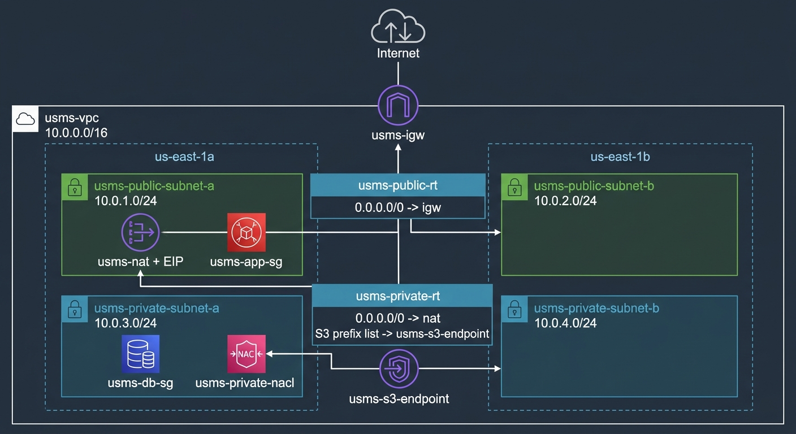

## 5. Implementation Procedure

The practical began by starting Floci under Docker Compose, confirming hybrid storage mode, and loading `course.env` and `lab-01.env`. The `USMSDeveloperBase` policy was inspected, the `usms-developer-role` was assumed, and `usms-vpc` (10.0.0.0/16) was created under that role before restoring the normal identity.  

DNS support and DNS hostnames were enabled, and an internet gateway was created and attached. A public and a private subnet were created in us-east-1a, public IP auto-assignment was enabled on the public subnet, and a second public subnet was added in us-east-1b.  

A public route table (default route to the internet gateway) and a private route table (no default route) were created and associated with their subnets, and the difference between the subnets was proven by reading back their effective routes. 

The security groups `usms-app-sg` (HTTP, HTTPS, SSH from the VPC) and `usms-db-sg` (PostgreSQL sourced from `usms-app-sg`) were created. A custom network ACL with explicit ephemeral-port rules was applied to the private subnet. 

An Elastic IP and NAT gateway were created in the public subnet and the private route table was pointed at it. An S3 gateway endpoint was added, resources were audited by tag, persistence was proven by restarting Floci, and all IDs were written to `configs/lab-02.env`.

| # | Action | Key command |
|---|---|---|
| 1 | Start Floci, check storage | `floci-up.sh`, `floci-storage-check.sh` |
| 2 | Load environments | `source configs/course.env configs/lab-01.env` |
| 3 | Assume developer role, create VPC | `aws sts assume-role`, `aws ec2 create-vpc` |
| 4 | Restore identity | `unset AWS_ACCESS_KEY_ID ...` |
| 5 | Enable DNS | `aws ec2 modify-vpc-attribute` |
| 6 | Internet gateway | `create-internet-gateway`, `attach-internet-gateway` |
| 7–9 | Subnets | `aws ec2 create-subnet`, `modify-subnet-attribute` |
| 10–12 | Route tables | `create-route-table`, `create-route`, `associate-route-table` |
| 13 | Prove public vs private | `describe-route-tables --filters association.subnet-id` |
| 14–16 | Security groups | `create-security-group`, `authorize-security-group-ingress` |
| 17–18 | Network ACL | `create-network-acl`, `create-network-acl-entry`, `replace-network-acl-association` |
| 19–20 | NAT gateway | `allocate-address`, `create-nat-gateway`, `create-route --nat-gateway-id` |
| 21 | S3 endpoint | `create-vpc-endpoint` |
| 22 | Tag audit | `describe-tags --filters Name=tag:Project,Values=USMS` |
| 23 | Persistence proof | `floci-down.sh`, `floci-up.sh`, `diff` |
| 24–25 | Save IDs, commit | `configs/lab-02.env`, `git commit` |

## 6. Results and Evidence

### 6.1 CLI Output

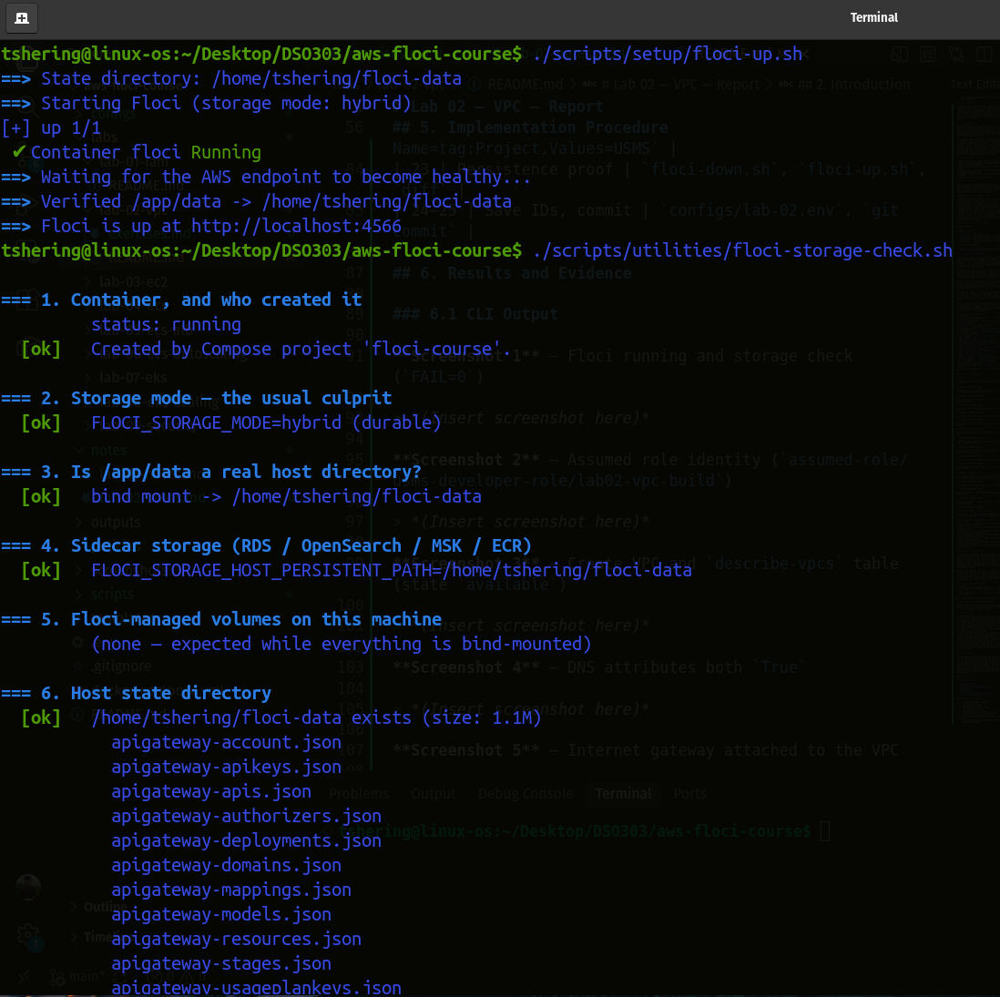
**Screenshot 1** – Floci running and storage check (`FAIL=0`)

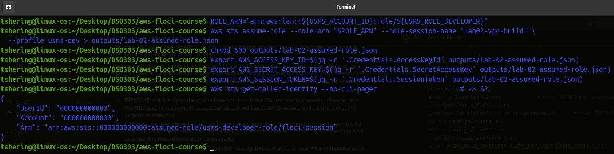
**Screenshot 2** – Assumed role identity (`assumed-role/usms-developer-role/lab02-vpc-build`)

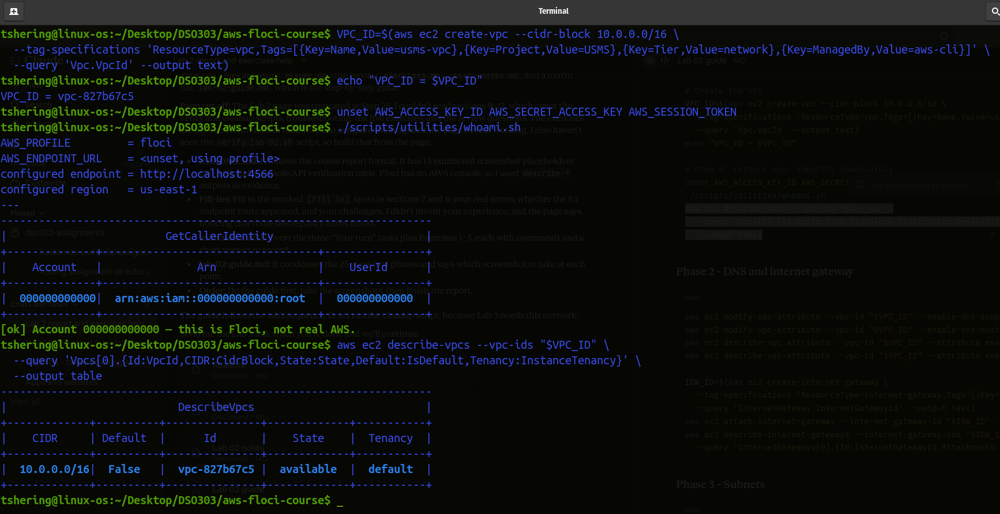
**Screenshot 3** – Create VPC and `describe-vpcs` table (state `available`)

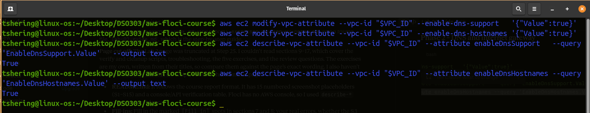
**Screenshot 4** – DNS attributes both `True`

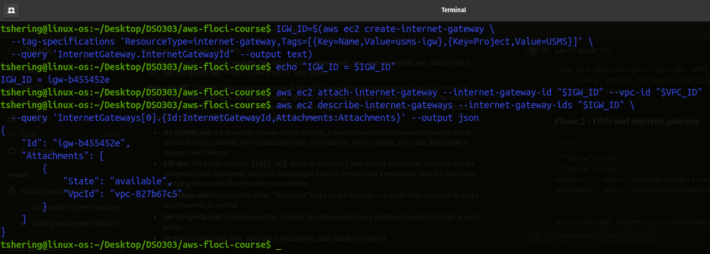
**Screenshot 5** – Internet gateway attached to the VPC

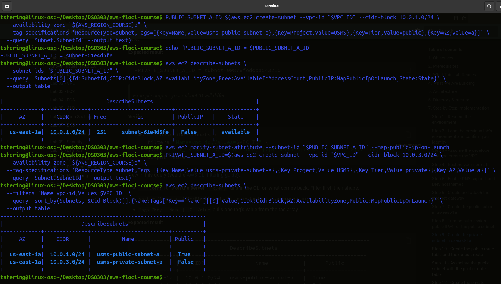
**Screenshot 6** – Subnet list (names, CIDR, AZ, public flag)

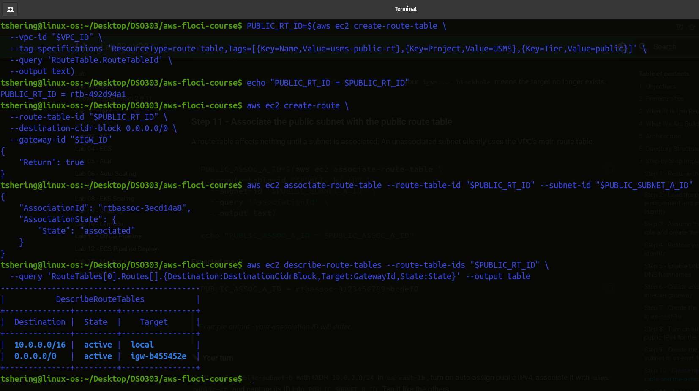
**Screenshot 7** – Public route table with `0.0.0.0/0 -> igw`

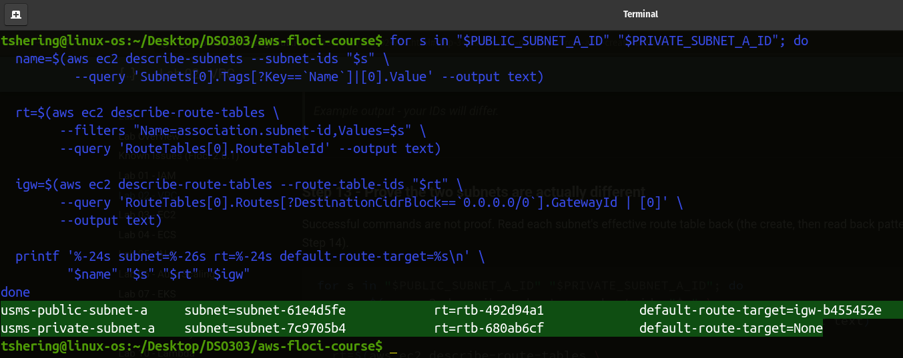
**Screenshot 8** – Step 13 proof: public default route = `igw-…`, private = `None`

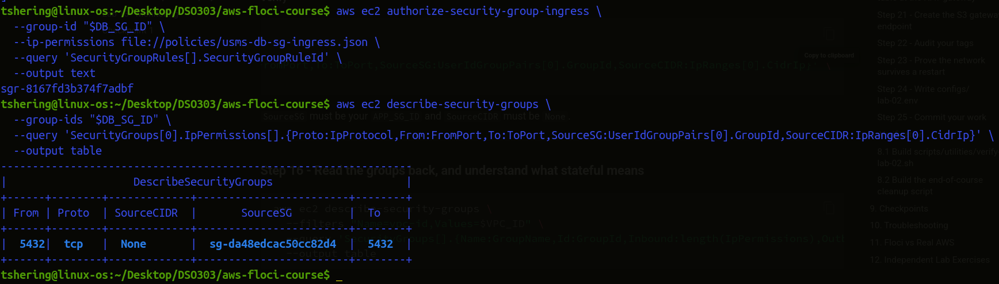
**Screenshot 9** – Security groups created and DB rule sourced from `usms-app-sg`

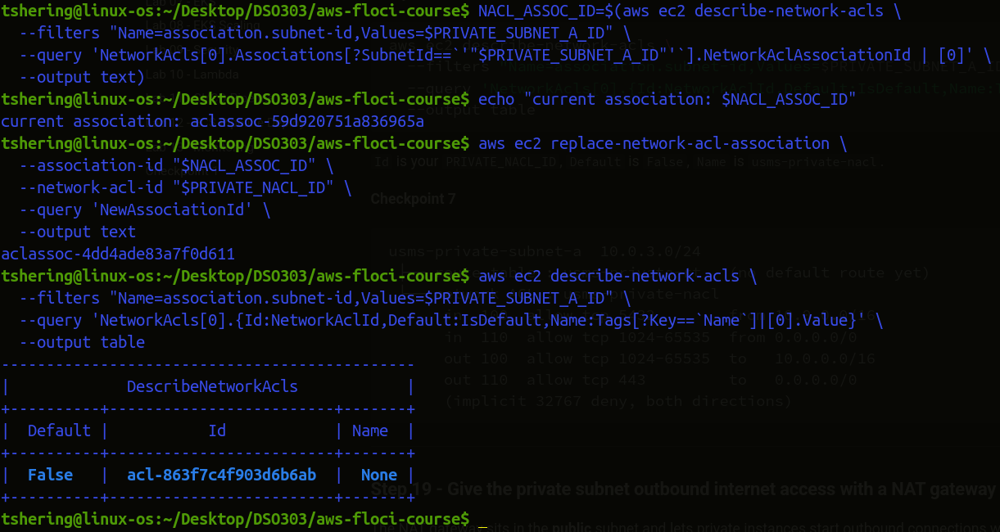
**Screenshot 10** – Private NACL entries and association

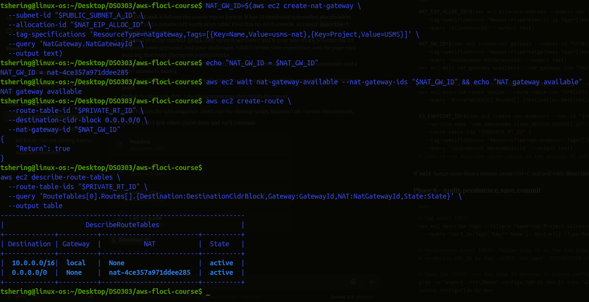
**Screenshot 11** – NAT gateway `available` and private route to NAT

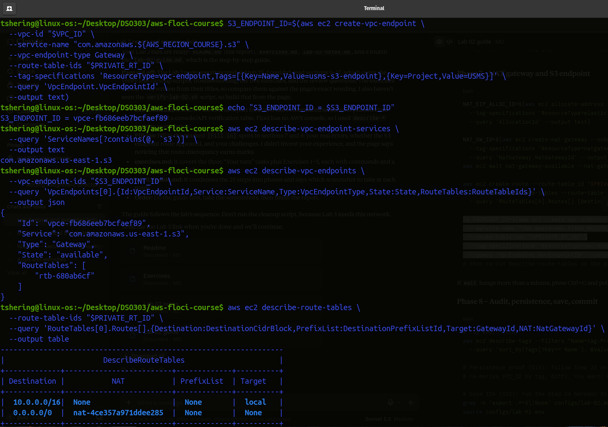
**Screenshot 12** – S3 endpoint and private route table

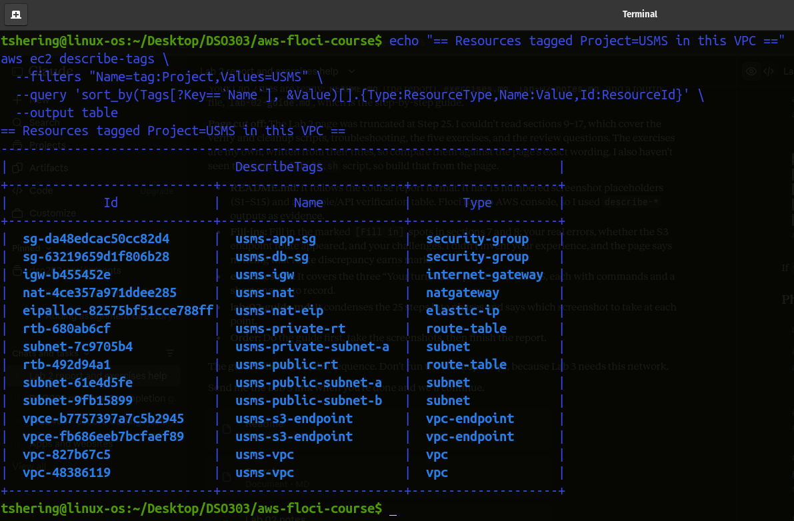
**Screenshot 13** – Tag audit table (`Project=USMS`)

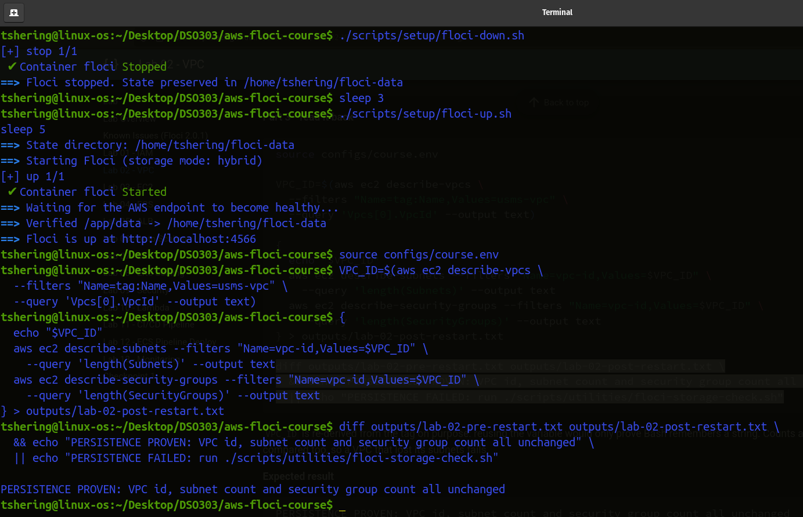
**Screenshot 14** – `PERSISTENCE PROVEN` message after Floci restart

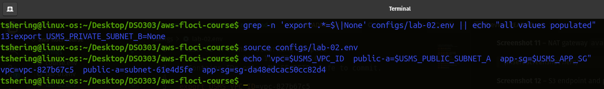
**Screenshot 15** – `configs/lab-02.env` populated and `all values populated`

### 6.2 AWS Console Verification

**VPC `usms-vpc`**  
Created with 10.0.0.0/16, available
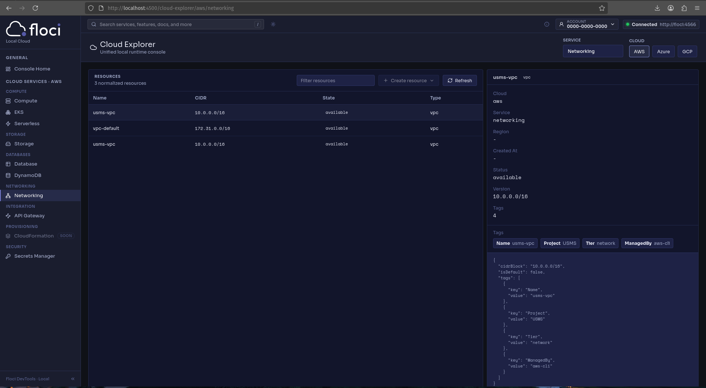

**Subnets, Route tables, Security groups**  
Three subnets across two AZs, Public route to IGW, private route to NAT, App and DB groups with correct rules.
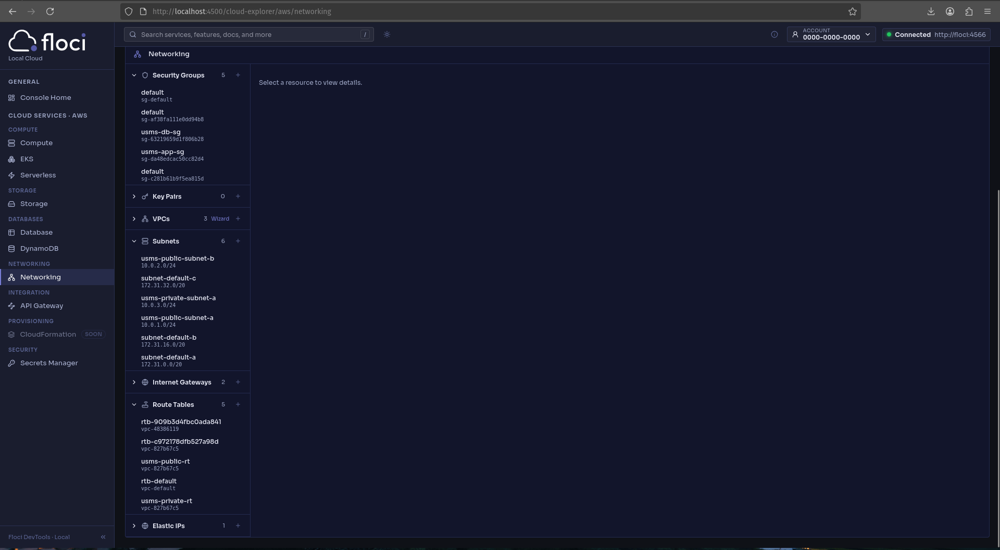

**VPC endpoint**   
S3 gateway endpoint available 
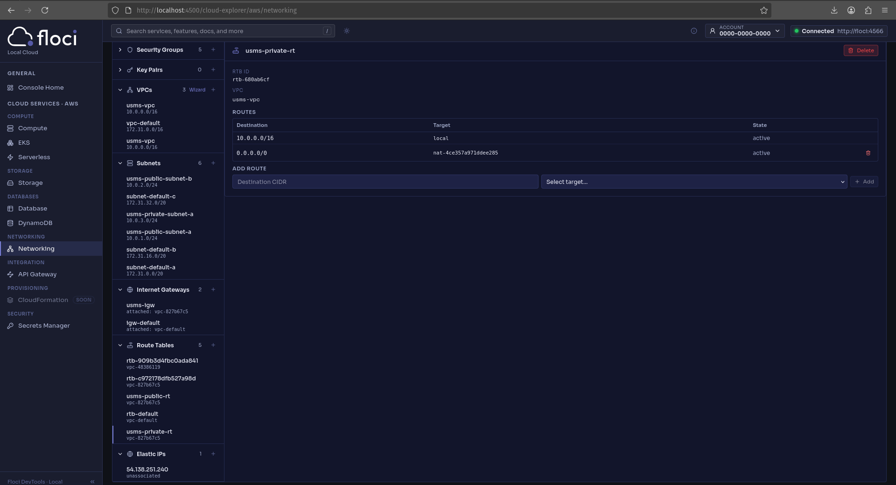

## 7. Analysis and Discussion

The practical produced a two-tier, two-AZ network for USMS in which the only difference between public and private subnets is their routing: the public subnet's route table sends `0.0.0.0/0` to the internet gateway, while the private subnet's table has no such route until the NAT gateway is added. Reading back each subnet's effective route (Step 13) confirmed this, since Floci does not run real packet traffic.

Security was layered. `usms-db-sg` references `usms-app-sg` as its source instead of a CIDR block, so the rule remains correct when the web tier scales or moves. The private network ACL adds a subnet-level control, and because ACLs are stateless it required explicit ephemeral-port rules (1024–65535) for return traffic.

Observations specific to Floci:

- The NAT gateway is created and reaches `available`, but no real address translation happens; it is an API object only.
- the S3 endpoint did not add a prefix-list route to `usms-private-rt`.

Errors encountered and how they were resolved:

- No significant errors were encountered.

Results matched the expected outputs in the lab guide: the VPC was `available`, the persistence check passed, and `lab-02.env` was populated for Lab 03.

## 8. Reflection

1. **What did I learn about this AWS service?** A "public subnet" is not a property of the subnet but a result of its route table association. Security groups are stateful and can reference other security groups; network ACLs are stateless, ordered, and need return-traffic rules.
2. **Challenges encountered:** Long multi-step command sequences, JMESPath quoting for `--query`, keeping variable IDs consistent across terminals, the unquoted heredoc rule for generating JSON and env files.
3. **Real-world application:** The same pattern is used for web applications with a private database tier: public subnets hold load balancers and web servers, private subnets hold databases, NAT provides outbound updates, and endpoints keep S3 traffic off the internet. In production, one NAT gateway per AZ would be used for resilience.
4. **What I would like to explore next:** VPC peering and Transit Gateway, VPC Flow Logs, interface endpoints (PrivateLink), IPv6 and egress-only gateways, and AWS Network Firewall.

## 9. Conclusion

The objectives of this practical were achieved. A complete VPC for USMS was built using only the AWS CLI, including subnets, routing, internet and NAT gateways, layered security with security groups and a network ACL, and an S3 gateway endpoint. The persistence of the configuration was proven after restarting the emulator, and all resource identifiers were saved for the next lab. VPC networking is the foundation of AWS security and architecture, and Lab 03 (EC2) depends directly on the subnets and security groups created here.

## 10. Appendix

### Additional Files

- `configs/lab-02.env`
- `policies/usms-db-sg-ingress.json`
- `outputs/lab-02-assumed-role.json`
- `outputs/lab-02-developer-base.json`
- `outputs/lab-02-subnet-inventory.txt`
- `outputs/lab-02-pre-restart.txt`
- `outputs/lab-02-post-restart.txt`
- `notes/lab-02-notes.md`
- `labs/lab-02-vpc/exercises.md`
- `scripts/utilities/verify-lab-02.sh`
- `scripts/cleanup/lab-02-cleanup.sh`

