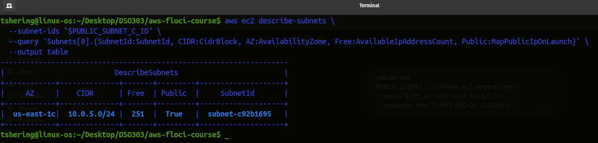
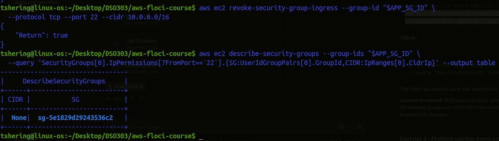
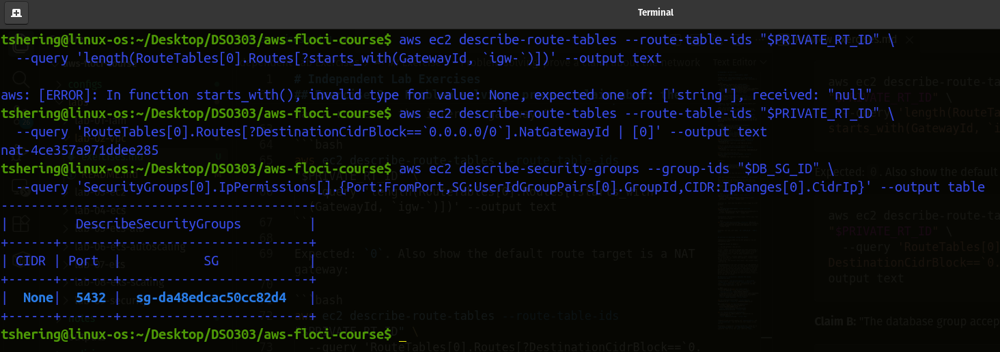
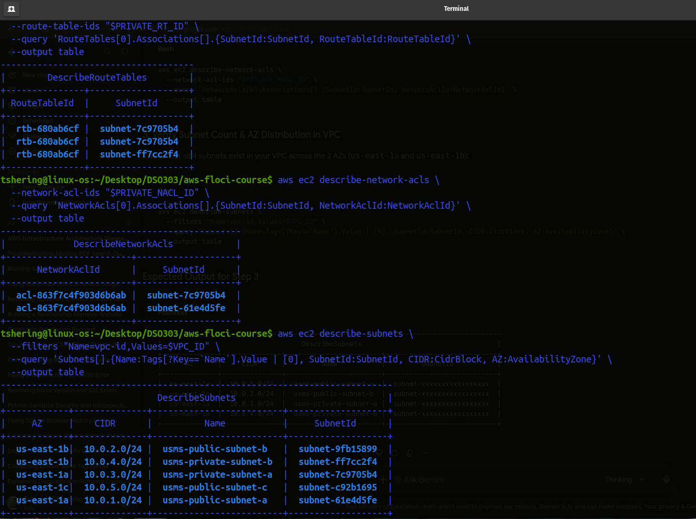

# Independent Lab Exercises

## Exercise 1 – Basic: a third public subnet

**Task:** Add `usms-public-subnet-c` (`10.0.5.0/24`, `us-east-1c`), enable auto-assign public IP, associate it with `usms-public-rt`.

```bash
PUBLIC_SUBNET_C_ID=$(aws ec2 create-subnet \
  --vpc-id "$VPC_ID" --cidr-block 10.0.5.0/24 \
  --availability-zone "${AWS_REGION_COURSE}c" \
  --tag-specifications 'ResourceType=subnet,Tags=[{Key=Name,Value=usms-public-subnet-c},{Key=Project,Value=USMS},{Key=Tier,Value=public},{Key=AZ,Value=c}]' \
  --query 'Subnet.SubnetId' --output text)

aws ec2 modify-subnet-attribute --subnet-id "$PUBLIC_SUBNET_C_ID" --map-public-ip-on-launch
aws ec2 associate-route-table --route-table-id "$PUBLIC_RT_ID" --subnet-id "$PUBLIC_SUBNET_C_ID"
```

**Check:** `describe-subnets` shows the new subnet with `Free = 251` and `Public = True`.
  

**Why `10.0.5.0/24`?**  
It is inside the VPC range, does not overlap existing subnets, and falls in the range left unallocated in the address plan.

## Exercise 2 – Intermediate: a bastion security group

**Task:** Create `usms-bastion-sg` that allows SSH only from a single admin address, then change `usms-app-sg` so SSH is allowed only from the bastion group instead of the whole VPC.

```bash
BASTION_SG_ID=$(aws ec2 create-security-group \
  --group-name usms-bastion-sg \
  --description "USMS bastion: SSH from the admin workstation only" \
  --vpc-id "$VPC_ID" \
  --tag-specifications 'ResourceType=security-group,Tags=[{Key=Name,Value=usms-bastion-sg},{Key=Project,Value=USMS},{Key=Tier,Value=bastion}]' \
  --query 'GroupId' --output text)

# Admin address: replace with your real public IP /32
aws ec2 authorize-security-group-ingress --group-id "$BASTION_SG_ID" \
  --protocol tcp --port 22 --cidr 203.0.113.10/32

# App SG: allow SSH only from the bastion SG
aws ec2 authorize-security-group-ingress --group-id "$APP_SG_ID" \
  --protocol tcp --port 22 --source-group "$BASTION_SG_ID"

# Remove the old broad SSH rule
aws ec2 revoke-security-group-ingress --group-id "$APP_SG_ID" \
  --protocol tcp --port 22 --cidr 10.0.0.0/16
```

**Check:**

```bash
aws ec2 describe-security-groups --group-ids "$APP_SG_ID" \
  --query 'SecurityGroups[0].IpPermissions[?FromPort==`22`].{SG:UserIdGroupPairs[0].GroupId,CIDR:IpRanges[0].CidrIp}' --output table
```
  

The SSH rule should show the bastion SG ID and `None` for CIDR.

**Why use a security-group source instead of `10.0.0.0/16`?**  
Only instances in the bastion group can reach SSH (not every host in the VPC), and the rule stays valid if the bastion's IP changes.

## Exercise 3 – Problem solving: prove a claim about the network

**Claim A:** "No subnet associated with `usms-private-rt` has a route to the internet gateway."

```bash
aws ec2 describe-route-tables --route-table-ids "$PRIVATE_RT_ID" \
  --query 'length(RouteTables[0].Routes[?starts_with(GatewayId, `igw-`)])' --output text
```

Expected: `0`. Also show the default route target is a NAT gateway:

```bash
aws ec2 describe-route-tables --route-table-ids "$PRIVATE_RT_ID" \
  --query 'RouteTables[0].Routes[?DestinationCidrBlock==`0.0.0.0/0`].NatGatewayId | [0]' --output text
```

**Claim B:** "The database group accepts traffic only from the application group."

```bash
aws ec2 describe-security-groups --group-ids "$DB_SG_ID" \
  --query 'SecurityGroups[0].IpPermissions[].{Port:FromPort,SG:UserIdGroupPairs[0].GroupId,CIDR:IpRanges[0].CidrIp}' --output table
```
    
Expected: one rule, port 5432, `SG = $APP_SG_ID`, `CIDR = None`.

## Exercise 4 – Challenge: design and defend

**Question:** Should USMS use one NAT gateway or one per Availability Zone?

| | One NAT gateway | One per AZ |
|---|---|---|
| Cost | Lowest (one hourly charge plus data processing) | Roughly doubles the hourly charge (check current pricing) |
| Availability | If AZ a fails, private subnets in AZ b lose outbound access | Each AZ keeps outbound access independently |
| Cross-AZ traffic | Private subnet b sends traffic across AZs to reach NAT in a (extra data charge) | Traffic stays inside its own AZ |
| Complexity | One private route table | One private route table per AZ |

**Recommendation:** For this coursework, one NAT gateway is acceptable because the data tier only needs outbound access for OS updates, which is not user-facing. For a production university system with availability requirements, use one NAT gateway per AZ, each with its own private route table, because a single zonal NAT is a single point of failure. 

## Exercise 5 – Integration: complete the second Availability Zone

**Task:** Build `usms-private-subnet-b` (`10.0.4.0/24`, `us-east-1b`), associate it with `usms-private-rt`, and apply `usms-private-nacl`. This also satisfies the RDS subnet-group requirement in Lab 06.

```bash
PRIVATE_SUBNET_B_ID=$(aws ec2 create-subnet \
  --vpc-id "$VPC_ID" --cidr-block 10.0.4.0/24 \
  --availability-zone "${AWS_REGION_COURSE}b" \
  --tag-specifications 'ResourceType=subnet,Tags=[{Key=Name,Value=usms-private-subnet-b},{Key=Project,Value=USMS},{Key=Tier,Value=private},{Key=AZ,Value=b}]' \
  --query 'Subnet.SubnetId' --output text)

aws ec2 associate-route-table --route-table-id "$PRIVATE_RT_ID" --subnet-id "$PRIVATE_SUBNET_B_ID"

NACL_ASSOC_B=$(aws ec2 describe-network-acls \
  --filters "Name=association.subnet-id,Values=$PRIVATE_SUBNET_B_ID" \
  --query 'NetworkAcls[0].Associations[0].NetworkAclAssociationId' --output text)

aws ec2 replace-network-acl-association \
  --association-id "$NACL_ASSOC_B" --network-acl-id "$PRIVATE_NACL_ID" \
  --query 'NewAssociationId' --output text
```

**Check:** both private subnets use `usms-private-rt` and `usms-private-nacl`, and the VPC has four subnets across two AZs.
  

