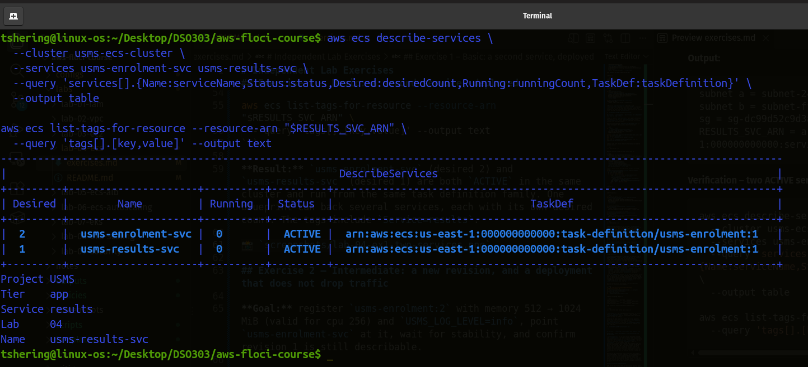
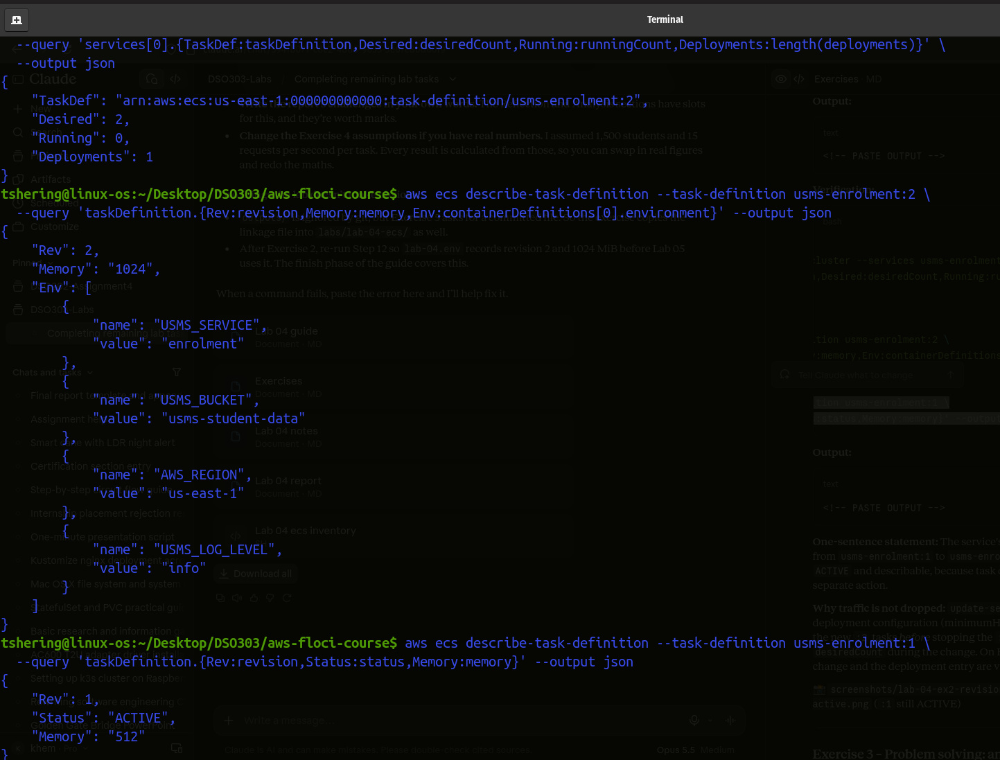
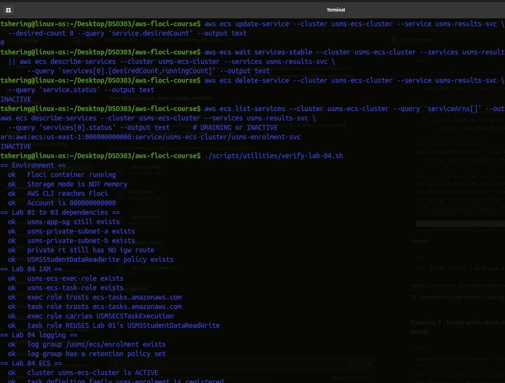
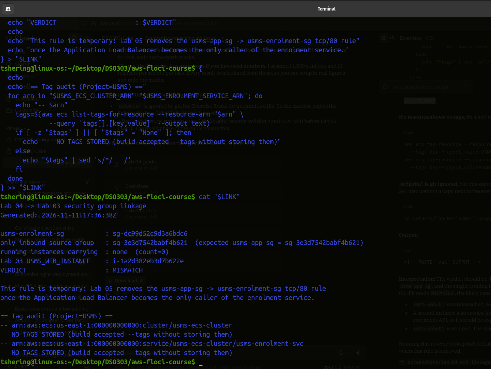

# Independent Lab Exercises

## Exercise 1 – Basic: a second service, deployed

**Goal:** `usms-results-svc` in `usms-ecs-cluster`, from the `usms-enrolment` family, desired count 1, both private subnets, `usms-enrolment-sg`. Not recorded in `configs/lab-04.env` (Exercise 4 removes it).

Every ID is looked up with `$(...)` and `--query`, not copied by hand:

```bash
SUBNET_A=$(aws ec2 describe-subnets \
  --filters "Name=tag:Name,Values=usms-private-subnet-a" \
  --query 'Subnets[0].SubnetId' --output text)
SUBNET_B=$(aws ec2 describe-subnets \
  --filters "Name=tag:Name,Values=usms-private-subnet-b" \
  --query 'Subnets[0].SubnetId' --output text)
ENROL_SG=$(aws ec2 describe-security-groups \
  --filters "Name=tag:Name,Values=usms-enrolment-sg" \
  --query 'SecurityGroups[0].GroupId' --output text)

echo "subnet a = $SUBNET_A"; echo "subnet b = $SUBNET_B"; echo "sg = $ENROL_SG"

RESULTS_SVC_ARN=$(aws ecs create-service \
  --cluster usms-ecs-cluster \
  --service-name usms-results-svc \
  --task-definition usms-enrolment \
  --desired-count 1 \
  --launch-type FARGATE \
  --network-configuration "awsvpcConfiguration={subnets=[$SUBNET_A,$SUBNET_B],securityGroups=[$ENROL_SG],assignPublicIp=DISABLED}" \
  --enable-ecs-managed-tags \
  --propagate-tags SERVICE \
  --tags key=Name,value=usms-results-svc key=Project,value=USMS key=Tier,value=app key=Lab,value=04 key=Service,value=results \
  --query 'service.serviceArn' --output text)

echo "RESULTS_SVC_ARN = $RESULTS_SVC_ARN"
```

**Output:**

```text
subnet a = subnet-249c9f10
subnet b = subnet-ff4a2081
sg = sg-dc99d52c9d3a6bdc6
RESULTS_SVC_ARN = arn:aws:ecs:us-east-1:000000000000:service/usms-ecs-cluster/usms-results-svc
```

**Verification – two ACTIVE services with different names and desired counts:**

```bash
aws ecs describe-services \
  --cluster usms-ecs-cluster \
  --services usms-enrolment-svc usms-results-svc \
  --query 'services[].{Name:serviceName,Status:status,Desired:desiredCount,Running:runningCount,TaskDef:taskDefinition}' \
  --output table

aws ecs list-tags-for-resource --resource-arn "$RESULTS_SVC_ARN" \
  --query 'tags[].[key,value]' --output text
```

**Result:** `usms-enrolment-svc` (desired 2) and `usms-results-svc` (desired 1) are both `ACTIVE` in the same cluster and run from the same task definition family. One blueprint can back several services, each with its own desired count. The tags include `Service=results`.



## Exercise 2 – Intermediate: a new revision, and a deployment that does not drop traffic

**Goal:** register `usms-enrolment:2` with memory 512 → 1024 MiB (valid for cpu 256) and `USMS_LOG_LEVEL=info`, point `usms-enrolment-svc` at it, wait for stability, and confirm revision 1 is still describable.

The revision-1 template `templates/lab-04-taskdef.json` is **kept unchanged**. Revision 2 is built from a copy:

```bash
jq '.memory = "1024"
    | .containerDefinitions[0].environment += [{"name":"USMS_LOG_LEVEL","value":"info"}]' \
  templates/lab-04-taskdef.json > templates/lab-04-taskdef-rev2.json

python3 -m json.tool templates/lab-04-taskdef-rev2.json > /dev/null && echo "valid JSON"
grep -c '\$' templates/lab-04-taskdef-rev2.json          # must print 0
diff <(jq -S . templates/lab-04-taskdef.json) <(jq -S . templates/lab-04-taskdef-rev2.json)
```

**Output (the diff should show only the memory line and the new env var):**

```text
valid JSON
0
15a16,19
>         },
>         {
>           "name": "USMS_LOG_LEVEL",
>           "value": "info"
40c44
<   "memory": "512",
---
>   "memory": "1024",

```

Register revision 2 and roll the service onto it:

```bash
TD2_ARN=$(aws ecs register-task-definition \
  --cli-input-json file://templates/lab-04-taskdef-rev2.json \
  --query 'taskDefinition.taskDefinitionArn' --output text)
echo "TD2_ARN = $TD2_ARN"

aws ecs update-service \
  --cluster usms-ecs-cluster \
  --service usms-enrolment-svc \
  --task-definition usms-enrolment:2 \
  --query 'service.{TaskDef:taskDefinition,Desired:desiredCount}' --output json

# wait - waiter first, polling loop as fallback (no fixed sleep)
aws ecs wait services-stable --cluster usms-ecs-cluster --services usms-enrolment-svc \
  && echo "service stable" \
  || for i in $(seq 1 12); do
       read -r d r p <<< "$(aws ecs describe-services --cluster usms-ecs-cluster --services usms-enrolment-svc \
         --query 'services[0].[desiredCount,runningCount,pendingCount]' --output text)"
       echo "attempt $i: desired=$d running=$r pending=$p"; [ "$d" = "$r" ] && break; sleep 5
     done
```

**Output:**

```text
attempt 1: desired=2 running=0 pending=0
attempt 2: desired=2 running=0 pending=0
attempt 3: desired=2 running=0 pending=0
attempt 4: desired=2 running=0 pending=0
attempt 5: desired=2 running=0 pending=0
attempt 6: desired=2 running=0 pending=0
attempt 7: desired=2 running=0 pending=0
attempt 8: desired=2 running=0 pending=0
attempt 9: desired=2 running=0 pending=0
attempt 10: desired=2 running=0 pending=0
attempt 11: desired=2 running=0 pending=0
attempt 12: desired=2 running=0 pending=0
```

**Verification:**

```bash
# service now points at :2
aws ecs describe-services --cluster usms-ecs-cluster --services usms-enrolment-svc \
  --query 'services[0].{TaskDef:taskDefinition,Desired:desiredCount,Running:runningCount,Deployments:length(deployments)}' \
  --output json

# revision 2 contents
aws ecs describe-task-definition --task-definition usms-enrolment:2 \
  --query 'taskDefinition.{Rev:revision,Memory:memory,Env:containerDefinitions[0].environment}' --output json

# revision 1 is still there and ACTIVE
aws ecs describe-task-definition --task-definition usms-enrolment:1 \
  --query 'taskDefinition.{Rev:revision,Status:status,Memory:memory}' --output json
```

**One-sentence statement:** The service's `taskDefinition` field (a mutable pointer) changes from `usms-enrolment:1` to `usms-enrolment:2`. Revision 1 itself does not change and stays `ACTIVE` and describable, because task definition revisions are immutable and deregistering is a separate action.

**Why traffic is not dropped:** `update-service` starts a rolling deployment. With the default deployment configuration (minimumHealthyPercent 100, maximumPercent 200), ECS starts the new `:2` tasks *before* stopping the `:1` tasks. Running capacity therefore never falls below `desiredCount` during the change. On Floci the tasks may not actually run, but the pointer change and the deployment entry are visible.



## Exercise 3 – Problem solving: an ECS configuration drift report

Script: `scripts/utilities/lab-04-ecs-inventory.sh` (committed alongside this file).

Design decisions:

- **Location independence:** `REPO_ROOT` is resolved from `${BASH_SOURCE[0]}` (same as `verify-lab-04.sh`), so `configs/` and `outputs/` are found from any working directory.
- **No hard-coded names:** services come from `aws ecs list-services --cluster …`, and each is described individually.
- **Computed verdicts:**
  - `roles` compares `executionRoleArn` with `taskRoleArn` from the task definition the service *actually points at*. The result is `SAME` or `SEPARATE`. It is `PARTIAL` if only one role is set, `NONE` if neither is set, and `UNKNOWN` if the task definition can't be read.
  - `publicip` reads `assignPublicIp`: `ENABLED` gives `RISK`, `DISABLED` (or absent, which is the API default) gives `OK`. A service with **no `networkConfiguration`** (EC2 launch type / bridge mode) prints `publicip=N/A` instead of crashing.
- **`set -uo pipefail` without `-e`:** this is a report, not a build. One service whose task definition cannot be described must not abort the run and hide every other service. Each AWS call is checked explicitly and turned into an explicit verdict instead (this justification is also a comment in the script).
- **JSON copy:** the same rows go to `outputs/lab-04-ecs-inventory.json` via `jq`.

Run from two different directories (run this **before** Exercise 4, so both services appear):

**Output (expected shape):**

```text
usms-enrolment-svc     desired=2   running=2   taskdef=usms-enrolment:2     roles=SEPARATE  publicip=OK
usms-results-svc       desired=1   running=1   taskdef=usms-enrolment:1     roles=SEPARATE  publicip=OK

JSON written to outputs/lab-04-ecs-inventory.json
```

`usms-results-svc` was created before revision 2, so it still points at `usms-enrolment:1`. Exercise 2 only updated `usms-enrolment-svc`. This is exactly the kind of drift the report is meant to surface.

**Testing the edge cases:** I tested the script against a mocked `aws` that returned a third service `usms-legacy-svc` with identical exec/task role ARNs and **no** `networkConfiguration`. It printed `roles=SAME publicip=N/A` without error. This confirms the verdicts are computed, not read from names.

## Exercise 4 – Challenge: the enrolment week capacity plan

### 4.1 Why a fixed `desiredCount` of 2 cannot answer the 08:03 problem

`usms-enrolment-svc` has no input except the number I typed into `create-service`. It reads no metric (CPU, request count, queue depth) and no clock, so its capacity changes only when a human runs `aws ecs update-service --desired-count`. The ECS scheduler only works to keep `runningCount` equal to `desiredCount`. It will happily keep two healthy-but-overloaded tasks running while requests time out, because "overloaded" is not a state it measures. At 08:00 on Monday, two tasks face 90 % of a week's traffic in twenty minutes. Unless someone is awake and watching at 07:59 to scale by hand, the service saturates within minutes, which matches the 08:03 failure. The same fixed number is also why Finance pays for the same two tasks at 03:00 on a Sunday in July.

Reacting to CPU alone would also be too slow. Real Fargate tasks take 20–60 s to start (Lab §11), and a CloudWatch alarm needs at least one or more 1-minute datapoints before it fires. A reactive policy would add capacity roughly 2–4 minutes after the surge begins, which is around the time the service fell over last year. So the plan needs a **scheduled pre-warm** before 08:00, with reactive scaling as a safety net on top.

### 4.2 Assumptions and derivation

USMS has no real traffic data in this course, so every input below is a stated assumption that the project lead can replace with Registrar and access-log figures. The derivation then recomputes mechanically.

| # | Input | Value | Source / reasoning |
|---|---|---|---|
| A1 | Students enrolling in the week | 1,500 | Assumption – replace with the Registrar's enrolment count |
| A2 | Requests per student enrolment session | 30 | Login, list modules, view 4–5 modules, register 4–5 times, confirmation page ≈ 30 API calls |
| A3 | Share of the week's traffic in the first 20 min | 90 % | Given by the project lead |
| A4 | Burst factor (peak minute ÷ 20-min average) | 2 | Assumption: the first minutes are steeper than the average – consistent with failing at 08:03 |
| A5 | Sustainable requests/s per task (0.25 vCPU, 1 GB) | 15 req/s at ≤ 70 % CPU | Assumption – must be measured with a load test before Lab 06 sets its target |
| A6 | Task size | 256 CPU / 1024 MiB | `usms-enrolment:2` from Exercise 2 |

Derivation:

```text
Weekly requests          = 1,500 × 30                         = 45,000
Requests in first 20 min = 45,000 × 0.90                      = 40,500
Average rate (20 min)    = 40,500 ÷ 1,200 s                   = 33.75 req/s
Peak rate                = 33.75 × 2 (A4)                     = 67.5  → 68 req/s
Tasks for peak           = ceil(68 ÷ 15)                       = 5
+ 1 task headroom (one task can be replacing/unhealthy)      = 6
Even split over 2 AZs    = 6 (3 per AZ)                        = 6
```

### 4.3 Proposed plan (for Lab 06 to implement)

| Setting | Value | Why this number | Cost of too **high** | Cost of too **low** |
|---|---|---|---|---|
| **Minimum** | 2 | One task per Availability Zone, so losing an AZ never takes the service to zero | Paying for idle tasks every night and weekend (each extra always-on task ≈ USD 10.63/month) | Below 2 a single task or AZ failure is a full outage |
| **Scheduled floor** | 6, Monday of enrolment week 07:45 → 09:15 | Derived peak (5) + 1 headroom, split 3/3 across AZs. Starts 15 min early because tasks need 20–60 s to start and need to be warm before 08:00 | 6 tasks for 1.5 h costs about USD 0.13. Too high here is almost free | The 08:03 outage repeats, because reactive scaling arrives minutes too late |
| **Maximum** | 10 | 10 × 15 = 150 req/s, ≈ 2.2× the forecast peak. Absorbs a wrong forecast (A1/A2) without unlimited spend | A runaway policy or a bot burst could run up to 10 tasks ≈ USD 0.15/hour | Caps the safety net. If real demand > 150 req/s, the service saturates at the cap |
| **Reactive trigger** | Target tracking on `ECSServiceAverageCPUUtilization` = 60 % | 60 % leaves room for the 20–60 s it takes a new task to start | A lower target means more tasks than needed (cost) | A higher target means saturation before new tasks start |
| **Cooldowns** | scale-out 60 s, scale-in 300 s | Add quickly, remove slowly, to avoid flapping during a surge | — | — |

**What I'd tell the Lab 06 team to aim for:**

1. A scalable target on `service/usms-ecs-cluster/usms-enrolment-svc` with min 2 / max 10.
2. A scheduled action that raises min to 6 at Monday 07:45 and returns it to 2 at 09:15.
3. A target-tracking policy at 60 % CPU on top.
4. Measure A5 before trusting any of these numbers.

(Known Issues says Floci does not support `put-scheduled-action`, so on Floci the schedule will be documented rather than executed.)

### 4.4 Monthly cost comparison

**Prices:** AWS Fargate, Linux/x86 On-Demand, US East (N. Virginia): **USD 0.04048 per vCPU-hour** and **USD 0.004445 per GB-hour**.
Source: AWS Fargate Pricing page, https://aws.amazon.com/fargate/pricing/ (checked 11 Nov 2026; the same rates are reported by independent trackers in 2026). A month is taken as 730 hours.

```text
Per task-hour (0.25 vCPU, 1 GB)  = 0.25 × 0.04048 + 1 × 0.004445 = USD 0.014565
Per task-month                   = 0.014565 × 730                 = USD 10.63
(For comparison, revision 1's 0.25 vCPU / 0.5 GB = USD 0.012343/h = USD 9.01/month)
```

| Option | Calculation | USD / month |
|---|---|---|
| Fixed at today's 2 | 2 × 10.63 | **21.26** |
| Fixed at proposed peak 6 | 6 × 10.63 | **63.79** |
| Fixed at maximum 10 | 10 × 10.63 | **106.32** |
| **Proposed: min 2 + scheduled 6 on enrolment Monday** | 21.26 + (4 extra × 1.5 h × 0.014565 = 0.09) | **≈ 21.35** in an enrolment month; 21.26 otherwise |

The proposed plan gives peak capacity for **about 0.4 % more than today's fixed 2**. "Always 6" would cost three times as much and would still not answer Finance's July-Sunday complaint. Reactive scale-out above 6 adds about USD 0.015 per extra task-hour, so it costs only what a real surge actually uses. Prices exclude data transfer, NAT gateway processing and CloudWatch charges.

### 4.5 What to switch off – the Exercise 1 results service

danger "Deleting usms-results-svc"  
**What will be deleted:** the ECS service `usms-results-svc` (Exercise 1 practice) and its tasks. The cluster, the task definitions and `usms-enrolment-svc` are untouched.  
**What depends on it:** nothing. It is not in `configs/lab-04.env`, and Labs 05/06 use `usms-enrolment-svc` only.  
**Reversible?** Yes. Exercise 1's `create-service` recreates it in one command.  
**Effect on later labs:** none. It is in the CLEAN UP column of Section 15, and removing it makes the cluster match what Lab 05 expects.

Commands, in dependency order (drain to 0 → wait → delete → confirm):

```bash
# 1. scale to zero so tasks drain instead of being killed
aws ecs update-service --cluster usms-ecs-cluster --service usms-results-svc \
  --desired-count 0 --query 'service.desiredCount' --output text

# 2. wait for the drain (waiter, then manual check as fallback)
aws ecs wait services-stable --cluster usms-ecs-cluster --services usms-results-svc \
  || aws ecs describe-services --cluster usms-ecs-cluster --services usms-results-svc \
       --query 'services[0].[desiredCount,runningCount]' --output text

# 3. delete the service
aws ecs delete-service --cluster usms-ecs-cluster --service usms-results-svc \
  --query 'service.status' --output text

# 4. confirm only the enrolment service remains ACTIVE
aws ecs list-services --cluster usms-ecs-cluster --query 'serviceArns[]' --output text
aws ecs describe-services --cluster usms-ecs-cluster --services usms-results-svc \
  --query 'services[0].status' --output text      # DRAINING or INACTIVE

# 5. the lab still passes
./scripts/utilities/verify-lab-04.sh
```

Nothing in Section 15's KEEP column was touched.



## Exercise 5 – Integration: close the loop back to Lab 3, and hand Lab 05 what it needs

```bash
LINK=outputs/lab-04-lab03-linkage.txt

# 1. the enrolment group's only inbound source group
SRC_SG=$(aws ec2 describe-security-groups --group-ids "$USMS_ENROLMENT_SG" \
  --query 'SecurityGroups[0].IpPermissions[0].UserIdGroupPairs[0].GroupId' --output text)

# reverse lookup: which RUNNING instances carry that group?
RESOLVED=$(aws ec2 describe-instances \
  --filters "Name=instance.group-id,Values=$SRC_SG" "Name=instance-state-name,Values=running" \
  --query 'Reservations[].Instances[].InstanceId' --output text)
COUNT=$(wc -w <<< "$RESOLVED")

# 2. compare with Lab 03's recorded instance
if [ "$COUNT" -eq 1 ] && [ "$RESOLVED" = "$USMS_WEB_INSTANCE" ]; then
  VERDICT="LOOP CLOSED"
else
  VERDICT="MISMATCH"
fi

# 3. write the linkage file
{
  echo "Lab 04 -> Lab 03 security group linkage"
  echo "Generated: $(date -u +%Y-%m-%dT%H:%M:%SZ)"
  echo
  echo "usms-enrolment-sg           : $USMS_ENROLMENT_SG"
  echo "only inbound source group   : $SRC_SG  (expected usms-app-sg = $USMS_APP_SG)"
  echo "running instances carrying  : ${RESOLVED:-none}  (count=$COUNT)"
  echo "Lab 03 USMS_WEB_INSTANCE    : $USMS_WEB_INSTANCE"
  echo "VERDICT                     : $VERDICT"
  echo
  echo "This rule is temporary: Lab 05 removes the usms-app-sg -> usms-enrolment-sg tcp/80 rule"
  echo "once the Application Load Balancer becomes the only caller of the enrolment service."
} > "$LINK"

# 4. tag audit, by ARN (list-tags-for-resource takes an ARN, not a name)
{
  echo
  echo "== Tag audit (Project=USMS) =="
  for arn in "$USMS_ECS_CLUSTER_ARN" "$USMS_ENROLMENT_SERVICE_ARN"; do
    echo "-- $arn"
    tags=$(aws ecs list-tags-for-resource --resource-arn "$arn" \
             --query 'tags[].[key,value]' --output text)
    if [ -z "$tags" ] || [ "$tags" = "None" ]; then
      echo "   NO TAGS STORED (build accepted --tags without storing them)"
    else
      echo "$tags" | sed 's/^/   /'
    fi
  done
} >> "$LINK"

cat "$LINK"
```

**If a resource shows no tags**, fix it and re-run step 4:

```bash
aws ecs tag-resource --resource-arn "$USMS_ECS_CLUSTER_ARN" \
  --tags key=Project,value=USMS key=Tier,value=app
aws ecs tag-resource --resource-arn "$USMS_ENROLMENT_SERVICE_ARN" \
  --tags key=Project,value=USMS key=Tier,value=app key=Lab,value=04
```

**`outputs/` is git-ignored**, but this exercise wants a committed file that a Lab 05 reader can open. So I also commit a copy next to the exercises:

```bash
cp outputs/lab-04-lab03-linkage.txt labs/lab-04-ecs/lab-04-lab03-linkage.txt
```

**Interpretation:** The verdict should be `LOOP CLOSED`. `usms-enrolment-sg`'s only source is `usms-app-sg`, and the single running instance carrying that group is `usms-web-01` from Lab 03. If it reads `MISMATCH`, the likely causes are:

- `usms-web-01` was relaunched, so the ID in `lab-03.env` is stale. Re-record it.
- A second instance also carries `usms-app-sg`. It would then also be allowed to call the enrolment API, so it should be explained or removed.
- `usms-web-01` is stopped. The `running` filter excludes it.

Running this reverse lookup before Lab 05's cutover shows exactly which caller loses access when that rule is removed.

