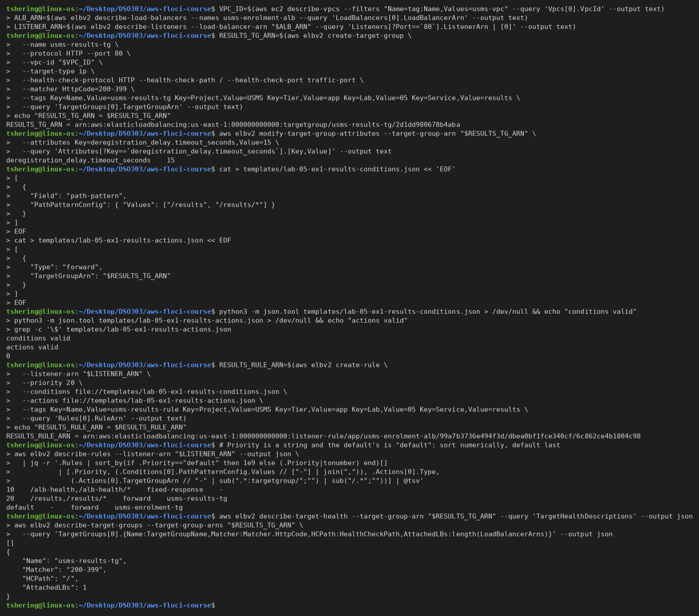
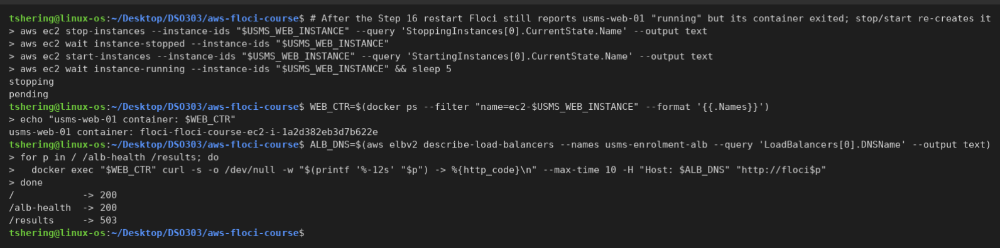
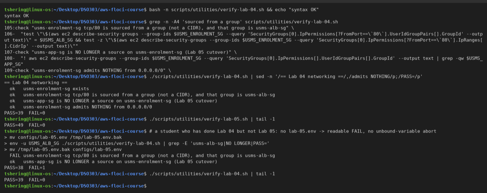
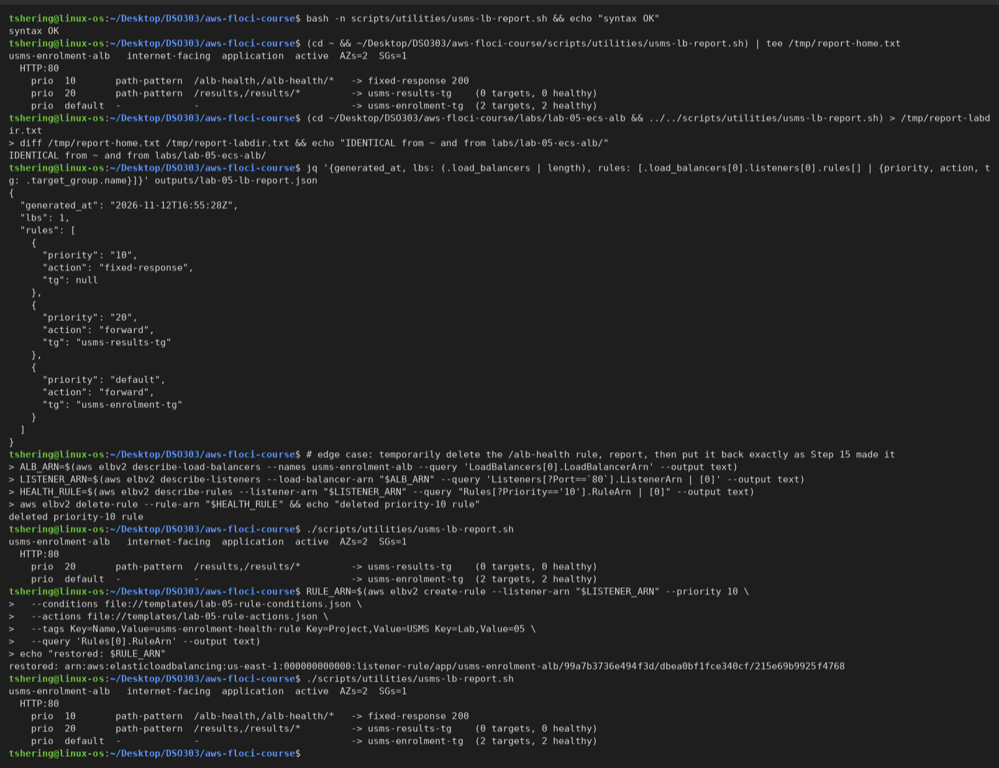
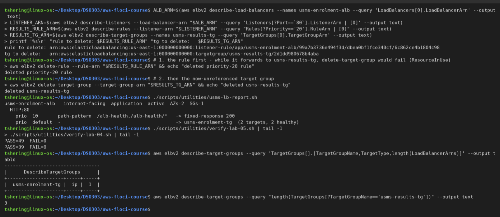
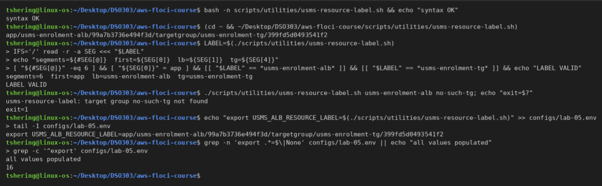
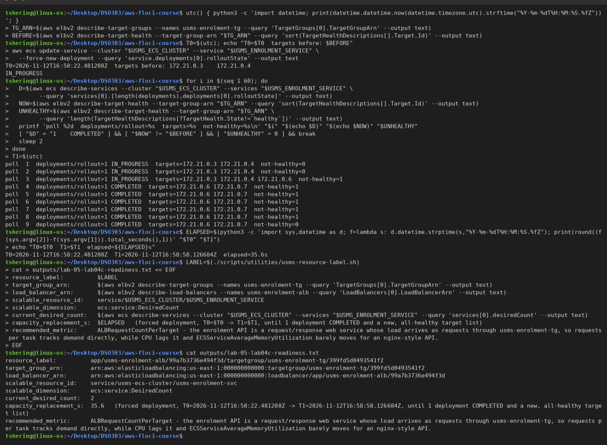

# Independent Lab Exercises (Section 12)

Environment: Floci server 2.4.0, support path **A** (see `notes/lab-05-notes.md`). All output below is from my terminal; the screenshots are in `screenshots/lab-5-alb/`.

## Exercise 1 – Basic: a second path through the same load balancer

**Goal:** route `/results` and `/results/*` on the existing HTTP:80 listener to a new, empty target group, `usms-results-tg` (same type, protocol and port as `usms-enrolment-tg`; health check `/`, matcher `200-399`, deregistration delay 15 s), with a rule at priority 20. Neither object goes into `configs/lab-05.env`, because Exercise 4 removes them.

Every ARN is captured with `$(...)` and `--query`:

```bash
VPC_ID=$(aws ec2 describe-vpcs --filters "Name=tag:Name,Values=usms-vpc" --query 'Vpcs[0].VpcId' --output text)
ALB_ARN=$(aws elbv2 describe-load-balancers --names usms-enrolment-alb --query 'LoadBalancers[0].LoadBalancerArn' --output text)
LISTENER_ARN=$(aws elbv2 describe-listeners --load-balancer-arn "$ALB_ARN" --query 'Listeners[?Port==`80`].ListenerArn | [0]' --output text)

RESULTS_TG_ARN=$(aws elbv2 create-target-group \
  --name usms-results-tg \
  --protocol HTTP --port 80 \
  --vpc-id "$VPC_ID" \
  --target-type ip \
  --health-check-protocol HTTP --health-check-path / --health-check-port traffic-port \
  --matcher HttpCode=200-399 \
  --tags Key=Name,Value=usms-results-tg Key=Project,Value=USMS Key=Tier,Value=app Key=Lab,Value=05 Key=Service,Value=results \
  --query 'TargetGroups[0].TargetGroupArn' --output text)

aws elbv2 modify-target-group-attributes --target-group-arn "$RESULTS_TG_ARN" \
  --attributes Key=deregistration_delay.timeout_seconds,Value=15 \
  --query 'Attributes[?Key==`deregistration_delay.timeout_seconds`].[Key,Value]' --output text
```

The conditions and actions are JSON documents in `templates/`. The actions document uses an unquoted heredoc so `$RESULTS_TG_ARN` expands:

```bash
cat > templates/lab-05-ex1-results-conditions.json << 'EOF'
[
  {
    "Field": "path-pattern",
    "PathPatternConfig": { "Values": ["/results", "/results/*"] }
  }
]
EOF
cat > templates/lab-05-ex1-results-actions.json << EOF
[
  {
    "Type": "forward",
    "TargetGroupArn": "$RESULTS_TG_ARN"
  }
]
EOF

RESULTS_RULE_ARN=$(aws elbv2 create-rule \
  --listener-arn "$LISTENER_ARN" \
  --priority 20 \
  --conditions file://templates/lab-05-ex1-results-conditions.json \
  --actions file://templates/lab-05-ex1-results-actions.json \
  --tags Key=Name,Value=usms-results-rule Key=Project,Value=USMS Key=Tier,Value=app Key=Lab,Value=05 Key=Service,Value=results \
  --query 'Rules[0].RuleArn' --output text)
```

**Reading the rules back in evaluation order.** `Priority` is a string and the default rule's is the word `default`, so I sort numerically and put `default` last:

```bash
aws elbv2 describe-rules --listener-arn "$LISTENER_ARN" --output json \
  | jq -r '.Rules | sort_by(if .Priority=="default" then 1e9 else (.Priority|tonumber) end)[]
           | [.Priority, (.Conditions[0].PathPatternConfig.Values // ["-"] | join(",")), .Actions[0].Type,
              (.Actions[0].TargetGroupArn // "-" | sub(".*:targetgroup/";"") | sub("/.*";""))] | @tsv'
```

**Output:**

```text
RESULTS_TG_ARN = arn:aws:elasticloadbalancing:us-east-1:000000000000:targetgroup/usms-results-tg/2d1dd980678b4aba
deregistration_delay.timeout_seconds    15
conditions valid
actions valid
0
RESULTS_RULE_ARN = arn:aws:elasticloadbalancing:us-east-1:000000000000:listener-rule/app/usms-enrolment-alb/99a7b3736e494f3d/dbea0bf1fce340cf/6c862ce4b1804c98
10        /alb-health,/alb-health/*   fixed-response   -
20        /results,/results/*         forward          usms-results-tg
default   -                           forward          usms-enrolment-tg
[]
{ "Name": "usms-results-tg", "Matcher": "200-399", "HCPath": "/", "AttachedLBs": 1 }
```



**Testing the route through the load balancer** from `usms-web-01`. Floci's restart in Step 16 had left its container exited, so I stopped and started the instance through the EC2 API first:

```text
/            -> 200
/alb-health  -> 200
/results     -> 503
```



**Result:** `describe-rules` shows three entries (priority 10, priority 20, then the default), `usms-results-tg` is empty and attached to one load balancer, and no ECS service or target was created. **A request to `/results` matches the priority-20 rule and is forwarded to a target group with no healthy targets, so the load balancer itself answers `503 Service Temporarily Unavailable`.** That is Section 10's "listener worked, no healthy targets" case, and I observed it, not just reasoned about it.

---

## Exercise 2 – Intermediate: repair the verification script you broke

**1. The property the failing check asserted:** *usms-enrolment-sg admits its HTTP traffic only from one named security group, never from a CIDR, and that group is the enrolment API's single legitimate caller.* In Lab 04 that caller was `usms-app-sg`; after Step 13 it is `usms-alb-sg`. The property is unchanged; only the expected group changed.

**2–4. The change** (`scripts/utilities/verify-lab-04.sh`). The original check keeps its place but asserts the property against the current caller. A second check, immediately after it, proves the old source is gone, because a check that only confirms the new state would still pass if both rules existed:

```bash
source "$REPO_ROOT/configs/lab-05.env" 2>/dev/null || true   # optional: absent before Lab 05
...
: "${USMS_ALB_SG:=none}"     # set by configs/lab-05.env; "none" gives a readable FAIL under set -u
...
check "usms-enrolment-sg tcp/80 is sourced from a group (not a CIDR), and that group is usms-alb-sg" \
  "test \"\$(aws ec2 describe-security-groups --group-ids $USMS_ENROLMENT_SG --query 'SecurityGroups[0].IpPermissions[?FromPort==\`80\`].UserIdGroupPairs[].GroupId' --output text)\" = $USMS_ALB_SG && test -z \"\$(aws ec2 describe-security-groups --group-ids $USMS_ENROLMENT_SG --query 'SecurityGroups[0].IpPermissions[?FromPort==\`80\`].IpRanges[].CidrIp' --output text)\""
check "usms-app-sg is NO LONGER a source on usms-enrolment-sg (Lab 05 cutover)" \
  "! aws ec2 describe-security-groups --group-ids $USMS_ENROLMENT_SG --query 'SecurityGroups[0].IpPermissions[].UserIdGroupPairs[].GroupId' --output text | grep -qw $USMS_APP_SG"
```

- `usms-alb-sg`'s ID comes from `configs/lab-05.env`, never hard-coded. If that file is missing, the default `none` makes the first check **fail readably** instead of aborting under `set -u`.
- The new check reads the **port-80** permission by filter, not `IpPermissions[0]`, so it does not depend on the order in which AWS (or Floci) lists permissions.
- `${BASH_SOURCE[0]}` resolution is unchanged, so the script still runs from any directory.
- The comment at the top now states the expected count:

```bash
# Expected result: PASS=39  FAIL=0   (39 checks; was 38 before Lab 05 Exercise 2)
```

**5. Both scripts at FAIL=0, plus the "Lab 04 only" case.** `env -u USMS_ALB_SG` removes the value my shell had already exported, so that run really behaves like a student without `lab-05.env`:

```text
== Lab 04 networking ==
  ok   usms-enrolment-sg exists
  ok   usms-enrolment-sg tcp/80 is sourced from a group (not a CIDR), and that group is usms-alb-sg
  ok   usms-app-sg is NO LONGER a source on usms-enrolment-sg (Lab 05 cutover)
  ok   usms-enrolment-sg admits NOTHING from 0.0.0.0/0
PASS=39  FAIL=0                                   <- verify-lab-04.sh
PASS=49  FAIL=0                                   <- verify-lab-05.sh

# without configs/lab-05.env:
  FAIL usms-enrolment-sg tcp/80 is sourced from a group (not a CIDR), and that group is usms-alb-sg
  ok   usms-app-sg is NO LONGER a source on usms-enrolment-sg (Lab 05 cutover)
PASS=38  FAIL=1
```



**New PASS count: 39** (38 + the "no longer a source" check). An undocumented count is worse than none. A reader who sees `PASS=38` cannot tell whether a check was deleted, never added, or silently skipped, and a number with no stated expectation looks authoritative while proving nothing. The stated count turns "it's green" into "all 39 things I promised were checked".

**6. Commit message** (explains why the assertion changed, not which line moved):

```text
verify-lab-04: assert enrolment tasks are reachable only via the load balancer

Lab 05 moved usms-enrolment-sg's only inbound source from the web tier
(usms-app-sg) to the ALB (usms-alb-sg). The property Lab 04 cares about is
unchanged - tcp/80 from one named group, never a CIDR - so the check now
asserts it against usms-alb-sg, and a new check proves usms-app-sg is gone,
so the script cannot pass with both paths open. usms-alb-sg is read from
configs/lab-05.env and degrades to a readable failure without it.
Expected: PASS=39 FAIL=0.
```

**When updating a verification script is right, and when it hides a regression:** updating is right when the system was changed on purpose and the change is recorded, so the check is re-pointed at the same property in the same commit as the change that moved it. It hides a regression when the script is edited simply to turn red into green, by loosening or deleting the assertion until it matches whatever the system currently does, because then the script describes the accident instead of the intent.

---

## Exercise 3 – Problem solving: a load balancer report tool

**Script:** `scripts/utilities/usms-lb-report.sh` (no arguments; read-only).

- It walks four levels of API calls: load balancers (`starts_with(LoadBalancerName, 'usms-')`), then listeners, then rules, then target health. It assembles one JSON document with `jq`, writes it to `outputs/lab-05-lb-report.json`, and switches to **python3 only for presentation**, which handles column alignment and per-action summaries.
- **Rule order:** `Priority` is a string, and the default rule's is the literal `default`. A plain sort gives `"10" < "2" < "default"`, so it sorts on `if .Priority == "default" then 999999 else (.Priority | tonumber)`: numeric order, with the default last because 999999 is above the 50000 maximum.
- **Non-forward actions** print their own summary (`fixed-response 200`, `redirect 301 HTTPS://…`).
- **Edge cases** degrade to a message, not a crash or a blank row: no load balancer, a load balancer with no listeners ("refuses every connection"), a listener with no non-default rules, and an empty target group (`0 targets, 0 healthy`).
- **`set -uo pipefail` without `-e`, justified in the script:** a reporting tool walking four levels of calls should degrade one row to `-` when a single call fails, not abort the whole report. Every call is guarded with `|| echo <fallback>`.
- `configs/course.env` is resolved from `${BASH_SOURCE[0]}`, so the script runs from any directory.

**Output** (with Exercise 1 in place; identical from `~` and from `labs/lab-05-ecs-alb/`):

```text
usms-enrolment-alb   internet-facing  application  active  AZs=2  SGs=1
  HTTP:80
    prio  10       path-pattern  /alb-health,/alb-health/*   -> fixed-response 200
    prio  20       path-pattern  /results,/results/*         -> usms-results-tg    (0 targets, 0 healthy)
    prio  default  -             -                           -> usms-enrolment-tg  (2 targets, 2 healthy)
IDENTICAL from ~ and from labs/lab-05-ecs-alb/
```

**With the `/alb-health` rule temporarily deleted** (then recreated exactly as in Step 15):

```text
    prio  20       path-pattern  /results,/results/*         -> usms-results-tg    (0 targets, 0 healthy)
    prio  default  -             -                           -> usms-enrolment-tg  (2 targets, 2 healthy)
```



**After Exercise 4's tidy-up** (two rows: priority 10 and default) the report is again correct; see `e4.png`.

---

## Exercise 4 – Challenge: the exposure review

*To: University Information Security Officer. Subject: the student enrolment API, what changed, and what I recommend.*

### What changed (two sentences)

**Network path:** the enrolment API used to be reachable only by its private task addresses from the portal server (`usms-web-01`) inside the VPC. It now has an Application Load Balancer, `usms-enrolment-alb`, whose nodes sit in the two public subnets with public addresses, so clients reach a single stable DNS name on the internet and the load balancer forwards to the still-private tasks. **Security groups:** the tasks' group `usms-enrolment-sg` no longer admits the portal's group `usms-app-sg`; it admits port 80 **only** from the load balancer's group `usms-alb-sg`, which in turn admits ports 80 and 443 from `0.0.0.0/0`.

### Internal versus internet-facing

**The case for `--scheme internal`.** Step 5's command would change in two places:
- `--scheme internal`;
- `--subnets "$USMS_PRIVATE_SUBNET_A" "$USMS_PRIVATE_SUBNET_B"`, because an internal ALB needs no internet-gateway route.

`usms-alb-sg` would then admit port 80 from `usms-app-sg` instead of `0.0.0.0/0`. The DNS name gains an `internal-` prefix (`internal-usms-enrolment-alb-….elb.amazonaws.com`) and resolves to **private** addresses only, so it is useless from outside the VPC.

What does **not** change: the target group, the listener and its rules, the service's `loadBalancers` attachment, the health checks and draining, and the `usms-alb-sg` → `usms-enrolment-sg` chain. The tasks stay private in both designs.

**Recommendation: internal.** The portal on `usms-web-01` is the only client of this API. An internet-facing load balancer exposes an API that no outside party is supposed to call, and the course's only `0.0.0.0/0` rule exists solely for it.

**The other side, in two sentences:** an internet-facing ALB is justified once browsers or mobile apps call the API directly (a single-page front end, or an app outside the campus network), and it is where AWS WAF and CloudFront would attach. Making it internet-facing now means the HTTPS, WAF and DNS work is done once, rather than re-creating the load balancer later: the scheme cannot be changed after creation, so moving between the two is a rebuild.

### Exposure delta

| Who can reach … | Before (Lab 04) | After (Lab 05) |
|---|---|---|
| **the load balancer** | n/a – no load balancer existed | **Anyone on the internet**, tcp/80 and tcp/443 (`usms-alb-sg`, `0.0.0.0/0`). Only HTTP:80 has a listener |
| **the tasks** (through any path) | Only instances carrying `usms-app-sg` (the portal) | Only the load balancer (`usms-alb-sg`), so **indirectly anyone on the internet, but only via the listener's rules** (`/alb-health` → fixed response, everything else → the API) |
| **the tasks directly**, by private IP | The portal (`usms-app-sg`), from inside the VPC | **Nothing** – `usms-app-sg` was removed in Step 13; no CIDR is admitted; the tasks have no public IP and no IGW route |

New exposure: the API is now callable from the internet through one managed entry point. What can no longer reach the tasks: the portal **by address**; it must now use the load balancer's name.

### Monthly cost estimate (us-east-1, 730 hours)

Prices are AWS's published on-demand rates for us-east-1 (sources below); they should be re-checked before being quoted to finance.

| Item | Derivation | Idle | Under load |
|---|---|---|---|
| ALB hours | 730 h × **$0.0225** per ALB-hour | $16.43 | $16.43 |
| Public IPv4 for the 2 ALB nodes | 2 addresses × 730 h × **$0.005** per IP-hour | $7.30 | $7.30 |
| LCUs | **$0.008** per LCU-hour; idle ≈ 0 LCU | ≈ $0.00 | $3.26 (below) |
| **ALB total** | | **≈ $23.73** | **≈ $26.99** |
| For comparison: the 2 Fargate tasks | 0.25 vCPU × $0.04048 + 1 GB × $0.004445 = $0.014565 per task-hour × 730 h × 2 | $21.26 | $21.26 |

**"Under load" assumption:** an enrolment peak of 50 requests/s for 8 hours a day on 22 working days (176 h), 5 KB average response, one new connection per request; near idle (0.1 LCU) for the other 554 h. An LCU is billed on the **largest** of four dimensions:
- **new connections:** 50/s ÷ 25 per LCU = **2.0 LCU**, which dominates;
- active connections: ~3,000/min ÷ 3,000 = 1.0;
- processed bytes: 50 × 5 KB × 3,600 ≈ 0.9 GB/h ÷ 1 GB = 0.9;
- rule evaluations: 2 rules, within the 10 free, so ≈ 0.

LCU-hours ≈ 2.0 × 176 + 0.1 × 554 = 407 → 407 × $0.008 = **$3.26**.

For a low-traffic API the dimension that dominates is **new connections**, not processed bytes as most people guess, because each request is small but opens its own connection. Keep-alive from the portal would cut it sharply. Even idle, **the load balancer costs more than the two tasks it fronts.**

Sources: Elastic Load Balancing pricing <https://aws.amazon.com/elasticloadbalancing/pricing/>; AWS Fargate pricing <https://aws.amazon.com/fargate/pricing/>; Amazon VPC pricing (public IPv4 addresses) <https://aws.amazon.com/vpc/pricing/>.

### HTTPS plan

What makes the **port open** is already done: `usms-alb-sg` admits tcp/443 (Step 4 "Your turn"). What makes **something listen** on it is still missing. In order:

1. **A domain name** that the university controls, e.g. `enrol.usms.example.edu`. This comes from **outside AWS** (the university's registrar or DNS team); Route 53 is optional.
2. **A public certificate from AWS Certificate Manager** for that name, `aws acm request-certificate --domain-name enrol.usms.example.edu --validation-method DNS`. **Public ACM certificates are free** when used with ELB, and ACM renews them automatically. <https://docs.aws.amazon.com/acm/latest/userguide/gs-acm-request-public.html>, <https://aws.amazon.com/certificate-manager/pricing/>
3. **One DNS validation record** (a CNAME that ACM provides) added in the university's DNS zone, which proves control of the domain; the certificate becomes `ISSUED`. <https://docs.aws.amazon.com/acm/latest/userguide/dns-validation.html>
4. **An HTTPS:443 listener** on `usms-enrolment-alb` with `--certificates CertificateArn=<acm arn>`, `--ssl-policy ELBSecurityPolicy-TLS13-1-2-2021-06`, and a default action of `forward` to `usms-enrolment-tg`. <https://docs.aws.amazon.com/elasticloadbalancing/latest/application/create-https-listener.html>
5. **A DNS record** pointing `enrol.usms.example.edu` at the ALB's DNS name (CNAME, or a Route 53 alias).
6. **Change the HTTP:80 listener's default action** with `modify-listener` to a **`redirect`** action: `Protocol=HTTPS, Port=443, StatusCode=HTTP_301`, so no plaintext request reaches a task. <https://docs.aws.amazon.com/elasticloadbalancing/latest/application/load-balancer-listeners.html>

Free from AWS: the certificate, its validation and its renewal. From outside AWS: the domain name and the DNS validation record in the university's zone. The tasks keep serving plain HTTP on port 80 *inside* the VPC; TLS terminates at the load balancer.

### Tidy-up: the two practice objects from Exercise 1

> ⚠️ **Read before running any delete command**
> **What will be deleted:** the listener rule at priority 20 (`/results` → `usms-results-tg`) on the HTTP:80 listener.
> **What depends on it:** nothing; no service registers into `usms-results-tg`, and `/results` currently returns 503.
> **Reversible? / Effect on later labs:** yes, `create-rule` with the two `templates/lab-05-ex1-results-*.json` documents restores it; no later lab uses it.

```bash
ALB_ARN=$(aws elbv2 describe-load-balancers --names usms-enrolment-alb --query 'LoadBalancers[0].LoadBalancerArn' --output text)
LISTENER_ARN=$(aws elbv2 describe-listeners --load-balancer-arn "$ALB_ARN" --query 'Listeners[?Port==`80`].ListenerArn | [0]' --output text)
RESULTS_RULE_ARN=$(aws elbv2 describe-rules --listener-arn "$LISTENER_ARN" --query "Rules[?Priority=='20'].RuleArn | [0]" --output text)
aws elbv2 delete-rule --rule-arn "$RESULTS_RULE_ARN"
```

> ⚠️ **Read before running any delete command**
> **What will be deleted:** the target group `usms-results-tg` (empty).
> **What depends on it:** only the priority-20 rule, which must be deleted **first**; otherwise `delete-target-group` fails with `ResourceInUseException`.
> **Reversible? / Effect on later labs:** yes, `create-target-group` as in Exercise 1; no later lab uses it.

```bash
RESULTS_TG_ARN=$(aws elbv2 describe-target-groups --names usms-results-tg --query 'TargetGroups[0].TargetGroupArn' --output text)
aws elbv2 delete-target-group --target-group-arn "$RESULTS_TG_ARN"
```

**Output:**

```text
deleted priority-20 rule
deleted usms-results-tg
usms-enrolment-alb   internet-facing  application  active  AZs=2  SGs=1
  HTTP:80
    prio  10       path-pattern  /alb-health,/alb-health/*   -> fixed-response 200
    prio  default  -             -                           -> usms-enrolment-tg  (2 targets, 2 healthy)
PASS=49  FAIL=0          <- verify-lab-05.sh
PASS=39  FAIL=0          <- verify-lab-04.sh
|  usms-enrolment-tg |  ip |  1  |       <- the only target group left
0                                         <- target groups named usms-results-tg
```



**Result:** practice objects gone, nothing from Section 15's KEEP column touched (the `/alb-health` rule is still there), and `verify-lab-05.sh` reports `PASS=49 FAIL=0`.

---

## Exercise 5 – Integration: the ResourceLabel hand-off to Lab 06

**Script:** `scripts/utilities/usms-resource-label.sh [LB_NAME] [TG_NAME]` (defaults `usms-enrolment-alb`, `usms-enrolment-tg`). It derives both ARNs from the ELBv2 API on every run, **never reads `configs/lab-05.env`**, and contains or references no access key. The two suffixes need different treatment, both done with shell parameter expansion:

```bash
# LB:  ...:loadbalancer/app/<name>/<id>   -> keep "app/<name>/<id>"         -> DROP the type word
LB_SUFFIX="${LB_ARN#*:loadbalancer/}"
# TG:  ...:targetgroup/<name>/<id>        -> keep "targetgroup/<name>/<id>" -> KEEP the type word
TG_SUFFIX="${TG_ARN##*:}"
LABEL="${LB_SUFFIX}/${TG_SUFFIX}"
```

Before printing, it validates: exactly 6 segments, first `app`, segment 2 the load balancer name, segment 4 `targetgroup`, segment 5 the target group name. Otherwise it exits 1 with a message.

**Output:**

```text
app/usms-enrolment-alb/99a7b3736e494f3d/targetgroup/usms-enrolment-tg/399fd5d0493541f2
segments=6  first=app  lb=usms-enrolment-alb  tg=usms-enrolment-tg
LABEL VALID
usms-resource-label: target group no-such-tg not found
exit=1
export USMS_ALB_RESOURCE_LABEL=app/usms-enrolment-alb/99a7b3736e494f3d/targetgroup/usms-enrolment-tg/399fd5d0493541f2
all values populated
16
```



`USMS_ALB_RESOURCE_LABEL` was appended to `configs/lab-05.env` from the script's output, not typed. The empty-value check passes and the file now has **16 exports**.

**Why `app`:** the first segment is the load balancer *type* taken from its ARN, `loadbalancer/app/…` for an Application Load Balancer. For a Network Load Balancer the ARN reads `loadbalancer/net/…`, so it would be `net`; `ALBRequestCountPerTarget` only accepts an `app/` label.

**Measurement: full capacity replacement.** Timestamps via python3: record T0, force a new deployment, poll every 2 s until the service reports exactly one deployment with rollout `COMPLETED` **and** the target list is new **and** every target is `healthy`, then record T1:

```text
T0=2026-11-12T16:58:22.481208Z  targets before: 172.21.0.3 172.21.0.4
poll  3  deployments/rollout=1 IN_PROGRESS  targets=172.21.0.3 172.21.0.4 172.21.0.6  not-healthy=1
poll  4  deployments/rollout=1 COMPLETED  targets=172.21.0.6 172.21.0.7  not-healthy=1
poll  9  deployments/rollout=1 COMPLETED  targets=172.21.0.6 172.21.0.7  not-healthy=0
T0=2026-11-12T16:58:22.481208Z  T1=2026-11-12T16:58:58.126684Z  elapsed=35.6s
```

**`outputs/lab-05-lab04c-readiness.txt`:**

```text
resource_label:          app/usms-enrolment-alb/99a7b3736e494f3d/targetgroup/usms-enrolment-tg/399fd5d0493541f2
target_group_arn:        arn:aws:elasticloadbalancing:us-east-1:000000000000:targetgroup/usms-enrolment-tg/399fd5d0493541f2
load_balancer_arn:       arn:aws:elasticloadbalancing:us-east-1:000000000000:loadbalancer/app/usms-enrolment-alb/99a7b3736e494f3d
scalable_resource_id:    service/usms-ecs-cluster/usms-enrolment-svc
scalable_dimension:      ecs:service:DesiredCount
current_desired_count:   2
capacity_replacement_s:  35.6   (forced deployment, T0=... -> T1=..., until 1 deployment COMPLETED and a new, all-healthy target list)
recommended_metric:      ALBRequestCountPerTarget - the enrolment API is a request/response web service whose load arrives as requests through usms-enrolment-tg, so requests per task tracks demand directly, while CPU lags it and ECSServiceAverageMemoryUtilization barely moves for an nginx-style API.
```



**Result:** a script that Lab 06 and the CloudFormation lab can call unchanged, a readiness file from which Lab 06's `put-scaling-policy` call can be written directly (`PredefinedMetricType=ALBRequestCountPerTarget`, `ResourceLabel=<resource_label>`, `ResourceId=service/usms-ecs-cluster/usms-enrolment-svc`), and a **measured 35.6 s** to replace all capacity. About 25 s of that is the two health checks needed to mark a new target healthy (30 s interval). Floci starts containers locally, so real Fargate (image pull through the NAT plus ENI attachment, typically 1–2 minutes) will be slower, and Lab 06's scale-out cooldown should be sized above the real figure, not this one.
