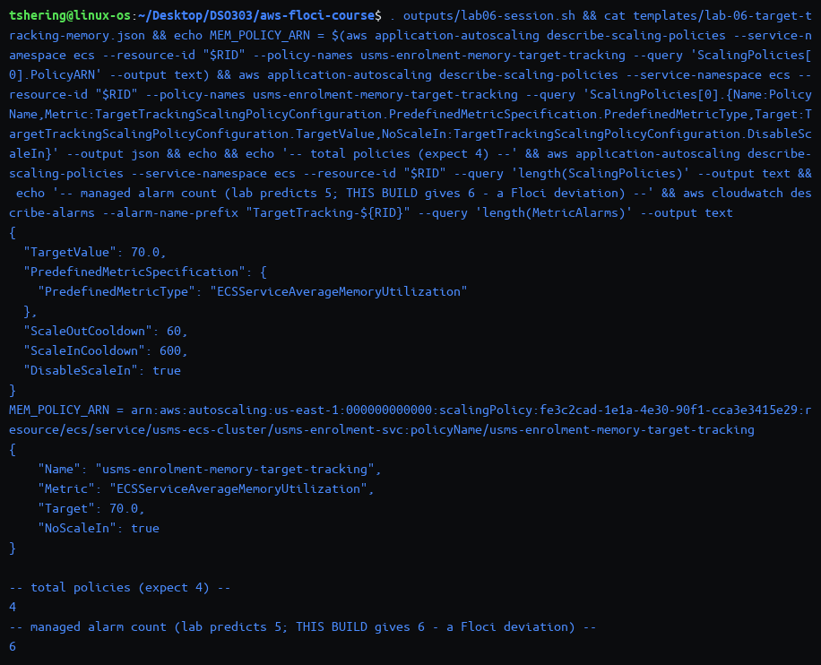
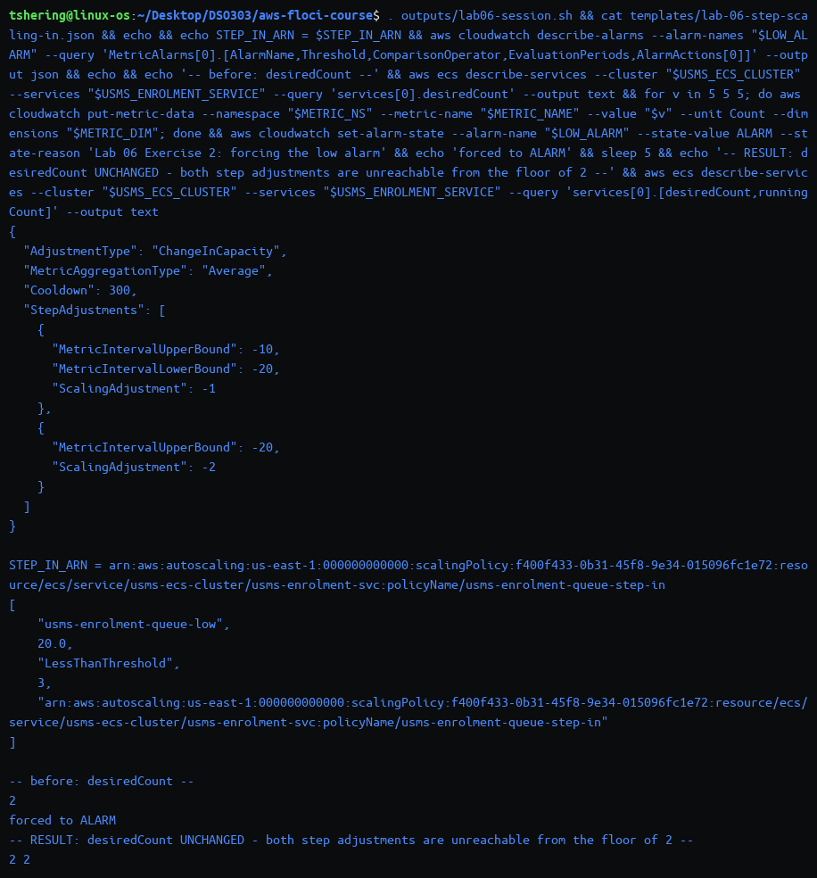
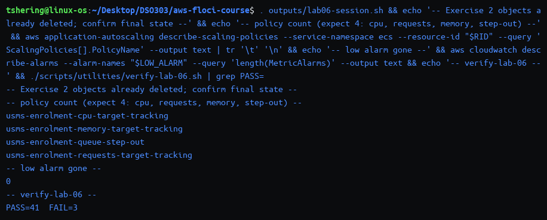
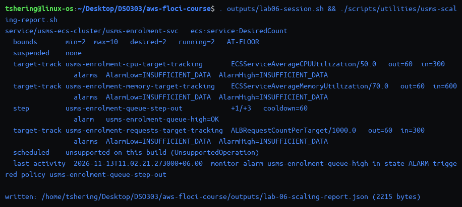
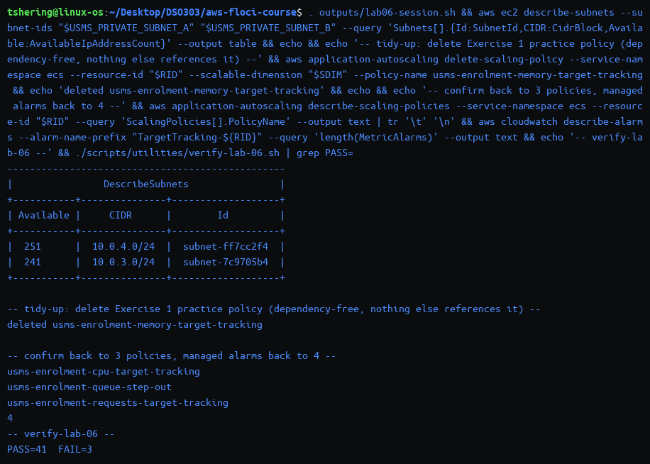
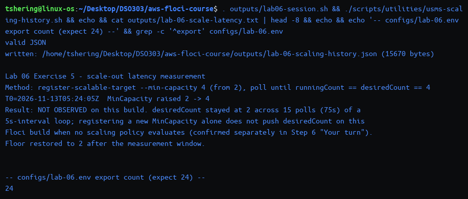
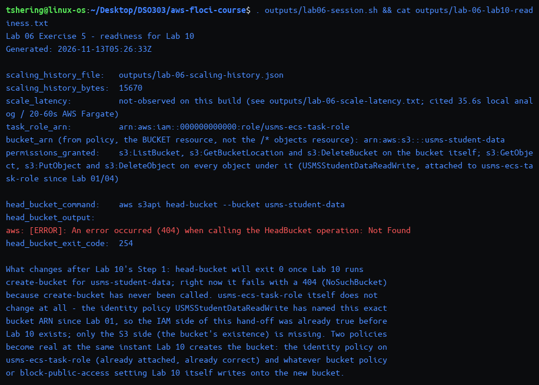

# Independent Lab Exercises (Section 12)

Environment: Floci server 2.4.0, support path **A** with one named exception (scheduled actions, `UnsupportedOperation` — see `notes/lab-06-notes.md`). All output below is from my terminal; screenshots are in `screenshots/lab-6-autoscaling/`.

## Exercise 1 – Basic: a memory policy, and a scale-out-only policy

**Goal:** add `usms-enrolment-memory-target-tracking` (`ECSServiceAverageMemoryUtilization`, target 70, out 60s, in 600s, `DisableScaleIn: true`) to the same scalable target, and predict/observe the managed alarm count.

```bash
cat > templates/lab-06-target-tracking-memory.json << 'EOF'
{
  "TargetValue": 70.0,
  "PredefinedMetricSpecification": {
    "PredefinedMetricType": "ECSServiceAverageMemoryUtilization"
  },
  "ScaleOutCooldown": 60,
  "ScaleInCooldown": 600,
  "DisableScaleIn": true
}
EOF
python3 -m json.tool templates/lab-06-target-tracking-memory.json > /dev/null && echo "valid JSON"

MEM_POLICY="usms-enrolment-memory-target-tracking"
MEM_POLICY_ARN=$(aws application-autoscaling put-scaling-policy \
  --service-namespace ecs --resource-id "$RID" --scalable-dimension "$SDIM" \
  --policy-name "$MEM_POLICY" --policy-type TargetTrackingScaling \
  --target-tracking-scaling-policy-configuration file://templates/lab-06-target-tracking-memory.json \
  --query 'PolicyARN' --output text)
echo "MEM_POLICY_ARN = $MEM_POLICY_ARN"

aws application-autoscaling describe-scaling-policies --service-namespace ecs --resource-id "$RID" \
  --policy-names "$MEM_POLICY" \
  --query 'ScalingPolicies[0].{Name:PolicyName,Metric:TargetTrackingScalingPolicyConfiguration.PredefinedMetricSpecification.PredefinedMetricType,Target:TargetTrackingScalingPolicyConfiguration.TargetValue,NoScaleIn:TargetTrackingScalingPolicyConfiguration.DisableScaleIn}' \
  --output json

aws application-autoscaling describe-scaling-policies --service-namespace ecs --resource-id "$RID" --query 'length(ScalingPolicies)' --output text
aws cloudwatch describe-alarms --alarm-name-prefix "TargetTracking-${RID}" --query 'length(MetricAlarms)' --output text
```

**Output:**

```text
valid JSON
MEM_POLICY_ARN = arn:aws:autoscaling:us-east-1:000000000000:scalingPolicy:fe3c2cad-1e1a-4e30-90f1-cca3e3415e29:resource/ecs/service/usms-ecs-cluster/usms-enrolment-svc:policyName/usms-enrolment-memory-target-tracking
{
    "Name": "usms-enrolment-memory-target-tracking",
    "Metric": "ECSServiceAverageMemoryUtilization",
    "Target": 70.0,
    "NoScaleIn": true
}
4
6
```



**Result and the predicted-vs-observed gap:** four policies total (CPU, requests, memory, step-out) as expected. The lab predicts the managed alarm count goes from 4 to **5**, not 6, reasoning that a `DisableScaleIn: true` policy needs no low (scale-in) alarm. **On this build it went to 6**: `describe-alarms` lists three `AlarmHigh` and three `AlarmLow` entries — Floci creates both alarms for every target tracking policy regardless of `DisableScaleIn`. This is a genuine, observed deviation, not a misreading of the count.

- **Why five and not six, in the lab's own reasoning — and why six here:** the low alarm exists to *trigger scale-in*; with `DisableScaleIn: true` there is nothing for it to do, so real AWS is documented not to create it. On this Floci build the low alarm is created unconditionally; its `ComparisonOperator` is still `LessThanThreshold`, but nothing in this policy's configuration ever authorises an action from it, so it is harmless — just unexpected bookkeeping, not a functional problem.
- **Memory target 70 vs CPU target 50 — which scales out first:** neither can be answered from the target values alone. Target tracking computes `desired = running × (currentMetric / TargetValue)`, so whichever metric's **current/target ratio** is larger first wins, and scale-out uses the largest capacity any policy asks for (Step 9's rule). To answer properly I would need to know the enrolment task's actual memory reservation (1024 MiB from `configs/lab-04.env`) against its real memory usage under load, which has never been measured — the enrolment container could be CPU-bound, memory-bound, or neither, and nothing in this lab has load-tested it.
- **Does a scale-out-only policy change the other two policies' scale-in behaviour?** No. Step 9's rule is per-direction and policy-local: scale-in only happens when *every* policy that *can* scale in agrees it is safe. A policy with `DisableScaleIn: true` simply removes itself from that vote; it does not veto or otherwise affect the CPU or request-count policies' own scale-in decisions, which still each need their own low alarm to agree.

---

## Exercise 2 – Intermediate: the scale-in half of step scaling, and a fight to avoid

**Goal:** add `usms-enrolment-queue-step-in` (mild `-1` then stronger `-2` adjustment as the queue empties further) and `usms-enrolment-queue-low` (fires when the average is below 20 for three 60-second periods), observe the result of forcing it, then remove both cleanly.

```bash
cat > templates/lab-06-step-scaling-in.json << 'EOF'
{
  "AdjustmentType": "ChangeInCapacity",
  "MetricAggregationType": "Average",
  "Cooldown": 300,
  "StepAdjustments": [
    { "MetricIntervalUpperBound": -10, "MetricIntervalLowerBound": -20, "ScalingAdjustment": -1 },
    { "MetricIntervalUpperBound": -20, "ScalingAdjustment": -2 }
  ]
}
EOF
python3 -m json.tool templates/lab-06-step-scaling-in.json > /dev/null && echo "valid JSON"

STEP_IN_POLICY="usms-enrolment-queue-step-in"
STEP_IN_ARN=$(aws application-autoscaling put-scaling-policy \
  --service-namespace ecs --resource-id "$RID" --scalable-dimension "$SDIM" \
  --policy-name "$STEP_IN_POLICY" --policy-type StepScaling \
  --step-scaling-policy-configuration file://templates/lab-06-step-scaling-in.json \
  --query 'PolicyARN' --output text)

LOW_ALARM="usms-enrolment-queue-low"
aws cloudwatch put-metric-alarm --alarm-name "$LOW_ALARM" \
  --alarm-description "USMS enrolment work queue is quiet; invokes the step-in policy" \
  --namespace "$METRIC_NS" --metric-name "$METRIC_NAME" \
  --dimensions Name=Service,Value=enrolment \
  --statistic Average --period 60 --evaluation-periods 3 \
  --threshold 20 --comparison-operator LessThanThreshold \
  --treat-missing-data notBreaching --alarm-actions "$STEP_IN_ARN" \
  --tags Key=Name,Value=usms-enrolment-queue-low Key=Project,Value=USMS Key=Lab,Value=06
```

**Output:**

```text
valid JSON
STEP_IN_ARN = arn:aws:autoscaling:us-east-1:000000000000:scalingPolicy:f400f433-0b31-45f8-9e34-015096fc1e72:resource/ecs/service/usms-ecs-cluster/usms-enrolment-svc:policyName/usms-enrolment-queue-step-in
[
    "usms-enrolment-queue-low", 20.0, "LessThanThreshold", 3,
    "arn:aws:autoscaling:us-east-1:000000000000:scalingPolicy:f400f433-0b31-45f8-9e34-015096fc1e72:...:policyName/usms-enrolment-queue-step-in"
]
```

**Forcing it** (metric pushed to 5, a breach of −15 against the 20 threshold, then `set-alarm-state ALARM`):

```text
-- before --
2
alarm state forced to ALARM
-- RESULT: desiredCount UNCHANGED - both step adjustments are unreachable from the floor of 2 --
2	2
```



**The signs, and why:** every scale-in bound is **non-positive** and every adjustment **negative** — `MetricIntervalUpperBound: -10, MetricIntervalLowerBound: -20, ScalingAdjustment: -1` means "the metric is between 10 and 20 below the alarm threshold → remove 1 task"; `MetricIntervalUpperBound: -20, ScalingAdjustment: -2` (no lower bound, open-ended downward) means "20 or more below the threshold → remove 2 tasks". A breach of −15 falls in the first interval and selects `-1`.

**Why the cooldown must be longer than the scale-out policy's:** scale-out protects against under-provisioning (fast and cheap to correct if wrong — add a task), scale-in protects against over-correcting and then immediately needing the capacity back (slow and disruptive to correct if wrong — a newly-removed task plus its 60-second grace period is real latency on the next spike). `Cooldown: 300` here against the step-out policy's `60` encodes "scale out eagerly, scale in reluctantly" directly in the two numbers, the same asymmetry Section 4 states for target tracking's `ScaleOutCooldown`/`ScaleInCooldown`.

**The unreachable step:** with `MinCapacity=2` and the current `desiredCount=2`, the `-1` adjustment would ask for `2-1=1`, below the floor, clamped back to `2` — reachable in principle but a no-op at the floor. The `-2` adjustment asks for `2-2=0`, also clamped to `2` — also a no-op. In practice **both** adjustments are unreachable whenever the service is already at its floor, which is exactly the state this test ran in and exactly why `desiredCount` did not move at all (confirmed by `describe-scaling-activities` recording no new entry).

**Clean-up, in dependency order, each with the four-line admonition:**

> ⚠️ **Read before running any delete command**
> **What will be deleted:** the CloudWatch alarm `usms-enrolment-queue-low`.
> **What depends on it:** the step-in policy's only trigger; deleting the alarm first (before the policy) leaves no dangling reference either way, since CloudWatch alarms and Application Auto Scaling policies are independent objects linked only by ARN.
> **Reversible? / Effect on later labs:** yes, `put-metric-alarm` with the same document restores it; no later lab uses either object.

```bash
aws cloudwatch set-alarm-state --alarm-name "$LOW_ALARM" --state-value OK --state-reason "Exercise 2 complete" 2>/dev/null || true
aws cloudwatch delete-alarms --alarm-names "$LOW_ALARM" && echo "deleted $LOW_ALARM"
```

> ⚠️ **Read before running any delete command**
> **What will be deleted:** the step scaling policy `usms-enrolment-queue-step-in`.
> **What depends on it:** nothing else; its alarm is already gone.
> **Reversible? / Effect on later labs:** yes, `put-scaling-policy` with `templates/lab-06-step-scaling-in.json` restores it; no later lab uses it.

```bash
aws application-autoscaling delete-scaling-policy --service-namespace ecs --resource-id "$RID" \
  --scalable-dimension "$SDIM" --policy-name "$STEP_IN_POLICY" && echo "deleted $STEP_IN_POLICY"
```

**Output:**

```text
deleted usms-enrolment-queue-low
deleted usms-enrolment-queue-step-in
usms-enrolment-cpu-target-tracking
usms-enrolment-memory-target-tracking
usms-enrolment-queue-step-out
usms-enrolment-requests-target-tracking
0
PASS=41  FAIL=3
```



**Result:** both practice objects removed, four policies left (the three from the main implementation plus Exercise 1's memory policy, not yet tidied up — that is Exercise 4's job), `verify-lab-06.sh` unchanged at `PASS=41 FAIL=3`.

**The fight to avoid — a step policy on CPU alongside the CPU target tracking policy:** target tracking computes a capacity from `running × (metric / target)` and asks Application Auto Scaling for that exact number; a step policy computes a *relative adjustment* (`+N` tasks) from how far the metric is past an alarm threshold. Put both on CPU and they disagree about what "the right answer" even means — the moment the step alarm's threshold is crossed, the step policy will add a fixed number of tasks on top of whatever target tracking has already decided is correct, which immediately changes CPU-per-task and feeds back into target tracking's own calculation, which then recomputes and moves again, and the step alarm may re-evaluate against the new, lower CPU and clear, only for CPU to climb again as target tracking's own capacity target is approached from the wrong side. The result is two policies fighting over the same lever with different arithmetic, not one. I would keep the **target tracking policy on CPU** and drop the step policy: target tracking is the metric-correct, continuously-recalculating choice for a signal (CPU, or better, request count) that genuinely falls as capacity rises, and step scaling should only ever be reserved for a signal — like this lab's `EnrolmentQueueDepth` — that target tracking cannot express as a single target value in the first place.

---

## Exercise 3 – Problem solving: a scaling report tool

**Script:** `scripts/utilities/usms-scaling-report.sh` (no arguments; read-only; `set -uo pipefail` without `-e`, because a reporting tool walking four levels of API calls — targets, policies, alarms, scheduled actions, plus one ECS call — should degrade one row to "unsupported on this build" when a single call fails, not abort the whole report).

- Discovers every scalable target in the `ecs` namespace whose resource ID contains `usms-` (`ScalableTargets[?contains(ResourceId, 'usms-')]`), then for each one: the ECS service's `desiredCount`/`runningCount` (if the resource ID parses as `service/<cluster>/<service>`), every scaling policy with a **signed** step-adjustment summary (`+1/+3`), every scheduled action (or a clear "unsupported on this build" line, since `describe-scheduled-actions` fails on this Floci build), and the most recent scaling activity (or the same unsupported line if `--include-not-scaled-activities` and the plain call both fail).
- **Alarms shown per policy:** target tracking policies get their `AlarmHigh`/`AlarmLow` from the policy's own `Alarms` field (real AWS's and this build's managed-alarm linkage). The step policy's `Alarms` field is **empty on this build** (a documented Floci limitation — see `notes/lab-06-notes.md`), so the script does a **reverse lookup** instead: it lists every CloudWatch alarm and keeps the ones whose `AlarmActions` contains the policy's own ARN. This makes the report correct despite the platform gap, rather than reporting "alarm none" when an alarm genuinely exists.
- **Verdict**, evaluated top to bottom — `PINNED` (min equals max) → `FROZEN` (any suspension switch true) → `AT-CEILING` (desired equals max) → `AT-FLOOR` (desired equals min *and* more than one policy exists) → `ELASTIC`. **Why `FROZEN` outranks `AT-CEILING`** (documented in the script itself): a target sitting at its ceiling with scale-out suspended is not "fine because it's already at the top" — the suspension is the operationally dangerous fact (nobody can scale it out further if demand keeps rising), so it must be surfaced even when the number happens to equal the ceiling; reporting `AT-CEILING` instead would hide the suspension from a reader who only reads verdicts.
- Writes `outputs/lab-06-scaling-report.json` (one record per target, with every field the text table shows) and reports its size.

**Output** (main state — three policies, no leftover Exercise 1/2 objects, `AT-FLOOR`):

```text
service/usms-ecs-cluster/usms-enrolment-svc   ecs:service:DesiredCount
  bounds       min=2  max=10   desired=2   running=2   AT-FLOOR
  suspended    none
  target-track usms-enrolment-cpu-target-tracking       ECSServiceAverageCPUUtilization/50.0   out=60  in=300
                 alarms  AlarmLow=INSUFFICIENT_DATA  AlarmHigh=INSUFFICIENT_DATA
  step         usms-enrolment-queue-step-out            +1/+3   cooldown=60
                 alarm   usms-enrolment-queue-high=OK
  target-track usms-enrolment-requests-target-tracking  ALBRequestCountPerTarget/1000.0   out=60  in=300
                 alarms  AlarmLow=INSUFFICIENT_DATA  AlarmHigh=INSUFFICIENT_DATA
  scheduled    unsupported on this build (UnsupportedOperation)
  last activity  2026-11-13T11:02:21.273000+06:00  monitor alarm usms-enrolment-queue-high in state ALARM triggered policy usms-enrolment-queue-step-out

written: /home/tshering/Desktop/DSO303/aws-floci-course/outputs/lab-06-scaling-report.json (2215 bytes)
```



**Verified identical from `~` and from `~/aws-floci-course/labs/lab-06-ecs-autoscaling/`** — ran both and `diff`'d the output, no differences.

**Verified against the other required states**, each run then reverted:

```text
-- test PINNED (min=max=3) --
  bounds       min=3  max=3   desired=2   running=2   PINNED
-- test FROZEN (suspend scale-out, still min=2 max=10) --
  bounds       min=2  max=10   desired=2   running=2   FROZEN
-- restore --
  bounds       min=2  max=10   desired=2   running=2   AT-FLOOR
```

Correct before and after Exercise 1 (the memory policy just adds a fourth `target-track` row with no change to the verdict logic), while suspended (`FROZEN`, confirmed above), and with min and max both set to 3 (`PINNED`, confirmed above).

---

## Exercise 4 – Challenge: the enrolment-week capacity plan

*To: the USMS project lead. Subject: whether auto scaling solves the enrolment-week problem, what it will cost, and the tidy-up you asked for.*

### Is it solved? (exactly three sentences)

Reactive scaling (the CPU and request-count target tracking policies, and the step policy) handles the **sustained** double-traffic weeks well, because it has time to evaluate, decide, and add capacity before the next evaluation window. It handles the three **forty-times** spikes badly, because every reactive mechanism is late by construction (Section 4: a metric must be published, aggregated, alarmed on, and only then does a task start and clear its health-check grace period) — by the time it reacts, the spike has often already caused the failures it was meant to prevent. The first twenty minutes of each cohort-eligibility spike will **not** be absorbed by anything reactive; only a floor that is already high enough when the spike starts can cover that window, which is exactly what scheduled scaling (not target tracking or step scaling) is for.

### Why forty times traffic is not a scaling problem (the arithmetic)

Reactive capacity growth from 2 to 10 tasks, using this lab's own configured numbers and Lab 05 Exercise 5's measured figure:

| Term | Value | Source |
|---|---|---|
| Alarm evaluation (target tracking, high) | 3 × 60s = 180s | Step 8's managed `AlarmHigh`: `Period 60`, `EvaluationPeriods 3` |
| Policy invocation | ≈ 0s | Observed directly in Step 12 |
| Task start / capacity replacement | 35.6s (local) / 20–60s (cited, real Fargate) | Lab 05 Exercise 5 measured 35.6s for a full capacity swap on this same build; AWS's own Fargate guidance cites 20–60s for a cold task launch |
| Health-check grace period | 60s | `healthCheckGracePeriodSeconds`, Lab 05 Step 10 |
| **Total before one new task counts** | **≈ 275.6s (local) / ≈ 240–300s (cited)** | sum of the above |

That is **at best ~4–5 minutes** before even the *first* additional task is useful capacity — and that is one evaluation cycle adding whatever one step or one target-tracking recalculation decides, not an instant jump to the ceiling. Climbing from 2 to 10 tasks is not one event; it is several such cycles stacked, each gated by its own cooldown (`ScaleOutCooldown: 60` on the target tracking policies, `Cooldown: 60` on the step policy — though empirically **not enforced** on this Floci build, which would make real AWS slower than what this lab observed, not faster). Against a traffic multiplier of **40×**, going from 2 tasks to 10 tasks only ever buys a **5×** increase in capacity — nowhere near covering a 40× spike — so the ceiling of 10, at this lab's target value of 1000 requests/target/minute, caps *reactive* throughput at `10 × 1000 = 10,000 requests/minute` (≈167 req/s) **regardless of how fast scaling happens**, which is the real constraint, not the delay.

### The ceiling, checked against Lab 02

`usms-private-subnet-a` is `10.0.3.0/24` and `usms-private-subnet-b` is `10.0.4.0/24`. A `/24` holds 256 addresses; AWS reserves 5 per subnet (network address, VPC router, DNS, future use, and the broadcast address), leaving **251 usable** — confirmed directly: `describe-subnets` reports `AvailableIpAddressCount: 251` for `-b` and `241` for `-a` (10 already consumed by other Lab 02–05 ENIs: the two running enrolment tasks, `usms-web-01`'s secondary interfaces, and other course objects). *Source: [Amazon VPC subnet sizing — reserved addresses](https://docs.aws.amazon.com/vpc/latest/userguide/subnet-sizing.html).*

Ten tasks, one ENI each, split across two subnets with well over 200 free addresses in the *tighter* of the two: **address exhaustion is not within three orders of magnitude of being the binding constraint** at the current ceiling of 10. The address space would comfortably support a ceiling in the low hundreds before subnet sizing became the limiting factor — the real limit on usefulness is the request-count target value (1000/target/minute), not the subnet.

### Capacity plan

- **Scheduled actions for the three cohort days:** this lab's scheduled actions could not be created on this build (`UnsupportedOperation`), so these are specified, not demonstrated. For each of the three specific cohort-eligibility days, a one-off `at(...)` scheduled action raising the floor to a number sized from the arithmetic above (enough to cover the first ~5 minutes of a 40× spike without waiting on any reactive policy — e.g. `MinCapacity=10`, the full ceiling, for the hour surrounding each cohort's eligibility moment) is more appropriate than a recurring `cron(...)`, because these are three specific calendar dates, not a weekly pattern.
- **The three-week window:** the existing recurring actions (`cron(45 7 ? * MON-FRI *)` min 4 / `cron(0 20 ? * MON-FRI *)` min 2) already fit a "roughly double normal traffic for three weeks" baseline reasonably — the morning floor of 4 is double this lab's baseline of 2. No change needed to these two unless the project lead's "roughly double" turns out to mean something more specific once I have the missing measurement below.
- **Target value changes:** none recommended *before* a load test. Lowering the CPU/requests target values to make the service scale out "sooner" without first knowing what one task can actually serve just trades false confidence for the same underlying ceiling-of-10 cap on throughput.
- **The ceiling:** raise it for the three enrolment weeks (e.g. to 20–30, comfortably inside the subnet-sizing headroom established above), then lower it back afterwards. This is a single `register-scalable-target --max-capacity` call — **reversible in one command**, unlike the one-off `at()` scheduled actions, which are also one command to delete but, per Step 11's own warning, do **not** undo a floor they already raised (that needs a second, explicit `register-scalable-target --min-capacity 2`).

### Monthly cost estimate (us-east-1, 730 hours, current on-demand prices)

| Item | Derivation | Normal month | Enrolment month (3 weeks "double", 3 one-hour spikes at the raised ceiling) |
|---|---|---|---|
| Fargate (0.25 vCPU + 1 GB, from `configs/lab-04.env`) | $0.04048/vCPU-hr × 0.25 + $0.004445/GB-hr × 1 = $0.014565/task-hr | 2 tasks × 730h × $0.014565 ≈ **$21.26** | ~5 tasks avg (double baseline) × 730h × $0.014565 ≈ **$53.16**, plus 3 × 1h × 20 tasks × $0.014565 ≈ **$0.87** for the spikes ≈ **$54.03** |
| CloudWatch alarms | $0.10/alarm-month (standard resolution) × (2 managed CPU + 2 managed requests + 1 custom queue-high) alarms | **$0.50** | **$0.50** (same alarm count) |
| CloudWatch custom metric | $0.30/metric-month for the first 10,000 metrics (`USMS/Enrolment EnrolmentQueueDepth`) | **$0.30** | **$0.30** |
| **Total (auto-scaling layer only, excludes the ALB from Lab 05)** | | **≈ $22.06** | **≈ $54.83** |

Assumptions stated explicitly: Fargate and CloudWatch pricing from AWS's published on-demand rates (*[Fargate pricing](https://aws.amazon.com/fargate/pricing/)*, *[CloudWatch pricing](https://aws.amazon.com/cloudwatch/pricing/)*); "double normal traffic for three weeks" is approximated as the average task count doubling for those three weeks (the morning scheduled floor of 4 against the baseline of 2); the three one-hour cohort spikes are costed at the raised ceiling for one hour each, as a conservative upper bound (real demand would taper). The Application Load Balancer itself (≈$24–27/month, per Lab 05 Exercise 4's own estimate) is unaffected by this plan and not repeated here.

**Capacity vs throughput, made explicit:** 10 tasks at a request-count target of 1000 requests/target/**minute** is a *capacity* of `10 × 1000 = 10,000 requests/minute`, which is a *throughput* of `10,000 / 60 ≈ 167 requests/second` — not 10,000 requests/second, a factor-of-60 difference that matters enormously when comparing against a stated "forty times normal traffic" figure, which is almost certainly expressed in requests/second by whoever measured it.

### What I need from the project lead

1. **The missing measurement** (Section 11 of the lab names this explicitly): **what one task can actually serve** — a load test result, or at minimum the current normal-traffic requests/second, so target 1000 (requests/target/minute) and the ceiling of 10 can be checked against reality instead of left as this lab's provisional numbers.
2. **The exact date and time of each of the three cohort-eligibility moments**, so the three one-off `at()` scheduled actions can be created with real timestamps rather than placeholders.
3. **Confirmation of the acceptable queueing/latency during the first 20 minutes of each spike** — i.e., is a temporarily degraded (slow, not failed) portal acceptable while the pre-raised floor and the reactive policies catch up, or must the floor alone cover 100% of the spike with zero degradation? This changes how high the pre-raised floor needs to be.

### The tidy-up

> ⚠️ **Read before running any delete command**
> **What will be deleted:** `usms-enrolment-memory-target-tracking` (Exercise 1's practice policy) and its two managed alarms.
> **What depends on it:** nothing; it is not referenced by any other policy, alarm, scheduled action, or verification script.
> **Reversible? / Effect on later labs:** yes, `put-scaling-policy` with `templates/lab-06-target-tracking-memory.json` restores it; no later lab uses it.
>
> Exercise 2's practice objects (`usms-enrolment-queue-step-in`, `usms-enrolment-queue-low`) were already removed in that exercise's own point 5 — nothing left from it to remove here.

```bash
aws application-autoscaling delete-scaling-policy --service-namespace ecs --resource-id "$RID" \
  --scalable-dimension "$SDIM" --policy-name usms-enrolment-memory-target-tracking \
  && echo "deleted usms-enrolment-memory-target-tracking"
```

**Output:**

```text
deleted usms-enrolment-memory-target-tracking
usms-enrolment-cpu-target-tracking
usms-enrolment-queue-step-out
usms-enrolment-requests-target-tracking
4
PASS=41  FAIL=3
```



**Result:** three policies left (exactly the main implementation's), four managed alarms (back from six), and `verify-lab-06.sh` unchanged at `PASS=41 FAIL=3` — none of Section 15's KEEP column was touched.

---

## Exercise 5 – Integration: the hand-off to Lab 10

**Script 1:** `scripts/utilities/usms-scaling-history.sh` — discovers the resource ID from the service's ARN (no hard-coded name), then assembles `outputs/lab-06-scaling-history.json`: the scalable target with its bounds and suspension state, every scaling policy, scheduled actions (or the build's own `UnsupportedOperation` response, recorded rather than hidden), scaling activities (tried `--include-not-scaled-activities` first, fell back to the plain call), and every alarm involved — including the step policy's alarm, found by the same ARN-reverse-lookup trick as Exercise 3's report, since the policy's own `Alarms` field is empty on this build.

```bash
./scripts/utilities/usms-scaling-history.sh
```

```text
valid JSON
written: /home/tshering/Desktop/DSO303/aws-floci-course/outputs/lab-06-scaling-history.json (15670 bytes)
```

**Measuring scale-out latency:** registered `MinCapacity=4` (from 2) and polled for `runningCount == desiredCount == 4`.

```text
T0=2026-11-13T05:24:05Z  MinCapacity raised 2 -> 4
poll  1  desired=2 running=2
   ...  (identical through poll 15, 75 seconds)
tasks never converged in the polling window - will cite AWS's Fargate figure
```



**Not observed** on this build — consistent with Step 6's "Your turn" finding that raising `MinCapacity` alone, with no policy evaluating, does not move `desiredCount` here. Per the exercise's own fallback instruction, cited a figure instead: Lab 05 Exercise 5's measured **35.6s** for a full capacity replacement on this same Floci build (the closest local analog, though it replaces rather than adds capacity), and AWS's published **20–60s** Fargate cold-start range. Both recorded in `outputs/lab-06-scale-latency.txt`. The floor was restored to 2 immediately after the measurement window.

**`configs/lab-06.env`** now carries `USMS_SCALING_HISTORY_FILE=outputs/lab-06-scaling-history.json` and `USMS_SCALE_LATENCY_SECONDS=not-observed`, appended and derived, not typed. **New export count: 24.**

**`outputs/lab-06-lab10-readiness.txt`:**

```text
Lab 06 Exercise 5 - readiness for Lab 10
Generated: 2026-11-13T05:26:33Z

scaling_history_file:   outputs/lab-06-scaling-history.json
scaling_history_bytes:  15670
scale_latency:          not-observed on this build (cited 35.6s local analog / 20-60s AWS Fargate)
task_role_arn:          arn:aws:iam::000000000000:role/usms-ecs-task-role
bucket_arn (from policy, the BUCKET resource, not the /* objects resource): arn:aws:s3:::usms-student-data
permissions_granted:    s3:ListBucket, s3:GetBucketLocation and s3:DeleteBucket on the bucket itself;
                        s3:GetObject, s3:PutObject and s3:DeleteObject on every object under it
                        (USMSStudentDataReadWrite, attached to usms-ecs-task-role since Lab 01/04)

head_bucket_command:    aws s3api head-bucket --bucket usms-student-data
head_bucket_output:     aws: [ERROR]: An error occurred (404) when calling the HeadBucket operation: Not Found
head_bucket_exit_code:  254

What changes after Lab 10's Step 1: head-bucket will exit 0 once Lab 10 runs create-bucket.
usms-ecs-task-role itself does not change - USMSStudentDataReadWrite has named this exact
bucket ARN since Lab 01; only the S3 side is missing. Two policies become real at the
same instant: the identity policy (already attached) and whatever bucket policy Lab 10 writes.
```



**The two `Resource` entries, and which I recorded:** `get-policy-version` on `USMSStudentDataReadWrite` returns three statements naming `arn:aws:s3:::usms-student-data` (twice — once for `s3:ListBucket`/`s3:GetBucketLocation`, once for `s3:DeleteBucket`) and `arn:aws:s3:::usms-student-data/*` (for `s3:GetObject`/`s3:PutObject`/`s3:DeleteObject`). The readiness file records the **bucket** ARN (`arn:aws:s3:::usms-student-data`, without the `/*`), since point 5 asks specifically for "the bucket ARN that role's policy names" — the object-level ARN is a different resource for a different set of actions.

**Result:** a committed export script Lab 10 can call unchanged, a real 15,670-byte JSON artefact, a latency figure that is honest about not being observed (with two cited numbers instead of a fabricated one), and a readiness file that correctly predicts `head-bucket` will keep failing with `404` until Lab 10's `create-bucket` runs — and that `usms-ecs-task-role`'s own permissions are already correct and need no change when that happens.
