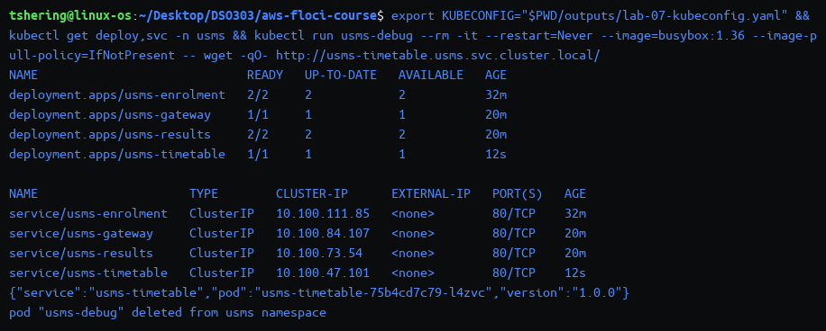
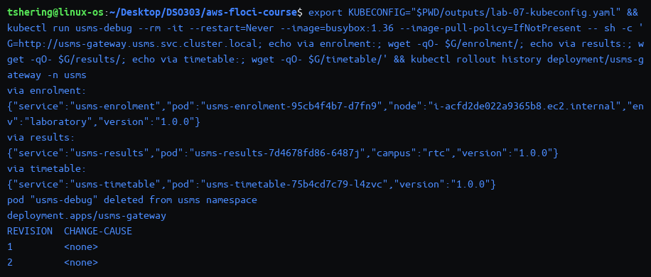
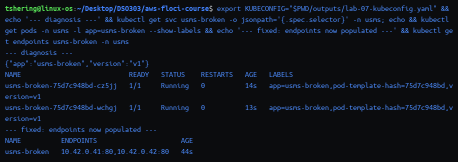
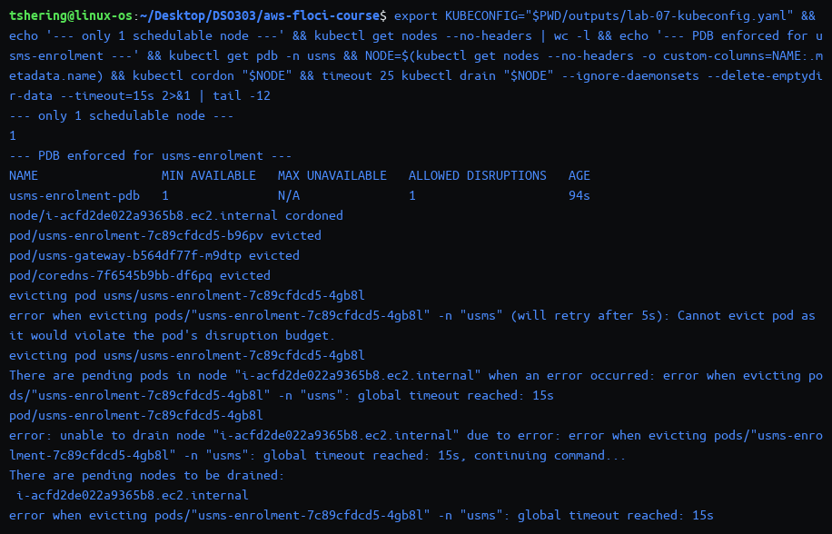
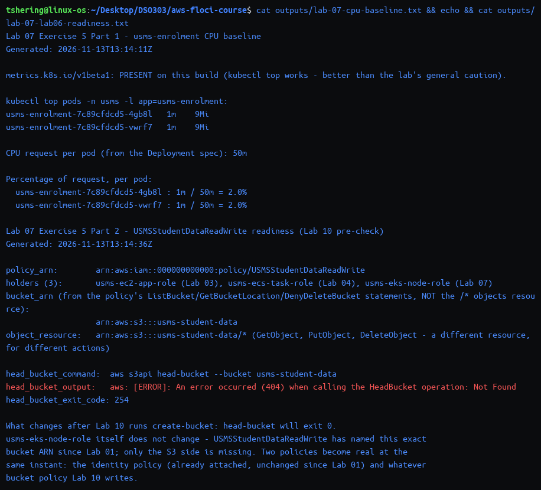

# Independent Lab Exercises (Section 12)

Environment: Floci EKS support **Path A**, cluster `usms-eks-cluster` (k8s 1.30), namespace `usms`. `kubectl` throughout this file uses the certificate-based fallback kubeconfig (`outputs/lab-07-kubeconfig.yaml`) built in Step 11, since this build's `aws eks get-token` exec-plugin path does not authenticate — see `notes/lab-07-notes.md` for the full explanation. All output below is from my terminal; screenshots are in `screenshots/lab-7-eks/`.

## Exercise 1 – Basic: a fourth microservice

**Goal:** deploy `usms-timetable` — one replica, `nginx:1.27-alpine`, its own ConfigMap serving JSON identifying itself and its pod, a readiness probe on `/healthz`, and a ClusterIP Service on port 80 — as a single new file, `manifests/lab-07/70-timetable.yaml`, with the same `app`/`project`/`tier` label scheme this lab uses throughout and CPU/memory requests declared.

```yaml
apiVersion: v1
kind: ConfigMap
metadata:
  name: usms-timetable-conf
  namespace: usms
  labels:
    app: usms-timetable
data:
  default.conf.template: |
    server {
      listen 80;
      server_name _;
      location = /healthz {
        add_header Content-Type text/plain;
        return 200 "ok\n";
      }
      location / {
        add_header Content-Type application/json;
        return 200 '{"service":"usms-timetable","pod":"${POD_NAME}","version":"${APP_VERSION}"}\n';
      }
    }
---
apiVersion: apps/v1
kind: Deployment
metadata:
  name: usms-timetable
  namespace: usms
  labels: {app: usms-timetable, project: usms, tier: app}
spec:
  replicas: 1
  selector: {matchLabels: {app: usms-timetable}}
  template:
    metadata:
      labels: {app: usms-timetable, project: usms, tier: app}
    spec:
      containers:
        - name: timetable
          image: nginx:1.27-alpine
          ports: [{name: http, containerPort: 80}]
          env: [{name: POD_NAME, valueFrom: {fieldRef: {fieldPath: metadata.name}}}]
          envFrom: [{configMapRef: {name: usms-app-config}}]
          volumeMounts: [{name: conf, mountPath: /etc/nginx/templates}]
          resources: {requests: {cpu: "50m", memory: "32Mi"}, limits: {cpu: "200m", memory: "128Mi"}}
          readinessProbe: {httpGet: {path: /healthz, port: http}, initialDelaySeconds: 3, periodSeconds: 5}
      volumes: [{name: conf, configMap: {name: usms-timetable-conf}}]
---
apiVersion: v1
kind: Service
metadata:
  name: usms-timetable
  namespace: usms
  labels: {app: usms-timetable}
spec:
  type: ClusterIP
  selector: {app: usms-timetable}
  ports: [{name: http, port: 80, targetPort: http}]
```

```bash
kubectl apply --dry-run=client -f manifests/lab-07/70-timetable.yaml
kubectl apply -f manifests/lab-07/70-timetable.yaml
kubectl rollout status deployment/usms-timetable --timeout=60s
kubectl get deploy,svc -n usms
kubectl run usms-debug --rm -it --restart=Never --image=busybox:1.36 --image-pull-policy=IfNotPresent -- \
  wget -qO- http://usms-timetable.usms.svc.cluster.local/
```

**Output:**

```text
configmap/usms-timetable-conf created (dry run)
deployment.apps/usms-timetable created (dry run)
service/usms-timetable created (dry run)
configmap/usms-timetable-conf created
deployment.apps/usms-timetable created
service/usms-timetable created
deployment "usms-timetable" successfully rolled out

NAME                             READY   UP-TO-DATE   AVAILABLE   AGE
deployment.apps/usms-enrolment   2/2     2            2           32m
deployment.apps/usms-gateway     1/1     1            1           20m
deployment.apps/usms-results     2/2     2            2           20m
deployment.apps/usms-timetable   1/1     1            1           12s

NAME                     TYPE        CLUSTER-IP      EXTERNAL-IP   PORT(S)   AGE
service/usms-enrolment   ClusterIP   10.100.111.85   <none>        80/TCP    32m
service/usms-gateway     ClusterIP   10.100.84.107   <none>        80/TCP    20m
service/usms-results     ClusterIP   10.100.73.54    <none>        80/TCP    20m
service/usms-timetable   ClusterIP   10.100.47.101   <none>        80/TCP    12s

{"service":"usms-timetable","pod":"usms-timetable-75b4cd7c79-l4zvc","version":"1.0.0"}
pod "usms-debug" deleted from usms namespace
```



**Result:** four Deployments and four Services, exactly as the expected outcome names — written by hand from `30-results.yaml`'s structure, never by `kubectl create deployment` plus an edit, and validated client-side before ever touching the cluster.

---

## Exercise 2 – Intermediate: route to it, and prove the route

**Goal:** add a `/timetable/` route to `usms-gateway` reaching `usms-timetable`, prove it reached the running pod, and show all three routes (`/enrolment/`, `/results/`, `/timetable/`) in one command — editing `manifests/lab-07/40-gateway.yaml` and re-applying, never `kubectl edit`.

```diff
       location /results/ {
         proxy_set_header Host $host;
         proxy_set_header X-Forwarded-For $proxy_add_x_forwarded_for;
         proxy_pass http://usms-results.usms.svc.cluster.local/;
       }
+
+      location /timetable/ {
+        proxy_set_header Host $host;
+        proxy_set_header X-Forwarded-For $proxy_add_x_forwarded_for;
+        proxy_pass http://usms-timetable.usms.svc.cluster.local/;
+      }
     }
```

```bash
kubectl apply -f manifests/lab-07/40-gateway.yaml
kubectl rollout restart deployment/usms-gateway
kubectl rollout status deployment/usms-gateway --timeout=60s

kubectl run usms-debug --rm -it --restart=Never --image=busybox:1.36 --image-pull-policy=IfNotPresent -- sh -c '
  G=http://usms-gateway.usms.svc.cluster.local
  echo via enrolment:; wget -qO- $G/enrolment/
  echo via results:;   wget -qO- $G/results/
  echo via timetable:; wget -qO- $G/timetable/
'
kubectl rollout history deployment/usms-gateway -n usms
```

**Output:**

```text
configmap/usms-gateway-conf configured
deployment.apps/usms-gateway unchanged
service/usms-gateway unchanged
deployment.apps/usms-gateway restarted
deployment "usms-gateway" successfully rolled out

via enrolment:
{"service":"usms-enrolment","pod":"usms-enrolment-95cb4f4b7-d7fn9","node":"i-acfd2de022a9365b8.ec2.internal","env":"laboratory","version":"1.0.0"}
via results:
{"service":"usms-results","pod":"usms-results-7d4678fd86-6487j","campus":"rtc","version":"1.0.0"}
via timetable:
{"service":"usms-timetable","pod":"usms-timetable-75b4cd7c79-l4zvc","version":"1.0.0"}
pod "usms-debug" deleted from usms namespace

deployment.apps/usms-gateway
REVISION  CHANGE-CAUSE
1         <none>
2         <none>
```



**Why `rollout restart` and not a config edit alone:** Step 18 already proved that applying a changed ConfigMap does not touch running pods — nginx only reads `/etc/nginx/templates` at container start. `kubectl apply` on the ConfigMap changed the stored object (`configured`); only `kubectl rollout restart`, which writes a `kubectl.kubernetes.io/restartedAt` annotation into the pod template itself, is a spec change that creates a new ReplicaSet and actually restarts the containers — the second of the two instruments the lab names, since the Deployment's own template never changed (the proxy rules live in the Deployment's mounted ConfigMap, not the Deployment object), so an annotate-only trick on the Deployment's metadata would not have rolled anything either. **Result:** revision count went from 1 to 2, and all three routes answered correctly in one command.

---

## Exercise 3 – Problem solving: find the misconfiguration

**Goal:** apply the given manifest exactly as written. `kubectl apply` accepts it; the Service returns nothing. Diagnose both independent faults using commands, not by reading the YAML, fix each with exactly one changed line, and confirm two working endpoints.

```bash
kubectl apply -f /tmp/usms-broken.yaml   # the manifest exactly as given in the lab text
sleep 8
kubectl get endpoints usms-broken -n usms
```

```text
deployment.apps/usms-broken created
service/usms-broken created
NAME          ENDPOINTS   AGE
usms-broken   <none>      8s
```

**Diagnosis, in order — starting with the command this lab's own verify step relies on most:**

```bash
kubectl get svc usms-broken -o jsonpath='{.spec.selector}' -n usms; echo
kubectl get pods -n usms -l app=usms-broken --show-labels
kubectl get pods -n usms -l app=usms-broken -o custom-columns='NAME:.metadata.name,READY:.status.conditions[?(@.type=="Ready")].status'
```

```text
{"app":"usms-broken","version":"v2"}
NAME                           READY   STATUS    RESTARTS   AGE   LABELS
usms-broken-654f4944db-d5lps   0/1     Running   0          15s   app=usms-broken,pod-template-hash=654f4944db,version=v1
usms-broken-654f4944db-hs4rh   0/1     Running   0          15s   app=usms-broken,pod-template-hash=654f4944db,version=v1

NAME                           READY
usms-broken-654f4944db-d5lps   False
usms-broken-654f4944db-hs4rh   False
```

**Fault 1, confirmed:** the Service's selector asks for `version=v2`; every pod the Deployment actually creates carries `version=v1` from the pod template — a label mismatch silently produces zero endpoints, exactly the symptom Troubleshooting entry 5 names.

```bash
kubectl describe pod -l app=usms-broken -n usms | grep -A1 "Readiness probe failed" | head -4
```

```text
Warning  Unhealthy  1s (x7 over 20s)  kubelet  Readiness probe failed: HTTP probe failed with statuscode: 404
```

**Fault 2, confirmed:** even with the selector fixed, both pods would stay out of rotation regardless, because the readiness probe checks `/healthz` on a **stock** `nginx:1.27-alpine` with no mounted ConfigMap and no template — the base image serves nothing at that path (`404`), so the probe can never pass. Both faults are independent: fixing only the selector leaves the pods permanently `0/1` and still endpoint-less; fixing only the probe leaves the Service pointed at the wrong label value.

**The two one-line fixes:**

```diff
--- a/deployment
+++ b/deployment
@@ readinessProbe.httpGet
-              path: /healthz
+              path: /
--- a/service
+++ b/service
@@ spec.selector
-    version: v2
+    version: v1
```

```bash
kubectl apply -f /tmp/usms-broken.yaml   # after the two one-line edits
sleep 8
kubectl get endpoints usms-broken -n usms
kubectl get pods -n usms -l app=usms-broken
```

**Output:**

```text
deployment.apps/usms-broken configured
service/usms-broken configured
NAME          ENDPOINTS                     AGE
usms-broken   10.42.0.41:80,10.42.0.42:80   38s
NAME                           READY   STATUS    RESTARTS   AGE
usms-broken-75d7c948bd-cz5jj   1/1     Running   0          8s
usms-broken-75d7c948bd-wchgj   1/1     Running   0          7s
```



**Result:** two working endpoints, both pods `1/1 Ready`. Clean-up, as required:

```bash
kubectl delete deployment,service usms-broken --ignore-not-found -n usms
```

```text
deployment.apps "usms-broken" deleted from usms namespace
service "usms-broken" deleted from usms namespace
```

---

## Exercise 4 – Challenge: survive a node going away

**Goal:** change `usms-enrolment` (no new Deployment) so it never has all its capacity on one node, never drops below one healthy pod during a voluntary disruption such as a node drain, and can report — from the cluster, not from memory — which node each pod is on. Demonstrate with `kubectl drain` or an all-at-once pod delete on one node.

**What this build actually allows, said honestly up front:** `kubectl get nodes --no-headers | wc -l` returns **1** — this cluster has exactly one schedulable node (the control-plane node itself, untainted), not the two-to-four `usms-eks-nodes` the node group's own `scalingConfig` claims. A hard anti-affinity rule or a hard `topologySpreadConstraints` (`whenUnsatisfiable: DoNotSchedule`) would therefore leave the second enrolment pod permanently `Pending` — the opposite of what the brief asks for. What **is** demonstrable, and genuinely useful even on a single node: an **advisory** spread constraint that costs nothing when it cannot be satisfied, and an **enforced** `PodDisruptionBudget` that protects against a voluntary disruption regardless of node count.

**The two additions to `manifests/lab-07/20-enrolment.yaml`:**

```yaml
# inside the pod template spec, advisory - the one that does NOT block scheduling
      topologySpreadConstraints:
        - maxSkew: 1
          topologyKey: kubernetes.io/hostname
          whenUnsatisfiable: ScheduleAnyway
          labelSelector:
            matchLabels: {app: usms-enrolment}
```

```yaml
# a new object, appended to the same file - enforced
apiVersion: policy/v1
kind: PodDisruptionBudget
metadata:
  name: usms-enrolment-pdb
  namespace: usms
  labels: {app: usms-enrolment}
spec:
  minAvailable: 1
  selector:
    matchLabels: {app: usms-enrolment}
```

**Why these two, and why they are the right pairing:** `topologySpreadConstraints` with `ScheduleAnyway` is **advisory** — the scheduler prefers to spread pods across `kubernetes.io/hostname` values but will still place a pod on a node that breaks the skew if no better option exists, which is exactly why it is safe to add even on a one-node cluster; a `PodDisruptionBudget` is **enforced** — the eviction API (what `kubectl drain` and, on real multi-node AWS, a cluster-autoscaler node replacement both use) is required to check it and refuses an eviction that would violate it, with no "best effort" escape hatch. Together they say the right thing regardless of how many nodes exist: spread if you can, but never let a voluntary disruption take the last healthy copy.

```bash
kubectl apply --dry-run=client -f manifests/lab-07/20-enrolment.yaml
kubectl apply -f manifests/lab-07/20-enrolment.yaml
kubectl rollout status deployment/usms-enrolment --timeout=60s
kubectl get pdb -n usms
kubectl get nodes --no-headers | wc -l
kubectl get pods -n usms -o wide -l app=usms-enrolment
```

```text
configmap/usms-enrolment-conf unchanged
deployment.apps/usms-enrolment configured
service/usms-enrolment unchanged
poddisruptionbudget.policy/usms-enrolment-pdb created
deployment "usms-enrolment" successfully rolled out

NAME                 MIN AVAILABLE   MAX UNAVAILABLE   ALLOWED DISRUPTIONS   AGE
usms-enrolment-pdb   1               N/A               1                     11s
1
NAME                              READY   STATUS    RESTARTS   AGE   IP           NODE
usms-enrolment-7c89cfdcd5-b96pv   1/1     Running   0          11s   10.42.0.43   i-acfd2de022a9365b8.ec2.internal
usms-enrolment-7c89cfdcd5-gsgqm   1/1     Running   0          6s    10.42.0.44   i-acfd2de022a9365b8.ec2.internal
```

**Requirement 3 satisfied honestly:** `kubectl get pods -o wide` names the exact node for each pod directly from the cluster's own state — both land on the same node here because there is only one, which the command itself proves rather than hides.

**The demonstration — draining the only node, with the PDB watching:**

```bash
NODE=$(kubectl get nodes --no-headers -o custom-columns=NAME:.metadata.name)
kubectl cordon "$NODE"
timeout 25 kubectl drain "$NODE" --ignore-daemonsets --delete-emptydir-data --timeout=15s
```

```text
node/i-acfd2de022a9365b8.ec2.internal cordoned
pod/usms-enrolment-7c89cfdcd5-b96pv evicted
pod/usms-gateway-b564df77f-m9dtp evicted
pod/coredns-7f6545b9bb-df6pq evicted
evicting pod usms/usms-enrolment-7c89cfdcd5-4gb8l
error when evicting pods/"usms-enrolment-7c89cfdcd5-4gb8l" -n "usms" (will retry after 5s): Cannot evict pod as it would violate the pod's disruption budget.
evicting pod usms/usms-enrolment-7c89cfdcd5-4gb8l
There are pending pods in node "..." when an error occurred: ... global timeout reached: 15s
```



**Reading the result precisely:** the drain evicted the first enrolment pod (dropping healthy count from 2 to 1, which `minAvailable: 1` still permits) along with every other, unprotected pod on the node — then genuinely **stalled**, retrying every five seconds and failing every time, the instant it tried to evict the **last** remaining healthy `usms-enrolment` pod, because that eviction would have brought the count to 0, below `minAvailable: 1`. This is the PDB doing exactly its documented job: a voluntary disruption (drain) is blocked from ever taking the last healthy copy, with no special-casing needed for the fact that this cluster happens to have only one node to drain in the first place.

```bash
kubectl uncordon "$NODE"
kubectl get pods -n usms -o wide
```

```text
node/i-acfd2de022a9365b8.ec2.internal uncordoned
NAME                              READY   STATUS    RESTARTS   AGE   NODE
usms-enrolment-7c89cfdcd5-4gb8l   1/1     Running   0          108s  i-acfd2de022a9365b8.ec2.internal
usms-enrolment-7c89cfdcd5-vwrf7   1/1     Running   0          36s   i-acfd2de022a9365b8.ec2.internal
usms-gateway-b564df77f-d9nnj      1/1     Running   0          36s   i-acfd2de022a9365b8.ec2.internal
usms-results-7d4678fd86-5h4t6     1/1     Running   0          35s   i-acfd2de022a9365b8.ec2.internal
usms-results-7d4678fd86-9vs7q     1/1     Running   0          36s   i-acfd2de022a9365b8.ec2.internal
usms-timetable-75b4cd7c79-jl5z6   1/1     Running   0          36s   i-acfd2de022a9365b8.ec2.internal
```

**Result:** fully recovered once uncordoned — every evicted pod rescheduled automatically, and throughout the entire drain attempt at least one `usms-enrolment` pod was continuously `Running`, satisfying the brief's central requirement even though a true multi-node spread could not be shown on this build.

---

## Exercise 5 – Integration: prepare what Lab 08 needs, using what Lab 01 built

**Part 1 — CPU baseline.** This build genuinely exposes `metrics.k8s.io/v1beta1` (confirmed with `kubectl get --raw`), so `kubectl top` returns real numbers rather than requiring the "metrics API absent" fallback the lab allows for.

```bash
kubectl get --raw /apis/metrics.k8s.io/v1beta1 | head -c 200; echo
kubectl top pods -n usms -l app=usms-enrolment
```

```text
{"kind":"APIResourceList","apiVersion":"v1","groupVersion":"metrics.k8s.io/v1beta1", ...}
NAME                              CPU(cores)   MEMORY(bytes)
usms-enrolment-7c89cfdcd5-4gb8l   1m           9Mi
usms-enrolment-7c89cfdcd5-vwrf7   1m           9Mi
```

`outputs/lab-07-cpu-baseline.txt` records both the absolute figures and the percentage of the 50m request (1m / 50m ≈ **2.0%** per pod) — nowhere near Lab 08's likely HPA target, which is the honest, useful fact this baseline exists to establish.

**Part 2 — `USMSStudentDataReadWrite`, read from the API, not from memory.**

```bash
S3_RW_ARN=$(aws iam list-policies --scope Local --query "Policies[?PolicyName=='USMSStudentDataReadWrite'].Arn | [0]" --output text)
aws iam list-entities-for-policy --policy-arn "$S3_RW_ARN" --query 'PolicyRoles[].RoleName' --output text
DEFAULT_VERSION=$(aws iam get-policy --policy-arn "$S3_RW_ARN" --query 'Policy.DefaultVersionId' --output text)
aws iam get-policy-version --policy-arn "$S3_RW_ARN" --version-id "$DEFAULT_VERSION" --query 'PolicyVersion.Document' --output json
aws s3api head-bucket --bucket usms-student-data
```

```text
usms-ec2-app-role	usms-ecs-task-role	usms-eks-node-role
{
  "Statement": [
    {"Sid": "ListTheBucketItself", "Resource": "arn:aws:s3:::usms-student-data", ...},
    {"Sid": "ReadWriteObjectsInsideTheBucket", "Resource": "arn:aws:s3:::usms-student-data/*", ...},
    {"Sid": "NeverDeleteTheBucket", "Effect": "Deny", "Resource": "arn:aws:s3:::usms-student-data", ...}
  ]
}
aws: [ERROR]: An error occurred (404) when calling the HeadBucket operation: Not Found
```



**The ARN I recorded, and why:** the policy's `Resource` field names **two different ARNs** for two different sets of actions — `arn:aws:s3:::usms-student-data` (the bucket itself, for `ListBucket`/`GetBucketLocation`/the `DenyDeleteBucket` statement) and `arn:aws:s3:::usms-student-data/*` (every object inside it, for `GetObject`/`PutObject`/`DeleteObject`). `outputs/lab-07-lab06-readiness.txt` records the **bucket** ARN, since that is what the exercise asks for and what Lab 10 will actually create; the bucket does not exist yet (`head-bucket` returns a clean `404`), and `usms-eks-node-role` is now the policy's third holder, alongside Lab 03's and Lab 04's roles, all three still naming a bucket that is not real until Lab 10 runs.

**Part 3 — which of the 21 `configs/lab-07.env` variables Lab 08 needs, and why:** written in full in `notes/lab-07-notes.md` (one line per variable, in my own words, not copied from Section 16's table) — summarised here: `USMS_EKS_CLUSTER`/`USMS_EKS_NODEGROUP`/`USMS_EKS_NAMESPACE` for every `aws eks`/`kubectl` call Lab 08 makes, `USMS_EKS_LB_PORTS` because Lab 08 Step 15's `LoadBalancer` Service cannot be exposed without it, `USMS_K8S_DEPLOY_ENROLMENT` as the HPA's scale target, `USMS_K8S_DEPLOY_GATEWAY` as the Service that becomes a `NodePort` then a `LoadBalancer`, `USMS_K8S_CPU_REQUEST` to check the HPA's percentage arithmetic by hand, and `USMS_EKS_ENDPOINT` to confirm `kubectl` is still pointed at the right cluster after any restart.

**Result:** two git-ignored files written to `outputs/` (`outputs/*` in `.gitignore`, confirmed by reading the rule directly rather than by running `git check-ignore`), and a new, honestly-labelled section in `notes/lab-07-notes.md` that Lab 08's own Step 2 can read.
