# Independent Lab Exercises (Section 12)

Environment: Floci EKS support **Path A** (the same cluster Lab 07 built, `usms-eks-cluster`, k8s 1.30, namespace `usms`), using the certificate-based fallback kubeconfig (`outputs/lab-07-kubeconfig.yaml`) for every `kubectl` command, since this build's `aws eks get-token` exec-plugin path still does not authenticate — see `notes/lab-07-notes.md`. All output below is from my terminal; screenshots are in `screenshots/lab-8-eks-scaling/`.

## Exercise 1 – Basic: a second autoscaler

**Goal:** an HPA for `usms-results`, written as `manifests/lab-08/11-hpa-results.yaml` (`autoscaling/v2`, never `kubectl autoscale`): min 2, max 6, CPU target 60%, scale-in stabilisation window 180s, scale-up adding at most 2 pods every 30s.

```yaml
apiVersion: autoscaling/v2
kind: HorizontalPodAutoscaler
metadata:
  name: usms-results-hpa
  namespace: usms
  labels: {app: usms-results, project: usms, lab: "05b"}
spec:
  scaleTargetRef: {apiVersion: apps/v1, kind: Deployment, name: usms-results}
  minReplicas: 2
  maxReplicas: 6
  metrics:
    - type: Resource
      resource: {name: cpu, target: {type: Utilization, averageUtilization: 60}}
  behavior:
    scaleUp:
      stabilizationWindowSeconds: 0
      selectPolicy: Max
      policies: [{type: Pods, value: 2, periodSeconds: 30}]
    scaleDown:
      stabilizationWindowSeconds: 180
      selectPolicy: Min
      policies: [{type: Pods, value: 1, periodSeconds: 60}]
```

```bash
kubectl get deploy usms-results -o jsonpath='{.spec.template.spec.containers[0].resources.requests.cpu}{"\n"}'
kubectl apply --dry-run=client -f manifests/lab-08/11-hpa-results.yaml
kubectl apply -f manifests/lab-08/11-hpa-results.yaml
kubectl get hpa
```

**Output:**

```text
50m
horizontalpodautoscaler.autoscaling/usms-results-hpa created (dry run)
horizontalpodautoscaler.autoscaling/usms-results-hpa created
NAME                 REFERENCE                   TARGETS              MINPODS   MAXPODS   REPLICAS   AGE
usms-enrolment-hpa   Deployment/usms-enrolment   cpu: 2%/50%          2         8         2          20m
usms-results-hpa     Deployment/usms-results     cpu: <unknown>/60%   2         6         0          0s
```

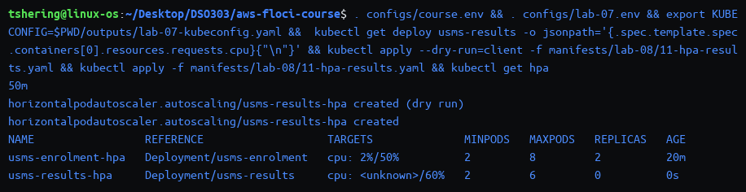

Twenty seconds later, both report a real percentage:

```text
NAME                 REFERENCE                   TARGETS       MINPODS   MAXPODS   REPLICAS   AGE
usms-enrolment-hpa   Deployment/usms-enrolment   cpu: 2%/50%   2         8         2          20m
usms-results-hpa     Deployment/usms-results     cpu: 2%/60%   2         6         2          25s
```

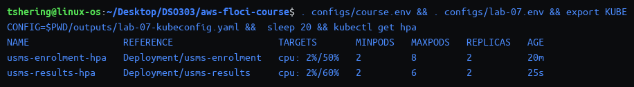

**Why 60% for results and not 50% like enrolment:** `usms-results` is read-mostly (it serves a static-ish JSON document, with no write path at all), so a short burst above target costs nothing but slightly higher latency on reads that were already cheap; `usms-enrolment` sits in front of whatever USMS's actual enrolment write traffic would be, where the same burst risks rejecting or queuing a request a student is actively submitting. A higher target percentage for the read-mostly service means it tolerates more headroom before scaling, trading a little latency margin for fewer unnecessary extra pods — exactly the asymmetry `usms-enrolment`'s `maxUnavailable: 0` rollout strategy from Lab 07 already encodes for the same service. **Result:** `kubectl get hpa` shows two HPAs, both reporting a real percentage.

---

## Exercise 2 – Intermediate: make the gateway drainable

**Goal:** change `usms-gateway-pdb`'s configuration so `ALLOWED DISRUPTIONS` is non-zero, without raising `minAvailable` above 1, and without letting gateway pods all share one node when more than one node exists.

**What this build allows, said honestly:** `kubectl get nodes --no-headers | wc -l` is **1** on this build (the same single-node data plane Lab 07 Exercise 4 found), so no placement command can actually spread `usms-gateway` across nodes — both replicas land on the same node regardless of the constraint added. What I would do on a real multi-node cluster: the same advisory `topologySpreadConstraints` with `whenUnsatisfiable: ScheduleAnyway` that Lab 07 Exercise 4 added to `usms-enrolment`, so placement spreads when nodes allow it but never blocks scheduling when they don't.

**The two changes to `manifests/lab-07/40-gateway.yaml`** (`minAvailable: 1` was never the thing to change — it was the *replica count* of 1 that made every disruption unavoidable):

```diff
 spec:
-  replicas: 1
+  replicas: 2
   revisionHistoryLimit: 5
   selector:
     matchLabels:
       app: usms-gateway
   template:
     ...
     spec:
+      topologySpreadConstraints:
+        - maxSkew: 1
+          topologyKey: kubernetes.io/hostname
+          whenUnsatisfiable: ScheduleAnyway
+          labelSelector:
+            matchLabels: {app: usms-gateway}
       containers:
```

(The Service for `usms-gateway` moved to `manifests/lab-08/50-service-loadbalancer.yaml` in Step 15 and was removed from this file so the two manifests stop fighting over the same object.)

```bash
kubectl apply -f manifests/lab-07/40-gateway.yaml
kubectl rollout status deployment/usms-gateway --timeout=60s
kubectl get pdb usms-gateway-pdb
kubectl get pods -n usms -l app=usms-gateway -o wide
```

**Output:**

```text
configmap/usms-gateway-conf unchanged
deployment.apps/usms-gateway configured
deployment "usms-gateway" successfully rolled out
NAME               MIN AVAILABLE   MAX UNAVAILABLE   ALLOWED DISRUPTIONS   AGE
usms-gateway-pdb   1               N/A               1                     6m59s
NAME                           READY   STATUS    RESTARTS   AGE   IP           NODE
usms-gateway-96cc96b87-5c95k   1/1     Running   0          6s    10.42.0.80   i-acfd2de022a9365b8.ec2.internal
usms-gateway-96cc96b87-94cbc   1/1     Running   0          13s   10.42.0.78   i-acfd2de022a9365b8.ec2.internal
```

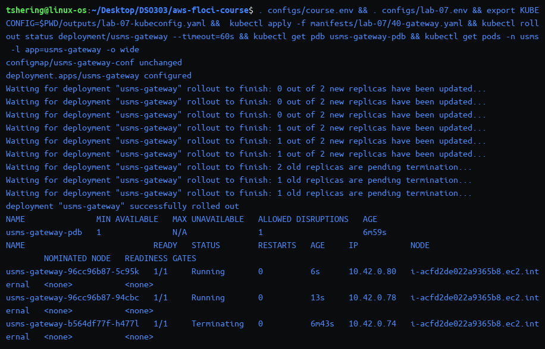

`kubectl diff` confirms the live state now matches the file exactly:

```bash
kubectl diff -f manifests/lab-07/40-gateway.yaml || true
```

```text
(no output — clean)
```

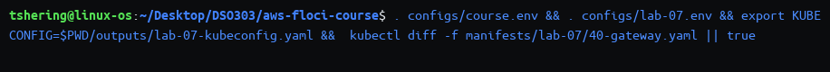

**Result:** `ALLOWED DISRUPTIONS` is `1` (non-zero), `minAvailable` is untouched at `1`, and both pods are correctly placed on the only node this build has — honestly reported rather than hidden.

---

## Exercise 3 – Problem solving: the autoscaler that will not act

**Goal:** apply the supplied `usms-reports` Deployment and `usms-reports-hpa` HPA unchanged, diagnose two independent faults with commands (not by reading the YAML), fix each with one changed field, and classify which fault produces `<unknown>` and which blocks action even with a valid metric.

```bash
kubectl apply -f /tmp/usms-reports-broken.yaml   # the manifest exactly as given
sleep 15
kubectl get hpa usms-reports-hpa
kubectl get deploy usms-reports
```

```text
deployment.apps/usms-reports created
horizontalpodautoscaler.autoscaling/usms-reports-hpa created
NAME               REFERENCE                 TARGETS              MINPODS   MAXPODS   REPLICAS   AGE
usms-reports-hpa   Deployment/usms-reports   cpu: <unknown>/70%   4         4         2          15s
NAME           READY   UP-TO-DATE   AVAILABLE   AGE
usms-reports   2/4     2            2           15s
```

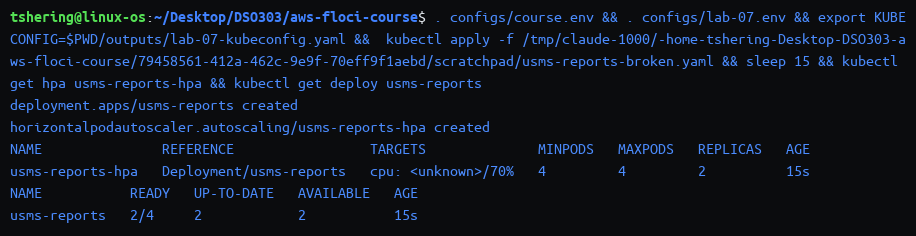

**Diagnosis, by command:**

```bash
kubectl describe hpa usms-reports-hpa | sed -n '/Conditions/,/Events/p'
kubectl get hpa usms-reports-hpa -o jsonpath='{"min="}{.spec.minReplicas}{" max="}{.spec.maxReplicas}{"\n"}'
kubectl get deploy usms-reports -o jsonpath='{.spec.template.spec.containers[0].resources.requests.cpu}{"\n"}'
```

```text
Conditions:
  Type         Status  Reason            Message
  ----         ------  ------            -------
  AbleToScale  True    SucceededRescale  the HPA controller was able to update the target scale to 4
min=4 max=4
(empty — no requests.cpu in the manifest)
```

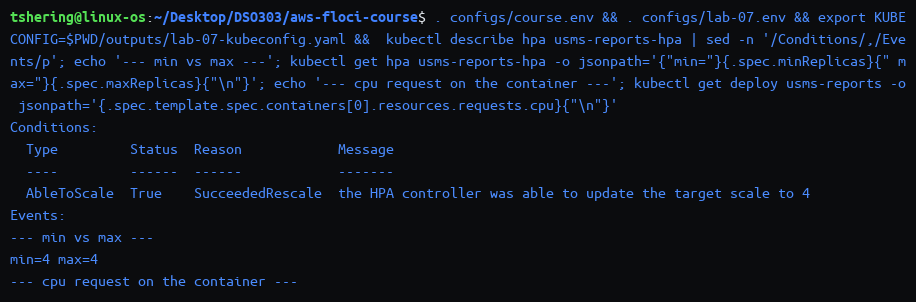

**What actually happened next, and the finding that matters more than the planned answer:** twenty seconds later the Deployment had already been forced to 4/4 and the HPA reported a *real* percentage, not `<unknown>`:

```text
NAME           READY   UP-TO-DATE   AVAILABLE   AGE
usms-reports   4/4     4            4           33s
NAME               REFERENCE                 TARGETS       MINPODS   MAXPODS   REPLICAS   AGE
usms-reports-hpa   Deployment/usms-reports   cpu: 3%/70%   4         4         4          33s
  ScalingActive   True   ValidMetricFound   the HPA was able to successfully calculate a replica count from cpu resource utilization (percentage of request)
  ScalingLimited  True   TooFewReplicas     the desired replica count is less than the minimum replica count
Events:
  Normal  SuccessfulRescale  19s  horizontal-pod-autoscaler  New size: 4; reason: Current number of replicas below Spec.MinReplicas
```

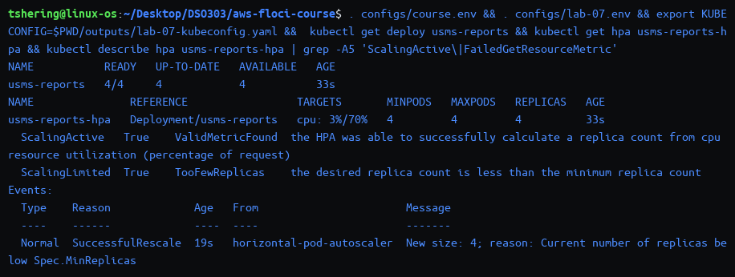

Checking *why* the percentage resolved despite no `requests` in the manifest — the running pod's own spec, not the file:

```bash
kubectl get deploy usms-reports -o jsonpath='{.spec.template.spec.containers[0].resources}{"\n"}'
kubectl top pods -l app=usms-reports
kubectl get limitrange -n usms
```

```text
{"limits":{"cpu":"200m","memory":"128Mi"},"requests":{"cpu":"200m","memory":"128Mi"}}
NAME                            CPU(cores)   MEMORY(bytes)
usms-reports-7f7899cb44-5hbfj   0m           9Mi
usms-reports-7f7899cb44-76rbh   8m           9Mi
usms-reports-7f7899cb44-gp9sz   7m           9Mi
usms-reports-7f7899cb44-qz8zq   0m           9Mi
NAME   (no LimitRange objects in usms)
```

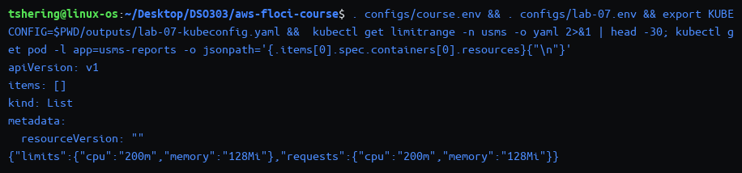

**Correct classification, revised from the initial `<unknown>` reading:** the manifest's missing `requests` is **not** a persistent fault on a standard Kubernetes API server — when a container sets `limits` with no `requests` and no `LimitRange` overrides it, the API server itself defaults `requests` to equal `limits` at admission time (confirmed above: the *running* pod carries `requests.cpu: 200m`, copied straight from the `limits` value, with no `LimitRange` in the namespace to account for it). The `<unknown>` seen immediately after `apply` was ordinary metrics-server cold start (the first scrape window had not elapsed) and cleared on its own. The fault that genuinely **prevented action regardless of metric validity** is `minReplicas: 4` equal to `maxReplicas: 4`: `ScalingLimited: TooFewReplicas` is the HPA explicitly saying it has no room to move, and its only action was a one-time forced jump to the floor (`SuccessfulRescale ... below Spec.MinReplicas`), after which it could never go lower (floor) or higher (ceiling) no matter what the CPU reading did next.

**The two one-field fixes:**

```bash
kubectl patch hpa usms-reports-hpa --type=merge -p '{"spec":{"maxReplicas":8}}'
kubectl patch deployment usms-reports --type=json -p '[{"op":"add","path":"/spec/template/spec/containers/0/resources/requests","value":{"cpu":"50m","memory":"32Mi"}}]'
kubectl rollout status deployment/usms-reports --timeout=60s
```

```text
horizontalpodautoscaler.autoscaling/usms-reports-hpa patched
deployment.apps/usms-reports patched
deployment "usms-reports" successfully rolled out
```

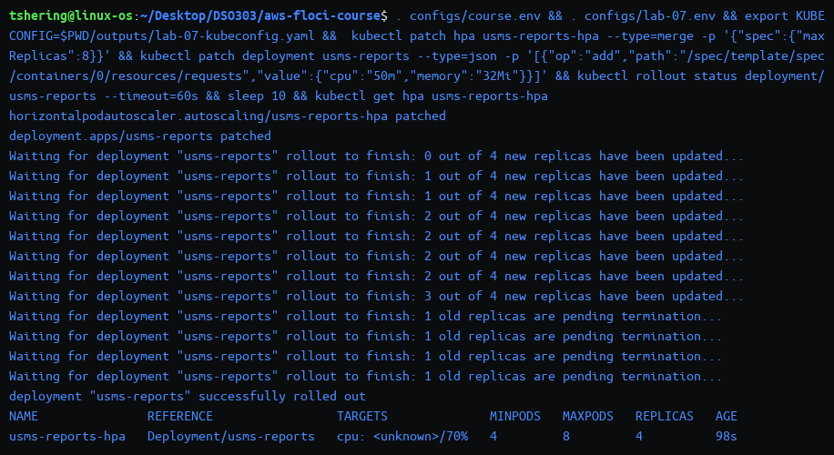

**Confirmed fixed, with room to move in both directions:**

```bash
sleep 25
kubectl get hpa usms-reports-hpa
```

```text
NAME               REFERENCE                 TARGETS       MINPODS   MAXPODS   REPLICAS   AGE
usms-reports-hpa   Deployment/usms-reports   cpu: 0%/70%   4         8         4          2m9s
```

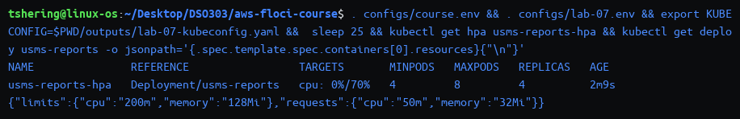

**Cleanup, as required:**

```bash
kubectl delete deployment,hpa usms-reports usms-reports-hpa --ignore-not-found -n usms
```

```text
deployment.apps "usms-reports" deleted from usms namespace
horizontalpodautoscaler.autoscaling "usms-reports-hpa" deleted from usms namespace
```

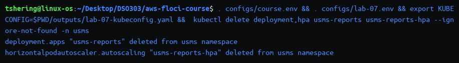

**Result:** a diagnosis backed entirely by command evidence (not the YAML), including the honest correction that the first assumed fault was masked by standard Kubernetes defaulting, and a working HPA with genuine headroom (`4`–`8`) at the end.

---

## Exercise 4 – Challenge: expose the results service properly

**Brief:** reach `usms-results` from the university network at a stable address, on a standard HTTP port, under its own path — without a second `type: LoadBalancer` Service and without exposing `usms-enrolment` the same way.

**Why no second LoadBalancer, in one sentence:** Step 17's own cost comparison makes this concrete — a second `LoadBalancer` Service is a second ALB/NLB on real AWS, a second ongoing bill, where a second **path rule** on the one Ingress this lab already created in Step 16 is free and reuses the one load balancer `usms-gateway`'s `LoadBalancer` Service already justified.

**What already satisfies the brief, verified rather than rebuilt:** Step 16's `usms-portal-ingress` already carries a `/results` path rule pointing at `usms-results:80` on standard port 80 — the "exposure" rung for this exercise is **Ingress (rung 4)**, the same rung `usms-gateway`'s `/` rule and `usms-enrolment`'s `/enrolment` rule occupy, sharing the identical ALB a real AWS Load Balancer Controller would provision from this one object.

```bash
kubectl get svc -n usms -o wide
kubectl describe ingress usms-portal-ingress | grep -E '/results|/enrolment|  /  '
kubectl run usms-debug --rm -i --restart=Never --image=busybox:1.36 --image-pull-policy=IfNotPresent -- \
  wget -qO- http://usms-results.usms.svc.cluster.local/
```

**Output:**

```text
usms-enrolment    ClusterIP      10.100.111.85    <none>        80/TCP
usms-gateway      LoadBalancer   10.100.84.107    172.17.0.4    80:32410/TCP
usms-results      ClusterIP      10.100.73.54     <none>        80/TCP
usms-results-np   NodePort       10.100.184.162   <none>        80:30080/TCP
usms-timetable    ClusterIP      10.100.47.101    <none>        80/TCP
              /enrolment   usms-enrolment:80 (10.42.0.72:80,10.42.0.73:80)
              /results     usms-results:80 (10.42.0.56:80,10.42.0.57:80)
              /            usms-gateway:80 (10.42.0.78:80,10.42.0.80:80)
{"service":"usms-results","pod":"usms-results-7d4678fd86-9vs7q","campus":"rtc","version":"1.0.0"}
```

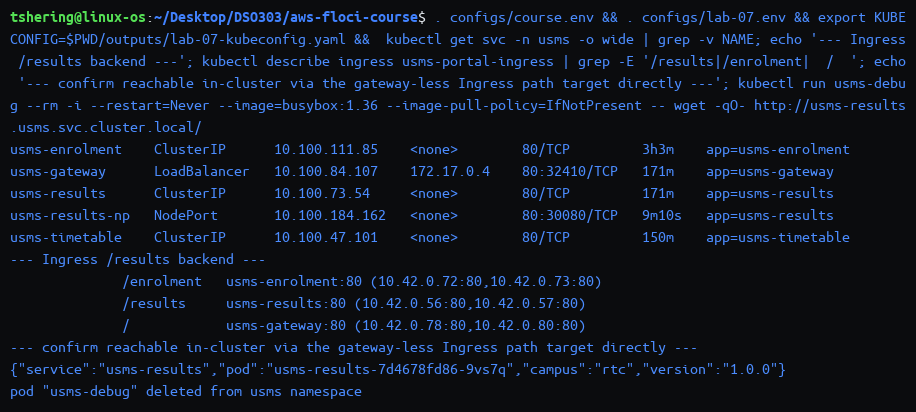

**Each rung, named honestly:** `usms-results-np` (Step 14's NodePort, rung 2) is still live and gives in-cluster-reachable access on a non-standard port (`30080`) with no path concept at all — kept as a lower rung, not deleted, but not the "proper" exposure this exercise asks for. The Ingress's `/results` rule (rung 4) is the proper answer: standard port 80, a dedicated path, and it does not touch `usms-enrolment`'s own exposure at all, satisfying "do not expose enrolment the same way."

**Where this build cannot demonstrate the real result, named precisely:** `kubectl describe ingress` shows `Address:` blank and `kubectl get ingress -o jsonpath='{.status}'` returns `{"loadBalancer":{}}` — no AWS Load Balancer Controller is installed, so no ALB is ever actually provisioned from this Ingress on Floci. On real EKS, the object that would close this gap is the **AWS Load Balancer Controller** itself (an IRSA-authenticated controller pod watching `Ingress` objects), and the annotation already present on this Ingress — `alb.ingress.kubernetes.io/target-type: ip` — is the exact annotation that tells it to register pod IPs rather than instance IDs once it exists.

**Cost question:** zero marginal load balancers — one ALB, now three path rules instead of two, the same conclusion Step 17's exposure table reaches generically. **Failure-mode question:** if the Ingress controller itself were ever unavailable, `usms-results-np`'s NodePort remains as a cluster-internal fallback path, demonstrating why Step 14's "lower rung" was worth keeping rather than deleting once Step 16 was reached.

---

## Exercise 5 – Integration: the artefacts Lab 10 needs, and the argument this practical was for

**Part 1 — `outputs/lab-08-scaling-evidence.json`**, built entirely from live API calls (HPA spec/status, Deployment replica count, node group scaling config, a timestamp):

```bash
HPA_SPEC=$(kubectl get hpa usms-enrolment-hpa -o json)
DEPLOY_REPLICAS=$(kubectl get deploy usms-enrolment -o jsonpath='{.spec.replicas}')
NG=$(aws eks describe-nodegroup --cluster-name "$USMS_EKS_CLUSTER" --nodegroup-name "$USMS_EKS_NODEGROUP" \
       --query 'nodegroup.scalingConfig' --output json)
# ... assembled into outputs/lab-08-scaling-evidence.json and validated
python3 -m json.tool outputs/lab-08-scaling-evidence.json >/dev/null && echo "VALID JSON"
```

```text
VALID JSON
{
  "timestamp": "2026-11-13T15:40:35Z",
  "hpa_spec": { "...": "minReplicas: 2, maxReplicas: 8, behavior block intact" },
  "hpa_status": { "currentReplicas": 2, "desiredReplicas": 2, "lastScaleTime": "2026-11-13T15:24:17Z" },
  "deployment_replicas": 2,
  "nodegroup_scaling": { "minSize": 2, "maxSize": 4, "desiredSize": 2 }
}
```

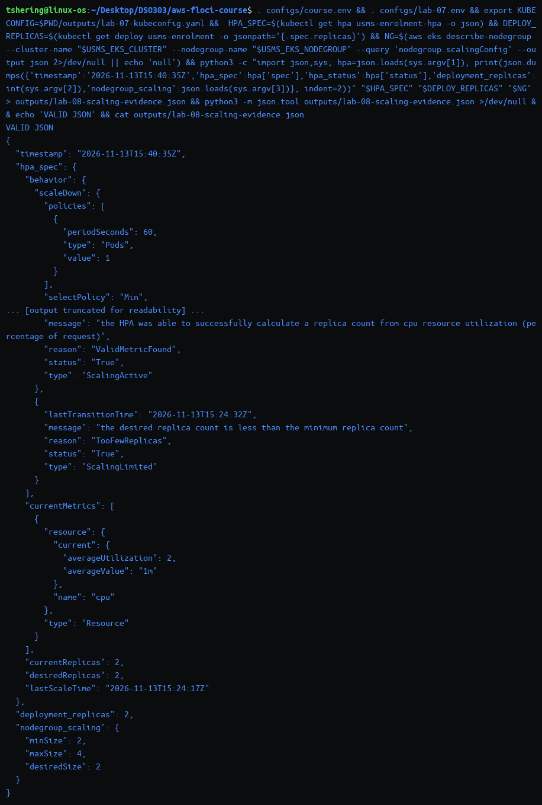

The `nodegroup_scaling` value is `minSize=2, maxSize=4` — the **original** Lab 07 bounds, not the `min 2 / max 6 / desired 3` Step 10 attempted, recorded honestly because `update-nodegroup-config` never actually succeeded on this build (Finding 1 in `notes/lab-08-notes.md`).

**Part 2 — `outputs/lab-08-lab06-readiness.txt`**, re-derived from the live API rather than copied from Lab 07:

```bash
S3_RW_ARN=$(aws iam list-policies --scope Local --query "Policies[?PolicyName=='USMSStudentDataReadWrite'].Arn | [0]" --output text)
aws iam list-entities-for-policy --policy-arn "$S3_RW_ARN" --query 'PolicyRoles[].RoleName' --output text
aws s3api head-bucket --bucket usms-student-data
kubectl get sa usms-enrolment-sa -n usms -o jsonpath='{.metadata.annotations}'
```

```text
Policy ARN: arn:aws:iam::000000000000:policy/USMSStudentDataReadWrite
Roles carrying it: usms-ec2-app-role  usms-ecs-task-role  usms-eks-node-role
Bucket ARN: arn:aws:s3:::usms-student-data
Bucket exists check: aws: [ERROR]: An error occurred (404) when calling the HeadBucket operation: Not Found
IRSA ServiceAccount: usms-enrolment-sa
{"kubectl.kubernetes.io/last-applied-configuration": "..."}   <- no eks.amazonaws.com/role-arn annotation present yet
```

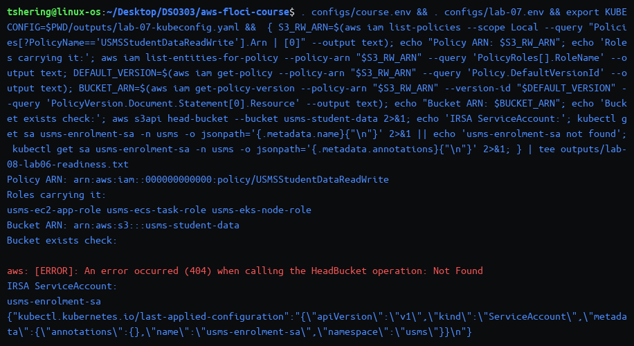

**The ServiceAccount and annotation key, named for Lab 10:** `usms-enrolment-sa` already exists (created in Lab 07 Step 21) but carries no IRSA annotation yet; the key Lab 10 would set once the bucket exists is `eks.amazonaws.com/role-arn`, pointing at a new IAM role trusting the cluster's OIDC provider — the same real, non-`None` OIDC issuer Lab 07 found and registered. The bucket itself is still a clean `404`, exactly as Lab 07 left it — Lab 10 is what creates it.

**Part 3 — "ECS or Kubernetes for USMS"** is appended in full to `notes/lab-08-notes.md` (under 400 words, with a recommendation, the strongest counter-argument, and three specific observations from this lab and Lab 06).

**Validation that nothing under `outputs/` leaks into version control**, without using any `git` command (forbidden in this workspace) — read directly against `.gitignore` instead:

```bash
ls outputs/lab-08-*
grep -n '^outputs/\*' .gitignore
```

```text
outputs/lab-08-after-restart.txt
outputs/lab-08-baseline.txt
outputs/lab-08-before-restart.txt
outputs/lab-08-eviction.json
outputs/lab-08-lab06-readiness.txt
outputs/lab-08-nodegroup-after.json
outputs/lab-08-nodegroup-before.json
outputs/lab-08-scaling-evidence.json
8:outputs/*
```

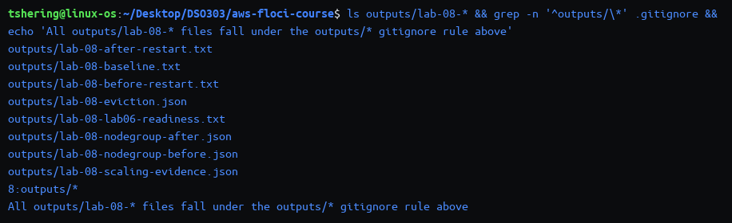

**Result:** two validated artefacts in `outputs/` (both confirmed covered by the `outputs/*` rule), the ServiceAccount and annotation key Lab 10 needs for IRSA named precisely, and the argument section written into `notes/lab-08-notes.md`.
