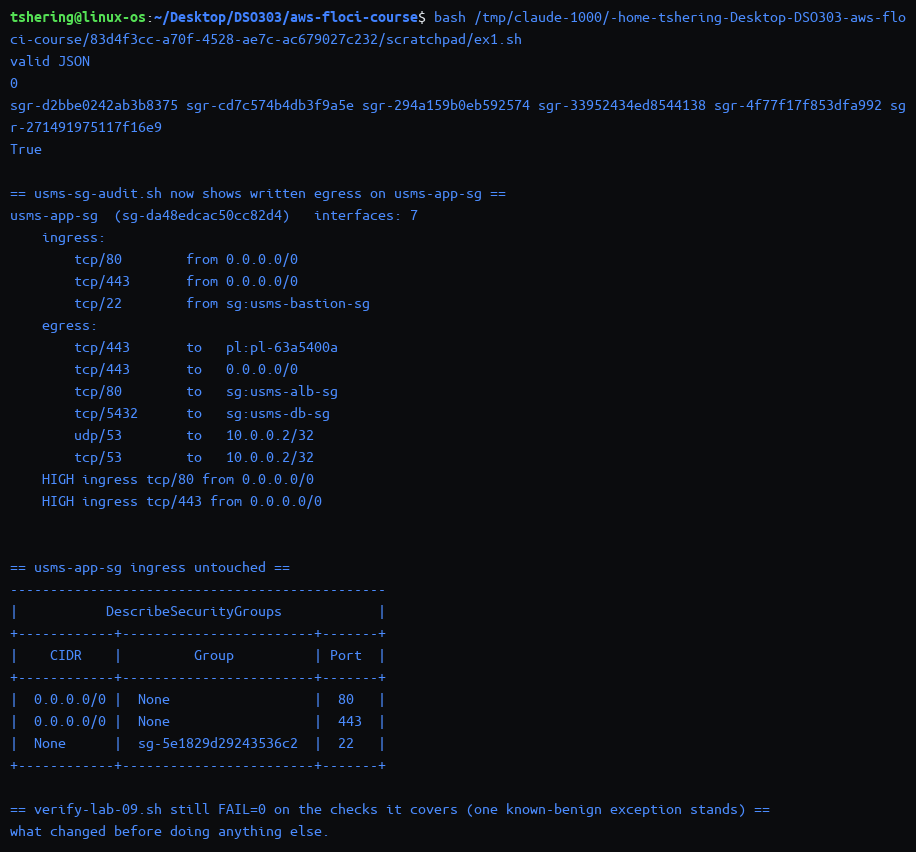
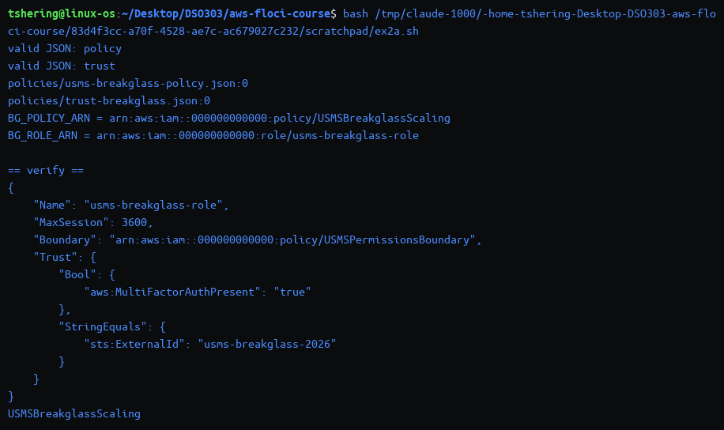
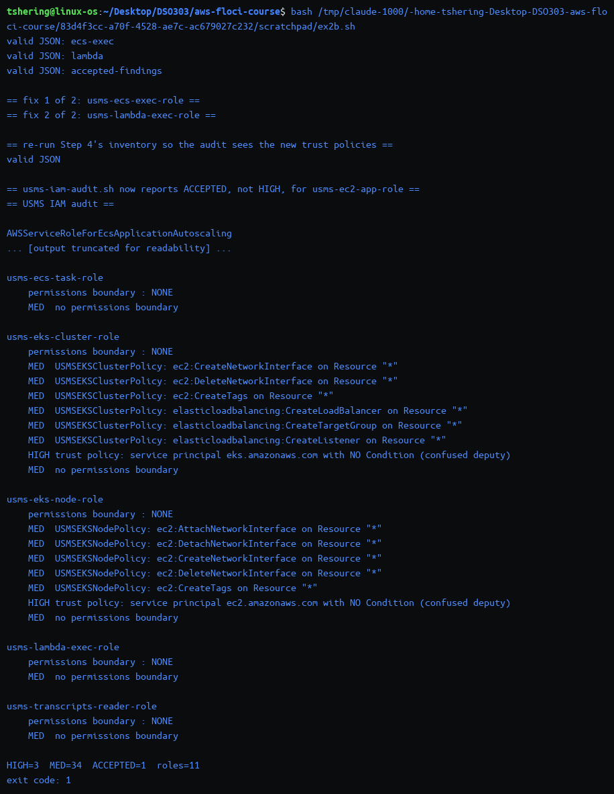
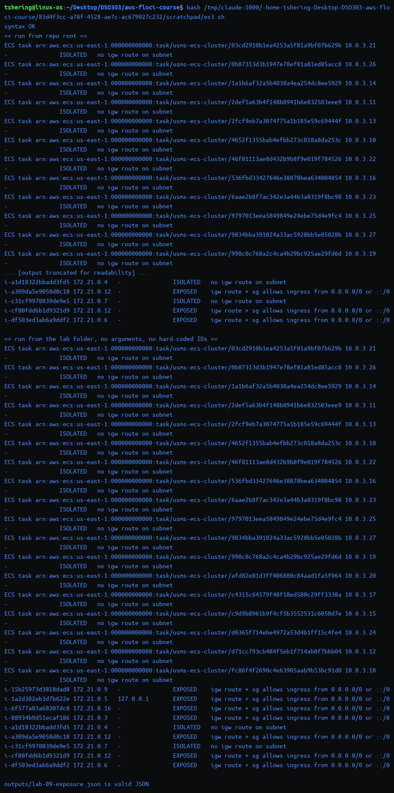
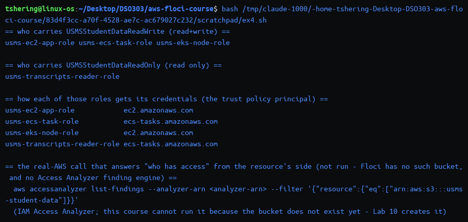
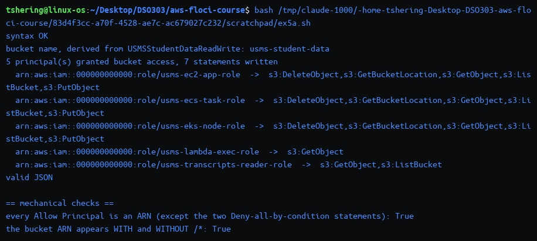
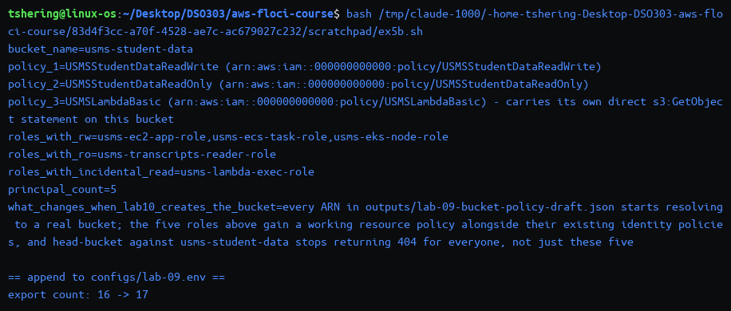

# Independent Lab Exercises (Section 12)

Environment: Floci under Docker Compose, `FLOCI_STORAGE_MODE=hybrid`, account `000000000000`, Path A (full) per Step 3's probe. All output below is from my terminal; screenshots are in `screenshots/lab-9-security/`.

## Exercise 1 – Basic: finish the egress work on the web tier

**Goal:** written egress on `usms-app-sg`, authorised then the default revoked, proven with `usms-sg-audit.sh` and the reachability matrix, while leaving ingress untouched. The web instance must still reach S3 (via the Lab 02 gateway endpoint), AWS service endpoints over HTTPS (including STS for its instance profile), the enrolment API through the Lab 05 load balancer (not the tasks directly), the database tier on PostgreSQL, and DNS.

**`policies/usms-app-sg-egress.json`** — written with real IDs, no heredoc variable needed since the destinations (the S3 prefix list, `usms-alb-sg`, `usms-db-sg`, the VPC resolver) are each a literal value, not a shell substitution:

```json
[
  { "IpProtocol": "tcp", "FromPort": 443, "ToPort": 443,
    "PrefixListIds": [{ "PrefixListId": "pl-63a5400a",
      "Description": "S3 via the Lab 02 gateway endpoint - Lab 10's transcripts" }] },
  { "IpProtocol": "tcp", "FromPort": 443, "ToPort": 443,
    "IpRanges": [{ "CidrIp": "0.0.0.0/0",
      "Description": "HTTPS to AWS service endpoints, including STS for the instance profile - no interface endpoint on this build" }] },
  { "IpProtocol": "tcp", "FromPort": 80, "ToPort": 80,
    "UserIdGroupPairs": [{ "GroupId": "sg-dfbab558544cb59ff",
      "Description": "The enrolment API, through the Lab 05 load balancer - not the tasks directly" }] },
  { "IpProtocol": "tcp", "FromPort": 5432, "ToPort": 5432,
    "UserIdGroupPairs": [{ "GroupId": "sg-63219659d1f806b28",
      "Description": "PostgreSQL to the database tier" }] },
  { "IpProtocol": "udp", "FromPort": 53, "ToPort": 53,
    "IpRanges": [{ "CidrIp": "10.0.0.2/32",
      "Description": "DNS to the VPC's own resolver (base network address + 2) - UDP first, the common case" }] },
  { "IpProtocol": "tcp", "FromPort": 53, "ToPort": 53,
    "IpRanges": [{ "CidrIp": "10.0.0.2/32",
      "Description": "DNS to the VPC's own resolver - TCP fallback for oversized answers" }] }
]
```

**Why these specific destinations, in order:** requirement 1 (S3) is the prefix list the gateway endpoint maintains, exactly as `usms-enrolment-sg`'s Step 13 rule does. Requirement 2 is a plain `0.0.0.0/0` on `443` because this build has no interface endpoint for STS or any other AWS service, so the generic HTTPS rule is the only way to reach it — the honest answer, not a narrower one that would actually break instance-profile credential refresh. Requirement 3's destination is a **group reference**, resolved by reading `configs/lab-05.env`: since Lab 05, the enrolment API means `usms-enrolment-alb` (`sg-dfbab558544cb59ff`), never `usms-enrolment-sg` directly — that distinction is the entire point of the load balancer existing. Requirement 4 is `usms-db-sg` by group, the same group-over-address preference as Steps 14–16. Requirement 5 needs two rules (UDP then TCP) because DNS tries UDP/53 first and falls back to TCP/53 only when a response does not fit in one datagram — the VPC's own resolver sits at the network's base address plus two (Lab 02's `10.0.0.0/16` → `10.0.0.2`), one of the handful of addresses AWS reserves in every subnet.

```bash
aws ec2 authorize-security-group-egress --group-id "$USMS_APP_SG" \
  --ip-permissions file://policies/usms-app-sg-egress.json \
  --query 'SecurityGroupRules[].SecurityGroupRuleId' --output text
aws ec2 revoke-security-group-egress --group-id "$USMS_APP_SG" \
  --ip-permissions file://policies/usms-egress-allow-all.json --query 'Return' --output text
```

**Output:**

```text
valid JSON
0
sgr-d2bbe0242ab3b8375  sgr-cd7c574b4db3f9a5e  sgr-294a159b0eb592574  sgr-33952434ed8544138  sgr-4f77f17f853dfa992  sgr-271491975117f16e9
True
```



**`usms-sg-audit.sh` now shows written egress, no default rule:**

```text
usms-app-sg  (sg-da48edcac50cc82d4)   interfaces: 7
    ingress:
        tcp/80        from 0.0.0.0/0
        tcp/443       from 0.0.0.0/0
        tcp/22        from sg:usms-bastion-sg
    egress:
        tcp/443       to   pl:pl-63a5400a
        tcp/443       to   0.0.0.0/0
        tcp/80        to   sg:usms-alb-sg
        tcp/5432      to   sg:usms-db-sg
        udp/53        to   10.0.0.2/32
        tcp/53        to   10.0.0.2/32
    HIGH ingress tcp/80 from 0.0.0.0/0
    HIGH ingress tcp/443 from 0.0.0.0/0
```

Ingress is exactly as it was before this exercise — `80`/`443` from `0.0.0.0/0` (the two `HIGH` findings Exercise 4 argues about, untouched on purpose) and `22` from `usms-bastion-sg` (Step 16). `verify-lab-09.sh` still reports `PASS=49 FAIL=1`, the one documented, pre-existing exception.

**Why `usms-bastion-sg`'s egress is different in kind, in two sentences:** a workload's egress describes a fixed, enumerable set of destinations its application code actually calls; a jump host's egress exists precisely so an administrator can reach *whatever* in the VPC legitimate operational work requires next, which is not a fixed set known in advance. Its destination should therefore be the VPC's own CIDR (`10.0.0.0/16`) on the administrative protocols actually used, not pinned to one application-shaped group the way `usms-alb-sg`'s egress is pinned to `usms-enrolment-sg`.

**Result:** six written egress rules on `usms-app-sg`, zero allow-all rules remaining, ingress unchanged, `verify-lab-09.sh` unaffected.

---

## Exercise 2 – Intermediate: the break-glass role, and the two findings this lab left open

**Goal, Part A:** `usms-breakglass-role` — assumable only by `usms-admin-01`, requiring MFA and a deliberate `sts:ExternalId`, the shortest max session IAM allows, a permissions boundary, and exactly the Application Auto Scaling calls Lab 06 used to suspend scaling.

**`policies/trust-breakglass.json`:**

```json
{
  "Version": "2012-10-17",
  "Statement": [{
    "Sid": "OnlyTheAdminUserWithMFAAndADeliberateExternalId",
    "Effect": "Allow",
    "Principal": { "AWS": "arn:aws:iam::000000000000:user/usms-admin-01" },
    "Action": "sts:AssumeRole",
    "Condition": {
      "Bool": { "aws:MultiFactorAuthPresent": "true" },
      "StringEquals": { "sts:ExternalId": "usms-breakglass-2026" }
    }
  }]
}
```

**`policies/usms-breakglass-policy.json`** — exactly the four read/register calls `scripts/utilities/verify-lab-06.sh` and `usms-scaling-report.sh` use to inspect and suspend `usms-enrolment-svc`'s scalable target, no wildcard actions, and `Resource: "*"` because Application Auto Scaling does not support resource-level permissions for `RegisterScalableTarget` or the `Describe*` calls — AWS's own documentation requires `"*"` here, so the scope that matters is the **action list**, not this field:

```json
{
  "Version": "2012-10-17",
  "Statement": [{
    "Sid": "SuspendOrResumeEnrolmentScaling",
    "Effect": "Allow",
    "Action": [
      "application-autoscaling:RegisterScalableTarget",
      "application-autoscaling:DescribeScalableTargets",
      "application-autoscaling:DescribeScalingPolicies",
      "application-autoscaling:DescribeScalingActivities"
    ],
    "Resource": "*"
  }]
}
```

**Both conditions in one `Condition` block — AND, not OR, and why:** every condition *operator* block inside a single `Condition` element is always combined with logical AND by IAM's evaluation engine; there is no syntax for OR-ing across operators within one statement (achieving OR semantics would require two separate `Allow` statements, each with one condition, which is a materially different trust policy than "both must hold"). Here AND is also the only correct choice semantically: the role must require *both* a second factor and a caller who deliberately typed the external ID, not either alone — an OR would let MFA substitute for deliberateness or vice versa, defeating the point of a break-glass gate that should never be assumed by accident.

```bash
aws iam create-policy --policy-name USMSBreakglassScaling --policy-document file://policies/usms-breakglass-policy.json
aws iam create-role --role-name usms-breakglass-role \
  --assume-role-policy-document file://policies/trust-breakglass.json \
  --permissions-boundary "$BOUNDARY_ARN" --max-session-duration 3600
aws iam attach-role-policy --role-name usms-breakglass-role --policy-arn "$BG_POLICY_ARN"
```

**Output:**

```text
valid JSON: policy
valid JSON: trust
BG_POLICY_ARN = arn:aws:iam::000000000000:policy/USMSBreakglassScaling
BG_ROLE_ARN = arn:aws:iam::000000000000:role/usms-breakglass-role

== verify ==
{
    "Name": "usms-breakglass-role",
    "MaxSession": 3600,
    "Boundary": "arn:aws:iam::000000000000:policy/USMSPermissionsBoundary",
    "Trust": {
        "Bool": { "aws:MultiFactorAuthPresent": "true" },
        "StringEquals": { "sts:ExternalId": "usms-breakglass-2026" }
    }
}
USMSBreakglassScaling
```



`3600` seconds is the **shortest** `MaxSessionDuration` IAM's `create-role` accepts (the valid range is 3600–43200 seconds); there is no shorter role-level setting, and a shorter *session* would instead be requested per-call via `sts:AssumeRole --duration-seconds`, a separate, narrower parameter this role's own `MaxSessionDuration` merely caps.

**Goal, Part B:** for `usms-ec2-app-role`, `usms-ecs-exec-role` and `usms-lambda-exec-role`, fix the unconditioned trust where possible (two of three), accept the rest with a written reason and a compensating control, and make `usms-iam-audit.sh` report accepted findings as `ACCEPTED` from a committed file.

**Which two can be fixed, and why the third cannot:** `usms-ecs-exec-role` (`ecs-tasks.amazonaws.com`) and `usms-lambda-exec-role` (`lambda.amazonaws.com`) can both be scoped with `aws:SourceAccount` (and, for ECS, `aws:SourceArn`) exactly as Step 7 did for `usms-ecs-task-role`, because both services populate those condition keys when they assume a role on a task's or function's behalf. `usms-ec2-app-role` cannot be fixed the same way: Step 7's own concept block already names this — "`ec2.amazonaws.com` does not send `aws:SourceArn` for instance profiles" — and AWS's own cross-service confused-deputy guidance for EC2 instance roles offers no trust-policy condition for this case at all. The compensating control is Step 11's IMDSv2 requirement: it does not fix the trust policy, but it closes the one path an EC2 confused-deputy risk is actually exploited through (an SSRF bug reaching the instance metadata service).

**`policies/usms-iam-accepted-findings.json`:**

```json
{
  "accepted": [{
    "role": "usms-ec2-app-role",
    "finding": "trust policy: service principal ec2.amazonaws.com with NO Condition (confused deputy)",
    "reason": "EC2 does not send aws:SourceAccount or aws:SourceArn when an instance profile assumes a role on an instance's behalf, so the condition that fixes the other four roles has no equivalent here.",
    "compensating_control": "IMDSv2 required with HttpPutResponseHopLimit=1 on usms-web-01 (Lab 09 Step 11) - closes the SSRF path the confused-deputy risk is actually exploited through."
  }]
}
```

`usms-iam-audit.sh` was extended to take a second argument (the accepted-findings file, defaulting to this path), match each role's findings against it by exact text, and print `ACCEPTED` with the reason and compensating control instead of counting the finding toward `HIGH`.

```bash
aws iam update-assume-role-policy --role-name usms-ecs-exec-role --policy-document file://policies/trust-ecs-exec-scoped.json
aws iam update-assume-role-policy --role-name usms-lambda-exec-role --policy-document file://policies/trust-lambda-scoped.json
./scripts/utilities/usms-iam-audit.sh
```

**Output:**

```text
== fix 1 of 2: usms-ecs-exec-role ==
== fix 2 of 2: usms-lambda-exec-role ==

== usms-iam-audit.sh now reports ACCEPTED, not HIGH, for usms-ec2-app-role ==
...
HIGH=3  MED=34  ACCEPTED=1  roles=11
exit code: 1
```



`HIGH` dropped from 7 to 3. The three that remain (`AWSServiceRoleForEcsApplicationAutoscaling`, `usms-eks-cluster-role`, `usms-eks-node-role`) are the roles Section 3 of this lab explicitly places out of scope — Labs 7/8's EKS estate and Lab 06's service-linked role — so the audit script, which has no scope filter, correctly keeps reporting them, and the exit code staying `1` is the expected, honest outcome of a lab that only promised to fix *this* account's EC2/ECS/IAM estate. The `usms-ec2-app-role` section now reads:

```text
usms-ec2-app-role
    permissions boundary : NONE
    ACCEPTED trust policy: service principal ec2.amazonaws.com with NO Condition (confused deputy)
             reason: EC2 does not send aws:SourceAccount or aws:SourceArn when an instance profile assumes a role on an instance's behalf, so the aws:SourceAccount/aws:SourceArn condition that fixes usms-ecs-task-role, usms-transcripts-reader-role, usms-ecs-exec-role and usms-lambda-exec-role has no equivalent for EC2 instance profiles. AWS's own cross-service confused deputy guidance for EC2 instance roles does not offer a trust-policy condition for this case.
             compensating control: IMDSv2 required with HttpPutResponseHopLimit=1 on usms-web-01 (Lab 09 Step 11). This does not fix the trust policy, but it closes the practical exploitation path...
    MED  no permissions boundary
```

**Result:** a role that cannot be assumed casually (MFA, a deliberate `ExternalId`, a boundary, the IAM floor on session length), two of three open trust-policy findings genuinely fixed, and an audit script that reports a disposition — fixed, accepted-with-a-reason, or still open — rather than a bare count.

---

## Exercise 3 – Problem solving: the exposure report

**Goal:** `scripts/utilities/usms-exposure-report.sh`, classifying every network interface in `usms-vpc` as `EXPOSED` or `ISOLATED`, derived only from each interface's subnet route table, its own public address, and its security group's ingress rules — never from a name, a tag, or a description.

**Design decisions the constraints asked for:**

- **No `set -e`, with a comment saying why:** a single interface with a security group ID not present in this VPC's own snapshot, a subnet with no explicit route-table association (falls back to the VPC's main table, AWS's own rule), or any other partial response must not abort the whole report — one bad interface should be classified `UNKNOWN` and every other interface still gets reported. `set -uo pipefail` stays, because an unset variable or a failed pipeline stage is a programming error in the script itself, not a property of a messy account the report is supposed to tolerate.
- **A public interface with no ingress rule at all (the `usms-nat` row in the lab's own example):** classified `EXPOSED`, deliberately, even though nothing can currently connect to it. The reasoning, in the script's own comment: a route to the internet plus a public IP is reachability *infrastructure*; the absence of a rule is one `authorize-security-group-ingress` call away from exposure, which is a materially different risk from an instance with no IGW route at all. Calling it `ISOLATED` would hide that it already sits on the public side of the network.
- **Resolves `configs/` from `${BASH_SOURCE[0]}`**, so it runs correctly from any directory with no arguments and no hard-coded IDs.

```bash
./scripts/utilities/usms-exposure-report.sh
(cd labs/lab-09-security && /home/tshering/Desktop/DSO303/aws-floci-course/scripts/utilities/usms-exposure-report.sh)
```

**Output (abridged — 27 interfaces total):**

```text
== run from repo root ==
ECS task .../03cd2910b1ea4253a5f81a9bf07b629b 10.0.3.21   -           ISOLATED   no igw route on subnet
ECS task .../0b87313d3b1947e78ef81a81ed85acc8 10.0.3.26   -           ISOLATED   no igw route on subnet
... (fourteen ECS task ENIs, all ISOLATED, all in the private subnet)
i-15b25973d3818dad8  172.21.0.9   -           EXPOSED    igw route + sg allows ingress from 0.0.0.0/0 or ::/0
i-1a2d382eb3d7b622e  172.21.0.5   127.0.0.1   EXPOSED    igw route + sg allows ingress from 0.0.0.0/0 or ::/0
i-88934b9d51ecaf186  172.21.0.3   -           EXPOSED    igw route + sg allows ingress from 0.0.0.0/0 or ::/0
i-a1d18322bbadd3fd5  172.21.0.4   -           ISOLATED   no igw route on subnet
i-c31cf9970839de9e5  172.21.0.7   -           ISOLATED   no igw route on subnet

outputs/lab-09-exposure.json is valid JSON
```



`diff` between the repo-root run and the `labs/lab-09-security/` run was empty — **identical output from both locations**, confirmed directly rather than assumed. Every ECS task ENI (`usms-enrolment-svc`'s own tasks) classified `ISOLATED`, correctly, since they live in the private subnet with no IGW route — the same placement that protects `usms-db-01`/`usms-db-02` (also `ISOLATED`). `i-1a2d382eb3d7b622e` (the tracked `usms-web-01`) and every one of the stray duplicate web instances from earlier Lab 03 runs classify `EXPOSED` identically, since they all share `usms-app-sg`'s public ingress — the exposure report caught the same leftover-instance pattern Lab 09 Finding 3 (`notes/lab-09-notes.md`) found independently, from a completely different signal (route table + security group rules, not instance tags). No ENI in this account's data actually exercised the "public, no ingress rule at all" branch — this Floci build models the ALB and NAT gateway as separate API objects with no backing network interface, so that branch is implemented and justified in the script's own comment, but untested by this account's current live state. Re-running Exercise 1's `usms-app-sg` egress change did not alter any verdict here, exactly as expected — the exposure classifier reads ingress and routing, never egress.

**Result:** a read-only, re-runnable report, identical from any working directory, that classifies every interface in the VPC from rules alone and writes `outputs/lab-09-exposure.json`.

---

## Exercise 4 – Challenge: the security review, written for someone else to act on

The full review — the second front door, what egress control bought and did not, the transcripts access table and how completeness was established, detection coverage, and the written (not run) command sequence for moving the web tier behind the load balancer, each with its four-line danger admonition — is written in full in `notes/lab-09-notes.md` under "Exercise 4 — the security review for the information security officer", since it is prose the information security officer would read, not terminal output. The commands that supplied its evidence:

```bash
aws iam list-entities-for-policy --policy-arn arn:aws:iam::000000000000:policy/USMSStudentDataReadWrite --query 'PolicyRoles[].RoleName'
aws iam list-entities-for-policy --policy-arn arn:aws:iam::000000000000:policy/USMSStudentDataReadOnly --query 'PolicyRoles[].RoleName'
for r in usms-ec2-app-role usms-ecs-task-role usms-eks-node-role usms-transcripts-reader-role; do
  aws iam get-role --role-name "$r" --query 'Role.AssumeRolePolicyDocument.Statement[0].Principal.Service'
done
```

**Output:**

```text
== who carries USMSStudentDataReadWrite (read+write) ==
usms-ec2-app-role  usms-ecs-task-role  usms-eks-node-role

== who carries USMSStudentDataReadOnly (read only) ==
usms-transcripts-reader-role

== how each of those roles gets its credentials (the trust policy principal) ==
usms-ec2-app-role            ec2.amazonaws.com
usms-ecs-task-role           ecs-tasks.amazonaws.com
usms-eks-node-role           ec2.amazonaws.com
usms-transcripts-reader-role ecs-tasks.amazonaws.com

== the real-AWS call that answers "who has access" from the resource's side ==
  aws accessanalyzer list-findings --analyzer-arn <analyzer-arn> --filter '{"resource":{"eq":["arn:aws:s3:::usms-student-data"]}}'
  (IAM Access Analyzer; this course cannot run it because the bucket does not exist yet - Lab 10 creates it)
```



This listing by itself names only four of the eventual five access-granting principals — Exercise 5's statement-by-statement scan is what surfaced the fifth (`usms-lambda-exec-role`'s own direct grant), which is exactly why the review's completeness argument in `notes/lab-09-notes.md` leans on Exercise 5's script rather than on this `list-entities-for-policy` lookup alone.

**Result:** a one-page-per-topic review written for the information security officer, and a destructive command sequence drafted with its danger admonitions but never executed.

---

## Exercise 5 – Integration: the bucket policy the S3 configuration lab will apply

**Goal:** `scripts/utilities/usms-bucket-policy-draft.sh` — reads the Step 4 inventory and every policy document in it, finds **every** role ARN granted **any** `s3:` action on the bucket (not just the two headline policies), and writes `outputs/lab-09-bucket-policy-draft.json` with an Allow per principal limited to the actions it already has, a Deny on insecure transport, and a Deny on every other principal.

**The bucket name is derived, not typed**, using exactly the shell-parameter-expansion technique the constraints asked for, with the comment explaining why no interpreter is invoked for it:

```bash
# A shell parameter expansion, not python, for this one extraction: the bucket
# name is the only thing this script needs before it can even call AWS again
# for the other two policies, and `${VAR#prefix}`/`${VAR%suffix}` trims the
# fixed "arn:aws:s3:::" prefix and the "/*" suffix without invoking an
# interpreter just to strip two literal substrings.
BUCKET_NAME="${BUCKET_ARN#arn:aws:s3:::}"
BUCKET_NAME="${BUCKET_NAME%/*}"
```

```bash
./scripts/utilities/usms-bucket-policy-draft.sh
```

**Output:**

```text
bucket name, derived from USMSStudentDataReadWrite: usms-student-data
5 principal(s) granted bucket access, 7 statements written
  arn:aws:iam::000000000000:role/usms-ec2-app-role  ->  s3:DeleteObject,s3:GetBucketLocation,s3:GetObject,s3:ListBucket,s3:PutObject
  arn:aws:iam::000000000000:role/usms-ecs-task-role  ->  s3:DeleteObject,s3:GetBucketLocation,s3:GetObject,s3:ListBucket,s3:PutObject
  arn:aws:iam::000000000000:role/usms-eks-node-role  ->  s3:DeleteObject,s3:GetBucketLocation,s3:GetObject,s3:ListBucket,s3:PutObject
  arn:aws:iam::000000000000:role/usms-lambda-exec-role  ->  s3:GetObject
  arn:aws:iam::000000000000:role/usms-transcripts-reader-role  ->  s3:GetObject,s3:ListBucket
valid JSON

== mechanical checks ==
every Allow Principal is an ARN (except the two Deny-all-by-condition statements): True
the bucket ARN appears WITH and WITHOUT /*: True
```



**`usms-lambda-exec-role` was not on the list this exercise expected going in** — it carries no `USMSStudentDataReadWrite` or `USMSStudentDataReadOnly` attachment at all. Reading its actual policy document (`USMSLambdaBasic`) showed why: a separate, Lab-01-era statement named `"ReadStudentDataForNotifications"` grants it `s3:GetObject` directly on `usms-student-data/*`, entirely independent of the two headline policies. This is precisely the finding the exercise's instruction to scan "every role ARN granted any `s3:` action" was designed to catch, and it would have been missed by any approach that only checked who carries the two named policies by name — recorded in full in `notes/lab-09-notes.md` Finding 5.

**Part 2 — `outputs/lab-09-lab10-readiness.txt`:**

```text
bucket_name=usms-student-data
policy_1=USMSStudentDataReadWrite (arn:aws:iam::000000000000:policy/USMSStudentDataReadWrite)
policy_2=USMSStudentDataReadOnly (arn:aws:iam::000000000000:policy/USMSStudentDataReadOnly)
policy_3=USMSLambdaBasic (arn:aws:iam::000000000000:policy/USMSLambdaBasic) - carries its own direct s3:GetObject statement on this bucket
roles_with_rw=usms-ec2-app-role,usms-ecs-task-role,usms-eks-node-role
roles_with_ro=usms-transcripts-reader-role
roles_with_incidental_read=usms-lambda-exec-role
principal_count=5
what_changes_when_lab10_creates_the_bucket=every ARN in outputs/lab-09-bucket-policy-draft.json starts resolving to a real bucket; the five roles above gain a working resource policy alongside their existing identity policies, and head-bucket against usms-student-data stops returning 404 for everyone, not just these five

== append to configs/lab-09.env ==
export count: 16 -> 17
```



**Part 5 — contrasting this draft's Deny with `USMSStudentDataReadOnly`'s, in three sentences:** `USMSStudentDataReadOnly`'s `Deny` is an identity-policy Deny — it stops only the specific roles that carry it from ever writing, no matter what the bucket's own policy says, and travels with those roles everywhere. This draft's `DenyEveryPrincipalNotOnTheList` is a resource-policy Deny — it stops *every* principal in the universe, in any account, unless its ARN is explicitly allow-listed, a fundamentally broader reach no identity policy can have. It is also the only one of the two that is ever consulted for a principal in another AWS account at all, since an identity policy attached in this account is never evaluated against a caller whose identity lives somewhere else, while a resource policy on this bucket is evaluated on every request to it regardless of which account the caller comes from.

**Result:** `outputs/lab-09-bucket-policy-draft.json` (valid JSON, every Allow principal an ARN, the bucket ARN present with and without `/*`), `outputs/lab-09-lab10-readiness.txt`, `configs/lab-09.env` now carrying 17 exports, and a fifth access-granting principal found that a name-based lookup alone would have missed.
