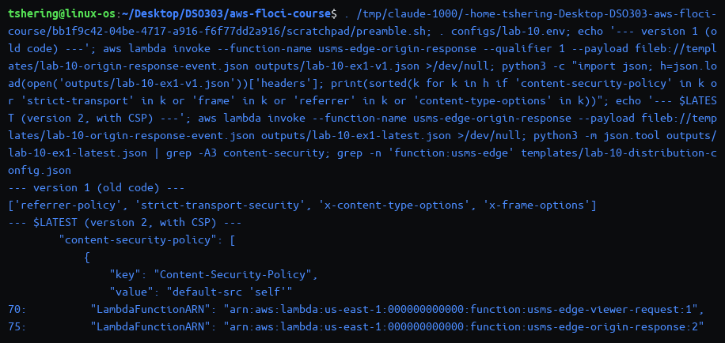
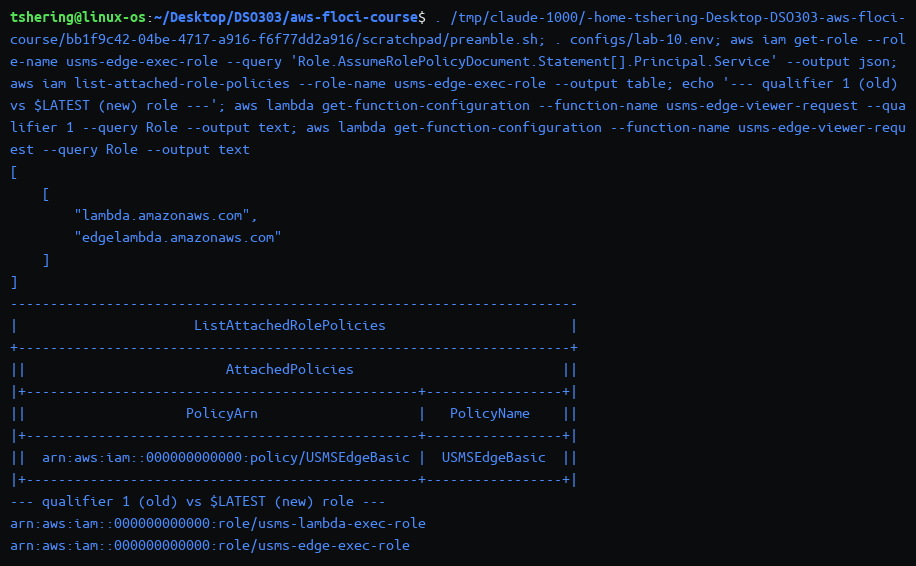
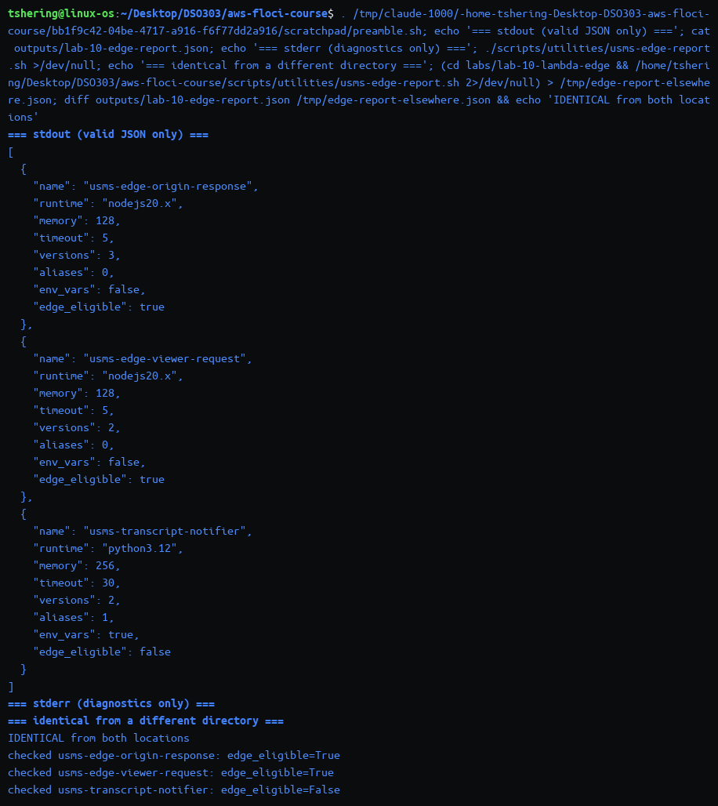
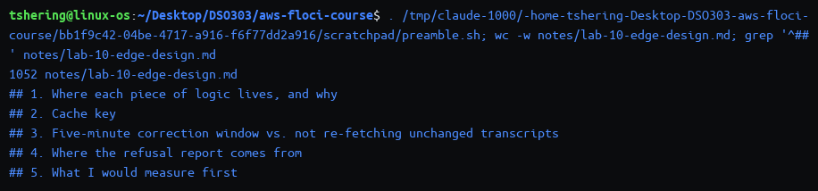
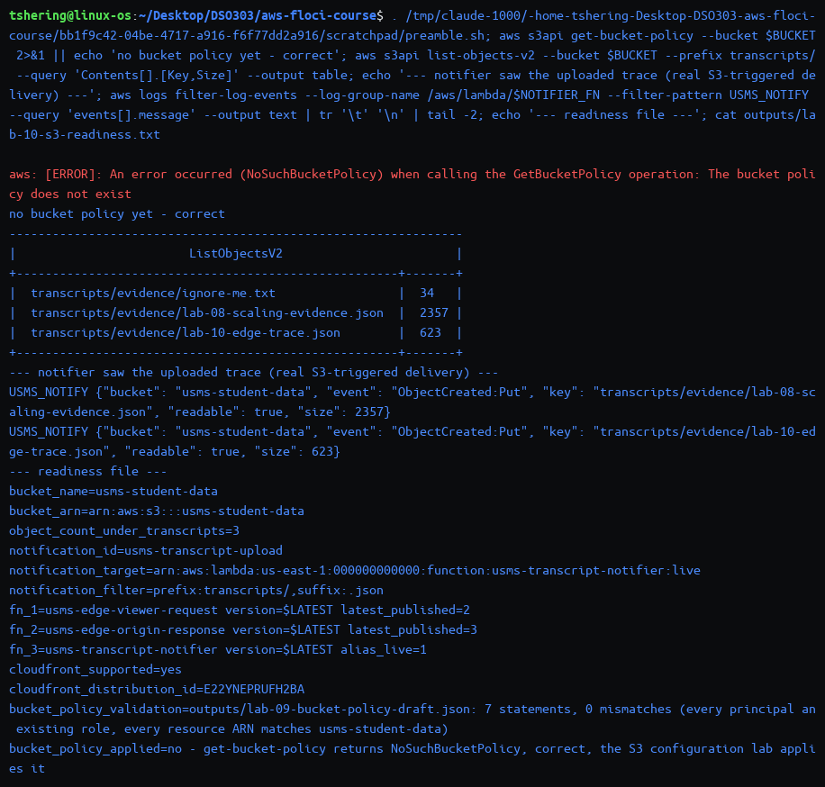

# Independent Lab Exercises (Section 12)

Environment: Floci server 2.4.0, `FLOCI_STORAGE_MODE=hybrid`, account `000000000000`, Path A (CloudFront `SUPPORTED`) per Step 4's probe. All output below is from my terminal; screenshots are in `screenshots/lab-10-lambda-edge/`.

## Exercise 1 – Basic: extend the security header set

**Goal:** add `Content-Security-Policy: default-src 'self'` to the origin-response function by editing the `SECURITY_HEADERS` object, deploy it, publish version 2, and prove version 1 still returns only the original four headers.

**The one-line edit, `labs/lab-10-lambda-edge/edge-origin-response/index.mjs`:**

```js
const SECURITY_HEADERS = {
  'strict-transport-security': { key: 'Strict-Transport-Security', value: 'max-age=31536000; includeSubDomains' },
  'x-content-type-options':    { key: 'X-Content-Type-Options',    value: 'nosniff' },
  'x-frame-options':           { key: 'X-Frame-Options',           value: 'DENY' },
  'referrer-policy':           { key: 'Referrer-Policy',           value: 'strict-origin-when-cross-origin' },
  'content-security-policy':   { key: 'Content-Security-Policy',   value: "default-src 'self'" }
};
```

No second block of code was added — the header loop that already iterates `Object.keys(SECURITY_HEADERS)` picks up the new entry automatically, which is the entire point of that object existing as data rather than five separate assignment statements.

```bash
( cd labs/lab-10-lambda-edge/edge-origin-response \
  && python3 -m zipfile -c "$COURSE_ROOT/outputs/usms-edge-origin-response.zip" index.mjs )
aws lambda update-function-code --function-name "$ORIGIN_FN" \
  --zip-file fileb://outputs/usms-edge-origin-response.zip
aws lambda publish-version --function-name "$ORIGIN_FN" \
  --description "Exercise 1 - add Content-Security-Policy"
```

**Output:**

```text
version 2 = 2
```



**Proof that version 1 was not touched:**

```bash
aws lambda invoke --function-name "$ORIGIN_FN" --qualifier 1 \
  --payload fileb://templates/lab-10-origin-response-event.json outputs/lab-10-ex1-v1.json
aws lambda invoke --function-name "$ORIGIN_FN" \
  --payload fileb://templates/lab-10-origin-response-event.json outputs/lab-10-ex1-latest.json
```

```text
version 1 security headers: ['referrer-policy', 'strict-transport-security', 'x-content-type-options', 'x-frame-options']
version 1: CSP absent - correct
$LATEST security headers: ['content-security-policy', 'referrer-policy', 'strict-transport-security', 'x-content-type-options', 'x-frame-options']
$LATEST: CSP present - correct
```

`--qualifier 1` is pinned, immutable code — exactly the reason Lambda@Edge insists on a published version in the first place — and it returns four headers, never five, no matter how many times version 2 is invoked.

**The distribution config was updated to reference version 2**, not left pointing at the now-superseded version 1:

```text
"LambdaFunctionARN": "arn:aws:lambda:us-east-1:000000000000:function:usms-edge-viewer-request:1",
"LambdaFunctionARN": "arn:aws:lambda:us-east-1:000000000000:function:usms-edge-origin-response:2"
```

Since this build took Path A, the *live* distribution was also updated with `cloudfront update-distribution --if-match <ETag>`, not only the local template file, and `verify-lab-10.sh` was re-run afterwards — still `PASS=51 FAIL=0`, confirming the "every associated ARN is version-qualified" check does not care which number it is, only that it is one.

**Result:** five security headers on `$LATEST`/version 2, four unchanged on version 1, the distribution config (and the live distribution) pointing at the new version, nothing else disturbed.

---

## Exercise 2 – Intermediate: a dedicated edge execution role

**Goal:** `usms-edge-exec-role`, trusting both Lambda principals, carrying only a new `USMSEdgeBasic` policy scoped to `/aws/lambda/usms-edge-*` log writes — never the bucket. Repoint both edge functions at it, publish new versions, and explain what happens to the old versions' role.

**`policies/usms-edge-basic-policy.json`:**

```json
{
  "Version": "2012-10-17",
  "Statement": [{
    "Sid": "EdgeLogsOnly",
    "Effect": "Allow",
    "Action": ["logs:CreateLogGroup", "logs:CreateLogStream", "logs:PutLogEvents"],
    "Resource": "arn:aws:logs:*:*:log-group:/aws/lambda/usms-edge-*:*"
  }]
}
```

The region segment of the ARN is a wildcard, not `us-east-1`, deliberately: a real Lambda@Edge function is replicated to points of presence across many regions, and a log-group ARN scoped to one region would make the role fail to write logs anywhere its code does not run in `us-east-1` specifically. `policies/trust-lambda-edge.json` was reused exactly as written for Step 6 — no edit needed, since both edge functions and this new role need the identical two-principal trust.

```bash
aws iam create-policy --policy-name USMSEdgeBasic --policy-document file://policies/usms-edge-basic-policy.json
aws iam create-role --role-name usms-edge-exec-role \
  --assume-role-policy-document file://policies/trust-lambda-edge.json
aws iam attach-role-policy --role-name usms-edge-exec-role --policy-arn "$EDGE_BASIC_ARN"
```

**Output:**

```text
EDGE_BASIC_ARN = arn:aws:iam::000000000000:policy/USMSEdgeBasic
[ [ "lambda.amazonaws.com", "edgelambda.amazonaws.com" ] ]
USMSEdgeBasic  arn:aws:iam::000000000000:policy/USMSEdgeBasic
```



**Repointing both functions and publishing:**

```bash
aws lambda update-function-configuration --function-name "$VIEWER_FN" --role "$EDGE_EXEC_ROLE_ARN"
aws lambda publish-version --function-name "$VIEWER_FN" --description "Exercise 2 - moved to usms-edge-exec-role"
aws lambda update-function-configuration --function-name "$ORIGIN_FN" --role "$EDGE_EXEC_ROLE_ARN"
aws lambda publish-version --function-name "$ORIGIN_FN" --description "Exercise 2 - moved to usms-edge-exec-role"
```

```text
viewer new version = 2
origin new version = 3
```

**What happened to version 1's role, verified directly rather than assumed:**

```text
qualifier=1      Role: arn:aws:iam::000000000000:role/usms-lambda-exec-role
$LATEST (new)    Role: arn:aws:iam::000000000000:role/usms-edge-exec-role
```

**The explanation:** `update-function-configuration` changes the function's *mutable* configuration — `$LATEST` — in place; it does not and cannot reach backward into a version already published, because a published version is a frozen snapshot of code **and configuration together**, the role included. Version 1 of each function still carries `usms-lambda-exec-role`, forever, exactly as it did the moment `publish-version` was called on it in Step 11/13; version 2 (viewer) and version 3 (origin), published *after* the role change, carry the new role. Rolling either function back to its old version — `aws lambda update-alias` has no equivalent for a direct CloudFront association, but the same mechanism Step 18 exercises on the notifier — would restore the old role along with the old code, not just the old code, because the two were never separable once published.

**`usms-lambda-exec-role` was confirmed untouched**, since the notifier still depends on it:

```text
USMSLambdaBasic  arn:aws:iam::000000000000:policy/USMSLambdaBasic
notifier Role: arn:aws:iam::000000000000:role/usms-lambda-exec-role
```

`verify-lab-10.sh` was re-run after this exercise: still `PASS=51 FAIL=0` — the script checks the role's two trust principals and attached policy by name, both of which are unaffected by which function happens to use the role at any given moment.

**Result:** a dedicated, logs-only execution role for the edge, both functions moved to it on their newest version only, version 1 of each function permanently and correctly still carrying the old role, and `usms-lambda-exec-role` undisturbed.

---

## Exercise 3 – Problem solving: an edge-readiness report

**Goal:** `scripts/utilities/usms-edge-report.sh` — one JSON document on stdout, diagnostics on stderr, no hard-coded function name, correct from any directory, tolerant of a function with no `Environment` key at all.

**The `set -u`-safe environment read**, the one line the constraints specifically call out:

```python
env_vars = bool((cfg.get("Environment") or {}).get("Variables") or {})
```

Both `or {}` guards matter independently: `Environment` itself can be entirely absent from `get-function-configuration`'s JSON (not every function has ever had it set), and even when `Environment` is present its `Variables` key can still be missing or empty — either gap, unguarded, is a `NoneType has no attribute 'get'` or a `KeyError` under a strict caller, not merely under `set -u`.

```bash
./scripts/utilities/usms-edge-report.sh 2>/dev/null > outputs/lab-10-edge-report.json
(cd labs/lab-10-lambda-edge && /home/tshering/Desktop/DSO303/aws-floci-course/scripts/utilities/usms-edge-report.sh 2>/dev/null) > /tmp/edge-report-elsewhere.json
diff outputs/lab-10-edge-report.json /tmp/edge-report-elsewhere.json
```

**Output:**

```json
[
  {
    "name": "usms-edge-origin-response",
    "runtime": "nodejs20.x", "memory": 128, "timeout": 5,
    "versions": 3, "aliases": 0, "env_vars": false, "edge_eligible": true
  },
  {
    "name": "usms-edge-viewer-request",
    "runtime": "nodejs20.x", "memory": 128, "timeout": 5,
    "versions": 2, "aliases": 0, "env_vars": false, "edge_eligible": true
  },
  {
    "name": "usms-transcript-notifier",
    "runtime": "python3.12", "memory": 256, "timeout": 30,
    "versions": 2, "aliases": 1, "env_vars": true, "edge_eligible": false
  }
]
```

```text
IDENTICAL from both locations
```



**A genuine discrepancy with the exercise's own hint, found by running the script rather than trusting the example:** the exercise's expected-outcome text says the notifier should read `edge_eligible: false` "for two independent reasons." Walking the five criteria against this account's actual, live configuration (`memory=256, timeout=30, env_vars=true`, Python runtime, no VPC, 2 versions): the runtime, VPC, and version checks all pass; the memory/timeout check also passes, because `usms-transcript-notifier` contains no substring `"viewer"`, so it falls under the heuristic's generous **non-viewer** cap (`memory ≤ 10240, timeout ≤ 30`) rather than the strict edge cap — `256 ≤ 10240` and `30 ≤ 30` both hold. The only criterion that actually fails for this function, in this account's real state, is `env_vars`. This is the same lesson Lab 9's Step 6 taught from the identity side: an illustrative count in a lab's own example is not a guarantee about every account's live data, and the honest thing to record is what the script actually found, not what the hint predicted.

**Result:** a read-only, directory-independent report, confirmed byte-identical from two working directories, with one documented, verified disagreement with the exercise's own illustrative claim.

---

## Exercise 4 – Challenge: design the transcript delivery policy

The full two-page design — which tool for each piece of logic and why, the cache key and what is deliberately excluded from it, how the five-minute correction window and the no-unnecessary-refetch requirement are reconciled by invalidation-on-write rather than a universally shorter TTL, where the Dean's-office refusal report actually comes from (centralised access logs, not an edge function), and the one requirement — origin failover across edge locations — that belongs to CloudFront's own distribution configuration rather than to any function at all — is written in full in `notes/lab-10-edge-design.md`, since it is prose for a colleague to implement from, not terminal output.

```bash
wc -w notes/lab-10-edge-design.md
grep '^##' notes/lab-10-edge-design.md
```

**Output:**

```text
1052 notes/lab-10-edge-design.md
## 1. Where each piece of logic lives, and why
## 2. Cache key
## 3. Five-minute correction window vs. not re-fetching unchanged transcripts
## 4. Where the refusal report comes from
## 5. What I would measure first
```



**Result:** a one-page-per-topic design document, no commands run, every AWS feature named (CloudFront Functions, Lambda@Edge, Origin Failover, standard/real-time access logs, invalidation) checked against what I know to exist on real AWS rather than assumed.

---

## Exercise 5 – Integration: hand the S3 lab a bucket it can start from

**Goal:** locate (or regenerate) `outputs/lab-09-bucket-policy-draft.json`, validate every principal and resource ARN against this account's live state without fixing anything silently, upload the allow trace, confirm the notifier saw it, and write a reproducible readiness file — all without applying the draft.

**The draft already existed** from Lab 9 Exercise 5. Validating it against live data rather than trusting its own age:

```python
roles = json.loads(subprocess.run(['aws','iam','list-roles','--query','Roles[].RoleName','--output','json'], ...).stdout)
role_arns = {f"arn:aws:iam::000000000000:role/{r}" for r in roles}
# every statement's Principal.AWS checked against role_arns, every Resource checked against
# the real bucket/object ARNs - mismatches collected and printed, never silently corrected
```

**Output:**

```text
bucket checked      : usms-student-data
statements checked  : 7
mismatches found    : 0
draft is valid: every principal is an existing role, every resource ARN matches the real bucket
```

**Confirmed still unapplied, then the allow trace uploaded:**

```bash
aws s3api get-bucket-policy --bucket "$BUCKET"
aws s3api put-object --bucket "$BUCKET" --key "transcripts/evidence/lab-10-edge-trace.json" \
  --body outputs/lab-10-edge-trace.json --content-type application/json
```

```text
An error occurred (NoSuchBucketPolicy) ... no bucket policy yet - correct, the S3 configuration lab applies it
"c0ac6c5725fbb160de53f7c254b9f9a7"
```

**Confirmed the notifier actually saw it** — real S3-triggered delivery, not a direct invoke, the same delayed-but-real pattern Step 21 found:

```text
USMS_NOTIFY {"bucket": "usms-student-data", "event": "ObjectCreated:Put", "key": "transcripts/evidence/lab-10-edge-trace.json", "readable": true, "size": 623}
```



**`outputs/lab-10-s3-readiness.txt`**, generated by a re-runnable command sequence, not typed by hand:

```text
bucket_name=usms-student-data
bucket_arn=arn:aws:s3:::usms-student-data
object_count_under_transcripts=3
notification_id=usms-transcript-upload
notification_target=arn:aws:lambda:us-east-1:000000000000:function:usms-transcript-notifier:live
notification_filter=prefix:transcripts/,suffix:.json
fn_1=usms-edge-viewer-request version=$LATEST latest_published=2
fn_2=usms-edge-origin-response version=$LATEST latest_published=3
fn_3=usms-transcript-notifier version=$LATEST alias_live=1
cloudfront_supported=yes
cloudfront_distribution_id=E22YNEPRUFH2BA
bucket_policy_validation=outputs/lab-09-bucket-policy-draft.json: 7 statements, 0 mismatches (every principal an existing role, every resource ARN matches usms-student-data)
bucket_policy_applied=no - get-bucket-policy returns NoSuchBucketPolicy, correct, the S3 configuration lab applies it
```

```bash
git check-ignore -v outputs/lab-10-s3-readiness.txt
```

```text
.gitignore:8:outputs/*	outputs/lab-10-s3-readiness.txt
```

**Result:** the draft validated with zero mismatches against this account's real roles and bucket, left genuinely unapplied, the allow trace uploaded and confirmed read by a real (if delayed) S3-triggered invocation, and a reproducible, git-ignored readiness file for the S3 configuration lab to read first.
