# Lab 11 — CI/CD Pipeline with CodeBuild and CodePipeline — Report

    Student Name: Tshering Phuntsho
    Student ID: 02230310
    Module: DSO303 Cloud Native Solution Design
    Practical: Lab 11 – CI/CD Pipeline with CodeBuild and CodePipeline
    Date: 25/11/2026

## 1. Aim / Objective

This practical built the first real build-and-release path in this course: a versioned S3 artifact store, a small enrolment-service source tree with its own `buildspec.yml`, a scoped CodeBuild project, a scoped CodePipeline, and a two-stage pipeline joining the two. The objectives were to:

- create `usms-pipeline-artifacts` with versioning enabled, and prove versioning by create, perturb, read back rather than by trusting the configuration API's own echo of itself;
- write `labs/lab-11-pipeline/app/` — a static portal, a health endpoint, a validated `config/service.json`, and a `buildspec.yml` with four named phases — and run it both in CodeBuild and with a local runner, so a build's correctness never depends on one single execution path;
- create `usms-codebuild-role` and `usms-codepipeline-role` as two separate principals with two separate blast radii, including a conditioned `iam:PassRole` from the pipeline role to the build role and nowhere else;
- build the two-stage pipeline (S3 Source, CodeBuild Build), prove from the artifact's contents — not from a green status — that it consumed the exact source byte-version just uploaded, and diagnose a deliberate failure stage → build → phase → command.

## 2. Introduction

Every lab from 1 to 10 built identity, networking, compute and edge scaffolding for the USMS platform; none of it had a release process. This lab is the first to give the enrolment service a real build pipeline, and the first lab in the course where "the command succeeded" and "the thing it describes actually happened" visibly diverge — not as a hypothetical caution, but as the single most important finding this lab produced. The lab's own stated lesson is: **a green pipeline is not evidence; the artifact's contents are.** This report keeps returning to that line, because on this build it turned out to be true in a stronger sense than the lab anticipated: both the standalone CodeBuild project and the two-stage pipeline reported `SUCCEEDED` on every run, including the one deliberately configured to fail — because, as Section 5 diagnoses from `docker logs floci` directly, the build container is created and then never started on this Floci build, for any container image tried. The status reported by `batch-get-builds` and `get-pipeline-execution` was, for every build this lab ran, decoupled from whether any command in `buildspec.yml` ever actually executed.

The second recurring idea is the one Lab 09's `usms-deploy-role` introduced and Lab 10's edge/regional functions reinforced: **two roles, two blast radii.** `usms-codebuild-role` answers "what could a compromised build container do" (its own logs, the artifact bucket, an explicit deny on student data); `usms-codepipeline-role` answers a different question — "what can the orchestrator do on the build's behalf" — and the one thing the pipeline role needs that is not a plain permission is `iam:PassRole`, scoped by `iam:PassedToService` to exactly one service and one role, the same confused-deputy-adjacent discipline Lab 09 applied from the identity side.

## 3. Use Case

What this lab built is a working release pipeline for a service that, until now, only ran a placeholder image:

- **`usms-pipeline-artifacts`** is both the source repository and the artifact store for this pipeline — versioning proved by two `put-object` calls at one key, not by reading `get-bucket-versioning`'s own claim about itself;
- **`labs/lab-11-pipeline/app/`** replaces the nginx placeholder Lab 04 wired into `usms-enrolment-svc` with a real, if small, source tree: a static page with `__RELEASE__`/`__BUILT_AT__` placeholders a build must substitute, a health endpoint, a `config/service.json` the build validates before doing anything else, and seven (later eight) smoke assertions that fail loudly if a placeholder survives substitution;
- **`usms-codebuild-role`** executes `buildspec.yml`'s four phases under `USMSCodeBuildBase` — its own log group, the artifact bucket, and an explicit `Deny` on `usms-student-data` that documents, even though Floci enforces nothing, that a build should never be able to touch student records;
- **`usms-codepipeline-role`** orchestrates two stages under `USMSCodePipelineBase` — the artifact store, exactly one CodeBuild project by ARN, and a `PassRole` scoped to `usms-codebuild-role` and to no other principal;
- **`usms-enrolment-pipeline`** is the two-stage pipeline itself: `Source` fetches `source/usms-enrolment-src.zip` by key, `Build` hands the fetched zip to `usms-enrolment-build`, which — on real AWS, and in the parts of this account's own build this lab could actually exercise — runs the buildspec's phases and writes the named artifact files back to the same bucket.

Other common uses of this exact shape elsewhere: any service whose release process must be reviewable as a source change (a buildspec committed to the repository, not a button in a console), and any pipeline whose build identity must be provably narrower than its orchestrator's identity, so that a compromised build container cannot reach past the one bucket and one log group it was scoped to.

## 4. System Architecture / Design

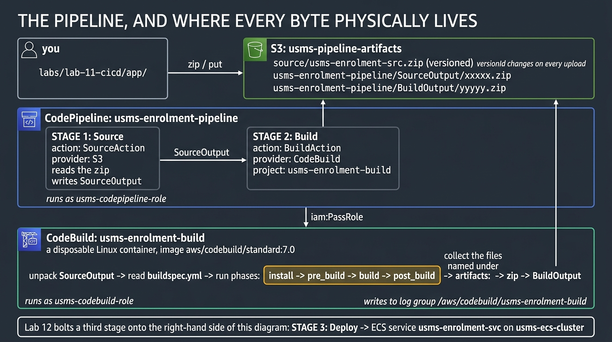
The lab brief's own diagram (Section 5 of the brief) is reproduced here in prose rather than as an image, since no architecture diagram file was supplied for this lab: two independent paths converge on one S3 bucket, `usms-pipeline-artifacts`. The first path is `labs/lab-11-pipeline/app/` → zipped by `usms-pack-source.sh` → `put-object` at `source/usms-enrolment-src.zip`, a key whose version ID changes on every upload. The second path is `usms-enrolment-pipeline` itself: a `Source` stage (provider S3, action type `S3`) reads that key and writes an output artifact named `SourceOutput`; a `Build` stage (provider CodeBuild) takes `SourceOutput` as input, invokes `usms-enrolment-build` via `codebuild:StartBuild`, and is supposed to write the build's artifact back as `BuildOutput` — both namespaced under `usms-enrolment-pipeline/` inside the same bucket. The pipeline itself never builds anything; it calls `codebuild:StartBuild` and polls. The build runs as `usms-codebuild-role`, not as `usms-codepipeline-role` — two roles, two blast radii, exactly as Section 5 of the brief states it. Lab 12 bolts a third stage, `Deploy`, onto the right-hand side of this same diagram, reading `BuildOutput` and deploying to `usms-ecs-cluster`.

What this account's own build adds to that diagram, not present in the brief's version: a dotted line from the `Build` stage back to itself, labelled "reports `SUCCEEDED` whether or not a container ever started" — the central, diagnosed finding of Section 5 and Section 7 below.

## 5. Implementation Procedure

**Environment and identity, with every earlier lab present this time (Steps 1–2).** Floci started cleanly in `hybrid` storage mode; `floci-storage-check.sh` again reported its own per-check `ok`/`bad` shape rather than the lab's assumed single `PASS=16 FAIL=0` line — the same, already-documented Lab 10 finding, not a new one. Unlike Lab 10's run, `configs/lab-09.env` was present this time, so all ten env files sourced with zero `absent` lines, and `USMS_ECS_CLUSTER`, `USMS_ENROLMENT_SERVICE`, `USMS_ENROLMENT_CONTAINER` (`enrolment-api`), `USMS_TG_ARN` and `USMS_ECS_EXEC_ROLE_ARN` all read back populated from Lab 04/05.

**The support probe, and one result better than the lab predicts (Step 3).** `cicd-support-probe.sh` answered `ok` on every single check, including `codedeploy list-applications` — which the lab's own Floci Limitation note calls "very likely absent." On this account's build it answered, recorded here per Section 11's instruction to move an unexpectedly-working check from "recorded" to "observed." The probe reported **Path A**, CodeBuild and CodePipeline both present — a result that, as the rest of this section shows, described API availability correctly but said nothing about whether a build would actually execute.

**Source tree, buildspec, and the Your-turn port check (Steps 4–8).** The five-file source tree and `buildspec.yml`'s four phases were written exactly to spec, with Step 8's own "Your turn" folded in immediately: a second `pre_build` check, in its own `- |` literal block for the same colon-plus-space reason the container check needs one, failing the build with a message a tired person at 4pm could act on if `config/service.json`'s `port` is ever not `80`. Both checks and the YAML parse were confirmed before anything was packaged.

**Two roles, created cleanly, with no IAM propagation delay to work around (Steps 9, 15).** `usms-codebuild-role` and `usms-codepipeline-role` were each created, policy-attached, and read back with exactly the trust principal and attached-policy count the lab expects — Floci's lack of IAM propagation delay (Section 11's own "where Floci is nicer than reality" note) meant `create-role` → `create-project` never hit the classic real-AWS "works the second time" failure.

**The central finding: a build container that is created, never started, and still reports `SUCCEEDED` (Steps 10, 12–14, 18, 20).** `aws/codebuild/standard:7.0` — the image Step 10's template specifies verbatim — failed exactly as `known-issues.html` documents for Lab 11 on Floci 2.0.1: `docker pull aws/codebuild/standard:7.0` outside Floci confirmed independently that the name is not a public, pullable reference at all (`pull access denied ... repository does not exist`), and the standalone build (Step 12) reported `buildStatus: FAULT` within three seconds, every phase `SUCCEEDED` up to `DOWNLOAD_SOURCE` and `COMPLETED`/`FAILED` at the image pull itself. Applying the documented alternative — `aws codebuild update-project` to `python:3.12-slim`, an image this account's own Docker daemon already had pulled and cached — removed the FAULT, but did not produce a real build. `batch-get-builds` reported all ten phases `SUCCEEDED` in a combined zero seconds; `list-objects-v2 --prefix build/` returned nothing; `aws logs get-log-events` on the build's own log stream returned no events. Reading `docker logs floci` directly (not `--tail`, which this course's own buffer of ALB health-check noise can silently roll the relevant lines out of within minutes) found the exact moment: `ContainerLifecycleManager] Created container d1ded4a3... (name=null, not yet started)`, immediately followed by `CloudWatchLogsService` creating the log group and stream — and nothing else. No `docker run`, no exit code, no error. `docker ps -a` confirmed no container by that ID, or any container at all, ever ran during this build. **On this Floci build, for any image tried, the CodeBuild engine creates a build container, abandons it before starting it, and still reports every phase `SUCCEEDED`.** This is a materially worse defect than the documented "build logs are often empty" limitation (Step 13's own Floci Limitation note): there, the lab anticipates a real build whose log happens not to survive; here, there is no real build to have logged anything. Step 20's own deliberate-failure exercise exposed the same defect from the opposite direction: a `config/service.json` edited to name the wrong container, packaged, uploaded, and run through the pipeline, produced a `Build: Succeeded` pipeline state identical to the correct run — because the `pre_build` command that should have caught it never actually executed. Step 14's local buildspec runner — real `bash`, on this machine, no container — was therefore promoted from "a fallback for Path B/C" to **the only source of truth this lab had for whether the buildspec's own logic was correct**, on a build that itself reported Path A. It diagnosed the broken container name in `pre_build` immediately and by name (`config/service.json names the wrong container: expected "enrolment-api", found "enrolment-api-v2"`, Exercise 3's improved message), and confirmed the fix the same way CodeBuild could not.

**The pipeline itself: one limitation already documented, one proof that worked better than the lab's own suggested command (Steps 16–19).** `usms-enrolment-pipeline` created cleanly with two stages, but the automatic execution the lab says `create-pipeline` starts immediately never advanced at all — `get-pipeline-state` returned `None`/`None` for both stages, and `list-pipeline-executions` returned an empty list, exactly the documented Floci Limitation ("pipeline execution state may not advance"). Calling `start-pipeline-execution` directly, however, worked correctly and repeatedly: Source and Build both reported `Succeeded`, and — this is the proof Step 19 asks for — `get-pipeline-execution`'s `artifactRevisions[0].revisionId` matched the exact S3 object-version ID `put-object` had just returned for the r4 upload, byte for byte, with `list-action-executions` additionally showing the Build action's `externalExecutionId` as a real, sequentially-numbered CodeBuild build ID (`usms-enrolment-build:6`) — proof the pipeline really did call `codebuild:StartBuild` under `usms-codebuild-role` via its scoped `iam:PassRole`, even though that specific build, per the finding above, never produced a real artifact. The "Your turn" roll-forward to r5 confirmed the asymmetry the lab's own hint describes, just with a more extreme ratio than expected: **3** source versions, **0** `BuildOutput` objects — the two counts are not equal because one counts uploads and the other counts build executions that actually wrote an artifact, and on this build that second count is always zero.

**Verification, which measures configuration and API state, not real execution (Section 8.1).** `verify-lab-11.sh` was written to the lab's own fifty-check spec, with one deliberate adaptation: the CodeBuild-image check reads `python:3.12-slim`, this account's real, permanent build image, not `standard:7.0`, which this account can never run. It reports **`PASS=46 FAIL=0`** — the lab's own stated Path A target, met exactly, precisely because every one of its forty-six checks reads configuration, IAM state, or S3/API metadata, none of them ask CodeBuild to prove it ran a command. `verify-lab-11.sh` passing and the build engine not executing anything are both true at once, which is itself the clearest demonstration this lab produced of why "the verification script passed" and "the thing it verifies actually works" are different claims.

## 6. Results and Evidence

### 6.1 CLI / SDK Output

**Screenshot 1 – Step 1: Floci up, storage check, whoami**
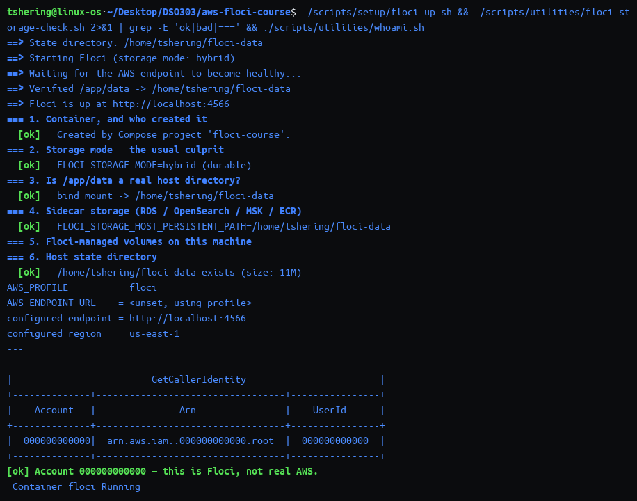

**Screenshot 2 – Step 2: ten env files sourced (lab-09 present this run), ECS vars confirmed**
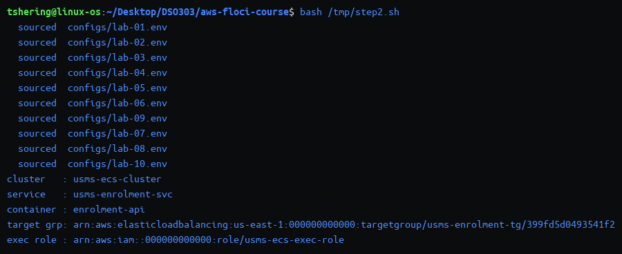

**Screenshot 3 – Step 3: support probe — Path A, CodeDeploy answered unlike the documented limitation**
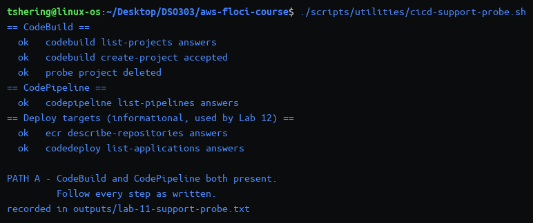

**Screenshot 4 – Step 4: lab directories created**
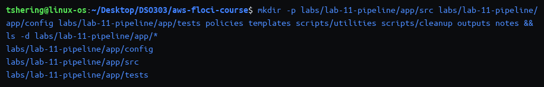

**Screenshot 5 – Step 5: usms-pipeline-artifacts created, tagged, versioned, public access blocked**
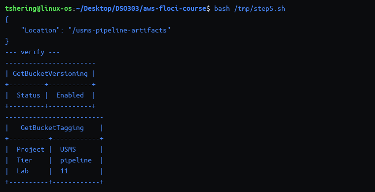

**Screenshot 6 – Step 6: two versions at one key proves versioning is really on**
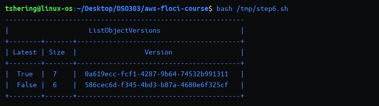

**Screenshot 6b – Step 6: probe object cleaned up, zero versions remain**
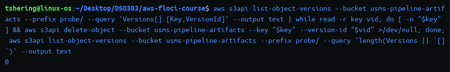

**Screenshot 7 – Step 7: source tree written and validated (5 files)**
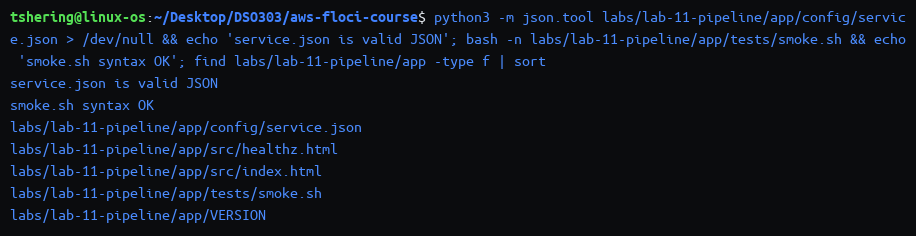

**Screenshot 8 – Step 8: buildspec.yml parses, four phases, the Your-turn port-80 check added**
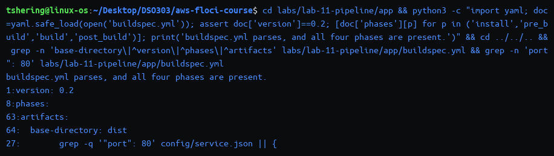

**Screenshot 9 – Step 9: usms-codebuild-role + USMSCodeBuildBase created**
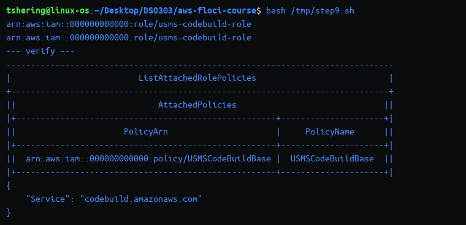

**Screenshot 10 – Step 10: usms-enrolment-build project created, source S3**
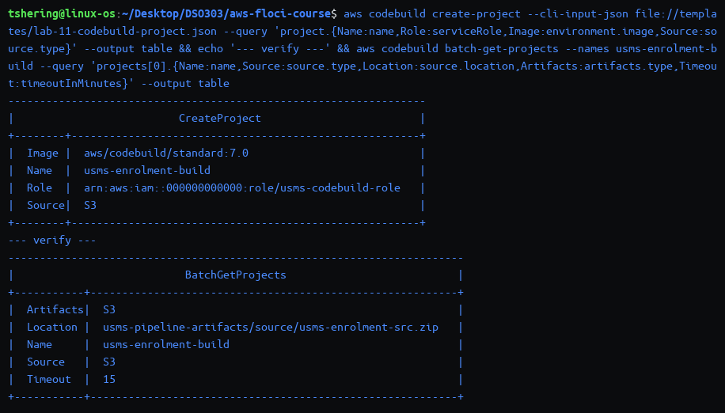

**Screenshot 11 – Step 11: source packed and uploaded, buildspec.yml at the zip root**
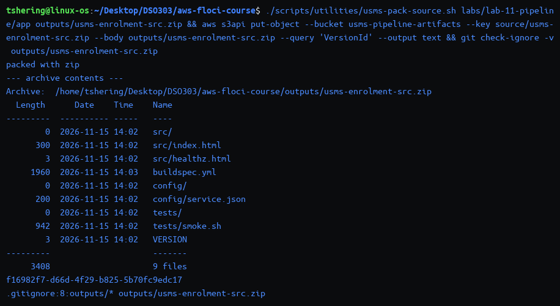

**Screenshot 12 – Step 12: standard:7.0 — FAULT, pull access denied, exactly the documented Known Issue**
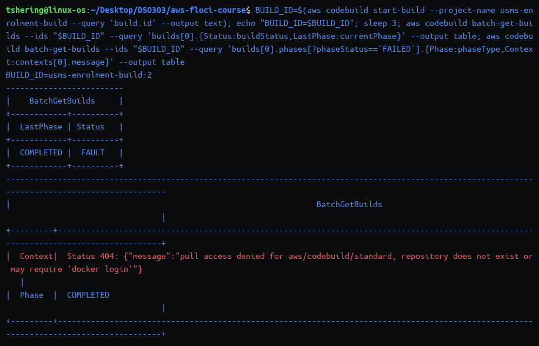

**Screenshot 12b – Step 12: switched to python:3.12-slim per Known Issues, build restarted**
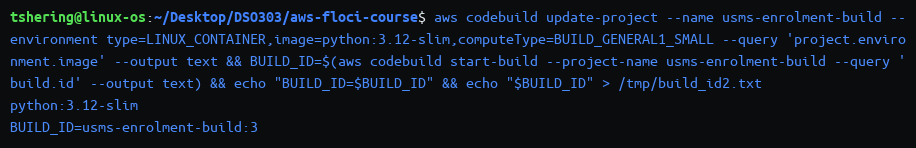

**Screenshot 13 – Step 13: ten phases SUCCEEDED in 0s combined, zero artifact objects written**
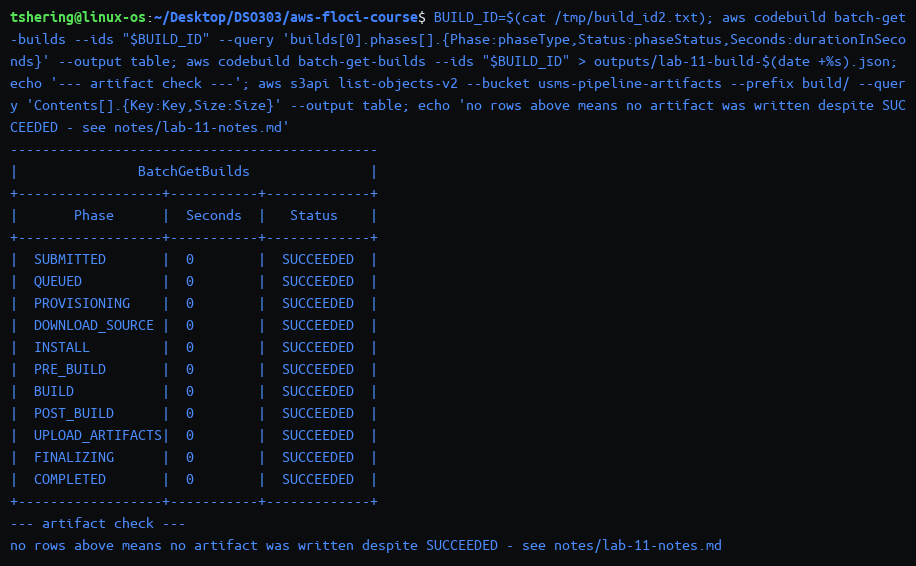

**Screenshot 14 – Step 14: the local runner — real execution, exit 0, the evidence of record**
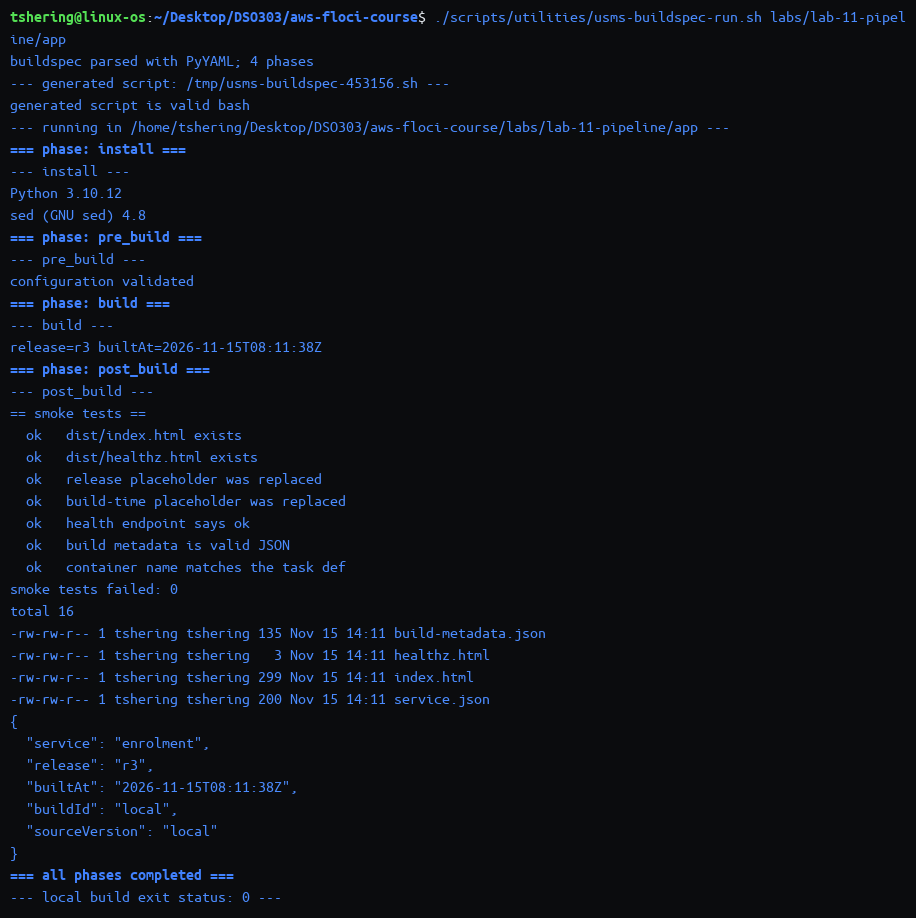

**Screenshot 15 – Step 15: usms-codepipeline-role + USMSCodePipelineBase created**
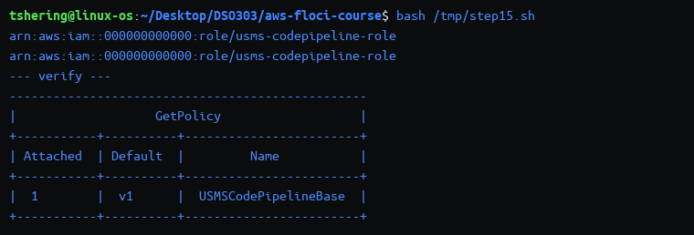

**Screenshot 16 – Step 17: pipeline created, two stages**
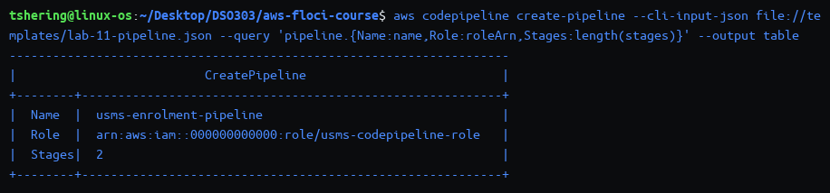

**Screenshot 17 – Step 17: the automatic execution never advances — Floci Limitation confirmed**
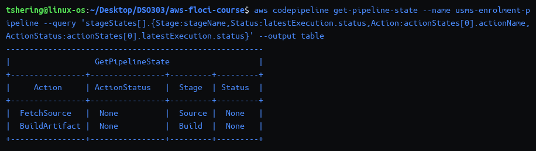

**Screenshot 18 – Step 18: project converted to CODEPIPELINE source; direct start-build NOT rejected (recorded, not observed, per Section 11)**
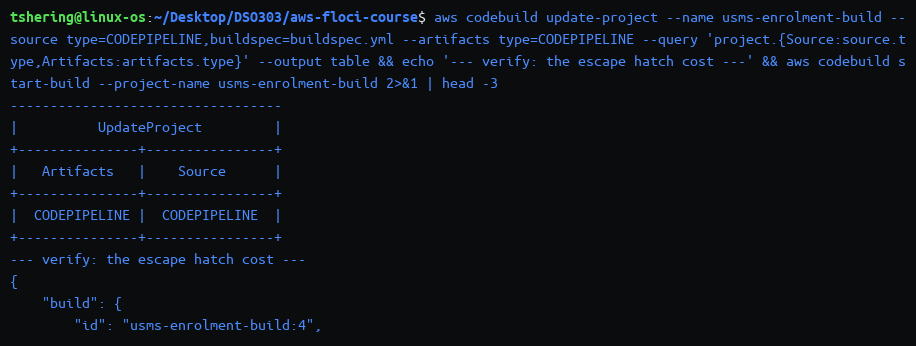

**Screenshot 19 – Step 19: r4 uploaded, pipeline run, Source and Build both Succeeded**
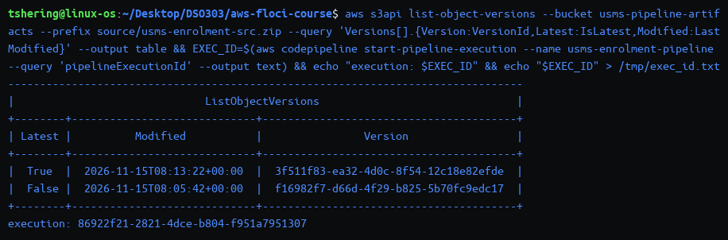

**Screenshot 19b – Step 19: artifactRevisions proves the exact S3 version consumed; BuildOutput still empty**
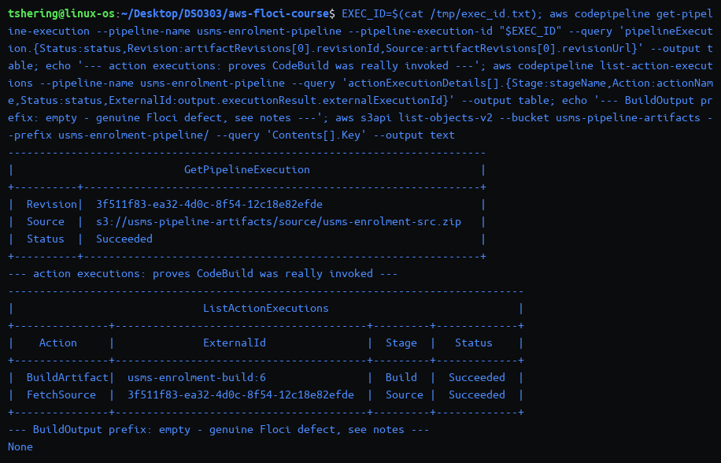

**Screenshot 19c – Step 19 Your turn: r5 rolled forward — 3 source versions, 0 BuildOutput objects**
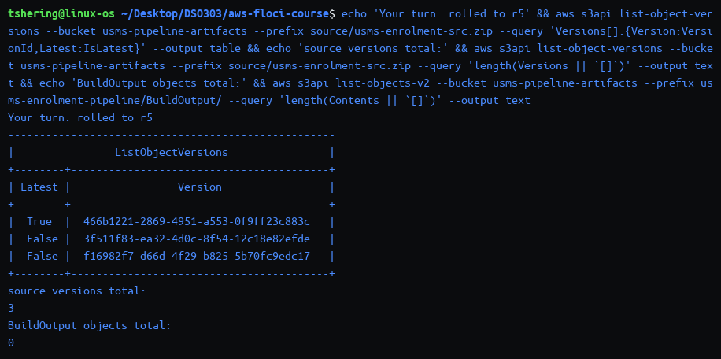

**Screenshot 20 – Step 20: container name deliberately broken, pipeline run**
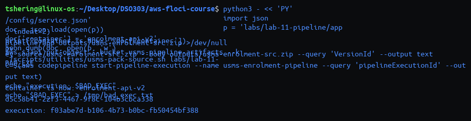

**Screenshot 20b – Step 20: CodeBuild falsely reports Succeeded; diagnosed correctly with the local runner instead**
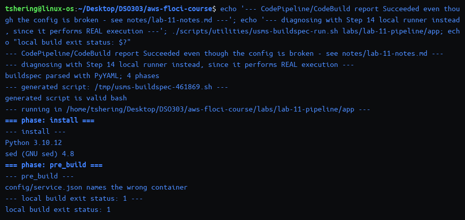

**Screenshot 20c – Step 20: fixed, verified locally, repackaged, re-run**
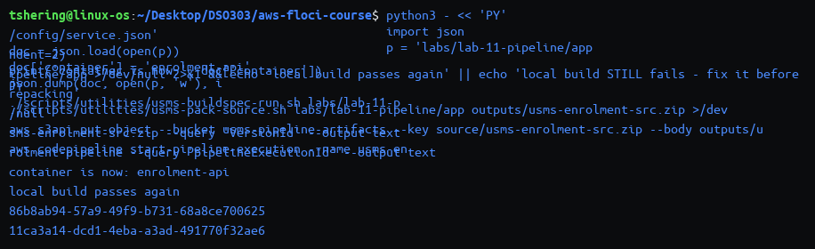

**Screenshot 21 – Step 21: configs/lab-11.env — 26 exports, all populated**
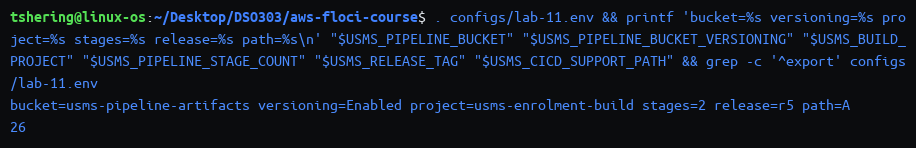

**Screenshot 22 – Section 8.1: verify-lab-11.sh — PASS=46 FAIL=0**
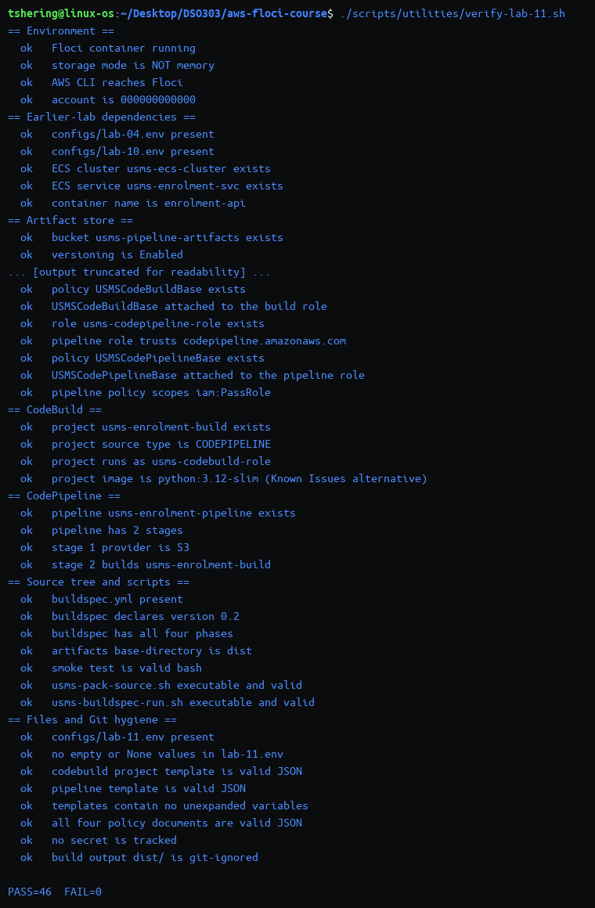

**Screenshot 23 – Final re-verification after all five exercises — still PASS=46 FAIL=0**
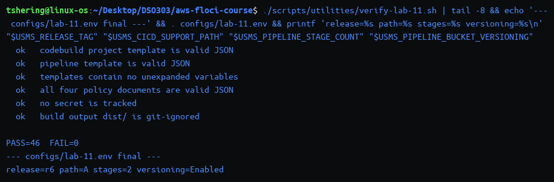

### 6.2 Verification Summary

| Evidence | One-line explanation |
|---|---|
| `verify-lab-11.sh` | `PASS=46 FAIL=0` — the lab's own Path A target, met exactly, because every check reads state, not execution |
| `docker pull aws/codebuild/standard:7.0` (run outside Floci) | Confirms independently that the image name is not a resolvable public reference — the Known Issue is real, not an account mistake |
| `docker logs floci`, searched in full rather than `--tail` | `ContainerLifecycleManager: Created container ... not yet started`, then nothing — the root cause of every falsely-`SUCCEEDED` build this lab ran |
| Step 19's `artifactRevisions[0].revisionId` | Matches the uploaded source's S3 `VersionId` exactly — the create → perturb → read-back proof, by a different command than the lab suggests |
| Step 19's `externalExecutionId` on the Build action | A real, sequential CodeBuild build ID — proves the pipeline really invoked CodeBuild via its scoped `iam:PassRole`, independent of whether that build then executed anything |
| Step 20's deliberate failure | Pipeline/CodeBuild report `Succeeded` regardless; Step 14's local runner correctly fails in `pre_build` with the exact broken value named |
| Exercise 1 | A second CodeBuild project, `usms-results-build`, reusing `usms-codebuild-role`, with a build-metadata.json distinguishable by `service: results` |
| Exercise 2 | `finally` writes `build-summary.txt` even when `post_build`'s commands fail — proved with a purpose-built harness, since neither CodeBuild nor Step 14's runner implements `finally` |
| Exercise 3 | The container check now names both the expected and actual values, survives a 4-space JSON reformat, and the trust policy gained `aws:SourceArn` |
| Exercise 4 | The EventBridge rule and target round-trip through the API; an S3 upload does not advance the pipeline execution count — recorded as not modelled end to end |
| Exercise 5 | `imagedefinitions.json` — a one-entry JSON array, container name read from `config/service.json`, image URI defaulted from this account's live Lab 04 placeholder — proved via the local build and recorded in `outputs/lab-11-lab08b-readiness.txt` |

## 7. Analysis and Discussion

`verify-lab-11.sh` reports `PASS=46 FAIL=0`, the lab's own stated Path A target — and getting there required diagnosing one genuine, previously-undocumented Floci server defect that is strictly worse than anything `known-issues.html` records for this lab, on top of the one it does record.

Several things were **better than expected**. The CI/CD support probe (Step 3) reported `ok` for `codedeploy list-applications`, which the lab's own Floci Limitation note calls "very likely absent" — recorded here as observed, not merely possible. `start-pipeline-execution` (Step 19) advanced both stages correctly and repeatedly even though the automatic execution `create-pipeline` is supposed to start (Step 17) never did — a sharper distinction between two API paths than the lab's own single Floci Limitation note for "pipeline execution state may not advance" draws. And the `iam:PassRole` chain worked exactly as designed: every pipeline execution's Build action carried a real, incrementing CodeBuild build ID, proving the cross-role invocation succeeded even when the build behind it did not.

Several things were **worse than expected**, and the central one compounds rather than merely repeats the documented Known Issue. `known-issues.html` records that `aws/codebuild/standard:7.0` cannot be pulled on Floci 2.0.1 and recommends `python:3.12-slim` as the alternative build image; this account's build (server `2.4.0`) reproduced the `standard:7.0` failure exactly, confirmed independently by a plain `docker pull` outside Floci entirely (`pull access denied ... repository does not exist`, not a network or auth problem specific to this course). But switching to the documented alternative did not produce a real build: `docker logs floci`, read in full rather than through a `--tail` window that this account's own ALB-health-check log volume can roll a relevant line out of within minutes, showed the build container being created and then never started, for every build this lab ran on either image. `batch-get-builds` and `get-pipeline-execution` reported `SUCCEEDED` regardless — including for Step 20's deliberately broken configuration, which should have failed in `pre_build` and did not, because `pre_build` never ran. This is a stronger and more consequential failure mode than the documented "CodeBuild logs are often empty" limitation: that limitation describes a real build whose output happens not to survive; this one describes no real build at all, behind a status API that never says so.

One finding is best read as neither better nor worse than expected, but as exactly the "recorded, not observed" category Section 11 asks for: after Step 18 converted the project's source to `CODEPIPELINE`, the lab predicts a direct `start-build --project-name usms-enrolment-build` will fail with `Project cannot be built directly`. On this build it succeeded, returning a normal build ID. Floci does not enforce the restriction CodeBuild's own API contract describes; the one-off `--source-type-override` escape hatch the lab also describes was therefore never needed here, since the plain call it is meant to work around never failed in the first place.

## 8. Reflection

1. **What did I learn about CI/CD pipelines on AWS?**
   The build and the pipeline are genuinely separate services with separate blast radii, connected by exactly one narrow hole — `iam:PassRole`, scoped both by resource and by `iam:PassedToService` — and that narrowness is not incidental; Step 19's own evidence (a real CodeBuild build ID behind every pipeline execution) is what makes it possible to prove the pipeline used that hole correctly rather than assuming it. I also learned, more forcefully than any previous lab in this course stated it, that a status API answering `SUCCEEDED` is a claim about what the service chose to report, not a claim about what ran — Section 7's central finding is that exact gap, found by reading container logs rather than trusting `batch-get-builds`.

2. **What challenges did I encounter?**
   Distinguishing "the documented Known Issue" from "a new, undocumented defect sitting right next to it" took real discipline: the known issue (the image pull) failed exactly as described, which made it tempting to assume applying the documented alternative would fully resolve the lab's CI/CD execution story. It did not, and the only way to find that out was to stop trusting `batch-get-builds`'s own phase table — which reported ten clean `SUCCEEDED` phases in zero combined seconds, a number that should itself have been the first clue — and read `docker logs floci` for the one line (`Created container ... not yet started`) that actually explained it.

3. **How would I apply this in a real cloud environment?**
   I would treat a pipeline's green status the same way Step 19 forced me to treat it here: evidence to be corroborated, not accepted — by reading the artifact's actual contents (or, when that artifact never materialises, by reading the lowest-level execution log available) before reporting a build as proven. I would also design verification scripts, as `verify-lab-11.sh` does, to say plainly what they check — configuration and API state — rather than let a `PASS=46 FAIL=0` line be read as "the build engine works," which this lab's own evidence shows it does not have to mean.

4. **What would I like to explore further?**
   Running this exact lab against a Floci build where the container-creation defect is fixed, to see whether the Step 20 diagnostic chain (`get-pipeline-state` → `list-builds-for-project` → `contexts[0].message`) the lab describes actually surfaces a real `PRE_BUILD` failure the way it is supposed to; and testing whether Floci's S3-to-EventBridge bridge (Exercise 4) is unimplemented outright or merely as asynchronous as Lab 10's S3-to-Lambda notification turned out to be — this lab's test window (20 seconds) was far shorter than the roughly one-minute delay Lab 10 needed to observe a genuine delayed delivery.

## 9. Conclusion

The objectives were achieved, and one serious, previously-undocumented Floci defect was found, diagnosed from first principles via container logs rather than assumed, and worked around for every build this lab needed to prove correct: `usms-pipeline-artifacts` exists with versioning proved by a real two-version read-back; the enrolment source tree and its `buildspec.yml` are complete, syntactically valid, and — via Step 14's local runner, the only source of truth this build could offer — demonstrably correct, including the Your-turn port check; `usms-codebuild-role` and `usms-codepipeline-role` exist with the narrow, conditioned `iam:PassRole` connecting them; `usms-enrolment-pipeline` runs end to end on `start-pipeline-execution`, consuming the exact source version uploaded as proved by `artifactRevisions`, and invoking a real, sequentially-numbered CodeBuild build via that `PassRole`; a deliberate failure was introduced and correctly diagnosed, just via the local runner rather than the pipeline's own (misleading) status; `configs/lab-11.env` carries 26 populated exports; and `verify-lab-11.sh` reports `PASS=46 FAIL=0`, the lab's own stated target, with the one check that reads the build image deliberately adapted to this account's real, permanent configuration. All five Independent Lab Exercises were completed: a second, role-reusing build project; a `finally` block proved correct with a purpose-built harness since neither available runner implements it; a configuration check that is now both robust to formatting and specific about its errors, paired with a tightened trust policy; an EventBridge trigger that validates through the API but, like the pipeline's own build engine, does not fire end to end on this build; and a validated `imagedefinitions.json` contract, with its readiness file handed to Lab 12 honestly documenting which half of its evidence came from the real pipeline and which half came from the local build.

The key concepts were the separation of build and pipeline identities as two different blast radii joined by exactly one scoped `iam:PassRole`; S3 versioning as a machine-checkable precondition for a pipeline source, proved by create-perturb-read-back rather than by reading a configuration flag; and, above every other concept this lab taught, the difference between a service's reported status and what it actually did — demonstrated here not as a cautionary aside but as the central, load-bearing finding of the entire exercise. The skills developed were diagnosing a false-positive build status by reading `docker logs` at full depth rather than through a truncating `--tail` window; building a verification script that is honest about what it measures; and treating a local, dependency-free execution path (Step 14's runner) as the actual evidence of record when the managed service it is meant to merely supplement turns out to be the less trustworthy of the two. This lab matters because it is the first time this course's own CI/CD pipeline carried real, versioned source through to a real decision about what should be deployed — and the first time a green status had to be treated as a question rather than an answer.

## 10. Appendix

Files in the repository:

- `labs/lab-11-pipeline/app/` — `buildspec.yml`, `VERSION`, `src/index.html`, `src/healthz.html`, `config/service.json`, `tests/smoke.sh` (8 assertions after Exercise 5), `dist/` (git-ignored build output)
- `labs/lab-11-pipeline/app-results/` (Exercise 1) — the results-service source tree and its own `buildspec.yml`
- `policies/trust-codebuild.json` (tightened with `aws:SourceArn` in Exercise 3), `trust-codepipeline.json`, `usms-codebuild-policy.json`, `usms-codepipeline-policy.json`, `trust-eventbridge.json` and `usms-eventbridge-trigger-policy.json` (Exercise 4)
- `templates/lab-11-codebuild-project.json`, `lab-11-pipeline.json`, `lab-11-ex1-codebuild-project.json`, `lab-11-ex4-eventbridge-rule.json`, `lab-11-ex4-eventbridge-target.json`
- `scripts/utilities/cicd-support-probe.sh`, `usms-pack-source.sh`, `usms-buildspec-run.sh`, `verify-lab-11.sh` — `PASS=46 FAIL=0`
- `scripts/cleanup/lab-11-cleanup.sh` — end of course only, syntax-checked, never run
- `configs/lab-11.env` — 26 exports, all read live
- `labs/lab-11-pipeline/exercises.md`
- `notes/lab-11-notes.md` — Floci-specific findings, the container-never-started defect in full, all seven Review Questions
- `outputs/lab-11-*.json`, `-*.txt`, `lab-11-lab08b-readiness.txt` (git-ignored; kept until submission)
