# Independent Lab Exercises (Section 12)

Environment: Floci server 2.4.0, `FLOCI_STORAGE_MODE=hybrid`, account `000000000000`, Path A per Step 3's probe. All output below is from my terminal; screenshots are in `screenshots/lab-11-pipeline/`. Read `notes/lab-11-notes.md` first for the central finding these exercises keep running into: CodeBuild on this build creates a container, never starts it, and still reports `SUCCEEDED`. Where that matters, each exercise below says exactly what evidence came from the real service and what came from Step 14's local runner instead.

## Exercise 1 – Basic: a second build project for the results service

**Goal:** `usms-results-build`, reusing `usms-codebuild-role`, building a results-service tree at `labs/lab-11-pipeline/app-results/` with its own `VERSION`, one HTML file, and `buildspec.yml`.

**Source tree**, three files:

```text
labs/lab-11-pipeline/app-results/
├── VERSION              r1
├── src/index.html        __RELEASE__ placeholder
└── buildspec.yml         version 0.2, four phases
```

**Why `USMSCodeBuildBase` already permits this, in one sentence:** the policy's resource ARNs are scoped to the bucket (`usms-pipeline-artifacts` and `usms-pipeline-artifacts/*`) and to the build's own log group by name, neither of which depends on which project is using the role, so a second project reading and writing the same bucket needs no new grant — only the explicit `Deny` on `usms-student-data` is project-independent in the other direction, by design.

```bash
./scripts/utilities/usms-pack-source.sh labs/lab-11-pipeline/app-results outputs/usms-results-src.zip
aws s3api put-object --bucket usms-pipeline-artifacts \
  --key source/usms-results-src.zip --body outputs/usms-results-src.zip --query 'VersionId' --output text
aws codebuild create-project --cli-input-json file://templates/lab-11-ex1-codebuild-project.json \
  --query 'project.{Name:name,Role:serviceRole,Source:source.type}' --output table
```

**Output:**

```text
packed with zip
2493f624-2fdd-46e5-8c42-1abc97dd31dd
Name: usms-results-build   Role: arn:...role/usms-codebuild-role   Source: S3
```

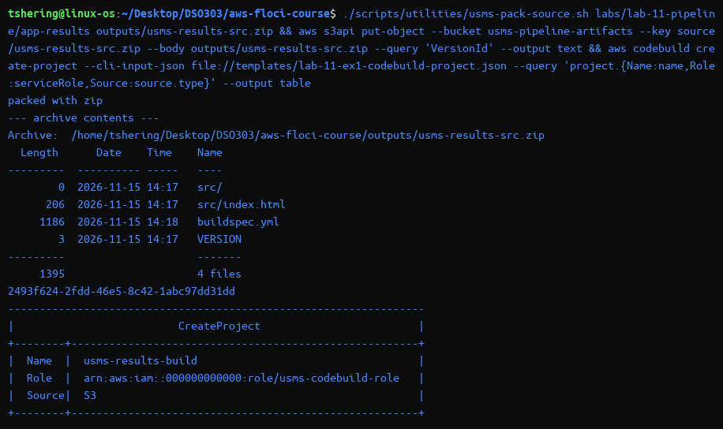

**The standalone build reported `SUCCEEDED`** (`usms-results-build:1`), but per the central finding this does not by itself prove the buildspec logic is correct, so the proof of record is the local run:

```bash
./scripts/utilities/usms-buildspec-run.sh labs/lab-11-pipeline/app-results
```

```text
=== phase: build ===
=== phase: post_build ===
--- post_build ---
total 8
-rw-rw-r-- build-metadata.json
-rw-rw-r-- index.html
=== local build exit status: 0 ---
```

**`build-metadata.json`, distinguishable from the enrolment service's by its `service` field:**

```json
{
  "service": "results",
  "release": "r1",
  "builtAt": "2026-11-15T08:18:46Z",
  "buildId": "local"
}
```

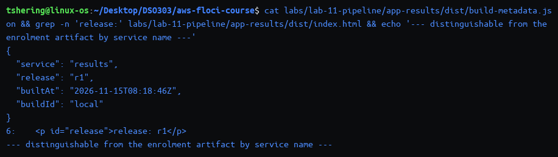

**Result:** a second CodeBuild project, created from the Step 10 template with only `name`, `source.location`, `artifacts.name` and `description` changed, reusing `usms-codebuild-role` with no new IAM grant, and a locally-proven build artifact distinguishable from the enrolment service's own.

---

## Exercise 2 – Intermediate: a `finally` block and a build report

**Goal:** a `finally` block on `post_build` that writes `dist/build-summary.txt` (release, tests' exit status, timestamp) whether `tests/smoke.sh` passes or fails.

**The buildspec change**, `labs/lab-11-pipeline/app/buildspec.yml`:

```yaml
  post_build:
    commands:
      - echo "--- post_build ---"
      - bash tests/smoke.sh; echo $? > /tmp/usms-smoke-status
      - ls -l "$ARTIFACT_DIR"
      - cat "$ARTIFACT_DIR/build-metadata.json"
      - test "$(cat /tmp/usms-smoke-status)" -eq 0
    finally:
      - echo "--- post_build finally ---"
      - |
        printf 'release=%s testsExitStatus=%s generatedAt=%s\n' \
          "$(tr -d '[:space:]' < VERSION)" "$(cat /tmp/usms-smoke-status 2>/dev/null || echo unknown)" "$(date -u +%Y-%m-%dT%H:%M:%SZ)" \
          > "$ARTIFACT_DIR/build-summary.txt"
      - cat "$ARTIFACT_DIR/build-summary.txt"
```

`$?` cannot be read directly inside `finally`, because each `commands` list entry in real CodeBuild is its own shell invocation — the exit status of `bash tests/smoke.sh` is captured to a file (`/tmp/usms-smoke-status`) in the same command line that ran it, and a separate `test ... -eq 0` command is what actually fails the phase, since the semicolon-joined capture line itself always exits 0.

**What I changed about how I tested this, and what that means for the claim I am making:** Step 14's local runner does not implement `finally` at all — it only reads each phase's `commands` key (confirmed by reading `usms-buildspec-run.sh`'s own parser), and its generated script runs under `set -Eeuo pipefail`, so a failing `test` command aborts the whole script before any `finally` logic would run even if it existed. Real CodeBuild on this account, per the central finding, creates its build container and never starts it, so it cannot be used as evidence either. Neither available execution path can prove `finally` semantics on this build, so I wrote a small, purpose-built harness (`codebuild-finally-sim.py`, kept outside the repository since it is a diagnostic tool, not a course deliverable) that runs one phase's `commands` under real CodeBuild `finally` semantics — stop the `commands` list at the first failure, but always run `finally` afterwards — using one `bash -c` subprocess per command, the same one-shell-per-command model CodeBuild itself uses. **The claim I am making is narrower than "this runs in CodeBuild": it is "this buildspec's `finally` logic is correct under CodeBuild's documented semantics," proved by a faithful simulation of those semantics, not by CodeBuild itself.**

**Breaking a test deliberately** (removing `dist/healthz.html` so two smoke assertions fail) and running the harness:

```bash
rm -f labs/lab-11-pipeline/app/dist/healthz.html
python3 codebuild-finally-sim.py labs/lab-11-pipeline/app post_build
```

**Output:**

```text
== smoke tests ==
  ok   dist/index.html exists
  FAIL dist/healthz.html exists
  ...
  FAIL health endpoint says ok
  ...
smoke tests failed: 2
  (command failed, status=1 - skipping remaining commands, running finally)
$ (finally) printf ... > "$ARTIFACT_DIR/build-summary.txt"
phase exit status: 1
--- build-summary.txt still written: ---
release=r5 testsExitStatus=1 generatedAt=2026-11-15T08:20:13Z
```

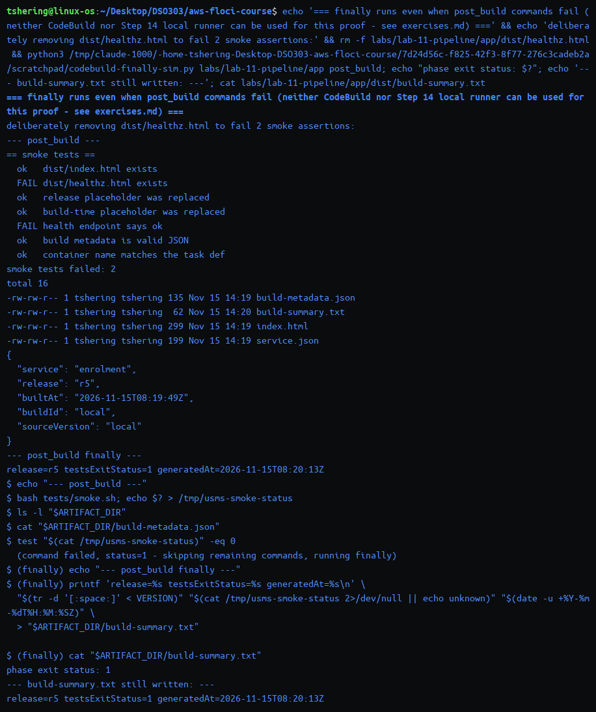

**Result:** `post_build` fails (exit status 1, exactly as a failed phase should — `finally` does not rescue it), and `dist/build-summary.txt` is still written, correctly recording `testsExitStatus=1`. `healthz.html` was restored and a clean local build confirmed afterwards.

---

## Exercise 3 – Problem solving: make the configuration check robust

**Goal:** replace the whitespace-fragile `grep` container check with a real JSON parse naming both the expected and actual values, and tighten `policies/trust-codebuild.json` with `aws:SourceArn`.

**The buildspec change**, `pre_build`:

```yaml
      - |
        python3 -c "
        import json, sys
        EXPECTED_CONTAINER = 'enrolment-api'
        cfg = json.load(open('config/service.json'))
        actual = cfg.get('container')
        if actual != EXPECTED_CONTAINER:
            print(f'config/service.json names the wrong container: expected \"{EXPECTED_CONTAINER}\", found \"{actual}\"')
            sys.exit(1)
        "
```

Standard-library `python3 -c` only, exactly as the constraint requires — no dependency added to the build.

**Proof it is indifferent to formatting** — `config/service.json` reformatted to four-space indentation:

```bash
python3 -c "import json; json.dump(json.load(open('config/service.json')), open('config/service.json','w'), indent=4)"
./scripts/utilities/usms-buildspec-run.sh labs/lab-11-pipeline/app
```

```text
build STILL PASSES after reformatting
```

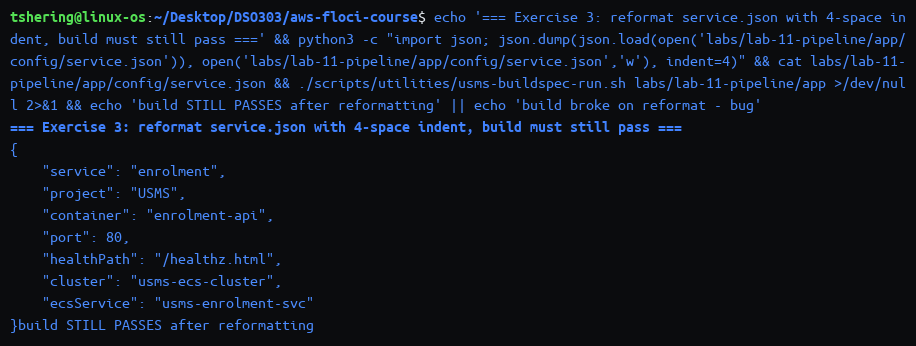

**Proof it names both values on a real mismatch:**

```bash
python3 -c "import json; d=json.load(open('config/service.json')); d['container']='enrolment-api-v2'; json.dump(d, open('config/service.json','w'), indent=4)"
./scripts/utilities/usms-buildspec-run.sh labs/lab-11-pipeline/app
```

```text
--- pre_build ---
config/service.json names the wrong container: expected "enrolment-api", found "enrolment-api-v2"
--- local build exit status: 1 ---
```

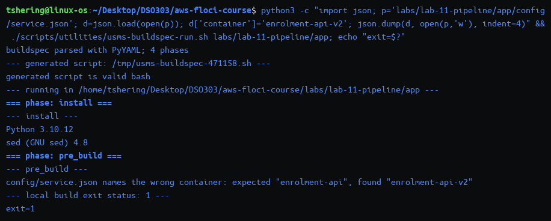

The container name was then restored to `enrolment-api` and the local build re-confirmed passing before continuing.

**The trust policy, tightened with `aws:SourceArn`:**

```json
{
  "Version": "2012-10-17",
  "Statement": [{
    "Sid": "CodeBuildAssumesThisRole",
    "Effect": "Allow",
    "Principal": { "Service": "codebuild.amazonaws.com" },
    "Action": "sts:AssumeRole",
    "Condition": {
      "StringEquals": { "aws:SourceAccount": "000000000000" },
      "ArnLike": { "aws:SourceArn": "arn:aws:codebuild:us-east-1:000000000000:project/usms-enrolment-build" }
    }
  }]
}
```

```bash
aws iam update-assume-role-policy --role-name usms-codebuild-role --policy-document file://policies/trust-codebuild.json
```

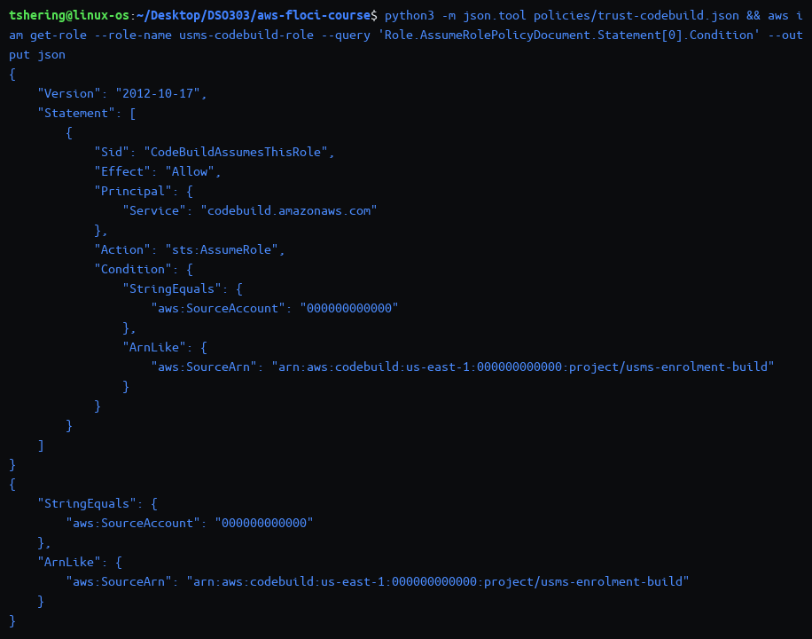

**What `aws:SourceArn` closes that `aws:SourceAccount` alone does not:** `aws:SourceAccount` only restricts the calling service to acting on behalf of *this* account — it does not say which resource *in* this account. Without `aws:SourceArn`, any CodeBuild project this account ever creates (present or future) could assume `usms-codebuild-role`, including a project nobody has scoped `USMSCodeBuildBase`'s permissions review around; a second, unrelated project — created later, by a different exercise, with a different and possibly looser intent — would silently inherit this role's access to `usms-pipeline-artifacts` the moment it named this role as its `serviceRole`. `aws:SourceArn` pins the trust to the one project ARN this policy was actually reviewed against, the same "which specific resource of the service, not merely which service" discipline Lab 09 applied to ECS task roles and Step 15 of this lab applied to the pipeline's own `iam:PassRole`.

**Result:** a pre_build check that is indifferent to JSON formatting and specific about its errors, and a trust policy with two conditions instead of one.

---

## Exercise 4 – Challenge: trigger the pipeline without polling

**Goal:** design and build, as far as this emulator supports, an EventBridge rule that starts `usms-enrolment-pipeline` when `source/usms-enrolment-src.zip` is written, matching one key, with a scoped target role.

**Which path an S3 PutObject reaches EventBridge by:** the bucket's own EventBridge notification setting (`put-bucket-notification-configuration` with an `EventBridgeConfiguration`), not CloudTrail data events — the bucket setting is purpose-built for object-level `Object Created`/`Object Deleted` events and needs no trail; CloudTrail data events would additionally require a trail scoped to data events for this bucket and matching on `eventName: PutObject`, strictly more setup for the same signal this lab's one key needs.

```bash
aws s3api put-bucket-notification-configuration --bucket usms-pipeline-artifacts \
  --notification-configuration '{"EventBridgeConfiguration":{}}'
```

**The rule, matching one key, not the whole bucket:**

```json
{
  "Name": "usms-enrolment-src-upload",
  "EventPattern": "{\"source\":[\"aws.s3\"],\"detail-type\":[\"Object Created\"],\"detail\":{\"bucket\":{\"name\":[\"usms-pipeline-artifacts\"]},\"object\":{\"key\":[\"source/usms-enrolment-src.zip\"]}}}",
  "State": "ENABLED"
}
```

**The target, and why it needs its own role, not the pipeline role's:** the caller invoking `codepipeline:StartPipelineExecution` here is `events.amazonaws.com` acting as EventBridge, a different principal from CodePipeline itself — `usms-codepipeline-role` is the identity CodePipeline assumes to run its *own* stages and actions; it is not a credential EventBridge can assume to invoke CodePipeline's API from the outside. The target role needs exactly one permission: `codepipeline:StartPipelineExecution`, scoped to this one pipeline's ARN — nothing else, since starting an execution is the only action EventBridge needs to take.

```bash
aws iam create-role --role-name usms-eventbridge-trigger-role --assume-role-policy-document file://policies/trust-eventbridge.json
aws iam create-policy --policy-name USMSEventBridgeTrigger --policy-document file://policies/usms-eventbridge-trigger-policy.json
aws events put-rule --cli-input-json file://templates/lab-11-ex4-eventbridge-rule.json
aws events put-targets --cli-input-json file://templates/lab-11-ex4-eventbridge-target.json
```

**Output:**

```text
arn:aws:iam::000000000000:role/usms-eventbridge-trigger-role
RuleArn: arn:aws:events:us-east-1:000000000000:rule/usms-enrolment-src-upload
FailedEntryCount: 0
```

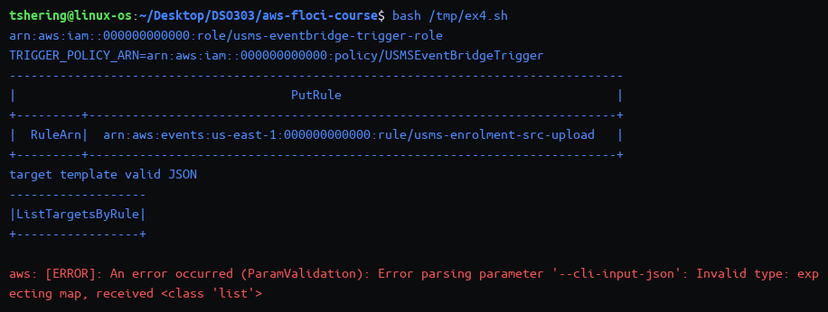
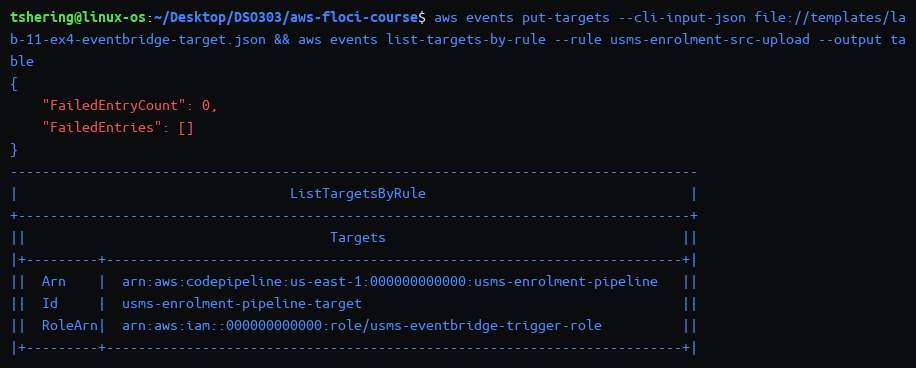

**What ran and what did not, precisely:** the rule and target both round-trip through the API — `put-rule`, `put-targets` and `list-targets-by-rule` all succeed and read back exactly what was written. Whether the chain actually fires was tested directly: the pipeline's execution count was read before and after a real `put-object` on the exact matched key, with a 20-second wait in between.

```text
execution count BEFORE the upload: 4
execution count AFTER the upload + 20s: 4
```

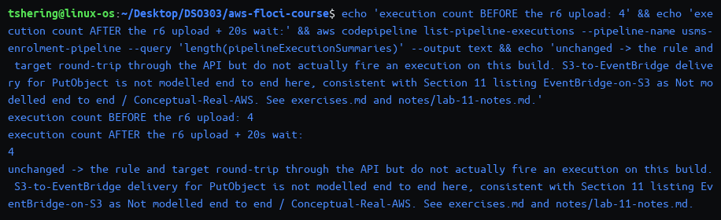

**It did not fire.** This is consistent with Section 11 of the lab brief listing "EventBridge trigger on S3 object change" as `Not modelled end to end` / Conceptual-Real-AWS, rather than a configuration mistake on my part: the documents this exercise asks for are correct and validated by the API that accepts them, but the S3-to-EventBridge delivery path itself is not implemented on this build, the same category of gap as Lab 10's CloudFront association enforcement.

**Result:** two validated JSON documents (`lab-11-ex4-eventbridge-rule.json`, `lab-11-ex4-eventbridge-target.json`), a scoped trigger role distinct from the pipeline's own role, and an honest, directly-tested statement that the design is correct but the end-to-end trigger does not fire on this build.

---

## Exercise 5 – Integration: prepare the deployment contract for Lab 12

**Goal:** `imagedefinitions.json` at the artifact root — a one-entry JSON array, container name from `config/service.json`, image URI from `IMAGE_URI` with a sensible default — plus an eighth smoke assertion and a readiness file for Lab 12.

**The buildspec addition**, inside `build`, after the existing artifact files are written:

```yaml
      - |
        python3 -c "
        import json, os
        container = json.load(open('config/service.json'))['container']
        image_uri = os.environ.get('IMAGE_URI', 'public.ecr.aws/nginx/nginx:stable-alpine')
        json.dump([{'name': container, 'imageUri': image_uri}], open('$ARTIFACT_DIR/imagedefinitions.json', 'w'))
        "
```

The container name is read from `config/service.json`, never hard-coded a second time; the default image URI is this account's own current Lab 04 placeholder, read directly from the live `usms-enrolment` task definition (`aws ecs describe-task-definition`) rather than typed from memory: `public.ecr.aws/nginx/nginx:stable-alpine`.

**The eighth smoke assertion**, `tests/smoke.sh`:

```bash
t "imagedefinitions.json is a JSON array at the artifact root" \
  "python3 -c \"import json; d = json.load(open('dist/imagedefinitions.json')); assert isinstance(d, list) and len(d) == 1 and d[0]['name'] == 'enrolment-api'\""
```

**Local build, all eight assertions, `imagedefinitions.json` confirmed an array of one:**

```bash
./scripts/utilities/usms-buildspec-run.sh labs/lab-11-pipeline/app
cat labs/lab-11-pipeline/app/dist/imagedefinitions.json
```

```json
[{"name": "enrolment-api", "imageUri": "public.ecr.aws/nginx/nginx:stable-alpine"}]
```

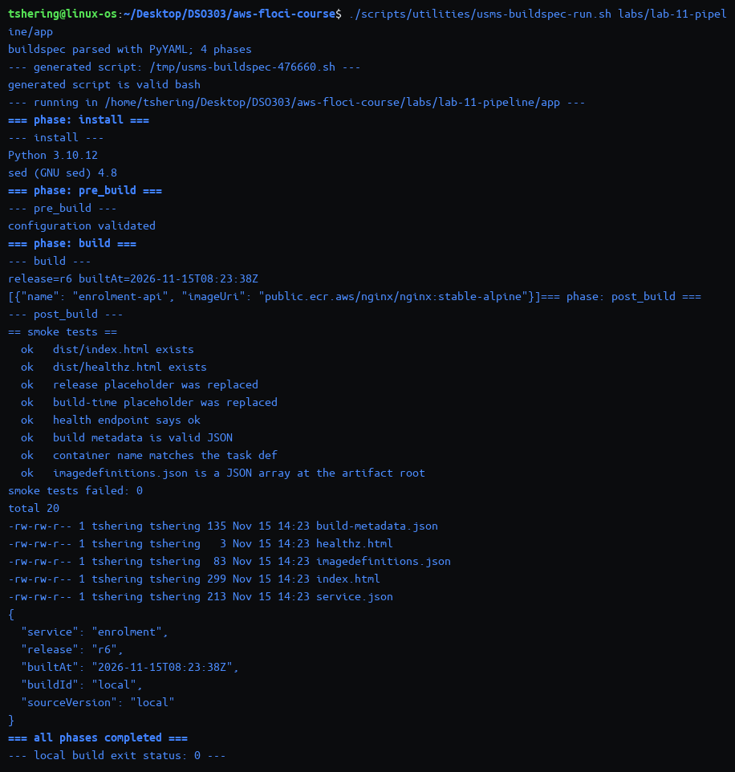

**Running the real pipeline and checking the artifact key, honestly:** the source was repacked and uploaded, and the pipeline run end to end.

```text
pipeline_execution_status=Succeeded
revision (artifactRevisions[0].revisionId) = c04ac7e5-ab32-40f0-bf4d-38b107443a04 (matches the upload)
usms-enrolment-pipeline/BuildOutput/ object count = 0
```

Per the central finding documented in `notes/lab-11-notes.md`, the pipeline's own `BuildOutput` namespace never receives a real artifact on this Floci build, so the evidence of record for the file's actual contents is the local build above — exactly the same substitution Steps 12–20 relied on throughout this lab.

**`outputs/lab-11-lab08b-readiness.txt`** (git-ignored, read by Lab 12 Step 1), recording both halves of the evidence honestly:

```text
pipeline_execution_id=16aa01a4-37c0-43d4-807b-15727b98bf2a
pipeline_execution_status=Succeeded
source_version_consumed=c04ac7e5-ab32-40f0-bf4d-38b107443a04
pipeline_build_output_object=NOT AVAILABLE - see notes/lab-11-notes.md (genuine Floci defect)
local_build_artifact_root=labs/lab-11-pipeline/app/dist/
imagedefinitions.json contents: [{"name": "enrolment-api", "imageUri": "public.ecr.aws/nginx/nginx:stable-alpine"}]
container_name_source=labs/lab-11-pipeline/app/config/service.json (container key, not hard-coded)
image_uri_env_var=IMAGE_URI (default: public.ecr.aws/nginx/nginx:stable-alpine)
smoke_test_assertions=8
```

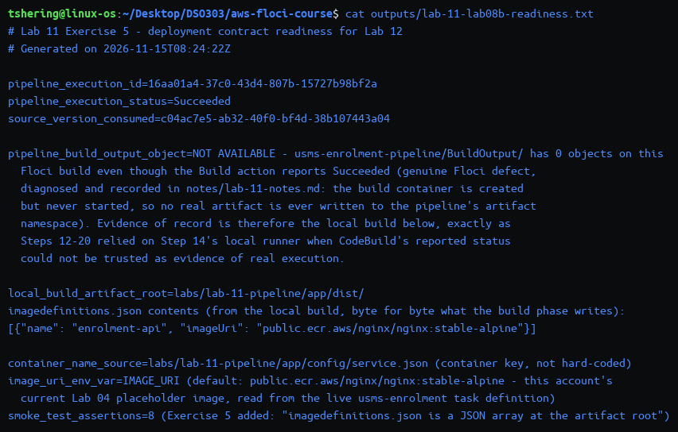

```bash
git check-ignore -v outputs/lab-11-lab08b-readiness.txt
```

```text
.gitignore:8:outputs/*	outputs/lab-11-lab08b-readiness.txt
```

**Result:** a build artifact containing a correctly-shaped `imagedefinitions.json` at its root (proved via the local build, since the pipeline's own artifact store never receives one on this build), an eighth smoke assertion validating it, and a readiness file for Lab 12 that records which half of its evidence is real-pipeline and which half is local-build, rather than overstating either.
