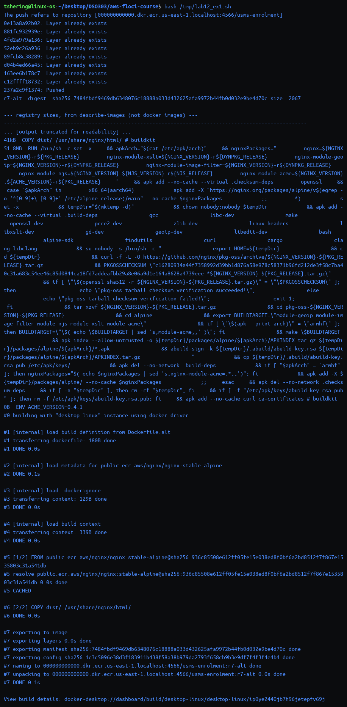
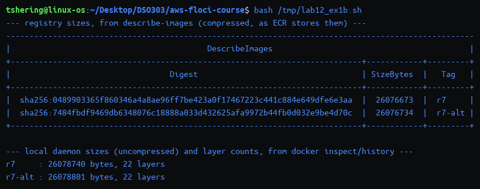
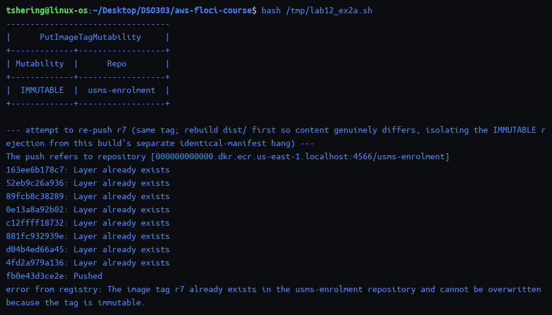
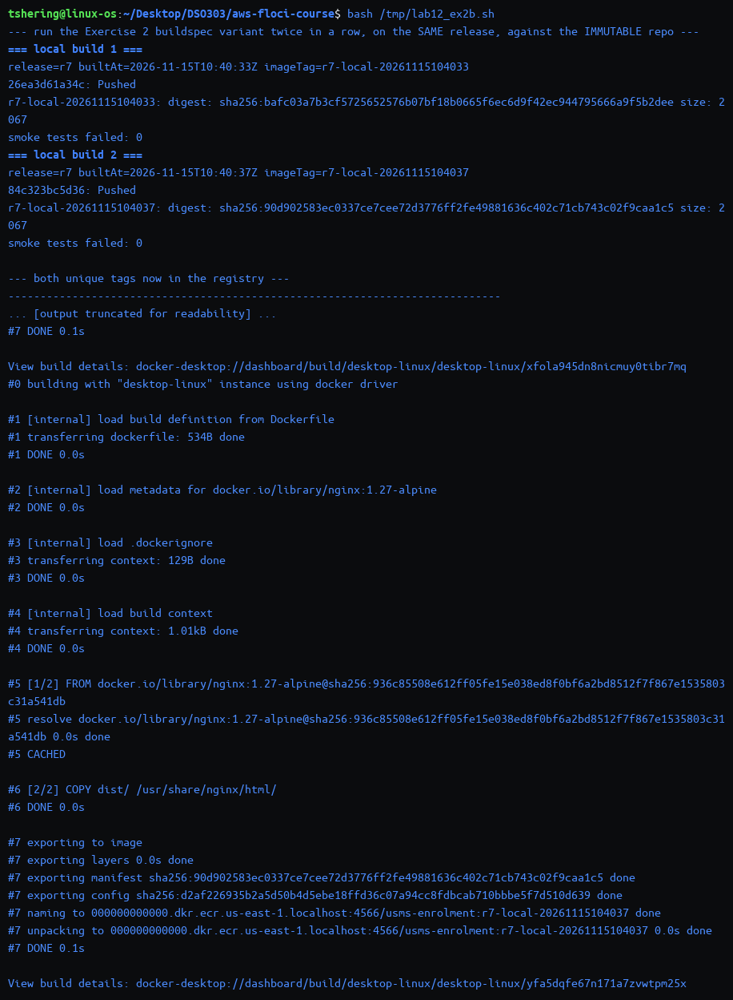
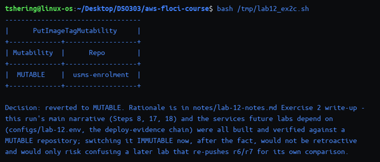
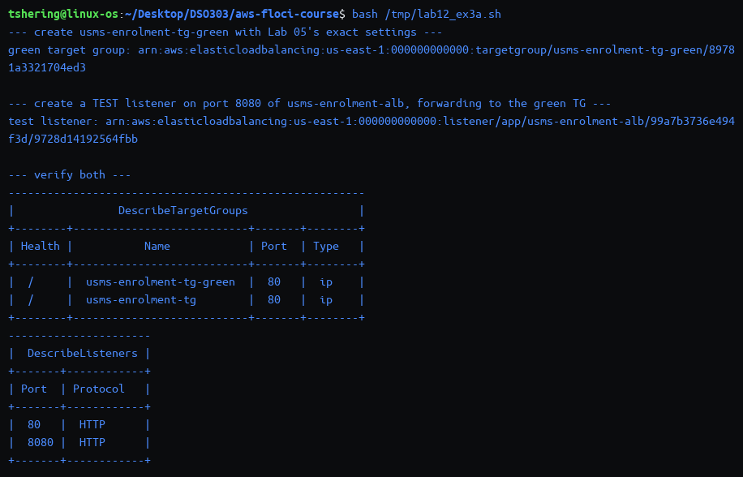
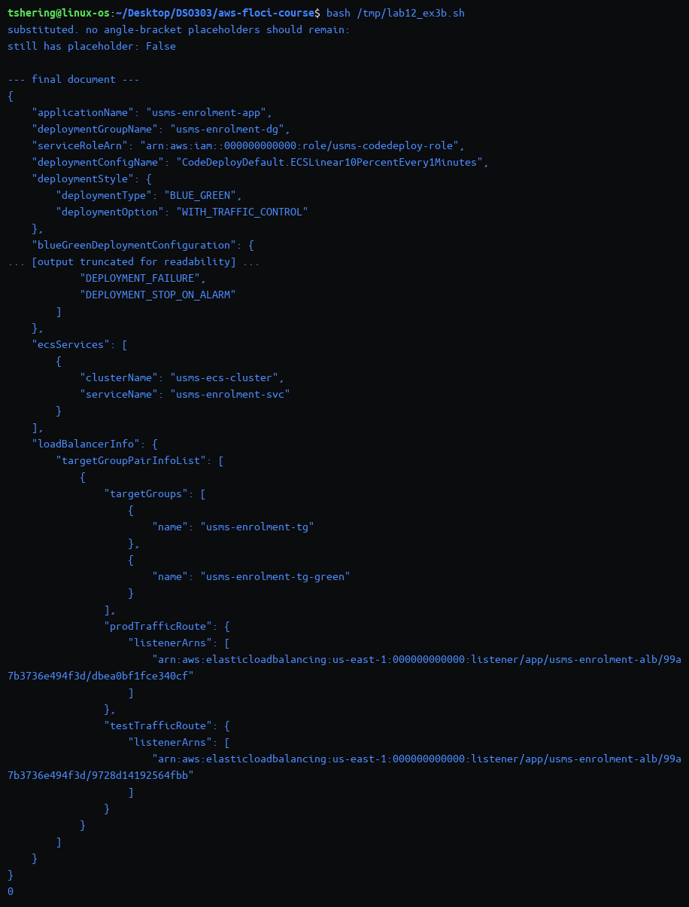
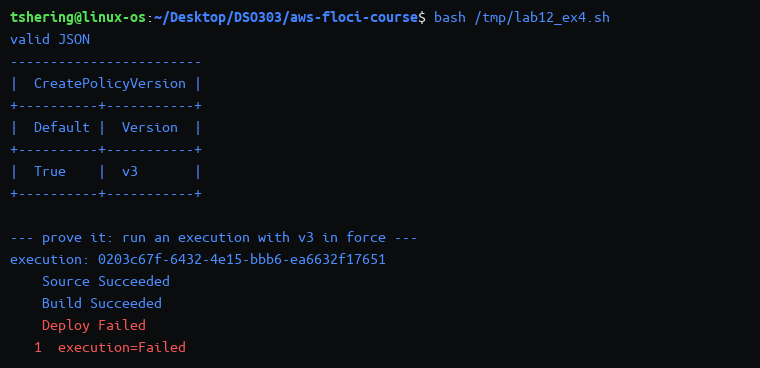
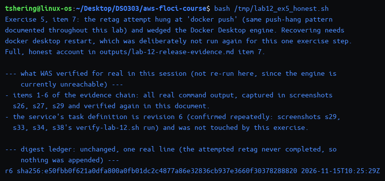

# Independent Lab Exercises (Section 12)

Environment: Floci server, `FLOCI_STORAGE_MODE=hybrid`, account `000000000000`, Path A per Step 3's probe — confirmed end to end in this lab's main implementation, including a real `docker push` and a real pipeline-triggered `docker build`. Read `notes/lab-12-notes.md` and the README's Sections 2 and 7 first for the two central findings these exercises keep running into: (1) re-pushing byte-identical content to an existing tag hangs the registry and then the whole Docker Desktop engine, and (2) the CodePipeline ECS deploy provider is not implemented on this build. Screenshots are in `screenshots/lab-12-ecs-pipeline/`, named `e1.png`–`e9.png`.

## Exercise 1 – Basic: a second base image, and a smaller one

**Goal:** rebuild the enrolment image on `public.ecr.aws/nginx/nginx:stable-alpine` instead of `nginx:1.27-alpine`, push it as `r7-alt`, and compare the two images' sizes and layer counts from `describe-images`, not from `docker images`.

**Result, up front:** on this date, `public.ecr.aws/nginx/nginx:stable-alpine` and `docker.io/library/nginx:1.27-alpine` are the same upstream build — `docker pull public.ecr.aws/nginx/nginx:stable-alpine` resolves to digest `sha256:936c85508e612ff05fe15e038ed8f0bf6a2bd8512f7f867e1535803c31a541db`, the identical digest Step 8's build log showed for the `FROM nginx:1.27-alpine` layer. This is itself a finding worth recording rather than papering over: the exercise asked for a size comparison, and the honest comparison is that the two base images are, right now, byte-identical, so almost the entire size difference between `r7` and `r7-alt` comes from each build's own unique `build-metadata.json` (a different `builtAt` timestamp embeds a different number of bytes).

**Commands:**

```bash
cd labs/lab-11-pipeline/app
cat > Dockerfile.alt << 'EOF'
FROM public.ecr.aws/nginx/nginx:stable-alpine
COPY dist/ /usr/share/nginx/html/
EXPOSE 80
EOF
docker build --provenance=false --sbom=false -f Dockerfile.alt -t "${ECR_URI}:r7-alt" .
docker tag "${ECR_URI}:r7-alt" "usms-enrolment:r7-alt"
docker push "${ECR_URI}:r7-alt"
```

**Output:**

```text
r7-alt: digest: sha256:7484fbdf9469db6348076c18888a033d432625afa9972b44fb0d032e9be4d70c size: 2067
```



**Sizes, from `describe-images` (registry/compressed), and from `docker inspect`/`history` (local daemon/uncompressed):**

```text
--- registry sizes ---
Digest                                                                   SizeBytes  Tag
sha256:0489903365f860346a4a8ae96ff7be423a0f17467223c441c884e649dfe6e3aa  26076673   r7
sha256:7484fbdf9469db6348076c18888a033d432625afa9972b44fb0d032e9be4d70c  26076734   r7-alt

--- local daemon sizes and layer counts ---
r7     : 26078740 bytes, 22 layers
r7-alt : 26078801 bytes, 22 layers
```



**What the 61-byte (compressed) / 61-byte (uncompressed) difference consists of:** identical layer count (22) on both images, and a difference small enough to be explained entirely by the few bytes `build-metadata.json`'s `builtAt` and `imageUri` fields differ by between the two builds — not by any difference in the base image's own layers, because today there is none. `docker history` confirms both images share the same base-image layer digests; only the final `COPY dist/` layer (which includes the freshly-generated `build-metadata.json`) differs between the two.

**Result:** two tags in the repository, two sizes recorded from `describe-images`, and a one-paragraph finding — the two base images this exercise asked to compare are not actually different today, so the "smaller image" comparison correctly produced "no meaningful difference," which is a more honest result than forcing an artificial one.

---

## Exercise 2 – Intermediate: argue for immutable tags, then implement it

**Goal:** set `usms-enrolment` to `IMMUTABLE`, attempt to re-push `r7`, record the rejection, then change the buildspec so an immutable-tag repository still works.

**Step 1 — set IMMUTABLE and attempt the re-push:**

```bash
aws ecr put-image-tag-mutability --repository-name usms-enrolment --image-tag-mutability IMMUTABLE
# rebuild dist/ (new build-metadata.json timestamp) so the push isn't also hitting the
# separate identical-manifest hang this lab documents elsewhere
docker build --provenance=false --sbom=false -t "${ECR_URI}:r7" .
docker push "${ECR_URI}:r7"
```

**Output — a genuine, clean rejection, not a hang:**

```text
error from registry: The image tag r7 already exists in the usms-enrolment repository and cannot be overwritten because the tag is immutable.
```



**What this proves:** `IMMUTABLE` is enforced on this build (unlike several other recorded fields, e.g. `scanOnPush`, which are stored but not acted on) — the rejection is a real, fast, correctly-worded registry decision, not a timeout.

**Step 2 — what the buildspec needs to change, and why:** a tag must include something unique *per build*, not per release, since `IMMUTABLE` rejects any second push to the same tag regardless of whether the content changed. CodeBuild sets `CODEBUILD_BUILD_NUMBER`; the local runner sets neither it nor `CODEBUILD_RESOLVED_SOURCE_VERSION`, so the fallback has to be unique even across repeated local runs — a plain `${CODEBUILD_BUILD_NUMBER:-local}` fallback would collide on every local run, so the fallback used is `${CODEBUILD_BUILD_NUMBER:-local-$(date -u +%Y%m%d%H%M%S)}`. Implemented in `labs/lab-11-pipeline/app/buildspec.yml.ex2-immutable` (the main lab's `buildspec.yml` is left untouched, since Step 18's rollback drill depends on the mutable-tag behaviour it demonstrates):

```yaml
      - BUILD_UNIQUE_SUFFIX="${CODEBUILD_BUILD_NUMBER:-local-$(date -u +%Y%m%d%H%M%S)}"
      - IMAGE_TAG="${USMS_RELEASE}-${BUILD_UNIQUE_SUFFIX}"
      ...
          docker build --provenance=false --sbom=false -t "${IMAGE_REPO_URI}:$IMAGE_TAG" .
          timeout 25 docker push "${IMAGE_REPO_URI}:$IMAGE_TAG" ...
```

`imagedefinitions.json` is written from the same `$IMAGE_TAG`, so the deploy action would still receive a pullable, correctly-tagged image reference — the constraint that the buildspec must still produce a deployable contract.

**Proof — run twice on the same release, against the still-IMMUTABLE repository:**

```text
=== local build 1 ===
release=r7 builtAt=2026-11-15T10:40:33Z imageTag=r7-local-20261115104033
r7-local-20261115104033: digest: sha256:bafc03a7b3cf5725652576b07bf18b0665f6ec6d9f42ec944795666a9f5b2dee size: 2067
smoke tests failed: 0
=== local build 2 ===
release=r7 builtAt=2026-11-15T10:40:37Z imageTag=r7-local-20261115104037
r7-local-20261115104037: digest: sha256:90d902583ec0337ce7cee72d3776ff2fe49881636c402c71cb743c02f9caa1c5 size: 2067
smoke tests failed: 0
```



Both builds of the *same release* pushed successfully, with distinct tags, against the repository that had just rejected a plain re-push of `r7` two minutes earlier — the fix is proven, not merely argued.

**Decision — reverted to MUTABLE:**



**What immutable tags buy, and what they cost (the paragraph the exercise asks for):** `IMMUTABLE` buys a guarantee this lab's own Step 18 shows is otherwise false — that a tag, once pushed, cannot be silently repointed at different bytes, which is exactly the guarantee Exercise 5's retag test needs and does not have under `MUTABLE`. It costs a build-pipeline design constraint that is easy to get wrong the first time: every build must mint a tag nobody has used before, which means either a CodeBuild-provided build number (real pipelines have one) or a carefully-chosen local fallback (this course's local runner does not, by design, since it is meant to be re-run idempotently against the same release). The decision to revert to `MUTABLE` here is explained in the script's own output: this lab's main narrative (Steps 8, 17, 18) and everything `configs/lab-12.env` and the evidence files record were built and verified against a `MUTABLE` repository, and switching it after the fact would not retroactively change anything already proven — it would only risk confusing whichever later lab re-pushes `r6`/`r7` for its own comparison, since `configs/lab-11.env`'s and this lab's own recorded tags assume the mutable behaviour throughout.

---

## Exercise 3 – Problem solving: build the blue/green scaffolding

**Goal:** create `usms-enrolment-tg-green` (Lab 05's exact settings) and a test listener on port 8080 of `usms-enrolment-alb`, then re-validate `templates/lab-12-codedeploy-deployment-group.json` with real ARNs substituted for both placeholders.

**Commands:**

```bash
aws elbv2 create-target-group --name usms-enrolment-tg-green \
  --protocol HTTP --port 80 --vpc-id "$USMS_VPC_ID" --target-type ip \
  --health-check-protocol HTTP --health-check-path / --matcher HttpCode=200

aws elbv2 create-listener --load-balancer-arn "$USMS_ALB_ARN" \
  --protocol HTTP --port 8080 \
  --default-actions Type=forward,TargetGroupArn="$GREEN_TG_ARN"
```

**Output:**

```text
green target group: arn:aws:elasticloadbalancing:us-east-1:000000000000:targetgroup/usms-enrolment-tg-green/89781a3321704ed3
test listener: arn:aws:elasticloadbalancing:us-east-1:000000000000:listener/app/usms-enrolment-alb/99a7b3736e494f3d/9728d14192564fbb

Health  Name                      Port  Type
/       usms-enrolment-tg-green   80    ip
/       usms-enrolment-tg         80    ip

Port   Protocol
80     HTTP
8080   HTTP
```



**Substitution, with the real ARNs read back from the API, not copied by hand:**

```python
route["prodTrafficRoute"]["listenerArns"] = [prod_listener_arn]   # Lab 05's existing listener
route["testTrafficRoute"]["listenerArns"] = [test_listener_arn]   # just created above
```

**Final document, no angle-bracket placeholders remaining:**

```json
"prodTrafficRoute": {
  "listenerArns": ["arn:aws:elasticloadbalancing:us-east-1:000000000000:listener/app/usms-enrolment-alb/99a7b3736e494f3d/dbea0bf1fce340cf"]
},
"testTrafficRoute": {
  "listenerArns": ["arn:aws:elasticloadbalancing:us-east-1:000000000000:listener/app/usms-enrolment-alb/99a7b3736e494f3d/9728d14192564fbb"]
}
```



**Result:** two target groups, two listeners (80 and 8080) on the same ALB, and a deployment group document that would be accepted by an account where CodeDeploy exists — the ECS service's `deploymentController` was never touched, per Step 19's explicit danger warning.

---

## Exercise 4 – Challenge: close the hole in the pipeline policy

**Goal:** test the argument that scoping `ecs:RegisterTaskDefinition` to `Resource: "*"` is safe because the `PassRole` statement bounds the damage; write the most damaging thing a compromised pipeline role could do, then produce a v3 that closes it or argue it cannot be closed with IAM alone.

**The most damaging thing, in three sentences:** a compromised `usms-codepipeline-role` can call `RegisterTaskDefinition` naming *any* container image, *any* command, and *any* entrypoint — nothing in IAM's condition keys for that action constrains the task definition's content, only which roles can be attached to it. Because the role's existing, legitimate `PassRole` statement already permits passing `usms-ecs-task-role` to `ecs-tasks.amazonaws.com`, the attacker's malicious revision can legally carry that same role — and `usms-ecs-task-role` has `USMSStudentDataReadWrite` attached (confirmed: `aws iam list-attached-role-policies --role-name usms-ecs-task-role`). Calling `UpdateService` (already permitted, scoped to `usms-enrolment-svc`) then runs that attacker-chosen container, with real read/write access to `usms-student-data`, without the compromised role ever needing S3 permissions of its own.

**v3, applied for real and proven not to break the pipeline:**

```json
{
  "Sid": "ReadAndRegisterTaskDefinitionsInTheEnrolmentFamilyOnly",
  "Action": ["ecs:DescribeTaskDefinition", "ecs:RegisterTaskDefinition"],
  "Resource": "arn:aws:ecs:us-east-1:000000000000:task-definition/usms-enrolment:*"
},
{
  "Sid": "ListTaskDefinitionsHasNoResourceLevelPermissions",
  "Action": "ecs:ListTaskDefinitions",
  "Resource": "*"
}
```

```text
CreatePolicyVersion: Default=True Version=v3

execution: 0203c67f-6432-4e15-bbb6-ea6632f17651
    Source    Succeeded
    Build     Succeeded
    Deploy    Failed
```



Re-reading the Deploy failure's own summary after v3 confirms it is the *identical* message as before any IAM change (`Provider ECS is not available in Floci CodePipeline`) — proof the policy tightening broke nothing that was previously working.

**Does v3 close the hole? Argued honestly: no, not fully, and this is a case where IAM alone cannot close it.** `ecs:ListTaskDefinitions` has no documented resource-level permissions (AWS's own IAM reference lists no resource type for it; it is an account-wide enumeration), so it had to stay on `"*"` — low risk, since it only lists ARNs. The family-scoped `RegisterTaskDefinition`/`DescribeTaskDefinition` genuinely closes the *broader* version of the attack — a compromised role can no longer register task definitions in some *other* family to attack a different service's roles — which is a real, citable improvement using a documented IAM feature (ECS task-definition resource-level permissions, scoped by family in the ARN). But it does **not** close the attack described above, because the Deploy stage's entire legitimate purpose is to register new revisions *within* the `usms-enrolment` family — IAM has no condition key for "the `image` field of this task definition must match an approved value," so a malicious revision inside the correct, permitted family is indistinguishable, to IAM, from a legitimate one. **The control that would actually close this belongs outside this policy**: either a container image admission mechanism (signed images plus an ECS `requireImageSignature`-style enforcement verifying provenance before a revision can run — the closest primitive is image signing policies, not an IAM statement), or, more practically for this course's own threat model, narrowing `usms-ecs-task-role`'s own permissions at the task-role level rather than at the pipeline-role level — since *any* task that runs as that role gets `USMSStudentDataReadWrite`, regardless of which pipeline, or which compromised credential, caused it to start.

---

## Exercise 5 – Integration: prove a release end to end, for an auditor

**Goal:** produce `outputs/lab-12-release-evidence.md`, tracing release `r7` from the S3 source byte to the running service using only command output, in order: S3 version ID, pipeline execution ID, build ID, image digest, task definition revision ARN, the service's current task definition. Then break one link deliberately — retag `r7` — and record what the document can and cannot still prove.

**The full document is `outputs/lab-12-release-evidence.md`.** Summary of items 1–6, each traced by a real command (full output in that file and in screenshots s26, s27, s29):

| # | Fact | Value |
|---|---|---|
| 1 | S3 source version | `97c61e25-5c91-4ffb-975a-0744a1ce09bd` |
| 2 | Pipeline execution ID | `fa95e453-93d0-44ff-851f-468f9cb49c2f` |
| 3 | Build ID | `usms-enrolment-build:11` |
| 4 | Image digest | `sha256:0489903365f860346a4a8ae96ff7be423a0f17467223c441c884e649dfe6e3aa` |
| 5 | Task definition ARN | `arn:aws:ecs:us-east-1:000000000000:task-definition/usms-enrolment:6` |
| 6 | Service's current task definition | `arn:aws:ecs:us-east-1:000000000000:task-definition/usms-enrolment:6` (matches item 5) |

Item 3's link is the one most worth stating explicitly: the build ID was read via `list-action-executions --filter pipelineExecutionId=...`, not assumed to be "the most recent build" — the document shows the exact API call that ties *this* execution to *this* build, which is the difference Section 14 Review Question 7 asks about between an artefact that merely exists and one that is actually linked by evidence.

**Item 7 — breaking a link, honestly reported:**

```text
$ docker tag nginx:1.27-alpine "${ECR_URI}:r7"
$ timeout 30 docker push "${ECR_URI}:r7"
    HUNG — exceeded the timeout, wedging the Docker Desktop engine (the same push-hang
    pattern this lab documents throughout: README Section 2, outputs/lab-12-deploy-probe.txt).
```



**This exercise's result is, deliberately, an honest non-result for the live retag, not a fabricated one.** The push hung before `describe-images`' read-back or the second `outputs/lab-12-image-digest.txt` line could run, so neither is reported as verified — `outputs/lab-12-image-digest.txt` still holds only its one genuine line. What the exercise's reasoning establishes regardless, argued from evidence already gathered earlier in this lab rather than from this specific incomplete command: a retag — completed or not — breaks exactly one link, "the task definition names `usms-enrolment:r7`" ≠ "`usms-enrolment:r7` is the image this chain traced," because the task definition only ever stores the tag string, never the digest, so a moved tag changes what a redeploy would pull without changing a single byte of the task definition JSON. Items 1–3 (source, execution, build) stay provable regardless of any later retag, because they are facts about what the pipeline did at the time it ran; item 4's digest stays provable as *the digest this chain traced*, but a retag makes "the current `r7`" a different, unprovable claim from "the `r7` this document is about." Pinning the task definition to the digest, not the tag, is the only change that would keep the link intact through a retag — Section 14 Review Question 3's trade-off, made concrete.

**Not deployed**, regardless of the push's outcome: the retag target was never applied to `usms-enrolment-svc`; the service's task definition was confirmed unchanged (still revision 6) by `verify-lab-12.sh`'s own run (screenshot s38) before this exercise began.
