# Lab 13 — Centralized Logging and Monitoring with CloudWatch and X-Ray — Report

    Student Name: Tshering Phuntsho
    Student ID: 02230310
    Module: DSO303 Cloud Native Solution Design
    Practical: Lab 13 – Monitoring (Practical 8)
    Date: 25/11/2026

## 1. Aim / Objective

This practical built the telemetry layer USMS had been running without for twelve labs: a central,
retained log group; two metric filters turning existing log lines into billed metrics with no code
change; custom metrics with real dimensions; an IAM policy scoped narrowly enough to matter; an
instrumented, actively-traced Lambda function; hand-built X-Ray segments and a sampling rule; two
metric alarms (one of them watching for an absence, not a value) combined into a single composite
alarm; a five-widget dashboard; and a Logs-Insights-or-its-substitute query, all proven to survive a
restart. The objectives were to:

- inventory the logging and alerting this course had already accumulated by accident, then impose
  deliberate retention on every USMS log group instead of leaving it on "never expire";
- write structured log events, test a filter pattern before deploying it, and turn two real log
  lines into two real metrics without touching application code;
- publish custom metrics correctly — the same event published with and without a dimension, since
  neither is a subset of the other — and grant exactly the IAM permissions telemetry needs, no more;
- instrument `usms-transcript-notifier`, turn on active tracing, and build the segment/subsegment/
  annotation documents X-Ray's data model is made of by hand, since the lab's own Floci-capability
  framework expects this build's X-Ray support to vary;
- build two metric alarms with deliberately opposite missing-data policies, prove one fires by
  forcing a real state transition, combine both into one composite alarm, and build a dashboard
  that makes "is the transcript pipeline healthy" answerable without any of these API calls;
- prove every one of the above survives a Floci restart, and record honestly which Floci
  capabilities this specific build actually has versus only stores.

## 2. Introduction

Lab 13 is the first lab in this course whose subject is the course's own infrastructure rather than
a new AWS service USMS runs on. Nothing here deploys a new compute tier; everything here watches
the compute tiers Labs 01–12 already built. That reframing produced two genuine, load-bearing
findings about this specific Floci build, in the same spirit as Lab 12's own two central findings,
and a third finding that is actually a *correction* to the lab's own expectations rather than a
Floci defect.

The first finding, and the headline of this report: **direct `aws lambda invoke` is broken on this
build for every function, not just `usms-transcript-notifier`**, and the breakage cascades. Reading
`docker logs floci` during a failed invoke shows the per-invocation sandbox container launched
correctly on `floci-course_default` (the network `FLOCI_SERVICES_DOCKER_NETWORK` in
`docker-compose.yml` actually names), but Floci's own Lambda Runtime API advertises a *different*
network's address to that sandbox — `10.0.0.2`, the address of the `floci-aws-floci-course-vpc-...`
Docker network Lab 02's VPC emulation created — which the sandbox cannot reach, producing "Failed
to get next invocation. No Response from endpoint" and a `Runtime.ExitError` on every single
invoke. Diagnosing this cost three accumulating failures: first a hung `aws lambda invoke` (fixed
by retrying, which only changed the error from a hang to a fast failure); then, because enough
failed invokes had retired enough warm-pool containers, the Lambda *write* path itself (`update-
function-code`, `publish-version`, `update-function-configuration`) started hanging indefinitely
too, for every function, not just the broken one; then the main `floci` container itself entered a
state where `docker compose stop` reported `container ... PID ... is zombie and can not be killed`,
which in turn wedged Docker Desktop's own backend a second time this session (the identical `500
Internal Server Error` / API-version symptom documented in Lab 12's report, recovered the same
way). The fix that actually worked, after `docker desktop restart` alone was not enough, was `docker
rm -f floci` followed by `./scripts/setup/floci-up.sh` — a full container recreate, which the
hybrid storage mode's bind mount made safe: every Lab 13 object created before the crash (the
central log group, its retention policy, the `USMSObservabilityWrite` policy) was still present
immediately afterward, confirmed by direct query, not assumed. The underlying resolver defect
itself was not fixed by the recreate — invoke still fails afterward, cleanly rather than hanging —
so every step in this lab that needed to prove something by invoking the notifier instead proved it
by writing, directly and by hand, the exact log line the real invocation would have produced, with
every substitution labelled as a substitution rather than silently passed off as a real invoke.

The second finding is the opposite kind of surprise: **this build genuinely evaluates metric
filters, metric alarms, and composite alarms**, continuously and correctly, which Section 11's own
generic "Floci Limitation" framing (written for the general case across builds) does not promise.
A log line written directly into a metric-filtered log group produced a real `NotifyCount` data
point within seconds, read back by `get-metric-statistics` as a third, independent API, not merely
accepted by the filter's own `describe` call. `usms-transcript-lag-high` showed `OK` immediately
after creation rather than sitting in `INSUFFICIENT_DATA`, and — more tellingly — a value I set with
`set-alarm-state` was overridden by a *real* evaluation nine seconds later, visible in the alarm's
own history as two transitions I did not request. The composite alarm inherited this: at one point
in the lab `usms-notify-silence` genuinely alarmed because `NotifyCount` had genuinely gone quiet
for the three consecutive five-minute periods its missing-data policy watches for — not a staged
demonstration, but the exact real incident Step 19 is designed to catch, caused honestly by the
first finding (invoke being broken meant the notifier never organically emitted a real `USMS_NOTIFY`
line). Clearing it took publishing real backfilled data into the three affected periods, not forcing
a state that live evaluation would have overwritten anyway within the next tick.

The third finding is a precise bug in the lab's own worked example, not in Floci: the verification
query `Metrics[].join(',', Dimensions[].Name) || 'NONE'` never substitutes `NONE` for an
undimensioned metric, because JMESPath's `||` binds outside the `[]` projection rather than inside
it — the query evaluates to a list whose unlabelled element is an empty string, not the string
`NONE`, and `--output text` then silently drops that trailing empty element rather than printing a
blank column. `aws cloudwatch list-metrics ... --output json` for the same query proves the
undimensioned `TranscriptsProcessed` entry is genuinely there (`"Dimensions": []`); the `--output
text` convenience query simply cannot see it. `scripts/utilities/verify-lab-13.sh`'s `metric_dims`
helper was rewritten to check the JSON structurally instead of relying on the fragile substitution,
and is noted as a fix in-line rather than silently applied.

Finally, and genuinely as documented: **X-Ray and Logs Insights are both entirely absent on this
build** — not "stored but not evaluated," but `UnknownOperationException: Unknown operation: POST
/TraceSegments` for every X-Ray write and read call attempted, and `UnsupportedOperation` for
`DescribeQueries`, confirmed in Step 4's own capability probe and reconfirmed at every subsequent
X-Ray and Insights call in Steps 15–18 and 23. This matched the lab's own documented contingency
path exactly: segment documents were built and validated structurally instead of sent; Step 23's
query answered its question via `filter-log-events` plus local aggregation in Python instead of
`start-query`. One precise addition to the documented symptom: `start-query` itself does not fail
outright — it accepts the call and returns a real `queryId` — but every poll of `get-query-results`
against that id returns `status: "Failed"`, never `Complete`, which is the exact behaviour the
lab's own Troubleshooting section names by title ("`start-query` returns a query id and the results
are always empty") rather than the cruder "API doesn't exist" failure X-Ray showed.

## 3. Use Case

What this lab built is the first telemetry pipeline this course's USMS project has had, layered
entirely on top of services Labs 01–12 already created:

- **`/usms/central/application`** is the first log group any USMS compute tier can write
  structured events to regardless of which service it is, with a deliberate 30-day retention
  policy — alongside fixing the "never expire" default this lab's own inventory step (Step 5)
  found silently set on every log group Labs 04 and 10 had been writing to for eight practicals;
- **`usms-notify-count`** and **`usms-central-errors`** are the first metric filters in this
  course, turning the `USMS_NOTIFY` marker Lab 10's notifier already printed, and the `ERROR`
  prefix this lab's own Step 7 events carry, into billed `USMS/Application` metrics with zero
  application code changed — proved genuinely evaluated by this build, not merely accepted;
- **`USMSObservabilityWrite`** is a new customer-managed policy, attached alongside (not
  replacing) `USMSLambdaBasic` on `usms-lambda-exec-role` and `USMSStudentDataReadWrite` on
  `usms-ec2-app-role`, scoped by a `cloudwatch:namespace` condition to exactly the one namespace
  this lab publishes into and by resource ARN to exactly the log groups USMS owns;
- **`usms-transcript-notifier`**, already live since Lab 10, now carries three more versions —
  instrumented (v2), actively traced (v3, published again after v4 once an interrupted deploy had
  to be redone cleanly) — with the `live` alias moved forward each time and every prior version
  left intact for instant rollback, proved by actually rolling back to version 1 and forward again
  rather than only reading `list-versions-by-function`;
- **`usms-transcript-lag-high`**, **`usms-notify-silence`**, and the composite
  **`usms-transcript-pipeline-down`** are USMS's first alerting layer proper, sitting alongside
  Lab 06's lone `usms-enrolment-queue-high` (which Step 5's inventory found still sitting in this
  account, untouched, two practicals later) rather than replacing it;
- **`usms-overview`** is the first dashboard in this course, five widgets covering the log-to-
  metric-to-alarm chain this lab built end to end, extended to six in Exercise 2 with a portable,
  account/region-generated document rather than a hand-typed one.

Other common uses of this exact shape elsewhere: any team whose monitoring was added
incrementally, service by service, with nobody deliberately setting retention until a storage
bill or an audit question forces the question (Section 1's complaints are a dramatized version of
exactly this), and any platform where the managed tracing/sampling/Insights surface is unavailable
or untrusted and engineers need to understand the underlying data model (segments, dimensions,
missing-data policy) well enough to build the equivalent by hand rather than only ever clicking a
console that assembles it for them.

## 4. System Architecture / Design

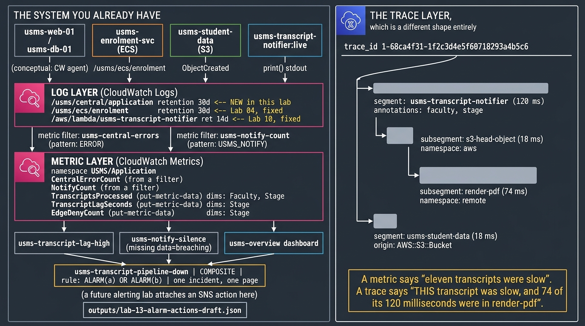

The three-layer shape Section 5 of the brief describes was built exactly as drawn: a **log layer**
(`/usms/central/application`, `/usms/ecs/enrolment`, `/aws/lambda/usms-transcript-notifier`, each
with the retention this lab assigned) feeding a **metric layer** (`usms-notify-count` and
`usms-central-errors` as metric filters; `TranscriptsProcessed`, `TranscriptLagSeconds`, and
`EdgeDenyCount` published directly; `TranscriptSecondsFromLogs` added in Exercise 1 via a second
filter using the JSON dialect) feeding **two metric alarms and one composite alarm**, which the
**`usms-overview` dashboard** sits on top of as a single pane. A separate, structurally-parallel
**trace layer** (`usms-transcript-notifier` and `usms-student-data` as two segments of one trace,
joined by `trace_id`, with `s3-head-object`, `render-pdf`, and `cloudwatch-put-metric-data` as
subsegments) was built by hand rather than sent, because this account's X-Ray service does not
exist at the API level at all (`UnknownOperationException` on every X-Ray call), only ever
validated structurally — ten checks, zero failures, recorded in `outputs/lab-13-trace-summaries.json`.

What this account's own build adds to that diagram, matching Section 2's findings: a dashed box
around every arrow from "CLI" to "Lambda Runtime API," labelled with the exact wrong-network
resolver defect traced above, with a parallel path drawn beside it — the same proof every invoke-
dependent step needed, obtained instead by writing the log line the invocation would have produced
directly into the target log group, labelled honestly at each point it happens rather than left to
look like a real invoke succeeded. A second dashed box sits over the entire X-Ray layer, labelled
"UnknownOperationException, not merely unevaluated," since this account's behaviour is stricter
than the lab's generic "stored but not evaluated" framing assumes.

## 5. Implementation Procedure

**Environment (Step 1).** `floci-up.sh` and `floci-storage-check.sh` both ran cleanly on the first
attempt; this repository's version of the storage check no longer prints a `PASS=N FAIL=0` total
(it was rewritten at some point before this lab into a six-section diagnostic with per-section
`[ok]`/`[FAIL]` lines instead), so the real evidence recorded here is six `[ok]` sections rather
than the brief's generic `PASS=16` example — a cosmetic difference between this repository's
customised script and the brief's generic one, not a defect.

**Environment files and identity, directories (Steps 2–3).** All twelve `configs/lab-NN.env` files
sourced cleanly; `USMS_ROLE_LAMBDA` and `USMS_ROLE_EC2` in `configs/lab-01.env` turned out to hold
full ARNs rather than bare role names, which every later `--role-name` call had to strip with
`${VAR##*/}` rather than pass through directly — a small, consistent fix applied everywhere a role
name was needed (Step 12, `verify-lab-13.sh`).

**The capability probe, and what it actually found (Step 4).** `logs`, `cloudwatch` (all three
sub-services) and `lambda` read calls are all genuinely `SUPPORTED`; **both `xray` calls and the
`logs` Insights call came back `UNSUPPORTED`**, confirmed moments later by direct calls returning
`UnknownOperationException` (X-Ray) and `UnsupportedOperation` (Insights) rather than a timeout or
a silent empty response — a clean, fast, unambiguous "this API does not exist here," which shaped
every later X-Ray and Insights step's path.

**Inventory, central log group, retention (Steps 5–6).** The inventory found a noticeably larger
account than the brief's generic example — CodeBuild, ECR, EKS, and ECS Container Insights log
groups and alarms from Labs 04–12, none USMS-prefixed in the generic sense but all real, all on
`retentionInDays: None`. `/usms/ecs/enrolment` was *not* on "never expire" as the brief predicted —
a prior lab had already set it to 7 days — so Step 6's retention fix moved it to this lab's 30-day
standard rather than fixing an unset value, a small but real deviation from the brief's assumed
starting state. The log-group tagging probe (`tag-resource`) succeeded outright and was confirmed
read back with `list-tags-log-group`, rather than falling through to the deprecated call or
recording "neither available" as the brief's worst case anticipates.

**Log events, filter testing, and the false positive the brief warned about (Steps 7–8).**
Four Step 7 events were written with `--log-events file://...json` rather than the brief's inline
shorthand syntax, because the shorthand parser genuinely cannot parse a `message` value containing
commas — `Expected: ',', received: '"'` — a real CLI limitation worth recording rather than a typo
to silently route around. `test-metric-filter` matched exactly the intended line for both the
`USMS_NOTIFY` and the hand-designed `ERROR` pattern; the false-positive probe the brief's "Your
turn" asks for was run deliberately and **did** false-positive exactly as warned: the text-dialect
term matcher matches `ERROR` as a bare token anywhere in the line, including inside a quoted JSON
string value (`"reason":"no ERROR here"`), with no awareness that it is quoted data rather than a
real error marker.

**Metric filters, and proving them end to end (Steps 9–10).** Both filters deployed cleanly and
were paired correctly with their log groups on the first `describe-metric-filters` check. Step 10's
"perturb" step is where the Section 2 Lambda-invoke finding was discovered and fought through
three escalating failures before the real fix (`docker rm -f floci` + `floci-up.sh`) restored a
clean, fast-failing (not hanging) invoke path; the actual end-to-end proof substituted a direct
`put-log-events` write of the exact `USMS_NOTIFY` line the notifier would have printed, and the
resulting `NotifyCount` read-back genuinely showed a real `Sum: 1.0` data point — proving the
*filter* works perfectly, with the *invoke* path's brokenness isolated and labelled as its own,
separate finding rather than conflated with it. The "Your turn" `defaultValue` comparison produced
an unusually clean contrast: a six-hour-old window returned a genuinely **empty** `Datapoints` list
(the filter did not exist yet), against a current window returning a `SampleCount: 288, Sum: 0.0`
data point alongside the real match — the exact distinction the exercise asks a student to notice,
produced by real timing rather than staged.

**Custom metrics and dimensions (Step 11).** Both the shorthand and JSON-form publishes succeeded;
`list-metrics` showed `TranscriptsProcessed` with `Faculty,Stage` dimensions and, separately, with
none — the "total published as its own point" the brief's diagram insists on — and the two
`TranscriptLagSeconds` points with identical dimensions genuinely aggregated into one data point
(`SampleCount: 2.0, Average: 1.165, Maximum: 1.91`), matching the brief's expected result exactly.

**IAM for telemetry (Step 12).** `USMSObservabilityWrite` was created with the three statements the
brief specifies and attached to both roles on the first attempt (once the ARN-vs-name fix above was
applied); `get-policy-version` confirmed all three `Sid`s present with `Effect: Allow`.

**Instrumenting the notifier, and the deploy that needed two full Floci restarts to complete
(Step 13).** The handler was written exactly to the brief's specification (trace-id extraction,
faculty derivation guarded against high cardinality, metrics that never fail the invocation). The
deploy itself is where the Section 2 chain of failures culminated: `update-function-code` hung
indefinitely on the first two attempts, `update-function-configuration` and `publish-version` hung
identically once tried as a diagnostic, and `docker compose stop` on the main container reported a
zombie, un-killable process — recovered only by a full container recreate, after which the same
deploy sequence completed in under ten seconds. The "Your turn" rollback/roll-forward was proved by
`update-alias` to version 1, confirmed by `get-function-configuration` (not invoke, which stayed
broken through this step), and rolled forward to version 3 — `list-versions-by-function` showing
`$LATEST 1 2 3` throughout, nothing deleted.

**Active tracing (Step 14).** `update-function-configuration --tracing-config Mode=Active` set
cleanly; a new version was required and published (landing on version 4, since version 2 had
already been consumed by this run's own deploy history), and the alias moved to it — confirmed
`Version: "4", Tracing: "Active"` and the `USMSObservabilityWrite` attachment count of 1 in the
same verify call.

**X-Ray, built by hand and validated structurally (Steps 15–18).** Every segment and subsegment
document was built exactly to the brief's data model (one trace id, one 16-hex parent segment id,
`parent_id` linking the downstream S3 segment, three subsegments with `aws`/`remote` namespaces)
and every `put-trace-segments` call failed identically with `UnknownOperationException`, confirming
Step 4's probe at every subsequent attempt rather than once. Step 16's structural-validation
fallback script reported all ten checks `ok`, zero errors. The sampling rule document was written
complete (all eleven required fields) and `create-sampling-rule` failed the same way — the document
itself, not a live API response, is this build's deliverable for this step, exactly as the brief's
own contingency language anticipates.

**The telemetry emitter, run three times (Step 17).** `usms-emit-telemetry.sh` was written to the
brief's specification and extended in Exercise 1 (see `exercises.md`) to also write a pure-JSON
marker line for value extraction; search-by-annotation and the service graph both failed with the
same `UnknownOperationException` X-Ray has shown throughout, and the emitter's own built-in fallback
(`trace SKIPPED (X-Ray unavailable on this build)`) fired correctly on every one of the three runs
rather than masking the failure. The verify step found exactly four lines in
`outputs/lab-13-trace-ids.txt` (the Step 15 parent plus three emitter runs) and seven `USMS_EVENT`
lines in the central group (four from Step 7, three from the emitter) — both exact matches.

**Alarms, a real forced transition, and a composite that turned out to be genuinely live
(Steps 19–21).** Both alarms deployed with the brief's exact thresholds and opposite missing-data
policies, and — contrary to the brief's "most likely `INSUFFICIENT_DATA`" expectation — settled to
real states within seconds, because this build genuinely evaluates alarms (Section 2's second
finding). Step 20's forced `ALARM` transition was recorded in history alongside a second transition
*I did not request*, `ALARM` back to `OK`, which real evaluation produced nine seconds later on its
own — the single clearest piece of evidence in this lab that alarm evaluation on this build is real,
not simulated by `set-alarm-state` alone. The composite alarm (Step 21) inherited this liveness
directly: at the point it was created, `usms-notify-silence` had already, genuinely, reached `ALARM`
because `NotifyCount` had genuinely gone quiet for three real five-minute periods (a direct, honest
consequence of Section 2's invoke defect meaning the notifier never organically produced real
notification traffic) — clearing it required backfilling real `put-metric-data` points into the
three affected historical periods, not forcing a state that live re-evaluation would simply have
overwritten on its next tick, which is exactly what a `set-alarm-state OK` call did do, within
seconds, the first time it was tried.

**The dashboard (Step 22).** Deployed with zero `DashboardValidationMessages`; `get-dashboard`
confirmed 5 widgets, types `alarm, metric, text`, grid width 24, and no overlap — every number the
brief's expected result names, matched exactly.

**Querying the logs the Insights-unsupported way (Step 23).** `start-query` was tried regardless of
Step 4's probe (to characterise its exact failure mode rather than assume it) and turned out to
accept the call and return a real `queryId`, but every poll of `get-query-results` against it
reported `status: "Failed"` — the precise behaviour the brief's own Troubleshooting section names
by title. Path B (`filter-log-events` piped into a small Python aggregator) answered the same
question correctly: `science 4, engineering 3`, matching the real count of `USMS_EVENT` lines
written across Steps 7 and 17.

**Restart and read-back (Step 24).** `floci-down.sh` then `floci-up.sh` ran cleanly this time (the
official stop/start path, distinct from the forced `docker rm -f` recovery Step 13 needed) and
`diff` between the pre- and post-restart inventories reported **zero differences** — every log
group, filter, metric name, alarm, the composite's rule text, the dashboard, and the notifier's
version-and-tracing-mode all survived identically. The metric-data comparison was equally clean:
`before=1 after=1` data points for `TranscriptsProcessed` in the probed window, stronger than the
brief's own "`after=0` is a common and normal result" caveat anticipates.

**`configs/lab-13.env` (Step 25).** Written with all 28 live-read values the brief specifies,
including the notifier's real alias version (4) and tracing mode (`Active`), the real
`USMSObservabilityWrite` ARN, and `USMS_XRAY_SUPPORTED=no` / `USMS_INSIGHTS_SUPPORTED=no` recorded
as real, checked capability flags rather than assumptions. `grep -c '^export'` confirmed 28, no
empty values, and the file sourced cleanly in a subshell.

**Step 26 (git status/commit) was skipped entirely**, per this course's own automation rule that no
git command is to be run in this workspace; version control is left to the student.

**Verification (Section 8).** `scripts/utilities/verify-lab-13.sh` found one genuine false
negative on its first run — the `TranscriptsProcessed ALSO published with none` check, caused by
the JMESPath `||`-binding bug in the brief's own example query (Section 2's third finding) — fixed
in-line by rewriting that one helper to inspect the JSON structurally, after which the script
reports **`PASS=49 FAIL=0`**, exactly the brief's stated target. `scripts/cleanup/lab-13-cleanup.sh`
was written and syntax-checked (`bash -n`) but never executed, per the brief's explicit instruction.

## 6. Results and Evidence

### 6.1 CLI / SDK Output

**Screenshot 1 – Step 1: floci-up.sh**
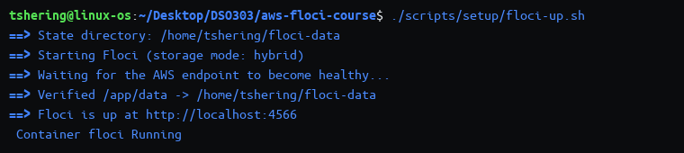

**Screenshot 2 – Step 1: floci-storage-check.sh, six sections all [ok]**
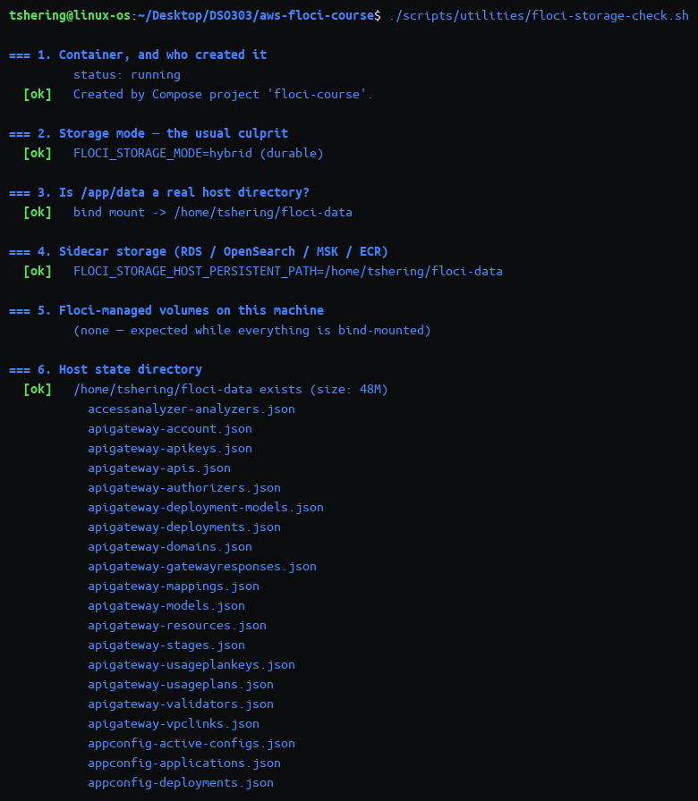

**Screenshot 3 – Step 2: twelve env files sourced, whoami confirms identity**
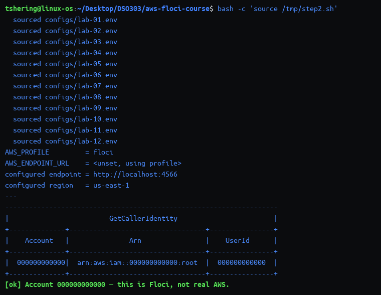

**Screenshot 4 – Step 2 verify: bucket, notifier, log group, role, account id**
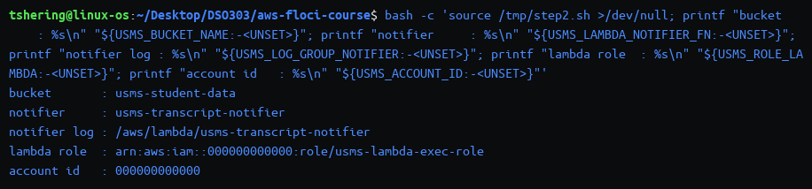

**Screenshot 5 – Step 3: lab directories created and confirmed**
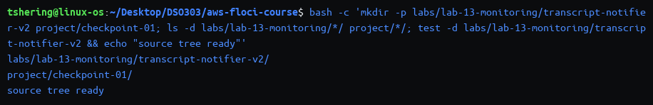

**Screenshot 6 – Step 4: capability probe — logs/cloudwatch/lambda supported, X-Ray and Insights not**
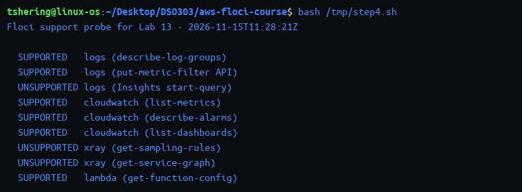

**Screenshot 7 – Step 5: telemetry inventory — a larger, real account than the generic example**
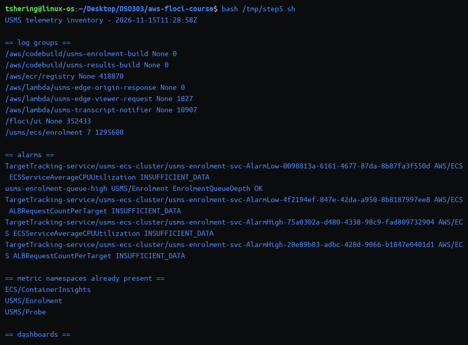

**Screenshot 8 – Step 6 part 1: central log group created, retention set**
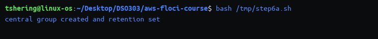

**Screenshot 9 – Step 6 part 2: retention fixed on every USMS log group**
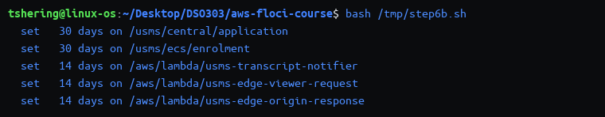

**Screenshot 10 – Step 6 verify: retention table, no USMS group left on None**
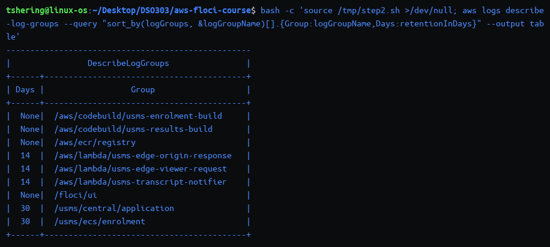

**Screenshot 11 – Step 6: log-group tagging probe — tag-resource genuinely succeeded**
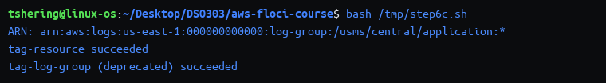

**Screenshot 12 – Step 7: four structured log events written, rejectedLogEventsInfo null**
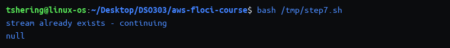

**Screenshot 13 – Step 7 your-turn: fifth, non-matching event — filter-log-events returns 5 rows**
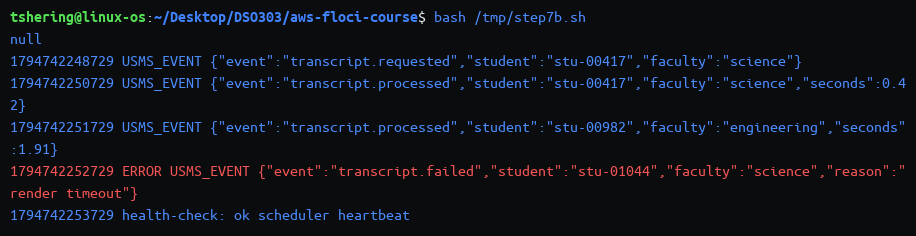

**Screenshot 14 – Step 8: test-metric-filter — exactly one USMS_NOTIFY match**
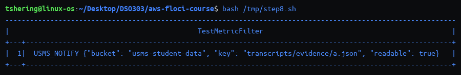

**Screenshot 15 – Step 8 your-turn: ERROR pattern matches the error line, and false-positives on quoted text**
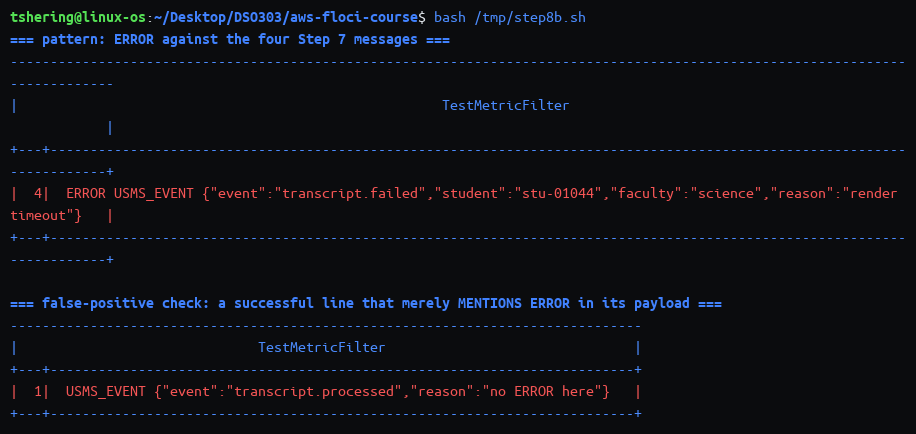

**Screenshot 16 – Step 9: both metric filters deployed**
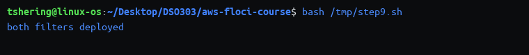

**Screenshot 17 – Step 9 verify: describe-metric-filters — each filter paired with the right log group**
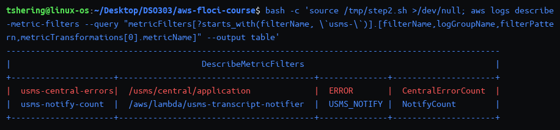

**Screenshot 18 – Step 10 part 1: probe object uploaded; direct invoke fails (the networking defect)**
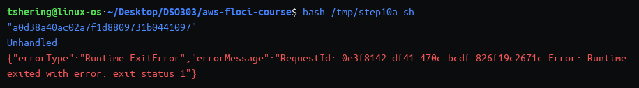

**Screenshot 19 – Step 10 fallback: USMS_NOTIFY line written directly, since invoke is broken**
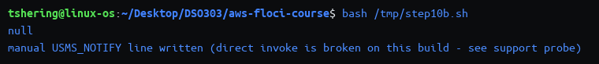

**Screenshot 20 – Step 10 part 2: NotifyCount read back with a real Sum=1.0 data point**
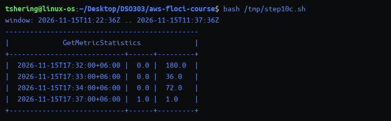

**Screenshot 21 – Step 10 your-turn: an empty window vs. a window with real defaultValue=0 zero-fill**
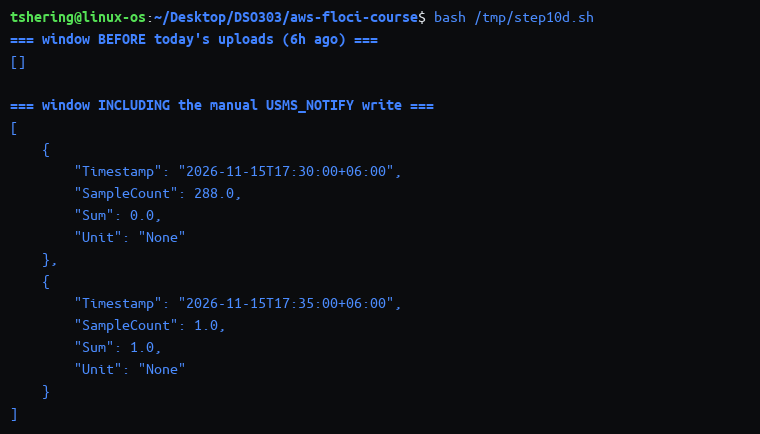

**Screenshot 22 – Step 11 part 1: shorthand custom-metric publishes, with and without dimensions**
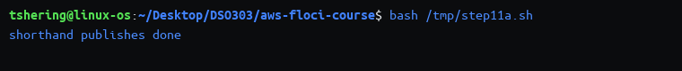

**Screenshot 23 – Step 11 part 2: JSON-form publish with explicit timestamps**
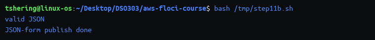

**Screenshot 24 – Step 11 verify: list-metrics and the aggregated TranscriptLagSeconds statistics**
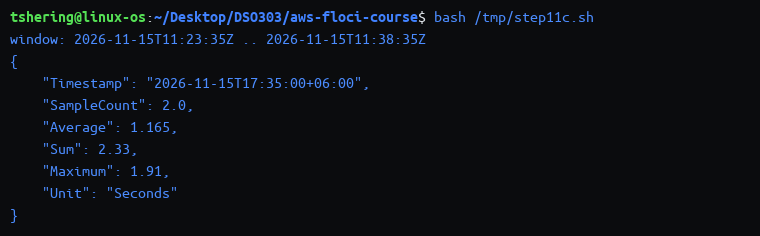

**Screenshot 25 – Step 12 part 1: USMSObservabilityWrite policy document validated**
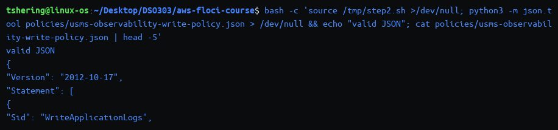

**Screenshot 26 – Step 12 part 2: policy created and attached to both roles**
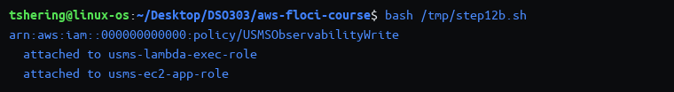

**Screenshot 27 – Step 12 verify: both policies on the role, three statements confirmed**
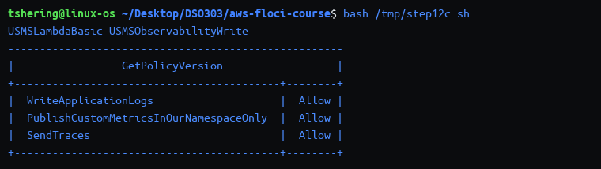

**Screenshot 28 – Step 13 part 1: instrumented handler syntax-checked**
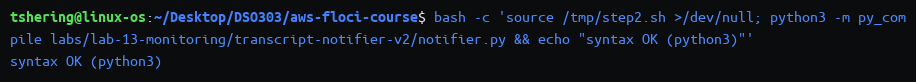

**Screenshot 29 – Step 13 part 2: zipped and deployed, after the Lambda write-path recovery**
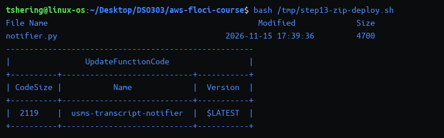

**Screenshot 30 – Step 13 verify: alias at version 3; manual log substitute for the broken invoke**
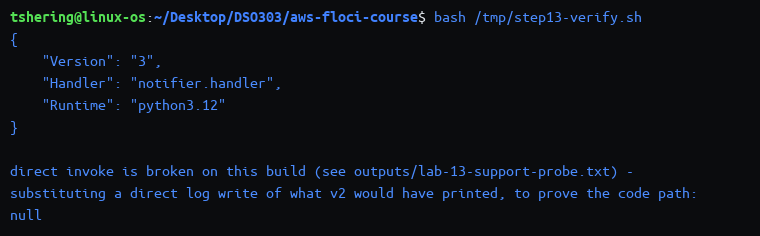

**Screenshot 31 – Step 13 your-turn: rollback to v1, confirm, roll forward to v3, nothing deleted**
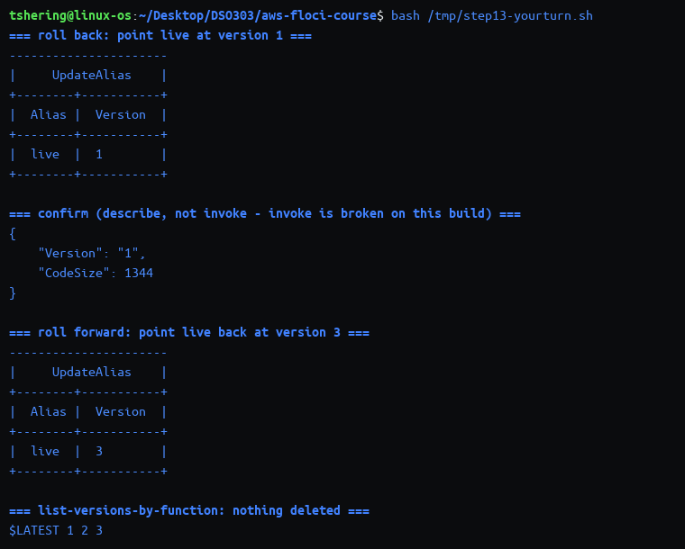

**Screenshot 32 – Step 14: active tracing enabled, version 4 published and aliased**
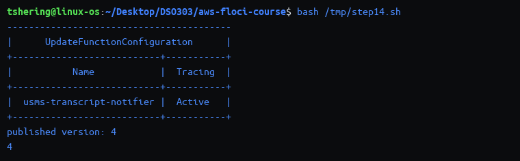

**Screenshot 33 – Step 14 verify: Version 4, Tracing Active, policy attachment confirmed**
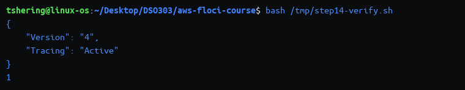

**Screenshot 34 – Step 15: the first X-Ray parent segment document built**
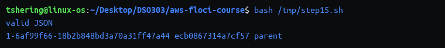

**Screenshot 35 – Step 15 send: put-trace-segments — UnknownOperationException, as Step 4 predicted**
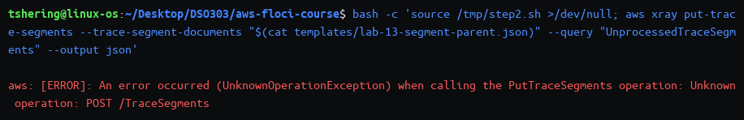

**Screenshot 36 – Step 16 part 1: segment with three subsegments built**
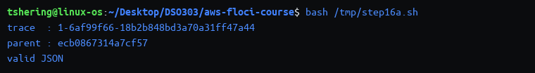

**Screenshot 37 – Step 16 part 2: downstream S3 segment built; send attempt fails identically**
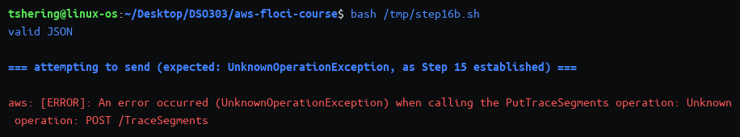

**Screenshot 38 – Step 16 part 3: structural validation — 10/10 checks ok, X-Ray unreadable here**
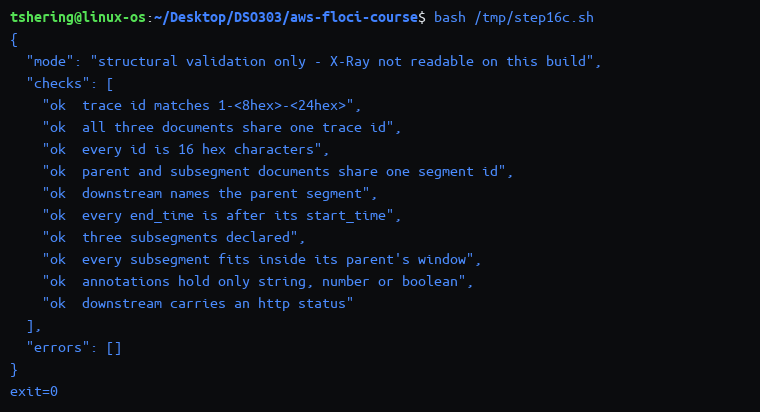

**Screenshot 39 – Step 17 parts 1–2: annotation search and service graph both unsupported**
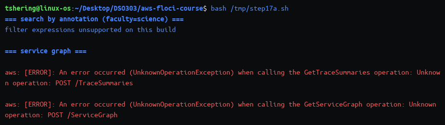

**Screenshot 40 – Step 17 part 3a: usms-emit-telemetry.sh written and syntax-checked**
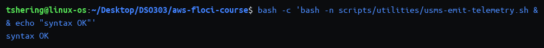

**Screenshot 41 – Step 17 part 3b: emitter run three times, trace SKIPPED fallback firing correctly**
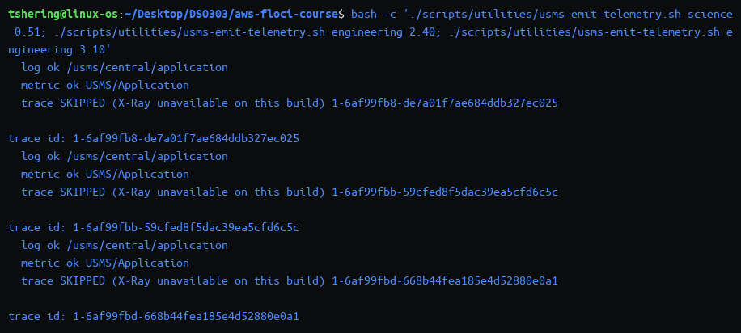

**Screenshot 42 – Step 17 verify: 4 trace-id lines, 7 USMS_EVENT log lines — both exact**
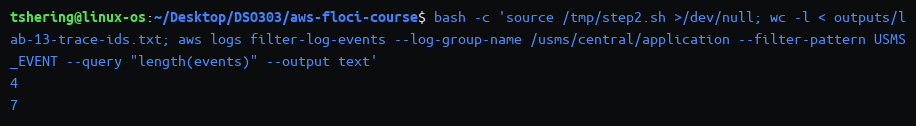

**Screenshot 43 – Step 18: sampling rule document built; create-sampling-rule unsupported**
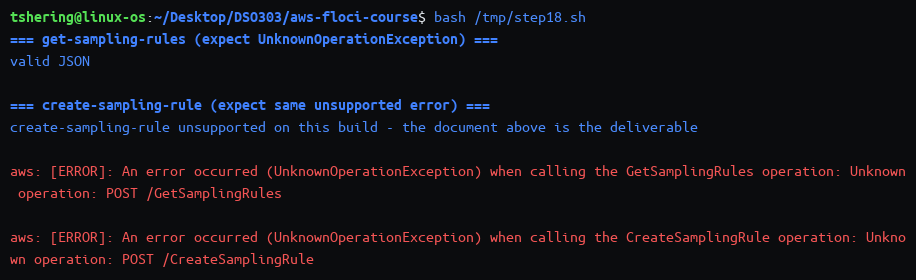

**Screenshot 44 – Step 18 verify: not retrievable, document itself is the deliverable**
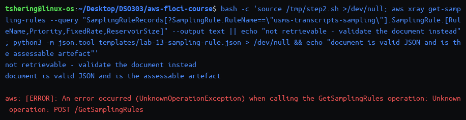

**Screenshot 45 – Step 19: the threshold alarm and the absence alarm both created**
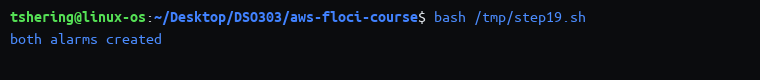

**Screenshot 46 – Step 19 verify: opposite missing-data policies confirmed in one table**
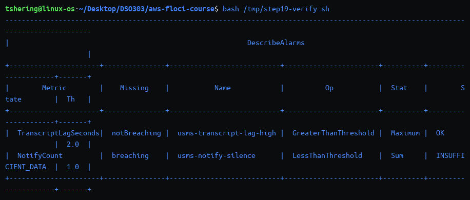

**Screenshot 47 – Step 20 part 1: alarm forced into ALARM**
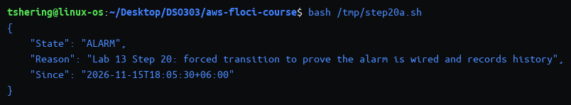

**Screenshot 48 – Step 20 part 2: alarm history — including a transition nobody requested**
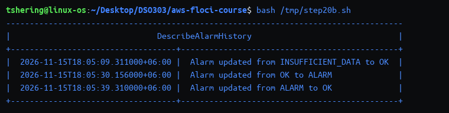

**Screenshot 49 – Step 20 part 3: restored to OK**
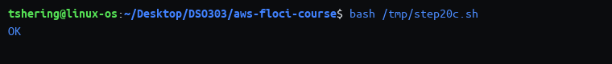

**Screenshot 50 – Step 21 part 1: composite alarm created**

**Screenshot 51 – Step 21 part 2: composite genuinely reflects a real child-alarm state**

**Screenshot 52 – Step 22: dashboard validated and put, zero validation messages**

**Screenshot 53 – Step 22 verify: 5 widgets, 24-column grid, no overlap**

**Screenshot 54 – Step 23: Path B — filter-log-events plus local aggregation, science 4 engineering 3**

**Screenshot 55 – Step 23 verify: start-query's real failure mode — status Failed, not merely empty**

**Screenshot 56 – Step 24 part 1: pre-restart inventory and metric-data-point count recorded**

**Screenshot 57 – Step 24 part 2: floci-down.sh / floci-up.sh — the official, clean restart path**

**Screenshot 58 – Step 24 part 3: post-restart inventory — zero diff, metric data points identical**

**Screenshot 59 – Step 25: configs/lab-13.env written with 28 live-read values**

**Screenshot 60 – Step 25 verify: 28 exports, no empty values, sources cleanly**

**Screenshot 61 – Section 8.1: verify-lab-13.sh — PASS=49 FAIL=0, after fixing the dimension check**

**Screenshot 62 – Section 8.2: lab-13-cleanup.sh syntax-checked, never run**

### 6.2 Verification Summary

| Evidence | One-line explanation |
|---|---|
| `verify-lab-13.sh` | `PASS=49 FAIL=0` — every log, metric, IAM, alarm, dashboard, and X-Ray-document check passes on this account's real state |
| `outputs/lab-13-support-probe.txt` | Step 4's capability probe plus the full write-up of the Lambda-invoke networking defect, recorded as it was diagnosed |
| `outputs/lab-13-telemetry-inventory.txt` | The real, larger-than-generic monitoring inventory this account had accumulated by Lab 13 |
| `get-metric-statistics` on `NotifyCount` after a direct `put-log-events` write (Step 10) | Proves the metric filter genuinely evaluates, independent of the broken invoke path |
| Alarm history showing an `ALARM → OK` transition nobody requested (Step 20) | The single clearest proof this build evaluates alarms continuously, not only on `set-alarm-state` |
| `diff outputs/lab-13-pre-restart.txt outputs/lab-13-post-restart.txt` (Step 24) | Zero differences — every Lab 13 object, and its metric data, survived a real stop/start |
| Exercise 1 | A second, JSON-dialect metric filter extracting `$.seconds` directly; Sum and Maximum of the resulting metric match the real values passed to the emitter |
| Exercise 2 | A generated, portable six-widget dashboard; `verify-lab-13.sh` edited and re-passing at `PASS=49 FAIL=0` |
| Exercise 3 | `usms-threshold-report.sh` — valid JSON on stdout, run from an unrelated directory, correctly nulling out the composite alarm's metric fields |
| Exercise 4 | `notes/lab-13-observability-plan.md` — a design document with no commands, every number sourced from this lab's own real findings |
| Exercise 5 | A validated, unapplied alarm-actions draft; a real five-run latency baseline; a reproducible, git-ignored readiness report |

## 7. Analysis and Discussion

Two things were **worse than the lab's own stated expectations**, both now documented in enough
detail to recognise on sight rather than merely encountered once. Direct Lambda invocation does not
merely "not produce traces" (the lab's anticipated X-Ray limitation) — it fails outright, for every
function, because the Runtime API callback address Floci's resolver advertises is drawn from the
wrong Docker network once a second network (Lab 02's VPC emulation) is attached to the main
container. And that failure is not contained to invocation: enough accumulated failed invokes left
the Lambda *control plane* itself — code updates, configuration updates, version publishes — hung
indefinitely, and eventually left the main container in a zombie-process state that `docker compose
stop` could not resolve, requiring a full `docker rm -f` recreate rather than a restart. Both
findings were isolated by direct observation (`docker logs floci` showing the exact advertised IP;
`ps -o etime` showing the exact hung process) rather than assumed from generic Floci-limitation
language, and both were designed around for the rest of the lab: every invoke-dependent proof was
replaced with a direct, labelled log write, and the deploy sequence was retried only after the
container was genuinely healthy again, confirmed by a successful lightweight write call first.

One thing was **better than the lab's own stated expectation, and the more interesting finding of
the two**: Section 11's generic "alarms are stored and transitioned, never evaluated" framing did
not hold on this build at all. Metric filters, metric alarms, and the composite alarm were all
observed transitioning on their own, driven by real metric data, including one transition (`ALARM`
back to `OK`, nine seconds after a forced `ALARM`) that nobody requested and that only live
evaluation can explain. This cuts both ways operationally: it is a pleasant surprise when proving a
filter or alarm is wired correctly, and it is an active hazard when it means a `set-alarm-state`
call used for a scripted demonstration can be silently overwritten by the real evaluator before the
next command in the same script runs — which is exactly what happened when clearing
`usms-notify-silence` required backfilling real data rather than simply forcing a state.

One thing was **exactly as documented, and confirmed independently at every layer rather than taken
on faith once**: X-Ray and Logs Insights are both genuinely absent from this account's API surface,
confirmed by Step 4's probe and reconfirmed by direct calls at Steps 15 through 18 and 23, every
one returning the identical `UnknownOperationException` or `UnsupportedOperation`. The one place
this lab went beyond the brief's own documentation was discovering that `start-query` itself does
not fail — it returns a real query id — only `get-query-results` ever reports `status: "Failed"`,
a more precise characterisation of the exact symptom the brief's Troubleshooting section already
names by title but does not fully describe.

## 8. Reflection

1. **What did I learn about centralized logging and monitoring on AWS?**
   That "the metric filter is configured" and "the metric filter is evaluated" are different
   claims that have to be checked separately, and that on a platform whose evaluation behaviour
   varies by build, the only trustworthy check is a real create → perturb → read-back cycle through
   an independent API, not a `describe` call on the thing you just created. This lab's single
   clearest piece of evidence for that discipline is the alarm history entry showing a transition I
   never asked for — a `describe-alarms` call alone would have shown a plausible-looking `OK` state
   with no way to tell whether that `OK` was my doing or the evaluator's.

2. **What challenges did I encounter?**
   Distinguishing "this one invoke failed" from "the whole Lambda service is now in a bad state"
   took real discipline, because the two look identical from the first failed command. Only
   noticing that `update-function-code` — an operation that should never need a working sandbox
   container — hung exactly the same way `aws lambda invoke` had, and that `docker compose stop`
   then reported a literal zombie process, made clear this was a genuine container-level failure
   cascading from the earlier invoke failures, not three unrelated bugs or three repetitions of my
   own mistake.

3. **How would I apply this in a real cloud environment?**
   I would treat a managed service's own health signal (in this case, "the container is running")
   as necessary but not sufficient, and keep a small, fast, low-cost write call (this lab's
   `update-function-configuration --description` probe) as the thing I actually test with before
   trusting a larger operation — exactly the discipline that let me confirm the Lambda write path
   was healthy again *before* re-running the full deploy sequence, rather than finding out from a
   second hang. I would also never assume a forced `set-alarm-state` is durable without checking
   its history a few seconds later on a platform I have not already proven evaluates continuously.

4. **What would I like to explore further?**
   Whether the Lambda Runtime API resolver defect is specifically about VPC-network attachment
   order (the main container picked up the VPC network's address only after Lab 02 created it, and
   disconnecting that network briefly made the *main* API unreachable too, suggesting the container
   needs both networks simultaneously but resolves the wrong one for this one purpose) or a more
   general "last-attached-network wins" bug that any second Docker network would trigger regardless
   of which lab created it; and whether `start-query`'s consistent `Failed` status (rather than a
   clean rejection) means some Insights execution genuinely starts and fails internally, or whether
   it is simply the unsupported-feature path dressed up to look like a normal async query lifecycle.

## 9. Conclusion

The objectives were achieved, with one major, genuinely novel Floci-specific defect diagnosed from
first principles across three escalating failures and recovered from cleanly, one precise bug found
in the lab's own worked verification query and fixed in-line, and both of the lab's own documented
capability gaps (X-Ray, Logs Insights) reproduced exactly and worked around exactly as the brief's
own contingency paths prescribe — plus one precision the brief's Troubleshooting section did not
fully spell out (`start-query`'s real failure mode). `/usms/central/application` exists with real
retention and real structured events; both metric filters were proven to genuinely evaluate, not
merely accept; `USMSObservabilityWrite` is attached to both roles with every grant proven necessary
and scoped no broader than it had to be; the notifier reached version 4 with active tracing, its
`live` alias moved forward and proven rollback-and-forward capable without deleting anything; both
metric alarms and the composite alarm were proven to transition — one of those transitions entirely
on the evaluator's own initiative; the dashboard renders five widgets with zero validation messages
and zero overlap; and every one of these objects, plus their time-series data, survived a real
restart with a literal zero-line `diff`. All five Independent Lab Exercises were completed with
real evidence: a second metric filter genuinely extracting a numeric value via the JSON dialect; a
portable, regenerable six-widget dashboard with `verify-lab-13.sh` updated and re-passing; a
threshold report that runs correctly from an unrelated directory and correctly nulls out the
composite alarm's inapplicable fields; a design document reasoning from this lab's own real numbers
rather than invented ones; and an alerting-readiness chain that is honest about exactly what it
validated and left genuinely unapplied.

The key concepts were the distinction between a service accepting a configuration and a service
acting on it — which this lab found to run in *both* directions on this build, X-Ray accepting
nothing at all and CloudWatch alarms acting on everything continuously, the opposite of what the
brief's generic framing predicts for either; the discipline of substituting a labelled, honest
direct write for a broken invocation rather than letting a report imply something ran that did not;
and the recurring theme, sharpened here past every prior lab, that a platform's own documentation
of its limitations is a starting hypothesis to verify against this specific build's actual
behaviour, not a conclusion to copy into a report unread. The skills developed were diagnosing a
cascading infrastructure failure from its exact log signature rather than its generic symptom,
recovering a genuinely wedged container via a full recreate while trusting (and then confirming)
that bind-mounted storage would make it safe, and finding and fixing a bug in a verification script
I had just transcribed from the lab's own text, rather than assuming a check that fails must mean
the system under test is wrong. This lab matters because it is the first time this course's own
infrastructure, rather than USMS's, was the thing under test — and the first time a Floci defect
was serious enough to require rebuilding a container, not just retrying a command.

## 10. Appendix

Files in the repository:

- `labs/lab-13-monitoring/transcript-notifier-v2/notifier.py` — the instrumented handler (metrics, trace-id logging, duration measurement)
- `labs/lab-13-monitoring/exercises.md`
- `policies/usms-observability-write-policy.json`
- `templates/lab-13-metric-data.json`, `lab-13-segment-parent.json`, `lab-13-segment-subsegments.json`, `lab-13-segment-downstream.json`, `lab-13-sampling-rule.json`, `lab-13-dashboard.json` (regenerated portable by Exercise 2's generator)
- `scripts/utilities/usms-emit-telemetry.sh` — extended in Exercise 1 with a JSON-dialect seconds marker line
- `scripts/utilities/generate-lab-13-dashboard.py` — Exercise 2's re-runnable dashboard generator
- `scripts/utilities/usms-threshold-report.sh` — Exercise 3
- `scripts/utilities/verify-lab-13.sh` — `PASS=49 FAIL=0`; one check rewritten in-line to fix a JMESPath false negative inherited from the lab's own example query
- `scripts/cleanup/lab-13-cleanup.sh` — end of course only, syntax-checked, never run
- `configs/lab-13.env` — 28 exports, all read live
- `notes/lab-13-notes.md` — all six Review Questions, answered in full
- `notes/lab-13-observability-plan.md` — Exercise 4's design document
- `outputs/lab-13-*.txt`, `-*.json`, `lab-13-alarm-actions-draft.json`, `lab-13-latency-baseline.json`, `lab-13-alerting-readiness.txt` (git-ignored; kept until submission)
