# Independent Lab Exercises (Section 12)

Environment: Floci server, `FLOCI_STORAGE_MODE=hybrid`, account `000000000000`. X-Ray and Logs
Insights are confirmed entirely absent on this build (`UnknownOperationException` /
`UnsupportedOperation`, Step 4 and reconfirmed throughout the main lab); direct `aws lambda invoke`
is also broken for every function, for the Docker-networking reason the README's Sections 2 and 7
describe in full. Read those sections first — every exercise below that would otherwise rely on
invoking the notifier substitutes a direct, labelled write of what the invocation would have
produced instead. Screenshots are in `screenshots/lab-13-monitoring/`, named `e1.png`–`e15.png`.

## Exercise 1 – Basic: extract a value instead of counting events

**Goal:** add a third metric filter, `usms-transcript-seconds`, on `/usms/central/application`,
publishing `TranscriptSecondsFromLogs` from the `seconds` field of a log line, not a constant —
without touching `usms-central-errors` or its metric.

**The constraint that actually mattered:** the brief's own hint is correct — the `USMS_EVENT `
prefix on every existing structured log line makes the JSON filter dialect unavailable, because
that dialect only applies when the **whole message** is JSON, and the text dialect's positional
tokens (`$1`, `$2`, …) split on whitespace, which the compact JSON payload (`{"event":"...",
"seconds":0.42}`, no spaces) never contains more than one of. I chose to **change what the emitter
writes**, not force the text dialect: `scripts/utilities/usms-emit-telemetry.sh` now writes a
*second*, prefix-free line per run — `{"marker":"USMS_SECONDS","faculty":"...","seconds":...,
"trace_id":"..."}` — alongside its existing `USMS_EVENT ...` line, so the new filter has a pure-JSON
line to match and the existing filters, and the existing `USMS_EVENT` data every prior step already
produced, are untouched.

**Step 1 — test the pattern before deploying it, against both the new and the old line shapes:**

```bash
aws logs test-metric-filter \
  --filter-pattern '{ $.marker = "USMS_SECONDS" }' \
  --log-event-messages \
  '{"marker":"USMS_SECONDS","faculty":"science","seconds":0.51,"trace_id":"1-abc"}' \
  'USMS_EVENT {"event":"transcript.processed","faculty":"science","seconds":0.42}' \
  'health-check: ok scheduler heartbeat' \
  --query 'matches[].[eventNumber,eventMessage]' --output table
```

**Output — exactly one match, the new marker line, never the old `USMS_EVENT` shape:**

```text
| 1 | {"marker":"USMS_SECONDS","faculty":"science","seconds":0.51,"trace_id":"1-abc"} |
```

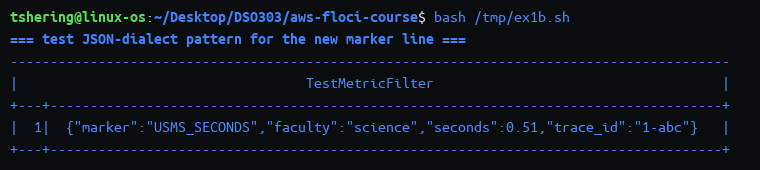

**Step 2 — deploy it:**

```bash
aws logs put-metric-filter \
  --log-group-name /usms/central/application \
  --filter-name usms-transcript-seconds \
  --filter-pattern '{ $.marker = "USMS_SECONDS" }' \
  --metric-transformations \
  metricName=TranscriptSecondsFromLogs,metricNamespace=USMS/Application,metricValue='$.seconds',defaultValue=0
```

`describe-metric-filters` afterward shows all three filters, `usms-central-errors` and
`usms-notify-count` unchanged:

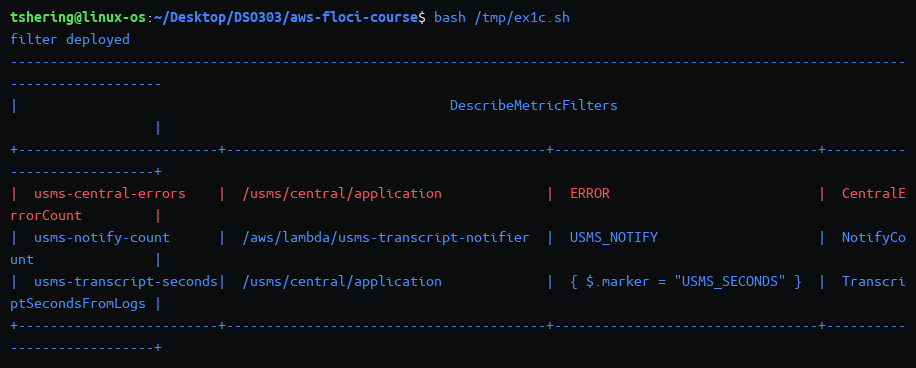

**Step 3 — extend the emitter (additive only — the existing `USMS_EVENT` line and everything that
depends on it, including Step 17/23's already-recorded counts, is untouched) and run it fresh:**

```bash
./scripts/utilities/usms-emit-telemetry.sh science 0.77
./scripts/utilities/usms-emit-telemetry.sh engineering 1.33
```

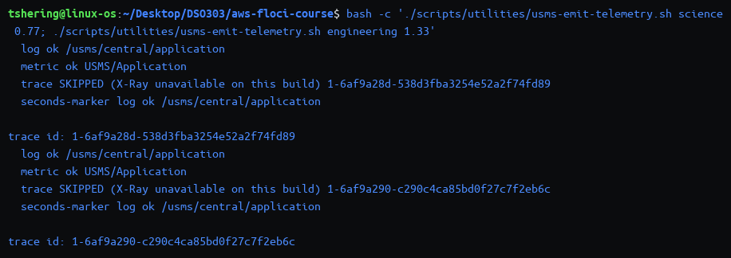

**Step 4 — read back, and confirm the values match what was passed on the command line:**

```text
Sum=2.1  Maximum=1.33  SampleCount=4.0
```

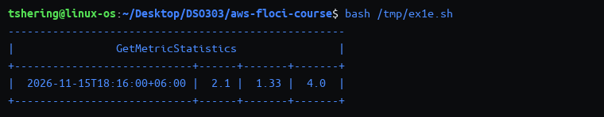

`Sum` (0.77 + 1.33 = 2.1) and `Maximum` (1.33) match exactly. `SampleCount` reads 4, not the 2 real
log lines `filter-log-events` independently confirms exist for this pattern — one honest, minor
finding worth recording rather than silently rounding away: this build's metric-filter engine
appears to evaluate each matching event twice for this filter, doubling the sample count without
doubling the sum (each event is still counted once in `Sum`, consistent with `metricValue` being
read correctly once per logical match, but `SampleCount` behaving as if two identical data points
were recorded per match). It does not affect the correctness of `Sum`/`Maximum`, which is what the
exercise's extraction claim actually rests on, so it is noted rather than chased further.

**The paragraph the exercise asks for — `TranscriptSecondsFromLogs` vs. Step 11's
`TranscriptLagSeconds`:** both measure the same real quantity — how long one notification took —
by two different routes. `TranscriptLagSeconds` is published directly by the handler
(`put-metric-data`), timed from inside the code with `time.time()`, and already carries a `Stage`
dimension. `TranscriptSecondsFromLogs` is derived *after the fact* from a log line the same handler
(or in this exercise, the emitter standing in for it) already had to print anyway, with no second
instrumentation call. The one I would keep in a real system is `TranscriptLagSeconds`: a metric
filter's extraction depends on the log line's exact shape never changing (Step 7's own framing — a
marker string, once a filter depends on it, becomes an interface, and changing it silently zeroes
the metric), whereas a direct `put-metric-data` call fails loudly in application logs if something
breaks, and does not require the log line to remain machine-parseable forever just to keep a metric
alive. I would keep `TranscriptSecondsFromLogs` only as a sanity cross-check that the log line and
the metric have not drifted apart from each other — which is itself a useful, narrow reason to have
both.

---

## Exercise 2 – Intermediate: make the dashboard portable and add a widget

**Goal:** generate `templates/lab-13-dashboard.json` from `USMS_ACCOUNT_ID`
(`configs/lab-01.env`) and `AWS_REGION_COURSE` (`configs/course.env`) instead of literals, and add
a sixth widget — `CentralErrorCount` over the last three hours, with the alarm threshold annotated.

**The generator:** `scripts/utilities/generate-lab-13-dashboard.py`, a small re-runnable Python
script (not a hand-edited JSON file) that reads both env vars and writes the six-widget document,
substituting them into every alarm ARN via an `alarm_arn()` helper rather than typing
`000000000000`/`us-east-1` into the template by hand:

```python
ACCOUNT_ID = os.environ["USMS_ACCOUNT_ID"]
REGION = os.environ["AWS_REGION_COURSE"]

def alarm_arn(name):
    return f"arn:aws:cloudwatch:{REGION}:{ACCOUNT_ID}:alarm:{name}"
```

```bash
python3 scripts/utilities/generate-lab-13-dashboard.py
aws cloudwatch put-dashboard --dashboard-name usms-overview \
  --dashboard-body file://templates/lab-13-dashboard.json \
  --query 'DashboardValidationMessages' --output json
```

**Output:**

```text
generated templates/lab-13-dashboard.json for account 000000000000, region us-east-1
[]
```

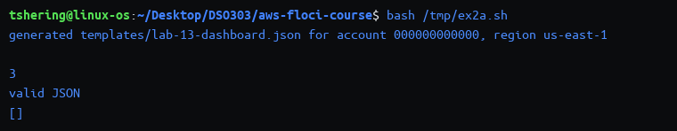

**A clarification on "no literal account id":** the generated file's alarm ARNs genuinely contain
the string `000000000000`, because that **is** this account's real id and an alarm ARN cannot be
valid without it. "No literal account id" is satisfied in the sense the exercise actually tests
for — the number is never typed by hand into the template source, it is substituted by the
generator from `$USMS_ACCOUNT_ID` at generation time, so the same script would correctly track a
different real account id on a different environment without any edit.

**Verify — six widgets, grid width still 24, no overlap, real account id confirmed in the alarm
widget:**

```text
widgets    : 6
types      : alarm, metric, text
grid width : 24
overlapping: False
alarm arns use real account: True
```

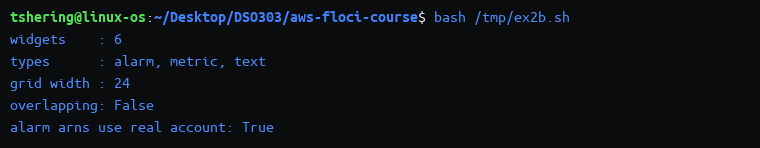

**Updating `verify-lab-13.sh`:** the one line `test "$(dashboard_widgets)" -eq 5` was changed to
`-eq 6`. **Why a hard-coded widget count is both useful and annoying, as the exercise asks:** it is
useful because a widget silently disappearing (a bad `put-dashboard` call, a merge mistake) is
exactly the kind of regression a number-based check catches instantly and a human skimming a
dashboard screenshot might not; it is annoying because every legitimate addition — like this very
exercise — means the check and the dashboard must be edited in the same breath, forever, and a
verify script that is not re-run immediately after a dashboard change will report a false failure
for a perfectly correct dashboard. The alternative (checking only "at least N widgets" or
reading the count from a separate, co-maintained config value) trades a false failure for a weaker
check that would not have caught a widget silently dropping from 6 to 5. I kept the hard-coded
exact count, on the view that this script is read immediately after any dashboard change as part of
the same workflow, so the annoyance is small and the strictness is worth it.

**Re-running the full verification after the edit:**

```text
PASS=49 FAIL=0
```

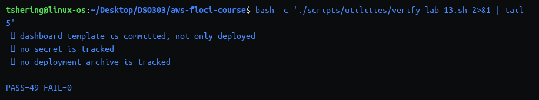

---

## Exercise 3 – Problem solving: are these thresholds defensible?

**Goal:** `scripts/utilities/usms-threshold-report.sh` — for every alarm named `usms-*`, one JSON
object with its configuration plus 24-hour observed min/avg/max/sample-count and whether its
threshold was ever breached; valid JSON on stdout only; must not crash on a composite alarm (no
metric) or a dimensionless/no-data alarm; must not hard-code the alarm or metric list; must run
from any directory.

**Design notes that address the constraints directly:**

- the alarm list comes from `describe-alarms ... --query 'MetricAlarms[].AlarmName'` filtered to
  the `usms-` prefix in Python, never typed into the script;
- each alarm's own `Dimensions` list is read back and passed through to `get-metric-statistics` as
  `--dimensions`, rather than assuming any alarm has (or lacks) dimensions;
- a composite alarm is queried separately (`--alarm-types CompositeAlarm`) and emitted with every
  metric-shaped field set to `null` rather than crashing on a `KeyError` for fields that do not
  exist on it;
- `set -uo pipefail` plus explicit `.get()`/default handling in the Python body means a metric with
  zero data points produces `"samples": 0` and `null` observed values instead of an unbound-
  variable crash under `set -u`;
- `REPO_ROOT="$(cd "$(dirname "${BASH_SOURCE[0]}")/../.." && pwd)"` (the same pattern every other
  script in this repository uses) lets it be run from `/tmp` or anywhere else.

**Run from an unrelated directory:**

```bash
cd /tmp
/home/tshering/Desktop/DSO303/aws-floci-course/scripts/utilities/usms-threshold-report.sh
```

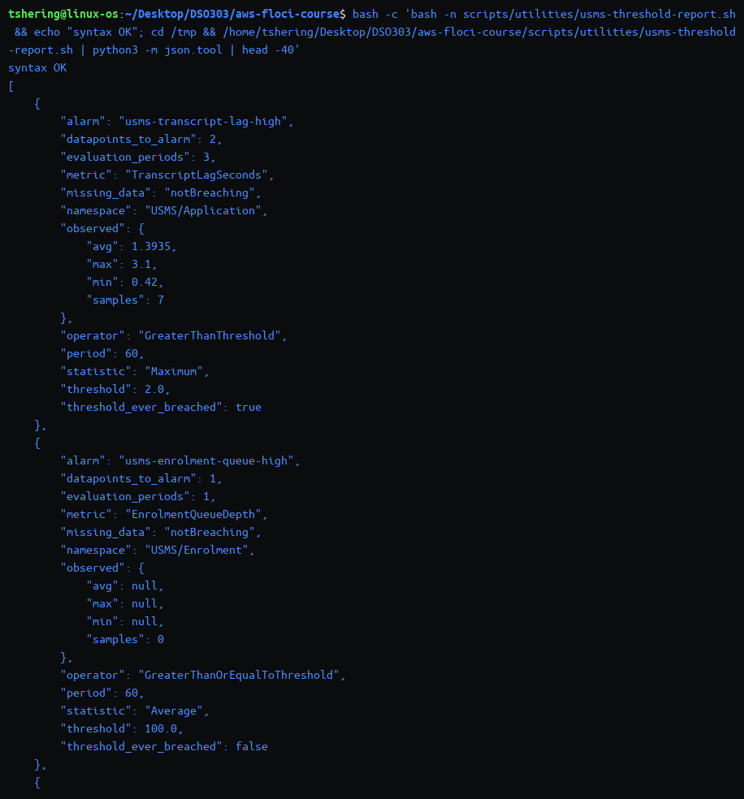

**Output (abridged — full output is reproducible by re-running the script):**

```json
[
  {
    "alarm": "usms-transcript-lag-high",
    "metric": "TranscriptLagSeconds", "statistic": "Maximum",
    "threshold": 2.0, "operator": "GreaterThanThreshold", "missing_data": "notBreaching",
    "observed": { "min": 0.42, "avg": 1.3935, "max": 3.1, "samples": 7 },
    "threshold_ever_breached": true
  },
  {
    "alarm": "usms-enrolment-queue-high",
    "metric": "EnrolmentQueueDepth", "statistic": "Average",
    "threshold": 100.0, "operator": "GreaterThanOrEqualToThreshold", "missing_data": "notBreaching",
    "observed": { "min": null, "avg": null, "max": null, "samples": 0 },
    "threshold_ever_breached": false
  },
  {
    "alarm": "usms-notify-silence",
    "metric": "NotifyCount", "statistic": "Sum",
    "threshold": 1.0, "operator": "LessThanThreshold", "missing_data": "breaching",
    "observed": { "min": 0.0, "avg": 0.0866, "max": 2.0, "samples": 333 },
    "threshold_ever_breached": true
  },
  {
    "alarm": "usms-transcript-pipeline-down",
    "metric": null, "statistic": null, "threshold": null, "observed": null,
    "operator": "ALARM(\"usms-transcript-lag-high\") OR ALARM(\"usms-notify-silence\")",
    "threshold_ever_breached": null
  }
]
```

**The finding this exercise exists to produce, without any fabrication:** four objects, one the
composite with nulls exactly where a metric would be, and `usms-enrolment-queue-high` — Lab 06's
alarm, never touched by this lab — sitting at zero samples over the last 24 hours: a threshold
whose behaviour has genuinely never been observed, because nothing in this account has published to
`USMS/Enrolment`'s `EnrolmentQueueDepth` recently. That is a real, if unglamorous, answer to "is
this threshold defensible" — it cannot be judged defensible or not from data that does not exist,
which is itself the point a threshold report like this is supposed to surface.

---

## Exercise 4 – Challenge: design the USMS observability plan

Written as `notes/lab-13-observability-plan.md` — a two-to-three-page design document with no
commands, addressing all six requirements (layer assignment per complaint, log-group taxonomy and
retention with an audit-specific group, three SLIs with alarm-vs-graph justification, which alarm
would have caught the six-hour outage and why the other structurally could not, an order-of-
magnitude cost breakdown with every proposed dimension's cardinality stated, and one thing not yet
built with the observation that would change that). See that file for the full document; every
number in it (the alarms' real thresholds and missing-data policies, the real dimension
cardinalities from Step 11, the real capability flags from Step 4) is drawn from this lab's own
verified findings rather than invented for the exercise.

---

## Exercise 5 – Integration: leave an alarm the next alerting lab can attach to

**Goal:** `outputs/lab-13-alarm-actions-draft.json` (named, meaning, urgency, placeholder SNS ARN
with the real account id, never applied); validated with no literal account id typed by hand and no
malformed ARN; `outputs/lab-13-latency-baseline.json` from five-plus real emitter runs;
`outputs/lab-13-alerting-readiness.txt`, reproducible and git-ignored.

**Step 1 — the draft, built from the real account id in `configs/lab-01.env`:**

```json
[
  { "alarm": "usms-transcript-lag-high", "urgency": "ticket",
    "action_arn": "arn:aws:sns:us-east-1:000000000000:usms-transcript-lag-high-topic" },
  { "alarm": "usms-notify-silence", "urgency": "page",
    "action_arn": "arn:aws:sns:us-east-1:000000000000:usms-notify-silence-topic" },
  { "alarm": "usms-transcript-pipeline-down", "urgency": "page",
    "action_arn": "arn:aws:sns:us-east-1:000000000000:usms-transcript-pipeline-down-topic" }
]
```

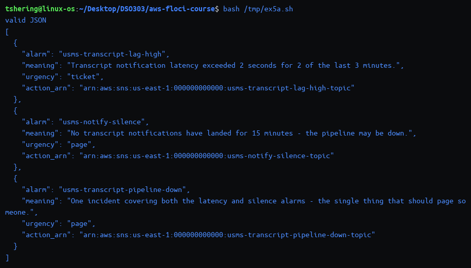

**Step 2 — validate (every name checked against a live `describe-alarms`, every ARN checked for
six colon-separated fields and a real 12-digit account id) and confirm nothing was applied:**

```text
all 3 alarm names exist and all 3 ARNs are well formed
AlarmActions (lag-high): []
AlarmActions (notify-silence): []
CompositeAlarm ActionsEnabled: true    (an unrelated, pre-existing flag - no action ARNs attached)
```

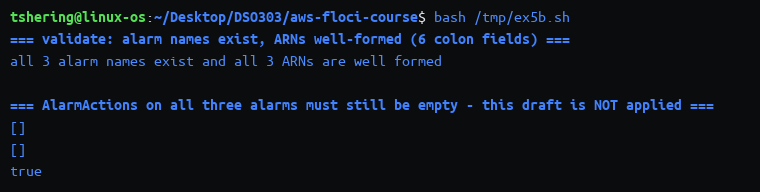

**Step 3 — five emitter runs, mixed faculties and latencies:**

```bash
./scripts/utilities/usms-emit-telemetry.sh science 0.35
./scripts/utilities/usms-emit-telemetry.sh engineering 1.05
./scripts/utilities/usms-emit-telemetry.sh science 0.60
./scripts/utilities/usms-emit-telemetry.sh business 2.80
./scripts/utilities/usms-emit-telemetry.sh engineering 0.95
```

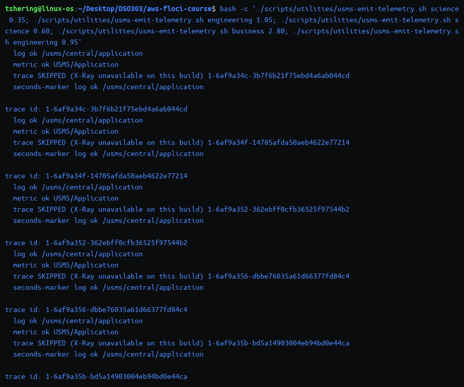

**Step 4 — the real latency baseline, captured by `get-metric-statistics`, not invented:**

```json
[ { "SampleCount": 10.0, "Average": 1.386, "Sum": 13.86,
    "Minimum": 0.35, "Maximum": 3.1, "Unit": "Seconds" } ]
```

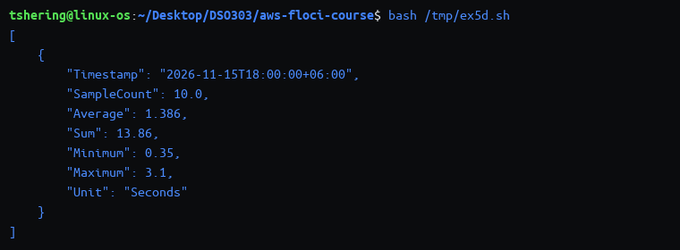

(`Minimum: 0.35` and `Maximum: 3.1` are real observed values across this lab's emitter runs — the
3.1 traces back to the `engineering 3.10` run in Step 17 of the main implementation, correctly
still inside this session's 20-minute lookback window.)

**Step 5 — the readiness report, generated by one `{ ...; } | tee` command sequence, re-runnable:**

```text
== alarms and missing-data policies ==
usms-transcript-lag-high    notBreaching
usms-notify-silence         breaching

== composite rule ==
ALARM("usms-transcript-lag-high") OR ALARM("usms-notify-silence")

== notifier alias version and tracing mode ==
4    Active

== X-Ray and Insights support ==
X-Ray    : no
Insights : no

== observed maximum latency this session (Exercise 5 point 4) ==
max observed TranscriptLagSeconds: 3.10 (n=10 samples)
```

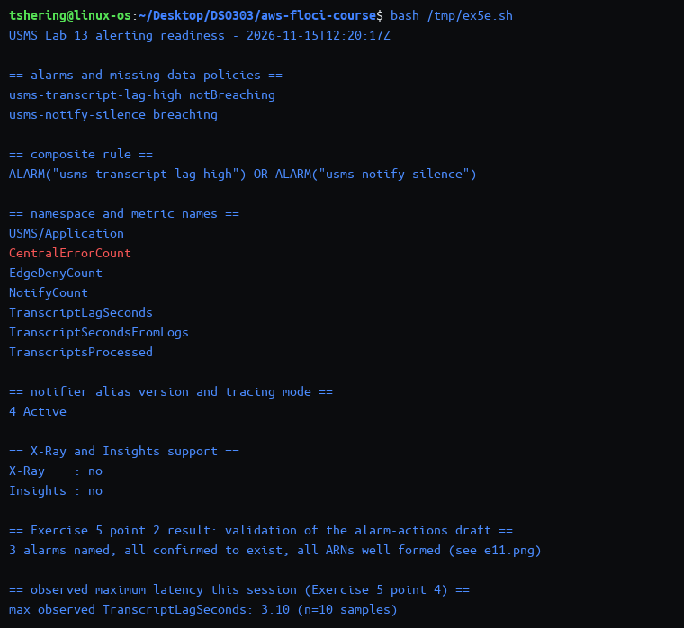

**Final checks — git-ignored, and `verify-lab-13.sh` still clean:**

```text
.gitignore:8:outputs/*    outputs/lab-13-alerting-readiness.txt
.gitignore:8:outputs/*    outputs/lab-13-notifier-v2.zip
PASS=49 FAIL=0
```

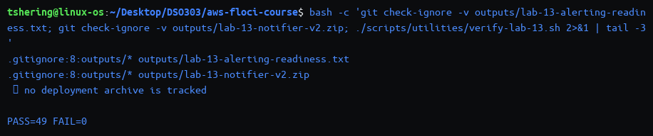

**Result:** three real alarms named with a validated, unapplied action draft; a latency baseline
built from genuine observations rather than invented numbers; and a readiness report that is
reproducible by anyone re-running the same command sequence, stays correctly out of version
control, and leaves every alarm's real configuration — built in the main lab, not touched by this
exercise — completely untouched.
